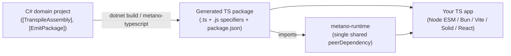

# Using Generated Code from TypeScript

This guide is written for **TypeScript and JavaScript developers** consuming a
package generated by Metano. It explains the runtime shapes Metano emits, how
to import and call them safely, where TypeScript idioms differ from C#, and
what to ask your C# team for at the API boundary.



If you are setting up the C# compiler side for the first time, start with
[Getting Started](../getting-started.md). For full reference tables, see
[BCL Type Mappings](../bcl-mappings.md), [Attribute Reference](../attributes.md),
[Overloads](../overloads.md), [JSON Serialization](../serialization.md), and
[Runtime Types and Interop](../runtime-types.md).

---

## Installing and importing

A Metano-generated TypeScript project is a standard ESM npm package (`"type": "module"`).
Here is the `package.json` Metano generates for an assembly marked with
`[assembly: EmitPackage("acme-billing", SubpathRoot = "Acme.Billing")]`:

```json
{
  "name": "acme-billing",
  "private": true,
  "type": "module",
  "sideEffects": false,
  "exports": {
    ".": {
      "source": "./src/acme/billing/index.ts",
      "types": "./dist/acme/billing/index.d.ts",
      "import": "./dist/acme/billing/index.js"
    }
  },
  "peerDependencies": {
    "metano-runtime": "*"
  }
}
```

> **Note:** When the compiler is built from a stable release tag, `"metano-runtime"`
> gets a caret range matching that release (for example, `"^3.0.2"`); unpublished
> local compiler builds emit `"*"`.

### Key packaging rules

- **Package `exports` and `SubpathRoot`.** Each C# namespace gets an entry in
  `exports` pointing at its barrel (`index.ts` / `index.js`). Setting
  `SubpathRoot` on `[EmitPackage]` strips that namespace prefix from `exports`
  keys (`Acme.Billing` becomes `"."`, `Acme.Billing.Invoices` becomes
  `"./invoices"`) without moving files on disk.
- **Relative `.js` specifiers.** Generated files import each other with relative
  `.js` specifiers (such as `import { PaymentMethod } from "./payment-method.js"`).
  You do **not** need `tsconfig.json` `paths`, a Node resolve hook, or
  `package.json#imports` (`#...` entries are only written if the build opts
  into `--import-alias` / `MetanoImportAlias`).
- **`metano-runtime` as a `peerDependency`.** Generated packages declare
  `metano-runtime` as a peer dependency instead of bundling private copies. Install
  **one** shared copy in your application (matching the compiler's major version)
  so `instanceof` checks on runtime classes (`List`, `Dictionary`, `Decimal`,
  `Exception`, etc.) work across every generated package.
  - Subpath imports used by generated code include `metano-runtime`,
    `metano-runtime/system/collections`, `metano-runtime/system/decimal`,
    `metano-runtime/system/json`, `metano-runtime/system/linq`, and
    `metano-runtime/system/exceptions/*`.
- **Environment setup:**
  - **Node ESM (22, 24, 26):** Build the generated package to `dist/` (`tsc` or
    `tsgo -b .`) and import normally. Use `"moduleResolution": "nodenext"` (or
    `"node16"` / `"bundler"`) in `tsconfig.json`; legacy `"node10"` cannot
    resolve `metano-runtime` subpath exports.
  - **Bun:** Resolves `.js` specifiers to `.ts` sources directly and works in
    workspaces without a prior `dist/` build (make sure the generated package
    is a workspace member and run `bun install` at the workspace root).
  - **Vite:** Uses `dist/` by default. To consume generated `.ts` sources
    directly during development without rebuilding `dist/`, opt into the
    `source` condition (listed first in every generated `exports` entry):

    ```typescript
    // vite.config.ts
    import { defaultClientConditions, defineConfig } from "vite";

    export default defineConfig({
      resolve: { conditions: ["source", ...defaultClientConditions] },
    });
    ```

    Pair that with `"moduleResolution": "bundler"` and
    `"customConditions": ["source"]` in your app's `tsconfig.json`.
  - **Webpack / Jest:** Webpack needs `resolve.extensionAlias: { ".js": [".ts", ".js"] }`
    when reading `.ts` sources directly; Jest needs a matching `moduleNameMapper`
    for `.js` specifiers.

---

## Numbers and characters

C# distinguishes integer widths, 64-bit integers, IEEE-754 floats, base-10
decimals, and UTF-16 characters. JavaScript has `number`, `bigint`, and
`string`, plus `Decimal` from `metano-runtime/system/decimal`.

| C# type | TypeScript type | Notes |
|---|---|---|
| `int`, `uint`, `short`, `ushort`, `byte`, `sbyte`, `float`, `double` | `number` | 32-bit integers wrap/truncate as in C#; `float` operations round via `Math.fround` |
| `long`, `ulong`, `nint`, `nuint`, `BigInteger` | `bigint` | Exact 64-bit / arbitrary-precision integers |
| `decimal` | `Decimal` (`metano-runtime/system/decimal`) | `decimal.js` clone configured to 29 significant digits and half-to-even rounding |
| `char` | `string` | Single UTF-16 code unit (length 1 by convention) |

**C# source:**

```csharp
namespace Acme.Billing;

public sealed record LineAmount(
    int Quantity,
    double DiscountRate,
    long Cents,
    ulong Sequence,
    decimal UnitPrice,
    char CurrencySymbol
);
```

**Exact generated TypeScript (`line-amount.ts`):**

```typescript
import { HashCode, copyRecordWith, formatDouble, formatText, valueEquals, type ClassType } from "metano-runtime";
import type { Decimal } from "metano-runtime/system/decimal";

let LineAmount$rt: ClassType<LineAmount> | undefined;

export class LineAmount {
  constructor(readonly quantity: number, readonly discountRate: number, readonly cents: bigint, readonly sequence: bigint, readonly unitPrice: Decimal, readonly currencySymbol: string) { }

  static get $runtimeType(): ClassType<LineAmount> {
    return (LineAmount$rt ??= {
      kind: "class",
      name: "LineAmount",
      fullName: "Acme.Billing.LineAmount",
      namespace: "Acme.Billing",
      ctor: LineAmount,
      interfaces: [],
      typeParameters: [],
      isAbstract: false,
      isValueType: false,
      test: (v: unknown): v is LineAmount => v instanceof LineAmount,
    });
  }

  equals(other: any): boolean {
    return other != null && Object.getPrototypeOf(other) === Object.getPrototypeOf(this) && this.quantity === other.quantity && valueEquals(this.discountRate, other.discountRate) && this.cents === other.cents && this.sequence === other.sequence && valueEquals(this.unitPrice, other.unitPrice) && this.currencySymbol === other.currencySymbol;
  }

  hashCode(): number {
    const hc = new HashCode();
    hc.add(this.quantity);
    hc.add(this.discountRate);
    hc.add(this.cents);
    hc.add(this.sequence);
    hc.add(this.unitPrice);
    hc.add(this.currencySymbol);

    return hc.toHashCode();
  }

  with(overrides?: Partial<LineAmount>): LineAmount {
    return copyRecordWith<LineAmount>(this, overrides);
  }

  toString(): string {
    return `LineAmount { Quantity = ${this.quantity}, DiscountRate = ${formatDouble(this.discountRate)}, Cents = ${this.cents}, Sequence = ${this.sequence}, UnitPrice = ${formatText(this.unitPrice)}, CurrencySymbol = ${this.currencySymbol} }`;
  }
}
```

### Working with `bigint` (`long` / `ulong`)

Metano maps `long` and `ulong` to `bigint` (since 3.0.0) so 64-bit IDs,
tick counts, and minor-unit monetary amounts never lose precision past
`Number.MAX_SAFE_INTEGER` (`2^53 - 1`):

- **Pass `bigint` literals or `BigInt(...)`:** Write `10n` or `BigInt(input)`,
  not `10`. Mixing `bigint` and `number` in JS arithmetic throws a `TypeError`.
- **Format with `Intl.NumberFormat`:** `Intl.NumberFormat` accepts `bigint`
  directly (for example, `new Intl.NumberFormat("en-US").format(line.cents)`).
- **Convert with `Number(...)` only when the range is known:** Only call
  `Number(cents)` when you know the value fits safely within `±2^53 - 1` (for
  example, UI chart axes or small counts).
- **Never pass floating-point `number` money into a `long` kernel:** Do not
  compute currency totals in JS `number` (`0.1 + 0.2`) and convert with
  `BigInt(Math.round(...))` when exact integer cents are expected; keep money
  arithmetic in `Decimal` or integer `bigint` cents.
- **Do not use raw `JSON.stringify`:** `JSON.stringify` throws
  `TypeError: Do not know how to serialize a BigInt` on any object holding a
  `bigint`. Use the generated `JsonSerializer` instead (see
  [JSON serialization](#json-serialization)).

### Working with `Decimal` (`decimal`)

Import `Decimal` from `metano-runtime/system/decimal`. It is a configured
`decimal.js` clone (29 significant digits, `ROUND_HALF_EVEN`) that matches
`System.Decimal` rounding without leaking global `decimal.js` settings:

```typescript
import { Decimal } from "metano-runtime/system/decimal";
import { LineAmount } from "acme-billing";

const item = new LineAmount(
  2,
  0.1,
  1999n,
  1n,
  new Decimal("19.99"), // pass strings, not floats, to preserve exact digits
  "$",
);

const doubled = item.unitPrice.times(2); // Decimal("39.98")
const same = item.unitPrice.equals(new Decimal("19.99")); // true
```

Known differences from .NET `System.Decimal`: division keeps 29 significant
digits (whereas .NET keeps 28 decimal places), results smaller than `1e-28` are
not rounded to zero, arithmetic drops trailing zeros (`1.10` prints `"1.1"`),
and overflow past `decimal.MaxValue` does not throw.

### Working with `char`

A C# `char` is a `string` in TypeScript. TypeScript's type system does not
enforce length 1, so pass single-character strings where a C# API expects
`char`. Note that a runtime overload dispatcher cannot distinguish `M(char)`
from `M(string)` at runtime — call the generated fast path in that case (see
[Overloads](#overloads)).

---

## Records, classes, and `[PlainObject]`

By default, C# `record` and `class` declarations compile to **TypeScript
classes**, not plain JSON objects.

**C# source:**

```csharp
using Metano.Annotations;

namespace Acme.Billing;

public sealed record InvoiceItem(string Sku, int Quantity, decimal UnitPrice);

[PlainObject]
public record CreateInvoiceDto(string CustomerId, string? Memo = null);
```

**Exact generated TypeScript (`invoice-item.ts` and `create-invoice-dto.ts`):**

```typescript
// invoice-item.ts
import { HashCode, copyRecordWith, formatText, valueEquals, type ClassType } from "metano-runtime";
import type { Decimal } from "metano-runtime/system/decimal";

let InvoiceItem$rt: ClassType<InvoiceItem> | undefined;

export class InvoiceItem {
  constructor(readonly sku: string, readonly quantity: number, readonly unitPrice: Decimal) { }

  static get $runtimeType(): ClassType<InvoiceItem> {
    return (InvoiceItem$rt ??= {
      kind: "class",
      name: "InvoiceItem",
      fullName: "Acme.Billing.InvoiceItem",
      namespace: "Acme.Billing",
      ctor: InvoiceItem,
      interfaces: [],
      typeParameters: [],
      isAbstract: false,
      isValueType: false,
      test: (v: unknown): v is InvoiceItem => v instanceof InvoiceItem,
    });
  }

  equals(other: any): boolean {
    return other != null && Object.getPrototypeOf(other) === Object.getPrototypeOf(this) && this.sku === other.sku && this.quantity === other.quantity && valueEquals(this.unitPrice, other.unitPrice);
  }

  hashCode(): number {
    const hc = new HashCode();
    hc.add(this.sku);
    hc.add(this.quantity);
    hc.add(this.unitPrice);

    return hc.toHashCode();
  }

  with(overrides?: Partial<InvoiceItem>): InvoiceItem {
    return copyRecordWith<InvoiceItem>(this, overrides);
  }

  toString(): string {
    return `InvoiceItem { Sku = ${this.sku}, Quantity = ${this.quantity}, UnitPrice = ${formatText(this.unitPrice)} }`;
  }
}
```

```typescript
// create-invoice-dto.ts
import type { PlainObjectType } from "metano-runtime";

export interface CreateInvoiceDto {
  readonly customerId: string;
  readonly memo?: string | null;
}

export function isCreateInvoiceDto(value: unknown): value is CreateInvoiceDto {
  if (value == null || typeof value !== "object") {
    return false;
  }

  const v = value as any;

  return typeof v.customerId === "string" && (v.memo == null || typeof v.memo === "string");
}

export const CreateInvoiceDto$runtimeType: PlainObjectType<CreateInvoiceDto> = {
  kind: "plainObject",
  name: "CreateInvoiceDto",
  fullName: "Acme.Billing.CreateInvoiceDto",
  namespace: "Acme.Billing",
  guard: isCreateInvoiceDto,
  test: isCreateInvoiceDto,
};
```

### Using generated records and classes safely

- **Use `.equals(other)` for value equality:** `a === b` checks reference
  identity in JavaScript. `a.equals(b)` checks prototype equality plus field
  equality (recursively via `valueEquals` for nested records, `Decimal`, and
  `NaN`).
- **Use `.with({ ... })` instead of object spread:** `item.with({ quantity: 3 })`
  calls `copyRecordWith`, which preserves the class prototype, non-enumerable
  type-argument slots, and any extra fields. Omitting a key keeps the existing
  value; explicitly passing `{ field: undefined }` coerces that field to `null`.
- **Never `structuredClone`, `{ ...record }`, or `Object.assign` a record:**
  Cloning or spreading a class instance strips its prototype, turning it into a
  plain object without `.equals()`, `.hashCode()`, `.with()`, or `.toString()`,
  and breaks `instanceof` checks.
- **Formatting with `.toString()`:** Records synthesize a .NET-style
  `TypeName { Prop = value }` `toString()`. Non-sealed class records also emit
  a `protected $printMembers()` helper so derived records chain base members.
  (Known limit: if a C# record declares its own `PrintMembers`, Metano warns
  `MS0001` and skips synthesizing `toString()`.)
- **`[ObjectArgs]` constructors today:** Methods and class constructors marked
  with `[ObjectArgs]` emit an object-parameter surface (on classes, a static
  `create({ ... })` factory beside the positional constructor). Using
  `[ObjectArgs]` directly on record positional constructors is not supported
  yet (tracked in [#739](https://github.com/danfma/metano/issues/739)).

### When to use `[PlainObject]` at boundaries

Ask your C# team to mark a type `[PlainObject]` when it represents **pure wire
or UI data** (request/response DTOs, serialized payloads without `bigint` or
`Decimal` fields, or frontend view models) that should construct as `{ ... }`
object literals and work naturally with spread syntax and state proxies. Keep
regular records/classes for **domain entities and value objects** that carry
methods, `with` updates, `Decimal`/`bigint` fields, or `instanceof` identity.

Note that if a `[PlainObject]` record declares instance methods in C#, Metano
emits them as standalone exported functions whose first argument is `self: T`
(for example, `display(dto, prefix)`), because the type has no runtime class.

---

## Collections, native arrays, and LINQ

C# `T[]` compiles to a native JavaScript array, whereas `List<T>`,
`IReadOnlyList<T>`, `Dictionary<K, V>`, `HashSet<T>`, `Queue<T>`, and `Stack<T>`
compile to **runtime classes and interfaces** imported from
`metano-runtime/system/collections`.

**C# source:**

```csharp
using System.Collections.Generic;
using System.Linq;
using Metano.Interop;

namespace Acme.Billing;

public class CatalogView
{
    private readonly List<string> _tags = ["urgent", "vip"];

    public IReadOnlyList<string> Tags => _tags;
    public Dictionary<string, decimal> Prices { get; } = new() { ["sku-1"] = 19.99m };
    public HashSet<string> ActiveSkus { get; } = ["sku-1"];
    public string[] SupportedCurrencies { get; } = ["USD", "EUR"];

    public JsArray<string> WritableTags() => _tags.AsJsArray();

    public ReadOnlyJsArray<string> ReadOnlyTags() => Tags.AsReadOnlyJsArray();

    public JsArray<string> CopiedTags() => Tags.ToJsArray();

    public IEnumerable<string> UpperTags() =>
        _tags.Where(t => t.Length > 2).Select(t => t.ToUpperInvariant());

    public List<string> MaterializedTags() => UpperTags().ToList();
}
```

**Exact generated TypeScript (`catalog-view.ts`):**

```typescript
import { Dictionary, HashSet, List, asJsArray, asReadOnlyJsArray, type IReadOnlyList } from "metano-runtime/system/collections";
import type { ClassType } from "metano-runtime";
import { linq, select, toList, where } from "metano-runtime/system/linq";
import { Decimal } from "metano-runtime/system/decimal";

let CatalogView$rt: ClassType<CatalogView> | undefined;

export class CatalogView {
  private readonly _tags: List<string> = List.of<string>(["urgent", "vip"]);

  readonly prices: Dictionary<string, Decimal> = Dictionary.assign<string, Decimal>([
    ["sku-1", new Decimal("19.99")],
  ]);

  readonly activeSkus: HashSet<string> = HashSet.of<string>(["sku-1"]);
  readonly supportedCurrencies: string[] = ["USD", "EUR"];

  constructor() { }

  static get $runtimeType(): ClassType<CatalogView> {
    return (CatalogView$rt ??= {
      kind: "class",
      name: "CatalogView",
      fullName: "Acme.Billing.CatalogView",
      namespace: "Acme.Billing",
      ctor: CatalogView,
      interfaces: [],
      typeParameters: [],
      isAbstract: false,
      isValueType: false,
      create: () => new CatalogView(),
      test: (v: unknown): v is CatalogView => v instanceof CatalogView,
    });
  }

  get tags(): IReadOnlyList<string> {
    return this._tags;
  }

  writableTags(): string[] {
    return asJsArray(this._tags);
  }

  readOnlyTags(): readonly string[] {
    return asReadOnlyJsArray(this.tags);
  }

  copiedTags(): string[] {
    return this.tags.toArray();
  }

  upperTags(): Iterable<string> {
    return linq(this._tags, where((t: string) => t.length > 2), select((t: string) => t.toUpperCase()));
  }

  materializedTags(): List<string> {
    return linq(this.upperTags(), toList());
  }
}
```

### Runtime classes vs native arrays

- **Why not plain `T[]`, `Map`, and `Set`?** Metano's `List`, `Dictionary`, and
  `HashSet` enforce .NET bounds checks (`ArgumentOutOfRangeException`), missing-key
  throws (`KeyNotFoundException`), collection-modified-during-enumeration checks,
  and structural equality (`equals`/`hashCode`) for record keys and elements.
- **Non-enumerable internal storage:** `List`, `Dictionary`, and `HashSet` store
  their internal backing structures (`_items`, `_store`) using non-enumerable
  properties. Calling `Object.keys(list)` or `JSON.stringify(list)` produces
  `[]` / `{}` — never inspect or serialize runtime collections directly with
  `JSON.stringify`.
- **Common methods from TypeScript:**
  - `List<T>` / `IReadOnlyList<T>`: `.count`, `.length` (mirrors `.count` on
    `List` and `IReadOnlyList`), `.get(index)`, `.toArray()`,
    `.asReadOnlyJsArray()`, and on mutable `List<T>`: `.set(index, value)`,
    `.add(item)`, `.remove(item)`, `.contains(item)`, `.asJsArray()`.
  - `Dictionary<K, V>` / `IReadOnlyDictionary<K, V>`: `.count`, `.get(key)`
    (throws `KeyNotFoundException` if missing), `.containsKey(key)`,
    `.tryGetValue(key, missingValue)` (returns `readonly [boolean, V | D]`),
    `.keys`, `.values`, and on mutable `Dictionary`: `.set(key, value)`,
    `.add(key, value)` (throws on duplicate), `.remove(key)`.
  - `HashSet<T>` / `IReadOnlySet<T>`: `.count`, `.contains(item)`, and on
    mutable `HashSet`: `.add(item)`, `.remove(item)`.

### Array views and copies (`AsJsArray`, `AsReadOnlyJsArray`, `ToJsArray`)

When TypeScript code needs `.map()`, `.filter()`, index access `arr[0]`, or
framework list rendering (such as SolidJS `<For>`), use the explicit array views
rather than copying unnecessarily:

| C# / TS helper | TS return type | Behavior |
|---|---|---|
| `list.AsJsArray()` (`list.asJsArray()` / `asJsArray(list)`) | `T[]` | **Zero-copy writable view** over a `List<T>`'s backing array. Writes on either side are immediately visible to the other. **Contract:** never add or remove elements via the view while `list` is being enumerated (it bypasses `_version`). Note: on .NET, `AsJsArray()` returns a copy; only TypeScript shares storage. |
| `list.AsReadOnlyJsArray()` / `ro.AsReadOnlyJsArray()` (`list.asReadOnlyJsArray()` / `ro.asReadOnlyJsArray()` / `asReadOnlyJsArray(ro)`) | `readonly T[]` | **Zero-copy read-only live view** for `List<T>` and runtime array-backed `IReadOnlyList<T>` implementations (reflects later mutations of a mutable source; older immutable collection versions detach when a newer version grows the shared store). Falls back to a shallow snapshot copy (`Array.from(ro)`) only if `ro` wraps a custom `IList`/`IReadOnlyList` without `asReadOnlyJsArray()`. |
| `list.ToJsArray()` / `ro.ToJsArray()` (`list.toArray()` / `ro.toArray()`) | `T[]` | **Detached mutable shallow copy** of the elements. Safe to mutate or store independently. |

If your C# team is authoring a TypeScript-only boundary API (for example, UI
component props), they can also expose `ReadOnlyJsArray<T>` (emits `readonly T[]`)
or `JsArray<T>` (emits `T[]`) from `Metano.Interop` directly in signatures (note:
those two interop types are TypeScript-only and report `MS0051` on other targets).

### Iterating and LINQ results

- **Iteration:** Every runtime collection implements `[Symbol.iterator]`, so
  `for (const x of list)`, `[...set]`, and `Array.from(dict)` all work.
  Iterating a `Dictionary` yields `readonly [K, V]` pairs. Adding/removing
  elements in a `List` (or inserting a new key into `Dictionary` / `HashSet`)
  during an active `for..of` loop throws `InvalidOperationException`.
- **LINQ results:**
  - Deferred LINQ pipelines (`linq(source, where(...), select(...))`) return a
    lazy `Iterable<T>` — iterate them with `for..of`, pass them to
    `Array.from(...)`, or materialize them in C# with `.ToArray()` / `.ToList()`.
    Each `for..of` pass re-evaluates the pipeline from the source.
  - `GroupBy` yields `Grouping<K, T>` (an `Iterable<T>` with `.key: K`).
  - Terminal operators return concrete values immediately: `.ToArray()` → `T[]`,
    `.ToList()` → `List<T>`, `.ToDictionary(...)` → `Dictionary<K, V>`,
    `.ToHashSet()` → `HashSet<T>`, `.ToLookup(...)` → `Lookup<K, V>`, and
    `.FirstOrDefault()` / `.Count()` → `T | null` (or default primitive) / `number`.

---

## Nullability, `object`, and enums

**C# source:**

```csharp
using Metano.Annotations;
using Metano.Annotations.TypeScript;

namespace Acme.Billing;

public enum Severity
{
    Low,
    Medium,
    High,
}

[StringEnum]
public enum InvoiceStatus
{
    Draft,

    [Name("paid")]
    Paid,
    Void,
}

public record CustomerNote(
    string? Note,
    object Payload,
    object? Metadata
);

[PlainObject]
public record CustomerNotePatch(string? Note, [Optional] string? Tag);
```

**Exact generated TypeScript (`severity.ts`, `invoice-status.ts`, `customer-note.ts`, `customer-note-patch.ts`):**

```typescript
// severity.ts
import { isInt32, type EnumType } from "metano-runtime";

export const Severity = {
  Low: 0,
  Medium: 1,
  High: 2,
} as const;

export type Severity = typeof Severity[keyof typeof Severity];

export const Severity$runtimeType: EnumType<Severity> = {
  kind: "enum",
  name: "Severity",
  fullName: "Acme.Billing.Severity",
  namespace: "Acme.Billing",
  values: [0, 1, 2],
  names: ["Low", "Medium", "High"],
  isFlags: false,
  default: () => 0,
  test: (v: unknown): v is Severity => isInt32(v),
};
```

```typescript
// invoice-status.ts
import type { EnumType } from "metano-runtime";

export const InvoiceStatus = {
  Draft: "Draft",
  Paid: "paid",
  Void: "Void",
} as const;

export type InvoiceStatus = typeof InvoiceStatus[keyof typeof InvoiceStatus];

export const InvoiceStatus$runtimeType: EnumType<InvoiceStatus> = {
  kind: "stringEnum",
  name: "InvoiceStatus",
  fullName: "Acme.Billing.InvoiceStatus",
  namespace: "Acme.Billing",
  values: ["Draft", "paid", "Void"],
  names: ["Draft", "Paid", "Void"],
  isFlags: false,
  default: () => "Draft",
  test: (v: unknown): v is InvoiceStatus => v === "Draft" || v === "paid" || v === "Void",
};
```

```typescript
// customer-note.ts
import { HashCode, copyRecordWith, defaultEquals, objectText, type ClassType } from "metano-runtime";

let CustomerNote$rt: ClassType<CustomerNote> | undefined;

export class CustomerNote {
  constructor(readonly note: string | null, readonly payload: Object, readonly metadata: Object | null) { }

  static get $runtimeType(): ClassType<CustomerNote> {
    return (CustomerNote$rt ??= {
      kind: "class",
      name: "CustomerNote",
      fullName: "Acme.Billing.CustomerNote",
      namespace: "Acme.Billing",
      ctor: CustomerNote,
      interfaces: [],
      typeParameters: [],
      isAbstract: false,
      isValueType: false,
      test: (v: unknown): v is CustomerNote => v instanceof CustomerNote,
    });
  }

  equals(other: any): boolean {
    return other != null && Object.getPrototypeOf(other) === Object.getPrototypeOf(this) && this.note === other.note && defaultEquals(this.payload, other.payload) && defaultEquals(this.metadata, other.metadata);
  }

  hashCode(): number {
    const hc = new HashCode();
    hc.add(this.note);
    hc.add(this.payload);
    hc.add(this.metadata);

    return hc.toHashCode();
  }

  with(overrides?: Partial<CustomerNote>): CustomerNote {
    return copyRecordWith<CustomerNote>(this, overrides);
  }

  protected $printMembers(): string {
    return `Note = ${this.note ?? ""}, Payload = ${objectText(this.payload ?? "")}, Metadata = ${objectText(this.metadata ?? "")}`;
  }

  toString(): string {
    return `CustomerNote { ${this.$printMembers()} }`;
  }
}
```

```typescript
// customer-note-patch.ts
import type { PlainObjectType } from "metano-runtime";

export interface CustomerNotePatch {
  readonly note: string | null;
  readonly tag?: string | null;
}

export function isCustomerNotePatch(value: unknown): value is CustomerNotePatch {
  if (value == null || typeof value !== "object") {
    return false;
  }

  const v = value as any;

  return (v.note == null || typeof v.note === "string") && (v.tag == null || typeof v.tag === "string");
}

export const CustomerNotePatch$runtimeType: PlainObjectType<CustomerNotePatch> = {
  kind: "plainObject",
  name: "CustomerNotePatch",
  fullName: "Acme.Billing.CustomerNotePatch",
  namespace: "Acme.Billing",
  guard: isCustomerNotePatch,
  test: isCustomerNotePatch,
};
```

### Nullability rules

- **`T?` becomes `T | null`, not `undefined` and not optional (`?:`):** On
  regular class and record constructors (`CustomerNote`), a nullable field
  requires an explicit `null` when passed from TypeScript (`new CustomerNote(null, {}, null)`).
  `[Optional]` on a regular record primary constructor parameter does **not**
  emit `?:` on the promoted property.
- **Optional properties (`?:`) on `[PlainObject]`, interfaces, and methods:**
  - On `[PlainObject]` records, parameters with a C# default value (like
    `string? Memo = null`), non-`required` auto-properties, and nullable
    parameters marked with `[Optional]` (from `Metano.Annotations.TypeScript`)
    emit `prop?: T | null`, so callers may omit the key or pass `null`.
  - Regular TypeScript interfaces and method signatures also honor `[Optional]`
    on nullable parameters/properties (`tag?: string | null`).
- **Known limitation on `?.` chains:** Native optional-chaining expressions
  emitted by the compiler (such as `list?.length`) yield `undefined` when the
  receiver is `null`, rather than `null` (see [BCL Mappings § Null-conditional access](../bcl-mappings.md#null-conditional-access)).

### `object` and linter configuration

C# `object` compiles to TypeScript's `Object` and `object?` compiles to
`Object | null`. Metano uses `Object` (capital `O`) because:

1. `Object` accepts every non-nullish value including primitives (`number`,
   `string`, `boolean`), matching C#'s boxed `object`, whereas lowercase `object`
   rejects primitives.
2. Keeping `Object` distinct from `Object | null` preserves the nullable split
   that `unknown` would erase.
3. `Object.prototype` exposes `.toString()` without casts.

Strict linters flag `Object` (`noBannedTypes` in Biome,
`no-wrapper-object-types` in typescript-eslint). Disable that rule **only for
the generated output directory** instead of editing generated files:

```json
{
  "overrides": [
    {
      "includes": ["src/generated/**"],
      "linter": { "rules": { "complexity": { "noBannedTypes": "off" } } }
    }
  ]
}
```

### Enums (`enum` vs `[StringEnum]`)

- **Plain `enum` (`Severity`):** Emits a `const` object of numbers and a union
  type (`0 | 1 | 2`). `[Flags]` enums emit a TypeScript numeric `enum` so
  bitwise flags stay numeric.
- **`[StringEnum]` (`InvoiceStatus`):** Emits a `const` object of strings and
  a string literal union (`"Draft" | "paid" | "Void"`). `[Name("...")]`
  overrides individual wire strings (`Paid: "paid"`).

---

## Closed hierarchies, unions, narrowing, and JSON

### Closed hierarchies and unions

C# 15 `closed` hierarchies emit a TypeScript **union** (spec 010 FR-C5, #738):
the family name is the union of its cases, so a value typed `PaymentMethod` narrows
with `switch (method.kind)` and no cast. The shape has three parts:

- a non-exported runtime class `PaymentMethod$Base` that carries the shared members;
- `export type PaymentMethod = CardPayment | BankTransfer`, the union of the cases;
- `export const PaymentMethod: typeof PaymentMethod$Base = PaymentMethod$Base`, so
  `instanceof PaymentMethod` and static members keep working.

Each case carries a read-only `kind` literal (its TypeScript name, or its `[Name]`)
as a prototype getter: it costs nothing per instance and never appears in `equals`,
`hashCode`, `toString`, `with`, `Object.keys` or JSON. A closed intermediate gets its
own union alias. True C# 15 `union` declarations are **not** supported yet and fail
compilation with `MS0038`; use a `closed` class/record hierarchy instead.

**C# source:**

```csharp
using Metano.Annotations;
using Metano.Annotations.TypeScript;

namespace Acme.Billing;

public closed record PaymentMethod;

public sealed record CardPayment(string Last4) : PaymentMethod;

public sealed record BankTransfer(string Iban) : PaymentMethod;
```

**Exact generated TypeScript (`payment-method.ts` and `card-payment.ts`):**

```typescript
// payment-method.ts
import { HashCode, copyRecordWith, type ClassType } from "metano-runtime";
import type { BankTransfer } from "./bank-transfer.js";
import type { CardPayment } from "./card-payment.js";

let PaymentMethod$rt: ClassType<PaymentMethod$Base> | undefined;

abstract class PaymentMethod$Base {
  abstract readonly kind: "CardPayment" | "BankTransfer";

  constructor() { }

  static get $runtimeType(): ClassType<PaymentMethod$Base> {
    return (PaymentMethod$rt ??= {
      kind: "class",
      name: "PaymentMethod",
      fullName: "Acme.Billing.PaymentMethod",
      namespace: "Acme.Billing",
      ctor: PaymentMethod$Base,
      interfaces: [],
      typeParameters: [],
      isAbstract: true,
      isValueType: false,
      test: (v: unknown): v is PaymentMethod$Base => v instanceof PaymentMethod$Base,
    });
  }

  equals(other: any): boolean {
    return other != null && Object.getPrototypeOf(other) === Object.getPrototypeOf(this);
  }

  hashCode(): number {
    const hc = new HashCode();

    return hc.toHashCode();
  }

  with(overrides?: Partial<PaymentMethod>): PaymentMethod {
    return copyRecordWith<PaymentMethod>(this as unknown as PaymentMethod, overrides);
  }

  protected $printMembers(): string {
    return "";
  }

  toString(): string {
    const members = this.$printMembers();

    return members ? `PaymentMethod { ${members} }` : "PaymentMethod { }";
  }
}

export type PaymentMethod = CardPayment | BankTransfer;

export const PaymentMethod: typeof PaymentMethod$Base = PaymentMethod$Base;
```

```typescript
// card-payment.ts
import { HashCode, copyRecordWith, type ClassType } from "metano-runtime";
import { PaymentMethod } from "./payment-method.js";

let CardPayment$rt: ClassType<CardPayment> | undefined;

export class CardPayment extends PaymentMethod {
  constructor(readonly last4: string) {
    super();
  }

  static override get $runtimeType(): ClassType<CardPayment> {
    return (CardPayment$rt ??= {
      kind: "class",
      name: "CardPayment",
      fullName: "Acme.Billing.CardPayment",
      namespace: "Acme.Billing",
      ctor: CardPayment,
      base: () => PaymentMethod.$runtimeType,
      interfaces: [],
      typeParameters: [],
      isAbstract: false,
      isValueType: false,
      test: (v: unknown): v is CardPayment => v instanceof CardPayment,
    });
  }

  override get kind(): "CardPayment" {
    return "CardPayment";
  }

  override equals(other: any): boolean {
    return super.equals(other) && this.last4 === other.last4;
  }

  override hashCode(): number {
    const hc = new HashCode();
    hc.add(super.hashCode());
    hc.add(this.last4);

    return hc.toHashCode();
  }

  override with(overrides?: Partial<CardPayment>): CardPayment {
    return copyRecordWith<CardPayment>(this, overrides);
  }

  protected override $printMembers(): string {
    const base = super.$printMembers?.() ?? "";

    return `${base ? `${base}, ` : ""}Last4 = ${this.last4}`;
  }

  override toString(): string {
    return `CardPayment { ${this.$printMembers()} }`;
  }
}
```

### Narrowing closed families and generated guards

- **Closed families:** switch on `kind`. The compiler checks exhaustiveness, so a
  new case breaks the build until it is handled:

  ```typescript
  import type { PaymentMethod } from "acme-billing";

  function describePayment(method: PaymentMethod): string {
    switch (method.kind) {
      case "CardPayment":
        return `Card ending in ${method.last4}`;
      case "BankTransfer":
        return `IBAN ${method.iban}`;
      default:
        return method satisfies never;
    }
  }
  ```

  - `x instanceof PaymentMethod` still works at run time, but today it narrows to
    `PaymentMethod$Base`, not to the union (#758). Prefer `kind`.
  - A generic family narrows too. For `Tree<T>` with a fixed case
    `IntLeaf : Tree<int>`, `IntLeaf` is part of `Tree<number>` and absent from
    `Tree<string>`, as in C#.
  - Code that reads `constructor.name` sees `PaymentMethod$Base` for the root class;
    the runtime descriptor (`$runtimeType.name`) keeps `PaymentMethod`.
  - A family keeps the old abstract-class shape, with warning `MS0073`, when it
    cannot take the union shape: for example a family type already has a member
    emitted as `kind` (an explicit `IKinded.Kind` counts), two cases share a tag, or
    a family type is `[NoEmit]` or `[PlainObject]`. Spec 010 FR-C5 lists every
    reason. A `[Discriminator]` on a family type keeps the old shape silently.
    Narrow those families with `instanceof` or a generated guard.
  - A family with a single case cannot reach `never`; that is a TypeScript limit.

- **Generated guards (`[GenerateGuard]` + `[Discriminator]`):** When a hierarchy
  uses `[PlainObject]` or needs runtime validation from `unknown` (such as
  parsed JSON), add `[GenerateGuard]` (and `[Discriminator(nameof(Kind))]`
  with a `[StringEnum]` whose member names match the variant names). Metano
  emits `isT(value): value is ...` and `assertT(value, message?)`:

**C# source:**

```csharp
[StringEnum]
public enum EventKind
{
    OrderCreated,
    OrderCancelled,
}

[GenerateGuard]
[Discriminator(nameof(Kind))]
public interface IDomainEvent
{
    EventKind Kind { get; }
}

[PlainObject, GenerateGuard, Discriminator(nameof(Kind))]
public sealed record OrderCreated(EventKind Kind, string OrderId) : IDomainEvent;

[PlainObject, GenerateGuard, Discriminator(nameof(Kind))]
public sealed record OrderCancelled(EventKind Kind, string OrderId, string Reason) : IDomainEvent;
```

**Exact generated TypeScript (`i-domain-event.ts` and `order-created.ts`):**

```typescript
// i-domain-event.ts
import { implementsInterface, type InterfaceType } from "metano-runtime";
import type { EventKind } from "./event-kind.js";
import { OrderCancelled$runtimeType, type OrderCancelled } from "./order-cancelled.js";
import { OrderCreated$runtimeType, type OrderCreated } from "./order-created.js";

export interface IDomainEvent {
  readonly kind: EventKind;
}

export const IDomainEvent$runtimeType: InterfaceType<IDomainEvent> = {
  kind: "interface",
  name: "IDomainEvent",
  fullName: "Acme.Billing.IDomainEvent",
  namespace: "Acme.Billing",
  baseInterfaces: [],
  plainImplementers: [
    () => OrderCreated$runtimeType,
    () => OrderCancelled$runtimeType,
  ],
  test: (v: unknown): v is IDomainEvent => implementsInterface(v, IDomainEvent$runtimeType),
};

export function isIDomainEvent(value: unknown): value is OrderCancelled | OrderCreated {
  if (value == null || typeof value !== "object") {
    return false;
  }

  const v = value as any;

  return v.kind === "OrderCancelled" || v.kind === "OrderCreated";
}

export function assertIDomainEvent(value: unknown, message?: string): asserts value is OrderCancelled | OrderCreated {
  if (!isIDomainEvent(value)) {
    throw new TypeError(message ?? "Value is not a IDomainEvent");
  }
}
```

```typescript
// order-created.ts
import type { PlainObjectType } from "metano-runtime";
import type { EventKind } from "./event-kind.js";
import type { IDomainEvent } from "./i-domain-event.js";

export interface OrderCreated extends IDomainEvent {
  readonly kind: EventKind;
  readonly orderId: string;
}

export function isOrderCreated(value: unknown): value is OrderCreated {
  if (value == null || typeof value !== "object") {
    return false;
  }

  const v = value as any;

  if (v.kind !== "OrderCreated") {
    return false;
  }

  return typeof v.orderId === "string";
}

export function assertOrderCreated(value: unknown, message?: string): asserts value is OrderCreated {
  if (!isOrderCreated(value)) {
    throw new TypeError(message ?? "Value is not a OrderCreated");
  }
}

export const OrderCreated$runtimeType: PlainObjectType<OrderCreated> = {
  kind: "plainObject",
  name: "OrderCreated",
  fullName: "Acme.Billing.OrderCreated",
  namespace: "Acme.Billing",
  guard: isOrderCreated,
  test: isOrderCreated,
};
```

Notice `kind` on `OrderCreated` is typed `EventKind` (the union) rather than
the literal `"OrderCreated"`, so in TypeScript you narrow `IDomainEvent` using
`if (isOrderCreated(ev)) { ... } else if (isOrderCancelled(ev)) { ... }`
(or add `[StrictUnionGuard]` on an abstract base class to validate the variant
shape in `isT`).

A `[GenerateGuard]` on the root of a closed family still accepts a plain object
through its structural fallback, and a plain object has no `kind` getter. Do not
switch on `kind` for a value a guard admitted from `unknown`; construct the case
first (tracked in [#757](https://github.com/danfma/metano/issues/757)).

### JSON serialization

Never serialize Metano classes/records (especially those containing `bigint`,
`Decimal`, `Dictionary`, `HashSet`, `List`, or polymorphic hierarchies) with
raw `JSON.stringify` / `JSON.parse`. Ask your C# team to declare a
`JsonSerializerContext` and use `JsonSerializer` from
`metano-runtime/system/json` with `<Context>.default.<typeSpec>`.

**C# source:**

```csharp
using System.Text.Json.Serialization;

namespace Acme.Billing;

[JsonSourceGenerationOptions(PropertyNamingPolicy = JsonKnownNamingPolicy.CamelCase)]
[JsonSerializable(typeof(InvoiceItem))]
[JsonSerializable(typeof(LineAmount))]
public partial class BillingJsonContext : JsonSerializerContext;
```

**Exact generated TypeScript (`billing-json-context.ts`):**

```typescript
import type { ClassType } from "metano-runtime";
import { Decimal } from "metano-runtime/system/decimal";
import { SerializerContext, type TypeSpec } from "metano-runtime/system/json";
import { InvoiceItem } from "./invoice-item.js";
import { LineAmount } from "./line-amount.js";

let BillingJsonContext$rt: ClassType<BillingJsonContext> | undefined;

export class BillingJsonContext extends SerializerContext {
  private static readonly _default = /* @__PURE__ */ new BillingJsonContext() as BillingJsonContext;
  private _invoiceItem?: TypeSpec<InvoiceItem>;
  private _lineAmount?: TypeSpec<LineAmount>;

  static get $runtimeType(): ClassType<BillingJsonContext> {
    return (BillingJsonContext$rt ??= {
      kind: "class",
      name: "BillingJsonContext",
      fullName: "Acme.Billing.BillingJsonContext",
      namespace: "Acme.Billing",
      ctor: BillingJsonContext,
      interfaces: [],
      typeParameters: [],
      isAbstract: false,
      isValueType: false,
      create: () => new BillingJsonContext(),
      test: (v: unknown): v is BillingJsonContext => v instanceof BillingJsonContext,
    });
  }

  static get default(): BillingJsonContext {
    return this._default;
  }

  get invoiceItem(): TypeSpec<InvoiceItem> {
    return this._invoiceItem ??= this.createSpec({
      type: InvoiceItem,
      runtimeType: () => InvoiceItem.$runtimeType,
      factory: (p: Record<string, unknown>) => new InvoiceItem(p.sku as string, p.quantity as number, p.unitPrice as Decimal),
      properties: [
        {
          ts: "sku",
          json: "sku",
          type: { kind: "primitive" },
        },
        {
          ts: "quantity",
          json: "quantity",
          type: { kind: "primitive", numberType: "System.Int32" },
        },
        {
          ts: "unitPrice",
          json: "unitPrice",
          type: { kind: "decimal", type: Decimal, typeName: "System.Decimal" },
        },
      ],
    });
  }

  get lineAmount(): TypeSpec<LineAmount> {
    return this._lineAmount ??= this.createSpec({
      type: LineAmount,
      runtimeType: () => LineAmount.$runtimeType,
      factory: (p: Record<string, unknown>) => new LineAmount(p.quantity as number, p.discountRate as number, p.cents as bigint, p.sequence as bigint, p.unitPrice as Decimal, p.currencySymbol as string),
      properties: [
        {
          ts: "quantity",
          json: "quantity",
          type: { kind: "primitive", numberType: "System.Int32" },
        },
        {
          ts: "discountRate",
          json: "discountRate",
          type: { kind: "primitive", numberType: "System.Double" },
        },
        {
          ts: "cents",
          json: "cents",
          type: { kind: "int64", numberType: "System.Int64" },
        },
        {
          ts: "sequence",
          json: "sequence",
          type: { kind: "int64", numberType: "System.UInt64" },
        },
        {
          ts: "unitPrice",
          json: "unitPrice",
          type: { kind: "decimal", type: Decimal, typeName: "System.Decimal" },
        },
        {
          ts: "currencySymbol",
          json: "currencySymbol",
          type: { kind: "primitive", typeName: "System.Char" },
        },
      ],
    });
  }
}
```

**Consuming `BillingJsonContext.default` in TypeScript:**

```typescript
import { JsonSerializer } from "metano-runtime/system/json";
import { Decimal } from "metano-runtime/system/decimal";
import { BillingJsonContext, LineAmount } from "acme-billing";

const line = new LineAmount(2, 0.1, 9_007_199_254_740_993n, 1n, new Decimal("19.99"), "$");

// Serialize to a JSON-safe object (uses JSON.rawJSON for exact bigint / Decimal digits)
const wire = JsonSerializer.serialize(line, BillingJsonContext.default.lineAmount);
const jsonText = JSON.stringify(wire);

// Prefer deserializeText(jsonText, spec) when payloads contain bigint or Decimal:
// JSON.parse would lose digits past 2^53 before deserialization runs.
const roundTripped = JsonSerializer.deserializeText(
  jsonText,
  BillingJsonContext.default.lineAmount,
); // LineAmount | null

// Or bind a serializer once for custom converters and constructor lookup:
const serializer = JsonSerializer.withContext(BillingJsonContext.default);
const fromLookup = serializer.deserializeText(jsonText, serializer.specFor(LineAmount));
```

- **Reference roots return `T | null`:** JSON `"null"` deserializes to `null`
  for classes, records, strings, arrays, and collections. Value-type (`struct`)
  and primitive value roots throw `JsonException` on JSON `"null"`.
- **Use `deserializeText` for exact numbers:** `JsonSerializer.deserialize(parsed, spec)`
  reads an already-parsed object tree (`JSON.parse`), which has already rounded
  numbers > `2^53 - 1` or decimals > 15 significant digits. `deserializeText`
  reads exact digits directly from JSON text.

---

## Exceptions and overloads

**C# source:**

```csharp
using System;
using Metano.Annotations;

namespace Acme.Billing;

public class InsufficientFundsException : InvalidOperationException
{
    public InsufficientFundsException(string message) : base(message) { }
}

public class ReceiptFormatter
{
    public ReceiptFormatter(int cents) => AmountCents = cents;

    [Name("decimal")]
    public ReceiptFormatter(decimal amount) => AmountCents = (int)(amount * 100m);

    public int AmountCents { get; }

    public string Format(int amount) => $"{amount}";

    public string Format(int amount, string currency) => $"{currency} {amount}";

    public static void Charge(long balanceCents, long amountCents)
    {
        if (amountCents > balanceCents)
            throw new InsufficientFundsException("Balance is too low.");
    }
}
```

**Exact generated TypeScript (`insufficient-funds-exception.ts` and `receipt-formatter.ts`):**

```typescript
// insufficient-funds-exception.ts
import type { ClassType } from "metano-runtime";
import { InvalidOperationException } from "metano-runtime/system/exceptions/invalid-operation-exception";

let InsufficientFundsException$rt: ClassType<InsufficientFundsException> | undefined;

export class InsufficientFundsException extends InvalidOperationException {
  override readonly name: string = "InsufficientFundsException";

  constructor(message: string) {
    super(message);
  }

  static override get $runtimeType(): ClassType<InsufficientFundsException> {
    return (InsufficientFundsException$rt ??= {
      kind: "class",
      name: "InsufficientFundsException",
      fullName: "Acme.Billing.InsufficientFundsException",
      namespace: "Acme.Billing",
      ctor: InsufficientFundsException,
      base: () => InvalidOperationException.$runtimeType,
      interfaces: [],
      typeParameters: [],
      isAbstract: false,
      isValueType: false,
      test: (v: unknown): v is InsufficientFundsException => v instanceof InsufficientFundsException,
    });
  }

  protected override get $typeName(): string {
    return "InsufficientFundsException";
  }

  protected override get $typeNamespace(): string {
    return "Acme.Billing";
  }
}
```

```typescript
// receipt-formatter.ts
import { isDecimal, isInt32, isString, narrowFromDecimal, type ClassType } from "metano-runtime";
import { Decimal } from "metano-runtime/system/decimal";
import { InsufficientFundsException } from "./insufficient-funds-exception.js";

let ReceiptFormatter$rt: ClassType<ReceiptFormatter> | undefined;

export class ReceiptFormatter {
  protected static readonly byReceiptFormatterCents = /* @__PURE__ */ Symbol("ReceiptFormatter(int cents)");
  protected static readonly byReceiptFormatterDecimal = /* @__PURE__ */ Symbol("ReceiptFormatter(decimal amount)");
  readonly amountCents: number = 0;

  constructor(overload: typeof ReceiptFormatter.byReceiptFormatterCents, cents: number);
  constructor(overload: typeof ReceiptFormatter.byReceiptFormatterDecimal, amount: Decimal);
  constructor(cents: number);
  constructor(amount: Decimal);
  constructor(...args: unknown[]) {
    if (typeof args[0] === "symbol" && args[0] === ReceiptFormatter.byReceiptFormatterCents) {
      const cents = args[1] as number;
      this.amountCents = cents;

      return;
    }

    if (typeof args[0] === "symbol" && args[0] === ReceiptFormatter.byReceiptFormatterDecimal) {
      const amount = args[1] as Decimal;
      this.amountCents = narrowFromDecimal(amount.times(new Decimal("100")), 32, true);

      return;
    }

    if (args.length === 1 && isInt32(args[0])) {
      const cents = args[0] as number;
      this.amountCents = cents;

      return;
    }

    if (args.length === 1 && isDecimal(args[0])) {
      const amount = args[0] as Decimal;
      this.amountCents = narrowFromDecimal(amount.times(new Decimal("100")), 32, true);

      return;
    }

    throw new Error("No matching constructor");
  }

  static get $runtimeType(): ClassType<ReceiptFormatter> {
    return (ReceiptFormatter$rt ??= {
      kind: "class",
      name: "ReceiptFormatter",
      fullName: "Acme.Billing.ReceiptFormatter",
      namespace: "Acme.Billing",
      ctor: ReceiptFormatter,
      interfaces: [],
      typeParameters: [],
      isAbstract: false,
      isValueType: false,
      test: (v: unknown): v is ReceiptFormatter => v instanceof ReceiptFormatter,
    });
  }

  static fromCents(cents: number): ReceiptFormatter {
    return new ReceiptFormatter(ReceiptFormatter.byReceiptFormatterCents, cents);
  }

  static fromDecimal(amount: Decimal): ReceiptFormatter {
    return new ReceiptFormatter(ReceiptFormatter.byReceiptFormatterDecimal, amount);
  }

  formatAmountCurrency(amount: number, currency: string): string {
    return `${currency} ${amount}`;
  }

  formatAmount(amount: number): string {
    return `${amount}`;
  }

  format(amount: number, currency: string): string;
  format(amount: number): string;
  format(...args: unknown[]): string {
    if (args.length === 2 && isInt32(args[0]) && isString(args[1])) {
      return this.formatAmountCurrency(args[0] as number, args[1] as string);
    }

    if (args.length === 1 && isInt32(args[0])) {
      return this.formatAmount(args[0] as number);
    }

    throw new Error("No matching overload for format");
  }

  static charge(balanceCents: bigint, amountCents: bigint): void {
    if (amountCents > balanceCents) {
      throw new InsufficientFundsException("Balance is too low.");
    }
  }
}
```

### Catching exceptions with `instanceof`

- Every mapped BCL exception (`Exception`, `InvalidOperationException`,
  `ArgumentException`, `ArgumentNullException`, `ArgumentOutOfRangeException`,
  `KeyNotFoundException`, `OverflowException`, `JsonException`, etc.) is a
  class under `metano-runtime/system/exceptions` extending `Exception extends Error`.
- User exceptions deriving from a mapped BCL exception extend that runtime
  class and keep their C# `name` and `$typeNamespace` / `$typeName` hooks so
  `toString()` formats as `Acme.Billing.InsufficientFundsException: ...`. (A
  user exception deriving from an unmapped BCL base extends `Exception` and
  reports `MS0001` at compile time.)
- In TypeScript, `err instanceof InsufficientFundsException`,
  `err instanceof InvalidOperationException`, and `err instanceof Exception`
  all work as expected — provided there is only **one** copy of `metano-runtime`
  in your dependency graph.
- **Plain JS errors:** Hand-written `try / catch` blocks in TypeScript catch
  raw JS errors (`TypeError`, `AbortError`, etc.) as-is. Inside transpiled
  C# `catch` chains, Metano wraps caught values with `toException(err)` from
  `metano-runtime/system/exceptions` (`TypeError` → `NullReferenceException`,
  `AbortError` → `TaskCanceledException`, any other value → `Exception`).

### Overload dispatchers vs named factories and fast paths

For every overloaded group, Metano emits **both**:

1. **A public runtime dispatcher** (`new ReceiptFormatter(x)`, `fmt.format(x)`),
   which checks argument count and runtime types (`isInt32`, `isDecimal`, etc.).
2. **Deterministic named members** with no runtime dispatch cost:
   - Constructor factories: `from<Suffix>(...)` (`ReceiptFormatter.fromCents`,
     `ReceiptFormatter.fromDecimal`)
   - Method fast paths: `<method><Suffix>(...)` (`fmt.formatAmount`,
     `fmt.formatAmountCurrency`)
   - Operator fast paths: `__<operator><Suffix>(a, b)`

**How suffixes are named** (see [Overloads](../overloads.md#the-naming-rule)):

1. **Capitalized parameter names concatenated** (`Format(int amount, string currency)`
   → `formatAmountCurrency`, `Format(int amount)` → `formatAmount`; a
   parameterless overload uses `Default`).
2. **CLR parameter type names on any collision** across the group (for example,
   `F(int a)` / `F(string a)` → `fInt32` / `fString`).
3. **Explicit `[Name("...")]` pin** replaces a single overload's suffix
   (`[Name("decimal")]` → `fromDecimal`).

**When TypeScript callers should prefer the named factory/fast path:**
Whenever runtime types overlap in JavaScript — `M(char)` vs `M(string)`,
`M(long)` vs `M(ulong)` vs `M(BigInteger)`, a `[Branded]` type vs its
underlying primitive (`UserId` vs `string`), or `List<int>` vs `List<string>` —
the runtime dispatcher cannot reliably separate them. Call the named fast path
directly in those cases and in hot loops.

---

## Frontend framework notes (SolidJS and React)

### SolidJS

- **Lists (`<For>`):** `IReadOnlyList<T>` and `List<T>` are runtime classes, not
  arrays. Pass `.asReadOnlyJsArray()` (zero-copy `readonly T[]`) to `<For>`:

  ```tsx
  <For each={catalog.tags.asReadOnlyJsArray()}>
    {(tag) => <li>{tag}</li>}
  </For>
  ```

- **Avoid `createStore` on domain records and runtime collections:** Solid's
  `createStore` wraps objects in deep ES proxies and expects plain objects/arrays.
  Class instances (`InvoiceItem`, `Decimal`, `List`, `Dictionary`) store
  prototypes or non-enumerable slots (`_items`, `_store`) that do not reconcile
  as plain records. Hold domain state in `createSignal` (updating via
  `record.with(...)`) and map to `[PlainObject]` view models if you want
  fine-grained store proxies.

### React

- **State updates (`useState` / `useReducer`):** Generated records are immutable
  by convention and `.with({ ... })` returns a fresh instance reference, which
  triggers React re-renders cleanly. Do **not** mutate a `List<T>` or
  `Dictionary<K, V>` in place inside React state — React will see the same
  object reference and skip rendering.
- **Rendering lists:** Use `.asReadOnlyJsArray().map(...)` or `.toArray().map(...)`
  to render items in JSX.
- **Value comparisons:** In `useEffect` / `useMemo` or custom memo comparators,
  remember that `recordA === recordB` is reference equality even if all fields
  match; use `recordA.equals(recordB)` when you need structural equality.

---

## Boundary checklist for C# APIs consumed from TypeScript

Share this checklist with the C# authors maintaining your Metano domain package:

1. **Use `[PlainObject]` for pure wire DTOs and UI view models; keep regular
   records for domain entities/value objects.** DTOs become lightweight TS
   interfaces that work with `{ ... }` literals, spread syntax, and store proxies;
   domain records keep `.with()`, `.equals()`, `.hashCode()`, and `instanceof`.
2. **Mark wire and UI enums `[StringEnum]`** (with `[Name("...")]` if lowercase
   strings are desired) so TypeScript sees `"paid"` instead of opaque integers.
3. **Use `[Branded]` for domain IDs and add `[JsonFactory]` on validating
   factories.** Branded primitives compile to zero-overhead `string` / `number`
   / `bigint` types with compile-time safety.
4. **Expose `IReadOnlyList<T>` (for domain collections) or `ReadOnlyJsArray<T>`
   (for TS-only boundaries).** Consumers can read `.length` and call
   `.asReadOnlyJsArray()` without copying `List<T>`.
5. **Choose `int`, `long`, and `decimal` intentionally.** Expect `long`/`ulong`
   to arrive as `bigint` in TS and `decimal` to arrive as `Decimal` (requiring
   `JsonSerializer` instead of raw `JSON.stringify`).
6. **Use `[Optional]` on `[PlainObject]` / interface / method `T?` members**
   when TypeScript callers should be able to omit optional keys rather than
   passing explicit `null`.
7. **Pin confusing overload suffixes with `[Name("...")]`** and avoid
   overloads that differ only by `char` vs `string`, `[Branded]` vs raw
   primitive, or `long` vs `ulong` if TS callers will use the dispatcher.
8. **Include a `JsonSerializerContext`** listing every boundary type (including
   records with `bigint`, `Decimal`, or collections) so TS consumers can use
   `JsonSerializer.serialize` and `JsonSerializer.deserializeText`.
9. **For polymorphic hierarchies, prefer `[GenerateGuard]` + `[Discriminator]`**
   when TS consumers need type-predicate narrowing from `unknown`, or plain
   `instanceof` checks on `closed` class/record hierarchies (and avoid C# 15
   `union` declarations until `MS0038` support lands).
10. **Mark .NET-only types/members `[Ignore]`** (EF Core, reflection, server
    config) and set **`[assembly: EmitPackage("...", SubpathRoot = "...")]`** so
    import paths stay short.
11. **Ensure a single `metano-runtime` installation** in the consuming app so
    `instanceof` checks on collections, `Decimal`, and exceptions never split
    across duplicate copies.
