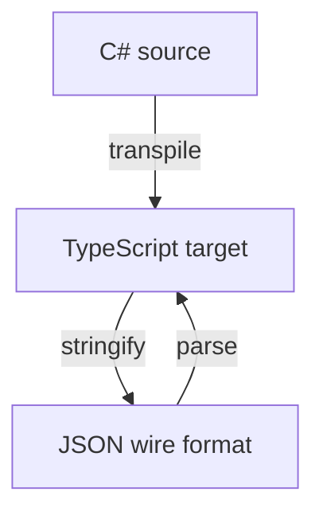

# JSON Serialization

Metano transpiles `System.Text.Json.Serialization.JsonSerializerContext`
subclasses into a TypeScript `SerializerContext` with **pre-computed `TypeSpec`
definitions**. JSON property names, naming policies, and per-property overrides
are all resolved at **compile time** — no runtime reflection, no string
comparisons.

## The triangle

There are three representations of your data, and each transition has its own
rules:



Naming conventions differ at each layer:

| Layer | Default naming | Example |
|-------|---------------|---------|
| C# property | PascalCase | `FirstName` |
| JSON wire | depends on `JsonSourceGenerationOptions.PropertyNamingPolicy` | `firstName`, `first_name`, `FirstName` |
| TypeScript field | camelCase (Metano convention) | `firstName` |

The TypeScript `toJSON()` and `fromJSON()` maps **TS field ↔ JSON wire** — C#
is the source of truth for deriving both, but they don't know about each other.

## Minimal example

**Input** — `JsonContext.cs`:

```csharp
using System.Text.Json.Serialization;
using Metano.Annotations;

namespace TestApp;

[StringEnum]
public enum Priority
{
    Low,
    Medium,
    High,
}

public record TodoItem(string Title, bool Completed, Priority Priority);

[Transpile]
[JsonSourceGenerationOptions(PropertyNamingPolicy = JsonKnownNamingPolicy.SnakeCaseLower)]
[JsonSerializable(typeof(TodoItem))]
public partial class JsonContext : JsonSerializerContext;
```

**Output** — `json-context.ts`:

```typescript
import { SerializerContext, type TypeSpec } from "metano-runtime/system/json";
import { TodoItem } from "./todo-item";
import { Priority } from "./priority";

export class JsonContext extends SerializerContext {
  private static readonly _default: JsonContext = new JsonContext();
  static get default(): JsonContext { return this._default; }

  private _todoItem?: TypeSpec<TodoItem>;
  get todoItem(): TypeSpec<TodoItem> {
    return this._todoItem ??= this.createSpec({
      type: TodoItem,
      factory: (p) => new TodoItem(
        p.title as string,
        p.completed as boolean,
        p.priority as Priority,
      ),
      properties: [
        { ts: "title",    json: "title",    type: { kind: "primitive" } },
        { ts: "completed", json: "completed", type: { kind: "primitive" } },
        { ts: "priority",  json: "priority",  type: { kind: "enum", values: Priority } },
      ],
    });
  }
}
```

**Usage** from TS:

```typescript
import { JsonSerializer } from "metano-runtime/system/json";
import { JsonContext } from "./json-context";
import { TodoItem } from "./todo-item";

const todo = new TodoItem("Write docs", false, "high");

// TS → JSON
const wire = JsonSerializer.serialize(todo, JsonContext.default.todoItem);
// → { title: "Write docs", completed: false, priority: "high" }

// JSON → TS
const parsed = JsonSerializer.deserialize(wire, JsonContext.default.todoItem);
// → TodoItem { title: "Write docs", completed: false, priority: "high" }
```

## What the transpiler does

When it sees a class that inherits from `JsonSerializerContext`:

1. **Reads `[JsonSourceGenerationOptions]`** — resolves the naming policy
   (`CamelCase`, `SnakeCaseLower`, `SnakeCaseUpper`, `KebabCaseLower`,
   `KebabCaseUpper`, or `null`/default for PascalCase preservation).

2. **Collects `[JsonSerializable(typeof(T))]` attributes** — each `T` becomes a
   lazy getter on the context class (see [Roots](#roots) for the accepted
   types, the getter names and the diagnostics).

3. **Adds every object type reachable from those roots**, as System.Text.Json
   does: types reached through property types, array / list / set elements,
   dictionary keys and values, nullable underlying types, and base types each
   get their own getter, so every `ref` descriptor and `base` link resolves.
   Roots come first, in declaration order, followed by the discovered types in
   breadth-first order; each type is emitted once, and cycles (`A → B → A`)
   terminate. The element, dictionary value and nullable inner types of a
   collection root are discovered the same way, so `typeof(ShotTiming[])`
   also emits `shotTiming`. Classes and structs are discovered when they are
   transpiled in their declaring assembly: this project (nested ones
   included) or a referenced `[TranspileAssembly]` + `[EmitPackage]` library,
   whose types the context imports from the package (and adds to
   `package.json#dependencies`). Closed generic types are discovered under
   their constructed name (`Page<EpisodeSummary>` → `pageEpisodeSummary`, with
   `TypeSpec<Page<EpisodeSummary>>`). Interfaces are not discovered. Base
   types, including a base declared in a referenced library, are included
   whenever the spec links to them through `base`.
   `[JsonDerivedType]` targets are not walked yet; polymorphic JSON is tracked
   in [#268](https://github.com/danfma/metano/issues/268).

4. **For each serializable type `T`**, walks its public properties and:
   - Excludes `[JsonIgnore]` and static properties
   - Resolves the JSON name: `[JsonPropertyName]` override wins, otherwise
     applies the context's naming policy to the C# property name
   - Classifies the property type (primitive, temporal, decimal, array, map,
     branded, enum, ref, etc.)

5. **Emits a `TypeSpec<T>`** as a lazy getter on the `SerializerContext`
   subclass, with pre-computed `ts`/`json` names, for every object type, and a
   **`ValueSpec<T>`** for every other root.

## Roots

`[JsonSerializable]` accepts the same root types as System.Text.Json:

| Root | Getter | Spec |
|------|--------|------|
| `typeof(EpisodeSummary)` (a transpiled class, record or struct) | `episodeSummary` | `TypeSpec<EpisodeSummary>` |
| `typeof(IReadOnlyList<EpisodeSummary>)` | `iReadOnlyListEpisodeSummary` | `ValueSpec<EpisodeSummary[] \| null>` |
| `typeof(EpisodeSummary[])` | `episodeSummaryArray` | `ValueSpec<EpisodeSummary[] \| null>` |
| `typeof(IEnumerable<Leaf>)` | `iEnumerableLeaf` | `ValueSpec<Iterable<Leaf> \| null>` |
| `typeof(Dictionary<string, EpisodeSummary>)` | `dictionaryStringEpisodeSummary` | `ValueSpec<Map<string, EpisodeSummary> \| null>` |
| `typeof(HashSet<string>)` | `hashSetString` | `ValueSpec<HashSet<string> \| null>` |
| `typeof(string)`, `typeof(int)`, `typeof(int?)` | `string`, `int32`, `nullableInt32` | `ValueSpec<string \| null>`, `ValueSpec<number>`, `ValueSpec<number \| null>` |
| `typeof(Guid)`, a `[StringEnum]`, a `[Branded]` type | `guid`, the type's name | `ValueSpec<UUID>`, `ValueSpec<Mood>`, `ValueSpec<EpisodeId>` |
| `typeof(List<string>), TypeInfoPropertyName = "Names"` | `names` | `ValueSpec<string[] \| null>` |

A `ValueSpec` holds the same descriptor the type gets as a property, so it goes
through the same converters (custom converters still match by `kind`):

```typescript
const json = JsonSerializer.serialize(shots, AppJsonContext.default.shotTimingArray);
const restored = JsonSerializer.deserialize(data, AppJsonContext.default.shotTimingArray); // ShotTiming[] | null
```

A reference-type root (a collection, dictionary, set or `string`) is typed
`T | null`, because JSON `null` reads back as `null`; a value-type root is not.
`IEnumerable<T>` / `IReadOnlyCollection<T>` roots and properties serialize any
iterable (a `Set`, a generator, a LINQ pipe) as a JSON array.

**Names** follow System.Text.Json's `JsonTypeInfo` property names, camel-cased:
a non-generic type uses its TypeScript name (so `[Name]` applies); a closed
generic type is its name without arity followed by its type arguments' names
(`ListListInt32`); an array is its element's name + `Array`; `Nullable<T>` is
`Nullable` + `T`'s name; BCL types use their CLR names (`String`, `Int32`,
`Guid`, `DateTimeOffset`). `TypeInfoPropertyName` replaces the name of its type
everywhere in the context, including `ref` / `base` links and the names of
generic types that use it as an argument. Type arguments use the same rule, so
`[Name("User")] UserDto` makes `List<UserDto>` → `listUser` (System.Text.Json:
`ListUserDto`).

**Diagnostics:**

- `MS0035` (error) rejects a root the context cannot describe: an open generic,
  `object`, a non-collection interface, a type that is not a transpiled class
  or struct (`KeyValuePair<,>`, tuples, `[Ignore]` / `[External]` types, types
  of non-Metano assemblies, and the dictionary types that are not recognized as
  dictionaries yet: `SortedDictionary`, `ReadOnlyDictionary`, `FrozenDictionary`),
  an array of rank > 1, a dictionary with non-`string` keys (not supported
  yet), a collection whose element type has no spec in the context (an
  interface or a type that is not transpiled), or a closed generic whose type
  argument has no spec (`Page<System.Version>`).
- `MS0036` reports two types that map to one getter (a warning that drops an
  unreferenced root, an error when the losing type is referenced by another
  spec), a getter that would shadow a `SerializerContext` member (`options`,
  `converters`, `createSpec`, `createValueSpec`, `readOptions`, `resolve`,
  `_registry`, `constructor`), and a type listed twice with different `TypeInfoPropertyName`
  values (a warning; the first one is kept). Use `TypeInfoPropertyName` to
  resolve a collision.

**Divergences:** `Stack<T>` is written and read in array order (System.Text.Json
writes it top-first and reverses it on read); the `[Name]` naming above.

**Getter renames (#270):** every getter now comes from the naming rule above.
A type whose camel-cased name is a JavaScript reserved word keeps the bare
name, because getters sit in property position: `Delete` → `get delete()`
(previously `get delete_()`), `Default` → `get default()` (previously
`default_`; it does not clash with the static `JsonContext.default`). Update
call sites such as `ctx.delete_` to `ctx.delete`.

## Supported type descriptors

The runtime (`metano-runtime/system/json`) interprets `TypeSpec` objects and
handles these kinds:

| Kind | TS type | On serialize | On deserialize |
|------|---------|-------------|----------------|
| `primitive` | string, number, boolean | passthrough | passthrough |
| `temporal` | `Temporal.PlainDate`, etc. | `.toString()` | `Type.from(iso)` |
| `decimal` | `Decimal` | `.toNumber()` (or string via custom converter) | factory wraps `new Decimal(...)` |
| `array` | `T[]` / `Iterable<T>` | `Array.from(iterable, serialize)` | `.map(deserialize)` |
| `map` | `Map<K,V>` | `Object.fromEntries(...)` | `new Map(Object.entries(...))` |
| `hashSet` | `HashSet<T>` | `Array.from(set, serialize)` | `new HashSet(arr)` |
| `branded` | `[Branded]` / `[InlineWrapper]` type | passthrough (brand erases at runtime) | `Type.create(value)`, or the type's `[JsonFactory]` ([below](#validating-branded-types)) |
| `enum` | string enum | passthrough (already string) | validates against allowed values |
| `numericEnum` | numeric enum | passthrough | validates against allowed values |
| `nullable` | `T \| null` | `null` passes through, else recurse | same |
| `ref` | another spec | recursive `serialize` with target spec | recursive `deserialize` |

## Validating branded types

A `[Branded]` type's descriptor calls `Type.create(value)`, which only casts: the validation you
wrote in C# (`From`) never runs on JSON input. Mark the validating method with `[JsonFactory]` and
the descriptor calls it instead:

```csharp
[Branded]
public readonly record struct Title(string Value)
{
    [JsonFactory]
    public static Title From(string value)
    {
        if (string.IsNullOrWhiteSpace(value))
            throw new InvalidOperationException("A title cannot be blank.");

        return new Title(value.Trim());
    }
}
```

```ts
type: { kind: "branded", create: Title.from },   // was: create: Title.create
```

`JsonSerializer.deserialize` then throws the factory's own error for `"   "` and returns `"ok"` for
`"  ok "`. Exceptions propagate unchanged, at any nesting depth (nullable, array, map value and map
key positions, and branded value roots). The member name is the one the companion declares, so
`[Name("parse")]` gives `create: Title.parse`, and a nested type gives `create: Episode.Code.from`.

A valid factory is a named static method (any accessibility) with exactly one parameter of the
wrapper's underlying type, returning the containing type; it is neither generic nor overloaded, is
emitted for TypeScript, is the type's only `[JsonFactory]`, and its TypeScript name is not `create`
or `toString` nor used by another method of the type. Anything else, or `[JsonFactory]` on a non-branded type, is error `MS0034` and the
descriptor keeps `create`. Without the attribute nothing changes.

In a library that declares `[EmitPackage]` the factory must be `public`: consumers compile against
the library's metadata, which omits non-public members, so a private factory would be dropped
there without notice and is reported as `MS0034` instead. Changing a library's factory without a
version bump can leave a consumer's cached context stale (the per-group cache does not track
referenced packages).

This is TypeScript-only: Metano ships no `System.Text.Json` converter that calls the factory, so
on the C# side `System.Text.Json` still writes the record struct as an object unless you supply
your own `JsonConverter`.

## Attribute support

| C# attribute | Handled by Metano? | Effect |
|---|---|---|
| `[JsonSerializable(typeof(T))]` | ✅ | Adds `T` and every object type reachable from it to the context's type list; collection, dictionary, set, primitive, enum, branded and nullable roots get a `ValueSpec` |
| `[JsonSerializable(..., TypeInfoPropertyName = "X")]` | ✅ | Names the getter `x` for that type everywhere in the context |
| `[JsonFactory]` (Metano) | ✅ | On a `[Branded]` type's static method: deserialization calls it instead of `create` ([details](#validating-branded-types)) |
| `[JsonSourceGenerationOptions]` with `PropertyNamingPolicy` | ✅ | Applies the naming policy to all properties |
| `[JsonPropertyName("wire_name")]` | ✅ | Overrides the wire name for that property |
| `[JsonIgnore]` | ✅ | Excludes the property from the spec; on an override, also hides the base declarations ([details](#inheritance)) |
| `JsonKnownNamingPolicy.CamelCase` | ✅ | `FirstName` → `firstName` |
| `JsonKnownNamingPolicy.SnakeCaseLower` | ✅ | `FirstName` → `first_name` |
| `JsonKnownNamingPolicy.SnakeCaseUpper` | ✅ | `FirstName` → `FIRST_NAME` |
| `JsonKnownNamingPolicy.KebabCaseLower` | ✅ | `FirstName` → `first-name` |
| `JsonKnownNamingPolicy.KebabCaseUpper` | ✅ | `FirstName` → `FIRST-NAME` |
| Default (`null`) | ✅ | Preserves PascalCase (`FirstName` → `FirstName`) |
| `[JsonConverter]` | ❌ | Not yet — use custom converters at runtime instead |
| `[JsonRequired]` | ❌ | Not yet |
| `[JsonExtensionData]` | ❌ | Not yet |
| Polymorphic `[JsonDerivedType]` | ❌ | Not yet |

## Custom converters

The runtime `SerializerContext` accepts custom converters in its options:

```typescript
import { SerializerContext, type JsonConverter } from "metano-runtime/system/json";
import { Decimal } from "decimal.js";

const decimalAsString: JsonConverter = {
  kind: "decimal",
  serialize: (v) => (v as Decimal).toString(),
  deserialize: (v) => new Decimal(v as string),
};

// If you construct your context manually:
class MyContext extends SerializerContext {
  constructor() {
    super({ converters: [decimalAsString] });
  }
}
```

The default `decimal` converter uses `.toNumber()`, which can lose precision for
large/high-precision values. Use the custom converter above to serialize as
strings for safety.

## Inheritance

When a record extends another transpilable record (of this project or of a
referenced Metano package), the child's `TypeSpec` references the parent's
spec via a `base` field:

```typescript
get dog(): TypeSpec<Dog> {
  return this._dog ??= this.createSpec({
    type: Dog,
    base: this.animal,  // ← inherits name and legs from animal's spec
    factory: (p) => new Dog(
      p.name as string,
      p.legs as number,
      p.breed as string,
    ),
    properties: [
      { ts: "breed", json: "breed", type: { kind: "primitive" } },
    ],
  });
}
```

At serialize/deserialize time, the runtime walks the `base` chain
(`collectWireProperties`) and writes properties in System.Text.Json's order:
the type's own properties first, then its base's, recursively
(`{"breed":…,"name":…,"legs":…}`). A property redeclared in a derived type
(`override` or `new`) under the same JSON name is written once, at the
most-derived declaration's position and with its type; an override renamed
with `[JsonPropertyName]` is written under both names, as STJ does. When the
base emits no spec (`[Ignore]`, a non-transpiled base), its properties are
inlined into the derived spec in the same order. Reading does not depend on key
order. The exported `collectProperties` still lists properties base-first.

A `[JsonIgnore]` override hides every base declaration of that property, as in
System.Text.Json, which neither writes nor reads it. A linked spec records the
hidden members in `ignoredProperties` (TS names, e.g. `ignoredProperties:
["name"]`); the base spec keeps the property for its own instances. The
factory of the derived type then receives no value for it.

## Polymorphism (runtime)

The runtime dispatches `[JsonPolymorphic]` / `[JsonDerivedType]` hierarchies
as System.Text.Json does. The transpiler does not emit the descriptor yet; that
comes with the generator slice of
[#268](https://github.com/danfma/metano/issues/268) (S6), so today only a
hand-written spec carries it. A polymorphic base spec gets a data-only
`polymorphism` member:

```typescript
polymorphism: {
  discriminator: "kind",            // verbatim, never renamed by a naming policy
  abstract: true,                   // abstract class or interface base
  derived: [
    { tag: "image", spec: () => this.imageClip },
    { tag: "silence", spec: () => this.silenceClip },
  ],
}
```

- **Write.** A class instance is matched by its constructor: a registered type
  (the base too, when it registers itself) writes its tag as the first key,
  then its contract (`{"kind":"image","Path":"a.png","Seconds":1.5}`); an
  unregistered base instance is written with no tag; any other runtime type
  follows `unknownDerivedType` — `failSerialization` (default) throws
  `NotSupportedException` `Runtime type 'X' is not supported by polymorphic
  type 'Clip'.`, `fallBackToBaseType` writes the base contract with no tag,
  `fallBackToNearestAncestor` writes the nearest registered ancestor class (or
  the base). A plain object has no runtime type: it is matched by the `test`
  guards of `[PlainObject]` variants, in `testOrder`. A derived contract
  reached this way is never dispatched again, even when it is polymorphic too.
- **Read.** The tag counts only under its exact name and only as the first key
  (anywhere with `readOptions: { allowOutOfOrderMetadataProperties: true }`). A
  string tag never matches a number tag (`1` ≠ `"1"`). An unknown tag throws
  `JsonException` `Read unrecognized type discriminator id 'video'.` unless
  `ignoreUnrecognizedTags` is set; a missing tag reads a concrete base and, on
  an abstract or interface base, throws `NotSupportedException` `The JSON
  payload for polymorphic interface or abstract type 'Clip' must specify a type
  discriminator.`; a tag that is neither a string nor a number throws
  `JsonException` `The '$id', '$ref' or '$type' metadata properties must be
  JSON strings. Current token type is 'Null'.`, and a number outside `Int32`
  throws `The JSON value could not be converted to Clip.`.
- **Misplaced metadata.** A later tag on a concrete base throws `JsonException`
  `The metadata property is either not supported by the type or is not the
  first property in the deserialized JSON object.` (on an abstract base it is a
  missing tag), and so do `$id` / `$ref`. Any other key that starts with `$`
  throws `Properties that start with '$' are not allowed in types that support
  metadata. …`. These checks apply only to polymorphic specs. JS enumerates
  array-index keys (`"0"`) first, so an index key written before the tag goes
  unnoticed, where STJ rejects it.
- Dispatch applies at the root and through `ref`, `array`, `hashSet`, `map` and
  `nullable` descriptors. A custom converter registered for `kind: "ref"`
  replaces it, as before.

## Errors and limits

Deserialization errors are `JsonException` (exported from
`metano-runtime/system/json`, extends `Error`, `name === "JsonException"`).
Messages follow System.Text.Json without its `Path` / `LineNumber` suffix:

| Input | Message |
|---|---|
| A non-object JSON value (or an array) for an object contract | `The JSON value could not be converted to Episode.` (`Object` for a `[PlainObject]` contract, which has no constructor) |
| A missing non-nullable property | `Missing required property: "title"` (STJ uses the default value unless the member is `required`; a documented divergence) |
| A non-array JSON value for an array, list or set | `Expected array for deserialization, got object` (STJ names the CLR collection type) |
| A non-object JSON value (or an array) for a dictionary | `Expected object for deserialization, got array` |
| An unknown string enum value | `Invalid enum value: …` (STJ: `The JSON value could not be converted to Color.`) |
| An unknown numeric enum value | `Invalid numeric enum value: …` — a divergence: STJ reads any number (`7` reads as `(Color)7`) |
| More than 64 nested containers on read | `The maximum configured depth of 64 has been exceeded. Cannot read next JSON object.` (`… JSON array.` for an array) |
| More than 64 nested containers on write, or an object cycle | `A possible object cycle was detected. This can either be due to a cycle or if the object depth is larger than the maximum allowed depth of 64. Consider using ReferenceHandler.Preserve on JsonSerializerOptions to support cycles.` |

The depth limit is System.Text.Json's default `MaxDepth` of 64: 64 nested
objects, arrays and dictionaries are written and read, the 65th throws; scalars
never count. On read, only the containers the contract visits count; a deeply
nested value under a key the contract does not declare is skipped without being
counted, where the STJ reader would throw.

On write, Metano is a hybrid of STJ's two modes. Its boundary is the one of a
source-generated context at its default (fast-path) settings, which also writes
a scalar inside the 64th container and throws `InvalidOperationException`
`CurrentDepth (64) is equal to or larger than the maximum allowed depth of
64. …` at the 65th. Its exception and message are the metadata / reflection
mode's `JsonException` above, which that mode already throws for a non-null
scalar written inside the 64th container. A custom converter that serializes a
separate root inside a call inherits the outer depth, where STJ starts that
root at depth 0.

Ignored properties: a constructor parameter bound to a `[JsonIgnore]` property
receives `undefined` (STJ passes `default(T)`), and a `[JsonIgnore] new`
(non-override) redeclaration does not hide the base declaration, which is then
written from the single TS member that holds the derived value, at the base's
position (STJ writes the base value at the redeclaration's position).

## When to use `[PlainObject]` vs `JsonSerializerContext`

Both are valid ways to handle JSON data:

| `[PlainObject]` | `JsonSerializerContext` |
|---|---|
| Emits a TS `interface`, no class | Emits a full class with spec-driven serialization |
| Use `JSON.stringify`/`parse` directly | Use `JsonSerializer.serialize`/`deserialize` |
| No naming policy handling | Full naming policy + per-property overrides |
| No nested type conversion | Handles `Temporal`, `Decimal`, `Map`, `HashSet`, branded types, etc. |
| Fast path for simple DTOs | Correct handling of non-JSON-safe types |

**Rule of thumb:**

- **Simple DTO** with only primitives and arrays of primitives? → `[PlainObject]`
- **Rich domain type** with dates, decimals, branded IDs, maps? → `JsonSerializerContext`

## See also

- [Attribute Reference](attributes.md#PlainObject) — `[PlainObject]` details
- [BCL Type Mappings](bcl-mappings.md) — how types are classified
- [`../spec/04-functional-requirements.md`](../spec/04-functional-requirements.md) — formal serialization requirements (`FR-032` to `FR-034`)
- [`../spec/08-feature-support-matrix.md`](../spec/08-feature-support-matrix.md) — current support status for serialization-related features
