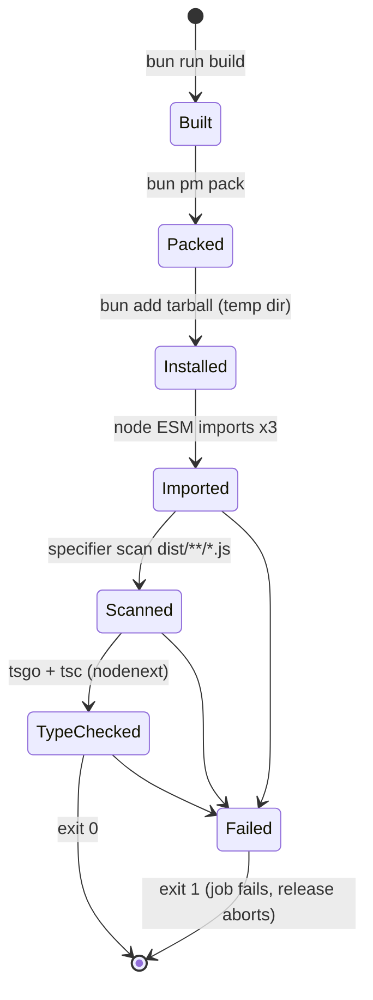

# Data Model: Make metano-runtime importable from Node ESM

No persistent data. The "entities" are packaging contracts.

## Packed runtime artifact

| Field | Description | Rule |
|---|---|---|
| tarball | output of `bun pm pack` for `targets/js/metano-runtime` | Built from a fresh `bun run build`; includes `dist/**/*`, `README.md`, `package.json` |
| `dist/**/*.js` relative specifiers | every `./` or `../` import/export target | MUST end in `.js` (FR-001) |
| `dist/**/*.d.ts` relative specifiers | declaration imports | MAY end in `.ts` (R2); MUST resolve under NodeNext |

## Export map (see contracts/package-exports.md)

| Key | Target | Purpose |
|---|---|---|
| `.` | `./dist/index.js` | root barrel |
| `./system/json` | `./dist/system/json/index.js` | documented subpath |
| `./system/linq` | `./dist/system/linq/index.js` | documented subpath |
| `./package.json` | `./package.json` | tooling metadata reads |
| `./*.js` | `./dist/*.js` | back-compat explicit-extension deep imports |
| `./*` | `./dist/*.js` | extensionless deep imports of files; directories resolve to a non-existent `.js` → module-not-found |

## Smoke-test consumer project (ephemeral)

| Field | Value |
|---|---|
| location | `$RUNNER_TEMP/metano-runtime-smoke` or `mktemp -d` — outside the repo workspace |
| `package.json` | `{ "private": true, "type": "module" }` |
| dependencies | packed tarball; dev: `typescript@5.9.3` |
| `tsconfig.json` | `module`/`moduleResolution: nodenext`, `target: es2022`, `lib: ["es2023"]`, `strict`, `noEmit`, `skipLibCheck: false`, `types: []` |
| `check.ts` | imports root, `system/json`, `system/linq`; one `@ts-expect-error` mismatch proving non-`any` types |

### Lifecycle

