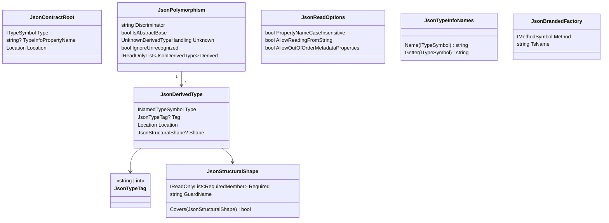
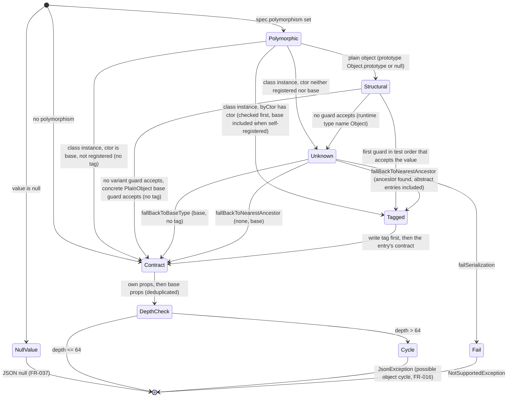
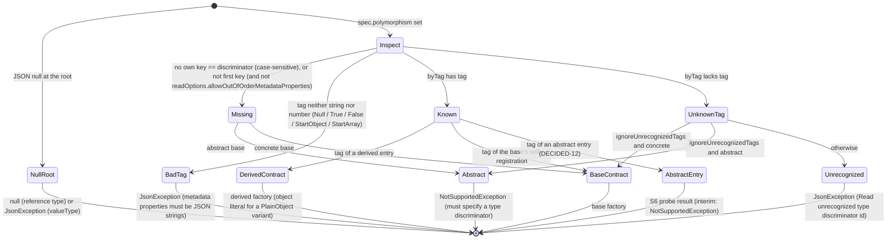

# Data Model: System.Text.Json-faithful JSON contracts

No persistent data. The entities are the C# inputs the generator reads, the compile-time model it
builds, and the runtime shapes the generated context emits.

## 1. C# inputs (read by the generator)

| Source | Members read | Notes |
|---|---|---|
| `JsonPolymorphicAttribute` (own attributes only) | `TypeDiscriminatorPropertyName` (default `$type`), `UnknownDerivedTypeHandling` (`FailSerialization` = 0, `FallBackToBaseType` = 1, `FallBackToNearestAncestor` = 2), `IgnoreUnrecognizedTypeDiscriminators` | Optional; `Inherited = false`. |
| `JsonDerivedTypeAttribute` (own, repeatable) | ctor `(Type)`, `(Type, string)`, `(Type, int)` | ≥ 1 makes the type polymorphic, whether it is a class, a record, an interface (FR-018) or a `[PlainObject]` type (FR-019). Attribute order = entry order. |
| `JsonSourceGenerationOptionsAttribute` on the context | ctor `JsonSerializerDefaults` (`Web` sets the next three), `PropertyNamingPolicy`, `PropertyNameCaseInsensitive`, `NumberHandling` (`AllowReadingFromString` only), `AllowOutOfOrderMetadataProperties`; every other named argument is only checked against the FR-046 list (`MS0037`) | A named argument overrides the Web default (FR-048). |
| `JsonPropertyOrderAttribute` on a contract member | presence only | `MS0037` (DECIDED-3); the order is not mirrored. |
| `JsonSerializableAttribute` on the context (repeatable) | ctor `Type` (named **or rank-1 array** type), `TypeInfoPropertyName` | Rank > 1 → `MS0035`. |
| `JsonFactoryAttribute` (new, `Metano.Annotations`) | marker on a static method | `[AttributeUsage(AttributeTargets.Method)]`. |

## 2. Compile-time model (TypeScript target, `Transformation/Json/`)



| Entity | Responsibility | Validation (diagnostic) |
|---|---|---|
| `JsonContractRoot` | One `[JsonSerializable]` entry. | `MS0035` for open generic / type parameter / error type / `object` / non-collection interface / non-transpilable object kind / array rank > 1. |
| `JsonPolymorphism` | Read once per type by a reader (`TryRead`). `null` for non-polymorphic types. `IsAbstractBase` is true for abstract classes and interfaces. | `MS0032` / `MS0033` rules (spec FR-012, FR-013). |
| `JsonDerivedType` | One derived registration (may be the base itself). `Tag == null` → untagged. `Shape` is set only for a `[PlainObject]` variant. | Duplicate type/tag, not assignable to the base, abstract without `FallBackToNearestAncestor`, interface-typed entry (OPEN-18), generic, not transpilable in its declaring assembly → `MS0032`. |
| `JsonStructuralShape` | The write-side test of a `[PlainObject]` variant (FR-019): the guard name it references (`isCircle`, synthesized by `TypeGuardBuilder`) and its required members (TS name + coarse kind `string` / `number` / `boolean` / `array` / `object` / `present`). `Covers` drives the test order. | Two shapes that cover each other, or a cycle in the specificity order → `MS0032`. |
| `JsonReadOptions` | The context's mirrored read behavior (FR-002, FR-048), resolved from the Web default and the named options. Emitted as the `readOptions` override only when non-default. | — |
| `JsonTypeInfoNames` | The single naming function (spec FR-031) with the context's `TypeInfoPropertyName` overrides; also used for constructed generic types (FR-015, FR-033). | Collision → `MS0036` (first wins; Error when the loser is referenced or the name is a reserved `SerializerContext` member). |
| `JsonBrandedFactory` | The resolved `[JsonFactory]` of a branded type and its TS member name, computed by `IrToTsNamingPolicy.ToFunctionName` (the function the companion declares it with). | `MS0034` (incl. operators and names equal to `create` / `toString`). |
| Contract closure | Ordered, deduplicated (by `JsonTypeInfoNames.Getter`) list of context entries: roots, then BFS over properties, `base` chain and `[JsonDerivedType]` targets, including closed generic object types and types from referenced Metano packages (FR-010, FR-033, FR-047). Each entry records whether it is the target of a `ref` / `base` / derived link (drives `MS0036` severity). | — |
| Property list | Per contract, own declarations deduplicated by final JSON name against the base chain; an `override` / `new` declaration replaces the base one (FR-009). For an interface base, the interface's own and inherited interface properties; class variants of an interface do not link to it (FR-018). | `MS0037` for `[JsonInclude]`, `byte[]`, `[JsonPropertyOrder]`. |

### Naming function (FR-031)

| C# type | Name | Getter |
|---|---|---|
| any, with `TypeInfoPropertyName = "Names"` | `Names` | `names` |
| `EpisodeSummary` (non-generic; `[Name]` honored) | `EpisodeSummary` | `episodeSummary` |
| `Shape.Circle` (nested) | `Circle` | `circle` |
| `List<EpisodeSummary>` | `ListEpisodeSummary` | `listEpisodeSummary` |
| `IReadOnlyList<EpisodeSummary>` | `IReadOnlyListEpisodeSummary` | `iReadOnlyListEpisodeSummary` |
| `EpisodeSummary[]` | `EpisodeSummaryArray` | `episodeSummaryArray` |
| `Dictionary<string, EpisodeSummary>` | `DictionaryStringEpisodeSummary` | `dictionaryStringEpisodeSummary` |
| `int?` | `NullableInt32` | `nullableInt32` |
| `string` / `int` / `Guid` | `String` / `Int32` / `Guid` | `string` / `int32` / `guid` |
| `Page<EpisodeSummary>` | `PageEpisodeSummary` | `pageEpisodeSummary` |
| `GBase<int>` (closed generic polymorphic base) | `GBaseInt32` | `gBaseInt32` |
| `IShape` (interface base; resolved TS name, which may drop the `I` prefix) | `Shape` | `shape` |

## 3. Runtime shapes (`metano-runtime/system/json`)

Additive except for the `JsonSerializer` / `BoundSerializer` signatures of FR-034 (breaking).

```ts
export type TypeDiscriminator = string | number;

export type UnknownDerivedTypeHandling =
  | "failSerialization"
  | "fallBackToBaseType"
  | "fallBackToNearestAncestor";

export interface DerivedTypeSpec {
  /** Absent for an untagged registration. */
  readonly tag?: TypeDiscriminator;
  /** Lazy: base and derived getters reference each other. */
  readonly spec: () => TypeSpec;
  /** [PlainObject] variants only: the synthesized guard used on write (FR-019). */
  readonly test?: (value: unknown) => boolean;
}

export interface PolymorphismSpec {
  /** Verbatim; never passed through a naming policy. */
  readonly discriminator: string;
  /** The C# base is abstract or an interface (missing / ignored tag → NotSupportedException). */
  readonly abstract?: boolean;
  /** C# simple name for messages; only when the base has no constructor (interface, [PlainObject]). */
  readonly typeName?: string;
  readonly derived: readonly DerivedTypeSpec[];
  /** Indices into `derived` in guard test order; only when it differs from attribute order. */
  readonly testOrder?: readonly number[];
  /** Default "failSerialization". */
  readonly unknownDerivedType?: UnknownDerivedTypeHandling;
  readonly ignoreUnrecognizedTags?: boolean;
}

/** Context-level read behavior (FR-002, FR-048); attached to each spec by createSpec / createValueSpec. */
export interface JsonReadOptions {
  readonly propertyNameCaseInsensitive?: boolean;
  readonly numberHandling?: "allowReadingFromString";
  readonly allowOutOfOrderMetadataProperties?: boolean;
}

export type NumberTypeName =
  | "System.Byte" | "System.SByte" | "System.Int16" | "System.UInt16"
  | "System.Int32" | "System.UInt32" | "System.Int64" | "System.UInt64"
  | "System.Single" | "System.Double";

// Existing descriptor with one optional member added (emitted only when the context reads
// numbers from strings, FR-048):
export type PrimitiveDescriptor = { readonly kind: "primitive"; readonly numberType?: NumberTypeName };

export interface TypeSpec<T = unknown> {
  // …existing members unchanged…
  readonly polymorphism?: PolymorphismSpec;
  /** FR-037: a C# struct contract; JSON null at the root throws JsonException. */
  readonly valueType?: boolean;
  /** Attached by createSpec when the context has non-default read options. */
  readonly readOptions?: JsonReadOptions;
}

export interface ValueSpec<T = unknown> {
  readonly descriptor: TypeDescriptor;
  /** FR-037: a C# value type (int, Guid, enum, branded, …); JSON null at the root throws.
   *  Absent for reference-type roots, whose getter is typed ValueSpec<T | null>. */
  readonly valueType?: boolean;
  /** Attached by createValueSpec when the context has non-default read options. */
  readonly readOptions?: JsonReadOptions;
  /** Phantom member that keeps T in the type. */
  readonly __type?: (value: T) => void;
}

export type JsonTypeInfo<T = unknown> = TypeSpec<T> | ValueSpec<T>;

export class JsonException extends Error {}
export class NotSupportedException extends Error {}

/** Wire order: own properties, then base's, recursively (STJ); deduplicated by JSON name,
 *  keeping the most-derived declaration (FR-009). */
export function collectWireProperties(spec: TypeSpec): readonly PropertySpec[];
```

`SerializerContext` gains a protected `readOptions` getter (default: no options), which generated
contexts override when their options are not the defaults, and a protected `createValueSpec`.
`BrandedDescriptor`, `PropertySpec`, the 11 descriptor kinds, `JsonConverter` and
`collectProperties` are unchanged.

### Dispatch index (internal)

| Field | Type | Built |
|---|---|---|
| `byCtor` | `Map<constructor, { tag?: TypeDiscriminator; spec: TypeSpec }>`; includes the base's constructor when the base registers itself | first serialize/deserialize through the base spec, never inside a getter |
| `byTag` | `Map<TypeDiscriminator, TypeSpec>` | same; `Map` keeps `1` and `"1"` distinct |
| `structural` | `{ test, tag?, spec }[]` in `testOrder` (or attribute order) | same; only entries with a `test` |

Cached in a module-level `WeakMap<PolymorphismSpec, Index>`.

### Serialize state machine (FR-005)



### Deserialize state machine (FR-007)


