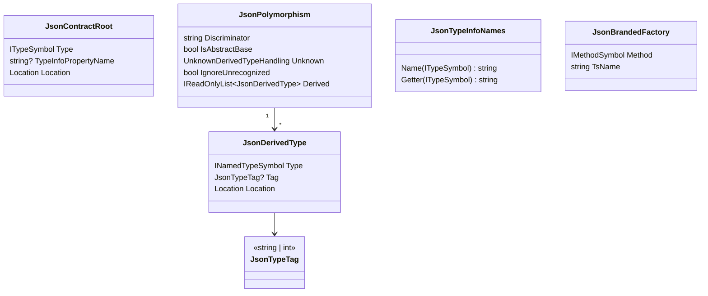
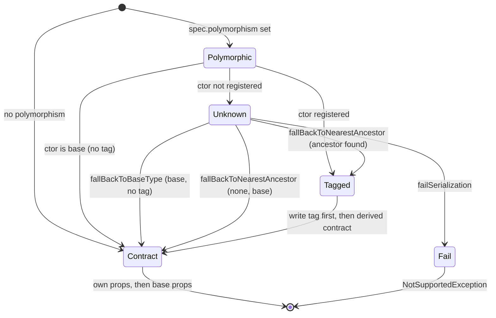
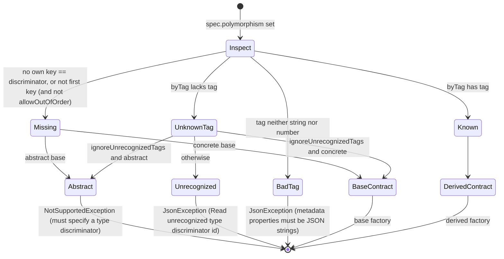

# Data Model: System.Text.Json-faithful JSON contracts

No persistent data. The entities are the C# inputs the generator reads, the compile-time model it
builds, and the runtime shapes the generated context emits.

## 1. C# inputs (read by the generator)

| Source | Members read | Notes |
|---|---|---|
| `JsonPolymorphicAttribute` (own attributes only) | `TypeDiscriminatorPropertyName` (default `$type`), `UnknownDerivedTypeHandling` (`FailSerialization` = 0, `FallBackToBaseType` = 1, `FallBackToNearestAncestor` = 2), `IgnoreUnrecognizedTypeDiscriminators` | Optional; `Inherited = false`. |
| `JsonDerivedTypeAttribute` (own, repeatable) | ctor `(Type)`, `(Type, string)`, `(Type, int)` | ≥ 1 makes the type polymorphic. Attribute order = entry order. |
| `JsonSourceGenerationOptionsAttribute` on the context | `PropertyNamingPolicy`, `AllowOutOfOrderMetadataProperties`, ctor `JsonSerializerDefaults` (OPEN-4) | |
| `JsonSerializableAttribute` on the context (repeatable) | ctor `Type` (named **or array** type), `TypeInfoPropertyName` | |
| `JsonFactoryAttribute` (new, `Metano.Annotations`) | marker on a static method | `[AttributeUsage(AttributeTargets.Method)]`. |

## 2. Compile-time model (TypeScript target, `Transformation/Json/`)



| Entity | Responsibility | Validation (diagnostic) |
|---|---|---|
| `JsonContractRoot` | One `[JsonSerializable]` entry. | `MS0035` for open generic / type parameter / error type / `object` / non-collection interface. |
| `JsonPolymorphism` | Read once per type by a reader (`TryRead`). `null` for non-polymorphic types. | `MS0032` / `MS0033` rules (spec FR-012, FR-013). |
| `JsonDerivedType` | One derived registration. `Tag == null` → untagged. | Duplicate type/tag, non-subtype, generic, interface/`[PlainObject]` → `MS0032`. |
| `JsonTypeInfoNames` | The single naming function (spec FR-031) with the context's `TypeInfoPropertyName` overrides. | Collision → `MS0036` (first wins). |
| `JsonBrandedFactory` | The resolved `[JsonFactory]` of a branded type and its TS member name (shared `[Name] ?? camelCase` rule). | `MS0034`. |
| Contract closure | Ordered, deduplicated (by `JsonTypeInfoNames.Getter`) list of context entries: roots, then BFS over properties, `base` chain and `[JsonDerivedType]` targets. | — |

### Naming function (FR-031)

| C# type | Name | Getter |
|---|---|---|
| any, with `TypeInfoPropertyName = "Names"` | `Names` | `names` |
| `EpisodeSummary` (non-generic; `[Name]` honored) | `EpisodeSummary` | `episodeSummary` |
| `Shape.Circle` (nested) | `Circle` | `circle` |
| `List<EpisodeSummary>` | `ListEpisodeSummary` | `listEpisodeSummary` |
| `IReadOnlyList<EpisodeSummary>` | `IReadOnlyListEpisodeSummary` | `iReadOnlyListEpisodeSummary` |
| `EpisodeSummary[]` | `EpisodeSummaryArray` | `episodeSummaryArray` |
| `Dictionary<string, EpisodeSummary>` | `DictionaryStringEpisodeSummary` | `dictionaryStringEpisodeSummary` |
| `int?` | `NullableInt32` | `nullableInt32` |
| `string` / `int` / `Guid` | `String` / `Int32` / `Guid` | `string` / `int32` / `guid` |
| `Page<EpisodeSummary>` | `PageEpisodeSummary` | `pageEpisodeSummary` |

## 3. Runtime shapes (`metano-runtime/system/json`, all additive)

```ts
export type TypeDiscriminator = string | number;

export type UnknownDerivedTypeHandling =
  | "failSerialization"
  | "fallBackToBaseType"
  | "fallBackToNearestAncestor";

export interface DerivedTypeSpec {
  /** Absent for an untagged registration. */
  readonly tag?: TypeDiscriminator;
  /** Lazy: base and derived getters reference each other. */
  readonly spec: () => TypeSpec;
}

export interface PolymorphismSpec {
  /** Verbatim; never passed through a naming policy. */
  readonly discriminator: string;
  /** The C# base is abstract (missing / ignored tag → NotSupportedException). */
  readonly abstract?: boolean;
  readonly derived: readonly DerivedTypeSpec[];
  /** Default "failSerialization". */
  readonly unknownDerivedType?: UnknownDerivedTypeHandling;
  readonly ignoreUnrecognizedTags?: boolean;
  readonly allowOutOfOrderMetadata?: boolean;
}

export interface TypeSpec<T = unknown> {
  // …existing members unchanged…
  readonly polymorphism?: PolymorphismSpec;
}

export interface ValueSpec<T = unknown> {
  readonly descriptor: TypeDescriptor;
  /** OPEN-6: reference-type roots read JSON null as null. */
  readonly acceptsNull?: boolean;
  /** Phantom member that keeps T in the type. */
  readonly __type?: (value: T) => void;
}

export type JsonTypeInfo<T = unknown> = TypeSpec<T> | ValueSpec<T>;

export class JsonException extends Error {}
export class NotSupportedException extends Error {}

/** Wire order: own properties, then base's, recursively (STJ). */
export function collectWireProperties(spec: TypeSpec): readonly PropertySpec[];
```

`BrandedDescriptor`, `PropertySpec`, the 11 descriptor kinds, `JsonConverter`, `SerializerContext`
and `collectProperties` are unchanged.

### Dispatch index (internal)

| Field | Type | Built |
|---|---|---|
| `byCtor` | `Map<constructor, { tag?: TypeDiscriminator; spec: TypeSpec }>` | first serialize/deserialize through the base spec, never inside a getter |
| `byTag` | `Map<TypeDiscriminator, TypeSpec>` | same; `Map` keeps `1` and `"1"` distinct |

Cached in a module-level `WeakMap<PolymorphismSpec, Index>`.

### Serialize state machine (FR-005)



### Deserialize state machine (FR-007)


