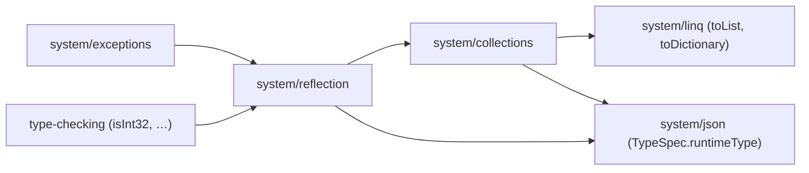

# Data Model: BCL collections as runtime types, runtime type descriptors

No persistent data. The entities are the C# inputs the core reads, the IR it builds, and the runtime shapes the TypeScript target emits.

## 1. C# inputs

| Source | Read | Notes |
|---|---|---|
| BCL collection symbols (`RoslynTypeQueries.IsCollectionLike` / `IsDictionaryLike` / `IsSetLike`, `Queue`, `Stack`, `ImmutableList`, `ImmutableArray`, `ReadOnlyCollection`, the interfaces) | symbol identity + type arguments | Replaced by one `CollectionKindResolver` that returns `(IrCollectionKind, args)`; string-prefix tests go away. |
| `Metano.Interop.JsArray<T>` | symbol identity | TS-only (MS0050 elsewhere). |
| `Metano.Interop.Js.Code` / `Code<T>` | the `code` argument syntax (literal, const, interpolated string), the type argument | FR-031; holes are `InterpolationSyntax` expressions. |
| `Metano.Interop.InteropExtensions.UnsafeCast<T>` / `AsDynamic` | the receiver, the type argument | FR-040 / FR-041. |
| `IDynamicTypeSymbol`, `IDynamic*Operation` | operation kind, member name, arguments | FR-030. |
| `IsPatternExpression`, `BinaryExpression(Is/As)`, `CastExpression`, switch arms and labels, overload parameters, `catch` clauses (+ filters), `GetType()` invocations, `TypeOfExpression`, `ObjectCreation` of `T`, `DefaultExpression` of `T` | the tested / target type and the tested expression's static type | The *runtime questions* that drive reachability (FR-027) and reification (FR-024). |
| `[PlainObject]` types assignable to a tested static type | shape (required members with coarse kinds; 009 FR-019) | MS0046. |
| `[Ignore(TargetLanguage)]` | per-target ignore | MS0050 suppression. |

## 2. Core IR (`Metano.Compiler`, target-agnostic)

```mermaid
classDiagram
    class IrCollectionTypeRef {
        IrCollectionKind Kind
        IReadOnlyList~IrTypeRef~ TypeArguments
    }
    class IrCollectionKind {
        <<enumeration>>
        List
        IList
        IReadOnlyList
        ICollection
        IReadOnlyCollection
        Dictionary
        IDictionary
        IReadOnlyDictionary
        HashSet
        ISet
        IReadOnlySet
        Queue
        Stack
        ImmutableList
        ReadOnlyList
        KeyCollection
        ValueCollection
    }
    class IrArrayTypeRef {
        IrTypeRef ElementType
        bool IsJsArray
    }
    class IrDynamicTypeRef
    class IrRuntimeTypeTest {
        <<abstract>>
        +Of(IrTypeRef, IrTypeRef staticType) IrRuntimeTypeTest
    }
    class Instanceof
    class Interface { IrNamedTypeRef Descriptor }
    class Structural { string GuardName }
    class Typeof { IrPrimitive Primitive; bool Validating }
    class Array
    class Collection { IrCollectionKind Kind; IReadOnlyList~IrTypeRef~ TypeArguments }
    class Reified { string TypeParameter }
    class Iterable
    class Null
    class Object
    class Union { IReadOnlyList~IrTypeRef~ Cases }
    class Constant { bool Result }
    class None
    IrRuntimeTypeTest <|-- Instanceof
    IrRuntimeTypeTest <|-- Interface
    IrRuntimeTypeTest <|-- Structural
    IrRuntimeTypeTest <|-- Typeof
    IrRuntimeTypeTest <|-- Array
    IrRuntimeTypeTest <|-- Collection
    IrRuntimeTypeTest <|-- Reified
    IrRuntimeTypeTest <|-- Iterable
    IrRuntimeTypeTest <|-- Null
    IrRuntimeTypeTest <|-- Object
    IrRuntimeTypeTest <|-- Union
    IrRuntimeTypeTest <|-- Constant
    IrRuntimeTypeTest <|-- None
    class IrReifiedTypeParameter {
        string Name
        string HiddenParameterName
        int Position
        bool HasDefault
    }
    class IrMethodSignature {
        IReadOnlyList~IrReifiedTypeParameter~ ReifiedTypeParameters
    }
    class IrClassDeclaration {
        IReadOnlyList~IrReifiedTypeParameter~ ReifiedTypeParameters
        IrRuntimeTypeDescriptor? Descriptor
    }
    class IrRuntimeTypeDescriptor {
        string Name
        string FullName
        string Namespace
        IrTypeRef? Base
        IReadOnlyList~IrTypeRef~ Interfaces
        IReadOnlyList~IrTypeRef~ PlainImplementers
        bool IsAbstract
        bool IsValueType
        bool HasParameterlessCtor
    }
    class IrCatchClause {
        IrTypeRef? ExceptionType
        string? VariableName
        IrExpression? Filter
        IReadOnlyList~IrStatement~ Body
    }
    class IrTypeTestExpression { IrExpression Value; IrRuntimeTypeTest Test; IrTypeRef Target }
    class IrAsExpression { IrExpression Value; IrRuntimeTypeTest Test; IrTypeRef Target }
    class IrCheckedCastExpression { IrExpression Value; IrRuntimeTypeTest Test; IrTypeRef Target; bool Unchecked }
    class IrGetTypeExpression { IrExpression Receiver; IrTypeRef? ConstantType }
    class IrTypeOfExpression { IrTypeRef Type }
    class IrInlineCodeExpression { IReadOnlyList~IrInlineCodePart~ Parts; IrTypeRef ResultType; TargetLanguage Target; bool IsStatement }
    class IrUnsafeCastExpression { IrExpression Value; IrTypeRef Target }
    class IrAsDynamicExpression { IrExpression Value }
    class IrDynamicMemberAccess { IrExpression Receiver; string Name }
    class IrDynamicInvocation { IrExpression Target; IReadOnlyList~IrExpression~ Arguments }
    class IrDynamicIndexerAccess { IrExpression Receiver; IReadOnlyList~IrExpression~ Arguments }
    class RuntimeTypeReachability {
        +Compute(IrCompilation) IReadOnlySet~IrTypeRef~
    }
```

Notes:

- `IrRuntimeTypeTest.Of(type, staticType)` gains the static type of the tested expression so that `Typeof.Validating` and `Constant` can be decided in one place (FR-022). Every existing caller passes `staticType: null` and gets today's behaviour plus the new categories.
- `IrReifiedTypeParameter.Position` is the index in the emitted parameter list after the trailing rule of OD-7; `HasDefault` is `true` when a preceding parameter is optional.
- `IrRuntimeTypeDescriptor` is attached to a declaration only when `RuntimeTypeReachability` reaches it (FR-027). The Dart target ignores it.
- `IrInlineCodePart` is `Text(string)` or `Hole(IrExpression)`.
- The existing `IrIsPatternExpression` + `IrTypePattern` keep working; `IrTypeTestExpression` is the node the extractor produces for `x is T` without a designator so the target can render helpers without a pattern walk. Both carry the classification so no target recomputes it.

## 3. TypeScript target

| Component | Role |
|---|---|
| `Bridge/IrToTsCollectionBridge` | `IrCollectionTypeRef` → runtime class / interface type refs; factories for `new` / initializers / collection expressions; `adopt` at array→interface conversions (FR-003). |
| `Transformation/RuntimeTypeEmitter` | `IrRuntimeTypeDescriptor` → `static readonly [runtimeType]` / merged-namespace `$type` (FR-018, FR-019, FR-020). |
| `Bridge/IrToTsRuntimeTestBridge` | renders every `IrRuntimeTypeTest` category (replaces `BuildTypeTest`; `IrTypeCheckBuilder.Generate` delegates to it, FR-021). |
| `Bridge/IrToTsCatchChainBridge` | FR-015. |
| `Bridge/IrToTsInlineCodeBridge` | FR-031 / FR-032. |
| `Analysis/IrRuntimeRequirementScanner` | imports for `runtimeType`, `isType`, `asType`, `castTo`, `getType`, `fromEnd`, `isIterable`, `toException`, descriptors, factories, collection and exception classes. |
| `JsonSerializerContextTransformer` | `runtimeType` thunk on specs; `list` / `dictionary` / … descriptor kinds (FR-028). |

## 4. Runtime shapes

See [contracts/runtime-collections.md](./contracts/runtime-collections.md) and [contracts/runtime-types.md](./contracts/runtime-types.md). The three new modules and their dependency direction:

`exceptions` depends on `reflection` only for its descriptors (each exception class carries `[runtimeType]`); the two modules are split so that a program that throws but never tests pays for `exceptions` alone — the descriptor factory is a small function, and tree-shaking keeps the rest of `reflection` out.

## 5. Dart target

`IrCollectionTypeRef` → `List` / `Map` / `Set` / `Queue`; `IrDynamicTypeRef` → `dynamic`; `IrRuntimeTypeTest` → native `is`; `IrCatchClause.Filter` → an `if` inside `on T catch (e)`; `IrUnsafeCastExpression` → `as T`; `IrAsDynamicExpression` → `as dynamic`; `IrInlineCodeExpression` with `Target = TypeScript` → MS0050; descriptors and reified parameters ignored (FR-035).
