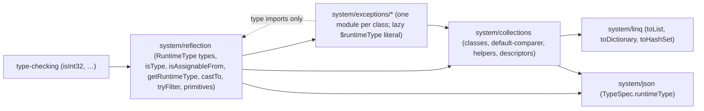

# Data Model: BCL collections as runtime types, runtime type descriptors

No persistent data. The entities are the C# inputs the core reads, the IR it builds, and the runtime shapes the TypeScript target emits.

## 1. C# inputs

| Source | Read | Notes |
|---|---|---|
| BCL collection symbols (`RoslynTypeQueries.IsCollectionLike` / `IsDictionaryLike` / `IsSetLike`, `Queue`, `Stack`, `ImmutableList`, `ImmutableArray`, `ReadOnlyCollection`, the interfaces) | symbol identity + type arguments + variance of the interface's type parameters | Replaced by one `CollectionKindResolver` that returns `(IrCollectionKind, args, variance)`; string-prefix tests go away. |
| `Metano.Interop.JsArray<T>` | symbol identity | TS-only (MS0051 elsewhere). |
| `Metano.Interop.InteropExtensions.AsJsArray`, `Metano.Collections.ListViewExtensions.AsSpan` / `AsReadOnlySpan` over `List<T>`, `System.Runtime.InteropServices.CollectionsMarshal.AsSpan(List<T>)`, `List<T>.ToArray()` and the other in-scope `ToArray()` members | symbol identity of the member | Declarative member mappings (FR-055, FR-056): the free helpers `asJsArray(list)` / `asSpan(list)` / `asReadOnlySpan(list)` (they handle `null`) and `toArray()` on the runtime class; no IR node of their own. `AsJsArray` is TS-only (MS0051). |
| `System.Span<T>` / `System.ReadOnlySpan<T>` in type position | element type, read-only-ness | Decided by the type (FR-001's span row): `ReadOnlySpan<char>` → `IrPrimitiveTypeRef(String)` (today's string-search rule, now also in type position); every other span → `IrArrayTypeRef` with `SpanKind`. Every conversion to `ReadOnlySpan<char>` whose source is not a `string` (`char[]`, the implicit `Span<char>` → `ReadOnlySpan<char>`, `List<char>.AsReadOnlySpan()`) reports `MS0001`. |
| `RoslynTypeQueries.IsDictionaryLike` / `IsSetLike` / `IsCollectionLike` | — | Today's groupings merge mutable, concurrent and immutable types (`IsDictionaryLike` matches `Dictionary`, `IDictionary`, `IReadOnlyDictionary`, `ConcurrentDictionary`, `ImmutableDictionary`, `IImmutableDictionary`; `IsSetLike` matches `HashSet`, `ISet`, `SortedSet`, `ImmutableHashSet`; `IsCollectionLike` merges `List`, the list interfaces, `ImmutableList`, `ImmutableArray`, `Queue`, `Stack`). `CollectionKindResolver` MUST map each type to its own `IrCollectionKind` and never through these groupings (FR-054), so an immutable dictionary never becomes the mutable runtime `Dictionary`. |
| `Metano.Interop.Js.Code` / `Code<T>` | the `code` argument syntax (literal, const, interpolated string), the type argument | FR-031; holes are `InterpolationSyntax` expressions; a hole position inside a JS string literal of the text is detected by a small lexer over the literal parts (MS0056). |
| `Metano.Interop.InteropExtensions.UnsafeCast<T>` / `AsDynamic` | the receiver, the type argument | FR-035 / FR-036. |
| `IConversionOperation` with `Conversion.IsBoxing` (to `object` / `ValueType` / `Enum` only) over an enum / `[InlineWrapper]` type that has a descriptor, `[EmitRuntimeType]` / `[assembly: DisableBoxing]` attributes | source type, target type (`object`, `ValueType`, `Enum`, an interface), whether the source is an open `T`, nullable, an interop-bound `object` slot | FR-050 / FR-027; the conversion is lowered to `box(...)` and reaches the type. |
| `IDynamicTypeSymbol`, `IDynamic*Operation`, `IConversionOperation` from `dynamic` | operation kind, member name, arguments, whether the conversion is explicit | FR-030: implicit conversions emit nothing; explicit casts go through FR-026. |
| `IsPatternExpression`, `BinaryExpression(Is/As)`, `CastExpression` (explicit reference / unboxing / `dynamic` conversions), switch arms and labels, overload parameters, `catch` clauses (+ `CatchFilterClauseSyntax`), `GetType()` invocations, `TypeOfExpression`, `ObjectCreation` of `T` | the tested / target type, the tested expression's static type, the receiver's static type for `GetType()` | The *runtime questions* that drive reachability (FR-027) and reification (FR-024). |
| Collection constructions (`ObjectCreation`, collection initializers in both forms, collection expressions, LINQ terminals) | the collection kind and whether a runtime question about that kind exists | FR-008: `$typeArguments$<Class>` passed only then. |
| `[PlainObject]` types assignable to a tested static type | shape (required members with coarse kinds; 009 FR-019); derived plain objects of a receiver type | MS0047; the `GetType()` constant fold condition (FR-020). |
| `[StrictUnionGuard]` bases and their variants (`TypeGuardBuilder.TryFindDiscriminatedVariants`) | variant guard names and modules | the strict guard is emitted in its own `<base>.guard.ts` module that imports base and variants; the base imports no variant (FR-029). |
| `[Ignore(TargetLanguage)]` | per-target ignore | MS0051 suppression. |

## 2. Core IR (`Metano.Compiler`, target-agnostic)

```mermaid
classDiagram
    class IrCollectionTypeRef {
        IrCollectionKind Kind
        IReadOnlyList~IrTypeRef~ TypeArguments
        IReadOnlyList~IrVariance~ Variance
    }
    class IrCollectionKind {
        <<enumeration>>
        List
        IList
        IReadOnlyList
        ICollection
        IReadOnlyCollection
        Dictionary
        IDictionary
        IReadOnlyDictionary
        HashSet
        ISet
        IReadOnlySet
        Queue
        Stack
        ImmutableList
        ReadOnlyList
        ImmutableHashSet
        ImmutableDictionary
        IImmutableList
        IImmutableSet
        IImmutableDictionary
        SortedSet
        SortedDictionary
        SortedList
        ConcurrentDictionary
        KeyCollection
        ValueCollection
    }
    class IrArrayTypeRef {
        IrTypeRef ElementType
        bool IsJsArray
        IrSpanKind SpanKind
    }
    class IrSpanKind {
        <<enumeration>>
        None
        Span
        ReadOnlySpan
    }
    class IrDynamicTypeRef
    class IrRuntimeTypeTest {
        <<abstract>>
        +Of(IrTypeRef, IrTypeRef staticType) IrRuntimeTypeTest
    }
    class NominalClass
    class NominalInterface { IReadOnlyList~IrTypeRef~ Implementers }
    class ErasedShape
    class Primitive { IrPrimitive Primitive; IrPrimitive? StaticPrimitive }
    class FixedTuple { int Arity }
    class Array
    class Collection { IrCollectionKind Kind; IReadOnlyList~IrTypeRef~ TypeArguments; IReadOnlyList~IrVariance~ Variance }
    class Reified { string TypeParameter }
    class Iterable
    class Null
    class Object
    class Union { IReadOnlyList~IrTypeRef~ Cases }
    class Constant { bool Result }
    class None
    IrRuntimeTypeTest <|-- NominalClass
    IrRuntimeTypeTest <|-- NominalInterface
    IrRuntimeTypeTest <|-- ErasedShape
    IrRuntimeTypeTest <|-- Primitive
    IrRuntimeTypeTest <|-- FixedTuple
    IrRuntimeTypeTest <|-- Array
    IrRuntimeTypeTest <|-- Collection
    IrRuntimeTypeTest <|-- Reified
    IrRuntimeTypeTest <|-- Iterable
    IrRuntimeTypeTest <|-- Null
    IrRuntimeTypeTest <|-- Object
    IrRuntimeTypeTest <|-- Union
    IrRuntimeTypeTest <|-- Constant
    IrRuntimeTypeTest <|-- None
    class IrReifiedTypeParameter {
        string Name
        string HiddenParameterName
        int Position
        bool HasDefault
    }
    class IrMethodSignature {
        IReadOnlyList~IrReifiedTypeParameter~ ReifiedTypeParameters
    }
    class IrClassDeclaration {
        IReadOnlyList~IrReifiedTypeParameter~ ReifiedTypeParameters
        string? TypeArgumentSlot
        IReadOnlyList~IrTypeRef~ BaseTypeArguments
    }
    class IrRuntimeQuestion {
        IrTypeRef Tested
        IrRuntimeQuestionKind Kind
        IrTypeRef? ReceiverStaticType
    }
    class IrCompilation {
        IReadOnlyList~IrRuntimeQuestion~ RuntimeQuestions
        IReadOnlySet~string~ QuestionedCollectionTypes
    }
    class IrCatchClause {
        IrTypeRef? ExceptionType
        string? VariableName
        IrExpression? Filter
        IReadOnlyList~IrStatement~ Body
        bool CatchesEveryException
        bool HandlesEveryException
    }
    class IrRethrowStatement
    class IrTypeTestExpression { IrExpression Value; IrRuntimeTypeTest Test; IrTypeRef Target }
    class IrAsExpression { IrExpression Value; IrRuntimeTypeTest Test; IrTypeRef Target }
    class IrCheckedCastExpression { IrExpression Value; IrRuntimeTypeTest Test; IrTypeRef Target; bool Unchecked }
    class IrGetTypeExpression { IrExpression Receiver; IrTypeRef? ConstantType }
    class IrBoxExpression { IrExpression Value; IrTypeRef BoxedType }
    class IrUnboxExpression { IrExpression Value; IrTypeRef Target; bool Interop }
    class IrTypeOfExpression { IrTypeRef Type }
    class IrIndexerUpdateExpression { IrCollectionElement Element; string CurrentName; IrExpression NewValue; IrIndexerUpdateResult Result }
    class IrCollectionElement { IrExpression Receiver; IrExpression Index; bool FromEnd; IrCollectionTypeRef ReceiverType }
    class IrIndexerUpdateResult {
        <<enumeration>>
        NewValue
        OldValue
        Coalesce
    }
    class IrFromEndElementAccess { IrExpression Receiver; IrExpression Offset; IrTypeRef ReceiverType }
    class IrArrayLiteral { IrCollectionTypeRef? TargetCollection }
    class IrArrayToCollectionConversion { IrExpression Value; IrCollectionTypeRef Target }
    class IrForEachStatement { IrTypeRef? CollectionType }
    class IrInlineCodeExpression { IReadOnlyList~IrInlineCodePart~ Parts; IrTypeRef? ResultType; TargetLanguage Language }
    class IrInlineCodeStatement { IReadOnlyList~IrInlineCodePart~ Parts; TargetLanguage Language }
    class IrUnsafeCastExpression { IrExpression Value; IrTypeRef Target }
    class IrAsDynamicExpression { IrExpression Value }
    class IrDynamicMemberAccess { IrExpression Receiver; string Name }
    class IrDynamicInvocation { IrExpression Target; IReadOnlyList~IrExpression~ Arguments }
    class IrDynamicIndexerAccess { IrExpression Receiver; IReadOnlyList~IrExpression~ Arguments }
```

Notes:

- `IrCollectionKind` has one value per runtime class and interface of FR-001 / FR-054; stage 011c adds the `List`, `HashSet`, `Dictionary`, `Queue`, `Stack` values with their interfaces and views, stage 011h the read-only, immutable, sorted and concurrent ones. Until 011h lands those types keep their 2.x IR.
- `IrArrayTypeRef.SpanKind` marks a `Span<T>` (`Span`) or `ReadOnlySpan<T>` (`ReadOnlySpan`, never with a `char` element, which is a string); the value is still the native array (a view of a `List<T>` is its backing array, FR-056, FR-057), only the TS type differs: the runtime `Span<T>` interface or `ReadonlyArray<T>`. `None` is every other array. Dart ignores `SpanKind` and maps the node to `List<T>` as any array.
- `IrRuntimeTypeTest.Of(type, staticType)` gains the static type of the tested expression so that `Primitive.StaticPrimitive` and `Constant` are decided in one place (FR-022). The categories are neutral (stage 011b, plan.md): `NominalClass` (classes, records, structs, exceptions, temporal types), `NominalInterface(Implementers)`, `ErasedShape` (`[PlainObject]`; `[InlineWrapper]` is classified explicitly by its underlying primitive), `Primitive`, `FixedTuple` (the former `ArrayTuple`), `Array`, `Iterable`, `Null`, `Object`, `Constant`, `None`; the collection, reified and union categories come with stages 011c, 011d and spec 010. Whether a test renders `instanceof`, `typeof`, a validating helper, a guard name or a descriptor is the TypeScript bridge's decision; `MS0045` for `None` is a TypeScript diagnostic.
- `IrCompilation.RuntimeQuestions` (an init property) is the frontend's scan of the Roslyn operations of every transpilable type: per runtime question of FR-027 the tested type, the kind (`Test`, `As`, `Cast`, `GetType`, `TypeOf`) and the receiver's static type; `QuestionedCollectionTypes` holds the questioned collection types by CLR definition name (``System.Collections.Generic.List`1``), which stage 011c maps to `IrCollectionKind`. The closure over them (`RuntimeTypeReachability`) is a TypeScript analysis (D29, plan.md stage 011b).
- `IrReifiedTypeParameter.Position` is the index in the emitted parameter list after the trailing rule of OD-7; `HasDefault` is `true` when a preceding parameter is optional. A generic class's `ReifiedTypeParameters` describe its hidden constructor parameter and `TypeArgumentSlot` names the per-declaring-class slot it defines (`$typeArguments$Box`), `null` for a class that defines none; `BaseTypeArguments` are the descriptors a derived class passes to `super` (FR-024). The variant guards of a `[StrictUnionGuard]` base are data of the guard emitter, not of the descriptor.
- There is no descriptor node in the IR: the TypeScript `RuntimeTypeEmitter` projects a reached declaration's data (name, namespace, base, `AllInterfaces`, abstractness, value-type-ness, a public parameterless constructor) into the literal.
- The questioned collection types drive FR-008: a collection construction passes `$typeArguments$<Class>` only when its kind is in the set.
- `IrBoxExpression` / `IrUnboxExpression` come from Roslyn `IConversionOperation` with `Conversion.IsBoxing` over an enum or `[InlineWrapper]` type (FR-050); `Interop` marks the gated unbox at `[Import]` / `[Emit]` / `Js.Code` / `dynamic` / `AsDynamic()` boundaries (FR-051: only when the argument's static type can hold a box and the compilation has a boxing conversion). The core emits both at every such conversion as a neutral fact (an open type parameter source is never one); under `[assembly: DisableBoxing]` the TypeScript bridge renders them raw, as the reachability phase decides (stage 011b B3). Dart ignores them.
- `IrIndexerUpdateExpression` is the evaluate-once node for `list[i] op= v`, `list[i]++` / `--` (prefix and postfix) and `list[i] ??= v` through the indexer of a 011c collection kind, list or dictionary, class or interface (FR-010; amended in 011c, D30's contract shapes). `NewValue` is the value written, an expression over `IrIdentifier(CurrentName)` (the current element), computed by the core with the existing operator, increment-constant and overflow rules of the element type; `Result` says what the expression yields: `NewValue` (`op=`, prefix `++` / `--`), `OldValue` (postfix `++` / `--`) or `Coalesce` (`??=`: `NewValue` is the right-hand side, evaluated and written only when the current value is `null`). Statement position is not a field: the node is then the expression of an `IrExpressionStatement`. The node is extracted only for a target whose collections are runtime classes (§ The native-collections capability); a target that keeps native collections gets the pre-011c lowering instead. The TypeScript target renders the shapes of contracts/runtime-collections.md § Indexer compound assignments (the direct form, the statement-level temporaries in a comma expression, or `update` / `updateReturningOld` for a class receiver in expression position other than `??=` and a right-hand side with `await` / `yield`); the choice among them is the target's.
- `IrFromEndElementAccess` is `r[^n]` (read, or the target of `r[^n] = v`) on a 011c collection kind, an array or `JsArray<T>`: `Offset` is `n`; like the update node it is extracted only for a target without native collections. TypeScript renders `r.fromEnd(n)` (a class receiver), `r.get(r.count - n)` (an interface receiver), `fromEnd(arr, n)` (an array), and `r.set(r.count - n, v)` for a write.
- `IrArrayToCollectionConversion` marks a C# conversion (implicit or explicit) from `T[]` / `JsArray<T>` to `IList<T>`, `ICollection<T>`, `IReadOnlyList<T>` or `IReadOnlyCollection<T>` (FR-003): TypeScript renders `List.adopt(value, { fixedSize: true })`; a target that keeps native collections never gets the node (its list is the native array).
- `IrForEachStatement.CollectionType` is the static type of the enumerated expression (an init property, `null` when unknown); the TypeScript target lowers the loop to FR-057's indexed loop when it is `IrCollectionTypeRef(List)`.
- **The native-collections capability (transitional, D28; W4-31, replaces W4-18's legacy element forms).** Extraction runs once per target, so the core decides the collection lowering from an extraction-time capability of the target, `IrExtractionContext.KeepsNativeCollections` (`true` for Dart until FR-038), in the pattern of `KeepsDynamicSourceForms` / `KeepsReflectionSourceForms`: a neutral representation fact ("this target's collections are its native ones"), not a rendering decision. Rules:
  - **A target that keeps native collections** (Dart) gets exactly the pre-011c IR of every collection construct: no `IrIndexerUpdateExpression`, `IrFromEndElementAccess` or `IrArrayToCollectionConversion` (the 2.x element-access lowering: the native compound operator, the receiver and index bound once, `r[length - n]`), the 2.x diagnostics (`ReportDictionaryEntryStore`'s `MS0001`, `IndexFromEndWrite`), and none of the B3 `MS0001` sites below. `IrArrayLiteral.TargetCollection` and `IrForEachStatement.CollectionType` are set for every target (init properties that such a target ignores). Its output and diagnostics stay byte-identical to main.
  - **Every other target** (TypeScript) gets only the structured nodes; no IR node carries a second, legacy form, so no walker or rewriter visits or rewrites two forms and no diagnostic needs deferring.
  - `IrCollectionTypeRef` is extracted for every target. `IrCollectionTypeRef.LegacyForm` stays as a computed property, a pure function of `Kind` and `TypeArguments` (not stored, not part of equality), read only by the Dart type mapper and by the Dart-path sites that compared 2.x shapes (`MultiplyConstructedInterfaces.IndistinguishableNote` under the capability): `IrArrayTypeRef(T)` for `List`, `IList`, `ICollection`, `IReadOnlyList`, `Queue`, `Stack`, `KeyCollection`, `ValueCollection`; `IrIterableTypeRef(T)` for `IReadOnlyCollection`; `IrMapTypeRef(K, V)` for the three dictionary kinds; `IrSetTypeRef(T)` for `HashSet` and `ISet`. `IReadOnlySet<T>` joins `CollectionKindResolver` in the flip only for a target that does not keep native collections (Dart keeps 2.x's named reference), so the Dart type mapper never reads its legacy form; the arm still returns `IrSetTypeRef(T)` instead of throwing, so the property is total. `IrCollectionTypeRef` is not an `IIrCompositeTypeRef`, so no walker descends into its arguments without deciding what the node means.
  - **Equality (final rule, the flip).** Two `IrCollectionTypeRef`s are equal when their `Kind`s are equal and their `TypeArguments` are equal element by element (`Variance` is a function of `Kind`); the hash code combines the kind and the arguments. `IrTypeRefEquivalence` compares a collection ref only with another collection ref, by kind and by the equivalence of each argument. A collection ref is never equal or equivalent to an array, map, set or iterable ref, nor `List` to `IList`: after the flip they render different TypeScript types (`List<number>`, `number[]`, `IList<number>`), so overload keys, synthesized-signature repeats, the enum-pattern merge and the expression-tree hoister must tell them apart. A site that must keep 2.x's comparison for a native-collections target compares `ToLegacyTypeRef()` forms explicitly, under the capability.
- **Element accesses carry their receiver type (B2).** Every `IrElementAccess` whose receiver is a collection kind has `TargetType` set to its `IrCollectionTypeRef`, including the rebound targets of a null-conditional assignment (`x?.Items[i] = v`, `list?[i] += v`), tuple-deconstruction targets and `out` arguments; a core test walks the IR of every element-access shape and asserts it. For a target that keeps native collections the `TargetType` is read through `LegacyForm`. Without it the TypeScript target would emit an expando write (`list[i] = v`) on a runtime `List`.
- **Collection literals (B1).** `IrArrayLiteral.TargetCollection` (an init property; Dart ignores it) is the collection kind a C# collection expression or `params` collection argument constructs: `List` (for `List<T>`, `IList<T>`, `ICollection<T>`, which C# builds as a `List<T>`), `IReadOnlyList` / `IReadOnlyCollection` (C# builds a read-only array: TypeScript renders `List.adopt([...], { fixedSize: true })`), `null` for `T[]`, `IEnumerable<T>` and spans. Set and dictionary literals are `IrNewExpression(IrCollectionTypeRef(HashSet / Dictionary), …)`.
- **From-end updates (B4).** `list[^n] op= v`, `list[^n]++` and `list[^n] ??= v` are one `IrIndexerUpdateExpression` whose `Element` (an `IrCollectionElement`) has `FromEnd = true` and `Index = n`; `r[^n] = v` is an assignment whose target is an `IrFromEndElementAccess`. No IR on a collection kind holds `length - n` outside a legacy form; the TypeScript target computes `r.count - n` (with `n` bound first when it is not reusable, since C# evaluates `n` before it reads the count).
- **`CurrentName` (B5)** is unique per update site within the body (a per-extractor counter) and contains a `$` (`v$3`), so it cannot collide with a C# local or capture the name of an enclosing or nested update.
- **Used-value updates without a statement list (B6)**: contracts/runtime-collections.md § Indexer compound assignments places the temporaries in the constructor body (instance field initializer, `base(...)` / `this(...)` arguments) or the static block (static initializer) and reports `MS0001` where neither exists; an interface receiver always takes the comma shape (it has no `update`). No path may throw an internal error on these sites.
- **Arrays reaching a collection type without a top-level conversion (B3).** After the flip a native array that reaches a list-interface type without the conversion of FR-003 would run `count` / `get` on an array (a silent `undefined`). These sites report `MS0001` (a loud regression against 2.x, accepted by W4-18 over a silent one), each from the core with its reason:
  1. a variant reference or delegate conversion whose source has an array (or `JsArray<T>`) where the target has `IList<T>` / `ICollection<T>` / `IReadOnlyList<T>` / `IReadOnlyCollection<T>` in a type-argument position (`IEnumerable<IReadOnlyList<int>> rows = int[][]`, `Func<int[]>` → `Func<IReadOnlyList<int>>`), and the same nesting through a tuple conversion of a non-literal operand;
  2. a generic method or type instantiated with an array type (or one that contains it) for a type parameter whose constraints include one of those interfaces (`F<T>(T x) where T : IList<int>` called with `int[]`);
  3. an `as` conversion to one of those interfaces from a type that is neither a 011c collection kind nor an array (`enumerable as IList<T>`, `obj as IReadOnlyList<int>`): the value may be a native array at run time. The type tests (`is IList<T>`) keep the MS0001 of W4-17. The cast form (`(IList<T>)enumerable`, `(IReadOnlyList<int>)obj`) is not reported (amended in C2 review round 1): it is an `IrListInterfaceCast`, which the TypeScript target renders as the runtime `asList(v)` (contracts/runtime-collections.md § Helpers), adopting a native array as a fixed-size list.
  The sites are reported only once the flip makes them wrong (hand-in C2), and only for a target that does not keep native collections; before it, and for Dart, the output is main's.
- **`IsJsArray` and `SpanKind` in equality.** `SpanKind` is part of `IrArrayTypeRef`'s equality and hash code (it changes the rendered type: `Span<T>` / `ReadonlyArray<T>` versus `T[]`, so overload keys must tell them apart). `IsJsArray`, like `IsNative`, is not (`JsArray<T>` and `T[]` render the same type in both targets; it is read only at the sites that need it, MS0051 and the JSON kind), so a rewrite must derive with `with`, never rebuild with `new IrArrayTypeRef(e)`. A `JsArray<T>` ref has `IsNative = true` (it is the native array).
- `IrInlineCodePart` is `Text(string)` or `Hole(IrExpression, IrSourceLocation?)`; the hole's location lets a target report `MS0056`. `ResultType` is the type argument of `Js.Code<T>` and `null` for the untyped `Js.Code` (whose C# result is `dynamic`), so a target decides the cast from the node alone, independent of how `dynamic` maps; `Language` is the target language the API belongs to (`TypeScript` for `Metano.Interop.Js`), a fact of the API, not of the running emission. `IrInlineCodeStatement` is the statement form (a `Js.Code` call that is an expression statement, an expression-bodied `void` member included); the target decides how the text ends.
- The existing `IrIsPatternExpression` + `IrTypePattern` keep working; `IrTypeTestExpression` is the node the extractor produces for `x is T` without a designator so the target can render helpers without a pattern walk. Both carry the classification so no target recomputes it.
- `IrCatchClause.Filter` was delivered ahead by #628 (`ExtractCatch` reads `CatchFilterClauseSyntax`), together with the computed `CatchesEveryException` (a general `catch` or `catch (System.Exception)`) and `HandlesEveryException` (that, without a filter), and with `IrRethrowStatement` for `throw;` (TS: `throw e$;`, Dart: `rethrow;`). The try statement keeps its clause list; **each target** renders the single-catch chain from it (FR-015), so the core holds the data and no target recomputes the arm order.

## 3. TypeScript target

| Component | Role |
|---|---|
| `Bridge/IrToTsCollectionBridge` | `IrCollectionTypeRef` → runtime class / interface type refs; a `foreach` whose collection is `IrCollectionTypeRef(List)` → the indexed loop over `_items`, with the receiver always bound once to a temporary (a local can be reassigned in the body), that checks `_version` and the recorded length at the start of every step including the final one, so never after a `break` / `return` (FR-057; each check carries FR-058's inline guard), every other `foreach` stays `for..of`; `IrArrayTypeRef.SpanKind` → `Span<T>` (imported from `metano-runtime/system/collections`) / `ReadonlyArray<T>` (FR-056); factories for `new` / both initializer forms / collection expressions; `adopt(…, { fixedSize: true })` at array→interface conversions (FR-003); `$typeArguments$<Class>` only for questioned kinds (FR-008); `IrIndexerUpdateExpression` → the shapes of contracts/runtime-collections.md § Indexer compound assignments (direct form, statement-level temporaries in a comma expression, `update` / `updateReturningOld`); `IrFromEndElementAccess` → `fromEnd`; `IrArrayToCollectionConversion` → `List.adopt`. |
| `Analysis/RuntimeTypeReachability` | the sequential closure over `IrCompilation.RuntimeQuestions` before the group transforms (D29: descriptor reads only, whole base chains, `AllInterfaces` implementers, `[EmitPackage]` public types, `[EmitRuntimeType]`); reports `MS0047` / `MS0048` / `MS0055`; its result hash joins every group-cache key. |
| `Transformation/RuntimeTypeEmitter` | a reached declaration's data → the lazy `static get $runtimeType()` returning a data literal + module-level `let X$rt` on classes; an exported data literal `X$runtimeType` for interfaces, plain objects, enums, unions (FR-018–FR-020, FR-029, FR-044). No factory call is emitted. |
| `Bridge/IrToTsRuntimeTestBridge` | renders every `IrRuntimeTypeTest` category (replaces `BuildTypeTest`; `IrTypeCheckBuilder.Generate` delegates to it, FR-021); `withImplementers` at cross-package interface tests (FR-019). From the 011c flip (W4-18), with type arguments erased as in 2.x: `is` / `as` / patterns / casts against `Dictionary`, `IDictionary`, `IReadOnlyDictionary` render `instanceof Dictionary` and against `HashSet`, `ISet`, `IReadOnlySet` `instanceof HashSet` (2.x: `instanceof Map` / `instanceof HashSet`); the list-shaped kinds keep 2.x's `MS0001` (W4-17). An overload dispatcher tests a collection-class parameter with `instanceof` of its runtime class (`List` where 2.x used `Array.isArray`) and a collection-interface parameter with `instanceof` over every 011c runtime class that implements the interface. One table, `RuntimeCollectionImplementers` (interface kind → runtime classes, from contracts/runtime-collections.md § Interfaces: `IList` / `ICollection` / `IReadOnlyList` → `List` (+ `HashSet` for `ICollection`); `IReadOnlyCollection` → `List`, `HashSet`, `Queue`, `Stack`, `Dictionary`, `KeyCollection`, `ValueCollection`; `IDictionary` / `IReadOnlyDictionary` → `Dictionary`; `ISet` / `IReadOnlySet` → `HashSet`), feeds both the type tests and the dispatchers; stage 011h adds its classes to it. |
| `Bridge/IrToTsCatchChainBridge` + `TypeScript/AST/TsTryStatement` | FR-015: a real AST node printed by `Printer`, replacing `MapTry`'s string rendering. |
| `Bridge/IrToTsInlineCodeBridge` | FR-031 / FR-032: holes as operand slots, the statement-form `;` rule, and the `MS0056` string-literal lexer (JS lexical knowledge stays in the target). |
| `Analysis/IrRuntimeRequirementScanner` | imports for `isType`, `asType`, `castTo`, `getRuntimeType`, `getRuntimeTypeFromType`, `getNumberType`, `box`, `unbox`, `enumFromRaw`, `tryFilter`, `withImplementers`, `fromEnd`, `isIterable`, `asArray`, `toException`, descriptors, factories, collection classes and per-class exception modules; nothing for an unreached type. |
| `Transformation/TypeGuardBuilder` | plain-object guard synthesis shared with 009 / 010; a `[StrictUnionGuard]` base's `isBase` is emitted into a separate `<base>.guard.ts` source file (a new `TsSourceFile` beside the base's) that imports the base and the variant guards and holds the `variants` table; `ImportCollector` resolves `isBase` references to the guard module (FR-029). |
| `JsonSerializerContextTransformer` | `runtimeType` thunk on specs; `list` / `dictionary` / … descriptor kinds (FR-028). |
| `Transformation/EnumTransformer` (existing enum path) | `export const E = {…} as const` + the closed-union alias, or `type E = number` for `[Flags]` (FR-044). |
| `PackageJsonWriter` | `sideEffects: ["./src/<entry>.ts", "./dist/<entry>.js", …]` from the `[ModuleEntryPoint]` modules, both condition paths (FR-045, #368). |

## 4. Runtime shapes

See [contracts/runtime-collections.md](./contracts/runtime-collections.md) and [contracts/runtime-types.md](./contracts/runtime-types.md). Modules and their dependency direction (acyclic; `reflection` never imports `collections`):

Before the literal fix there was a value-level cycle `reflection → exceptions` (`castTo` / `getRuntimeType` throw `InvalidCastException` / `NullReferenceException`) and `exceptions → reflection` (`classType` inside the getters). With FR-018's literal getters, `exceptions` imports only **types** from `reflection` (erased at build), so the value graph is acyclic: `reflection` imports the two exception modules it throws, and nothing imports `reflection` from `exceptions`. A program that throws but never tests pays for the one exception module alone (**budget** ≤ 0.65 KB gz, NFR-008; the critic's probe measured 0.35 KB for the literal shape, research R13).

## 5. Dart target

`IrCollectionTypeRef` → `List` / `Map` / `Set` / `Queue`, and for the FR-054 classes the unmodifiable views and `SplayTreeMap` / `SplayTreeSet` of FR-038; `IrDynamicTypeRef` → `dynamic`; `IrRuntimeTypeTest` → native `is`; the catch clause list → one `catch (e$)` with an `is` chain and `when` filters inside (FR-015, FR-038); `IrIndexerUpdateExpression` → `list[i] = f(list[i])` with a temp for the index; `IrUnsafeCastExpression` → `as T`; `IrAsDynamicExpression` → `as dynamic`; `AsSpan()` → the list itself, `AsReadOnlySpan()` → `UnmodifiableListView(list)`, `AsJsArray()` → MS0051 (FR-056); `IrInlineCodeExpression` with `Target = TypeScript` → MS0051; descriptors and reified parameters ignored. Each node's Dart mapping lands in the same PR as the node (FR-038) — deferred to after 3.0.0 (D28); until then a new node may lower to an `MS0001` placeholder in Dart.
