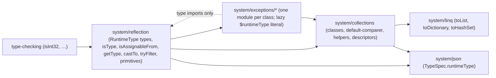

# Data Model: BCL collections as runtime types, runtime type descriptors

No persistent data. The entities are the C# inputs the core reads, the IR it builds, and the runtime shapes the TypeScript target emits.

## 1. C# inputs

| Source | Read | Notes |
|---|---|---|
| BCL collection symbols (`RoslynTypeQueries.IsCollectionLike` / `IsDictionaryLike` / `IsSetLike`, `Queue`, `Stack`, `ImmutableList`, `ImmutableArray`, `ReadOnlyCollection`, the interfaces) | symbol identity + type arguments + variance of the interface's type parameters | Replaced by one `CollectionKindResolver` that returns `(IrCollectionKind, args, variance)`; string-prefix tests go away. |
| `Metano.Interop.JsArray<T>` | symbol identity | TS-only (MS0051 elsewhere). |
| `Metano.Interop.Js.Code` / `Code<T>` | the `code` argument syntax (literal, const, interpolated string), the type argument | FR-031; holes are `InterpolationSyntax` expressions; a hole position inside a JS string literal of the text is detected by a small lexer over the literal parts (MS0056). |
| `Metano.Interop.InteropExtensions.UnsafeCast<T>` / `AsDynamic` | the receiver, the type argument | FR-035 / FR-036. |
| `IDynamicTypeSymbol`, `IDynamic*Operation`, `IConversionOperation` from `dynamic` | operation kind, member name, arguments, whether the conversion is explicit | FR-030: implicit conversions emit nothing; explicit casts go through FR-026. |
| `IsPatternExpression`, `BinaryExpression(Is/As)`, `CastExpression` (explicit reference / unboxing / `dynamic` conversions), switch arms and labels, overload parameters, `catch` clauses (+ `CatchFilterClauseSyntax`), `GetType()` invocations, `TypeOfExpression`, `ObjectCreation` of `T` | the tested / target type, the tested expression's static type, the receiver's static type for `GetType()` | The *runtime questions* that drive reachability (FR-027) and reification (FR-024). |
| Collection constructions (`ObjectCreation`, collection initializers in both forms, collection expressions, LINQ terminals) | the collection kind and whether a runtime question about that kind exists | FR-008: `$typeArguments$<Class>` passed only then. |
| `[PlainObject]` types assignable to a tested static type | shape (required members with coarse kinds; 009 FR-019); derived plain objects of a receiver type | MS0047; the `GetType()` constant fold condition (FR-020). |
| `[StrictUnionGuard]` bases and their variants (`TypeGuardBuilder.TryFindDiscriminatedVariants`) | variant guard names | a `variants` thunk table local to the base's guard function (FR-029). |
| `[Ignore(TargetLanguage)]` | per-target ignore | MS0051 suppression. |

## 2. Core IR (`Metano.Compiler`, target-agnostic)

```mermaid
classDiagram
    class IrCollectionTypeRef {
        IrCollectionKind Kind
        IReadOnlyList~IrTypeRef~ TypeArguments
        IReadOnlyList~IrVariance~ Variance
    }
    class IrCollectionKind {
        <<enumeration>>
        List
        IList
        IReadOnlyList
        ICollection
        IReadOnlyCollection
        Dictionary
        IDictionary
        IReadOnlyDictionary
        HashSet
        ISet
        IReadOnlySet
        Queue
        Stack
        ImmutableList
        ReadOnlyList
        KeyCollection
        ValueCollection
    }
    class IrArrayTypeRef {
        IrTypeRef ElementType
        bool IsJsArray
    }
    class IrDynamicTypeRef
    class IrRuntimeTypeTest {
        <<abstract>>
        +Of(IrTypeRef, IrTypeRef staticType) IrRuntimeTypeTest
    }
    class Instanceof
    class Interface { IrNamedTypeRef Descriptor; IReadOnlyList~IrNamedTypeRef~ ConsumerImplementers }
    class Structural { string GuardName }
    class Typeof { IrPrimitive Primitive; bool Validating }
    class ArrayTuple { int Arity }
    class Array
    class Collection { IrCollectionKind Kind; IReadOnlyList~IrTypeRef~ TypeArguments; IReadOnlyList~IrVariance~ Variance }
    class Reified { string TypeParameter }
    class Iterable
    class Null
    class Object
    class Union { IReadOnlyList~IrTypeRef~ Cases }
    class Constant { bool Result }
    class None
    IrRuntimeTypeTest <|-- Instanceof
    IrRuntimeTypeTest <|-- Interface
    IrRuntimeTypeTest <|-- Structural
    IrRuntimeTypeTest <|-- Typeof
    IrRuntimeTypeTest <|-- ArrayTuple
    IrRuntimeTypeTest <|-- Array
    IrRuntimeTypeTest <|-- Collection
    IrRuntimeTypeTest <|-- Reified
    IrRuntimeTypeTest <|-- Iterable
    IrRuntimeTypeTest <|-- Null
    IrRuntimeTypeTest <|-- Object
    IrRuntimeTypeTest <|-- Union
    IrRuntimeTypeTest <|-- Constant
    IrRuntimeTypeTest <|-- None
    class IrReifiedTypeParameter {
        string Name
        string HiddenParameterName
        int Position
        bool HasDefault
    }
    class IrMethodSignature {
        IReadOnlyList~IrReifiedTypeParameter~ ReifiedTypeParameters
    }
    class IrClassDeclaration {
        IReadOnlyList~IrReifiedTypeParameter~ ReifiedTypeParameters
        string? TypeArgumentSlot
        IReadOnlyList~IrTypeRef~ BaseTypeArguments
        IrRuntimeTypeDescriptor? Descriptor
    }
    class IrRuntimeTypeDescriptor {
        string Name
        string FullName
        string Namespace
        IrTypeRef? Base
        IReadOnlyList~IrTypeRef~ Interfaces
        IReadOnlyList~IrTypeRef~ PlainImplementers
        bool IsAbstract
        bool IsValueType
        bool HasParameterlessCtor
    }
    class IrCatchClause {
        IrTypeRef? ExceptionType
        string? VariableName
        IrExpression? Filter
        IReadOnlyList~IrStatement~ Body
    }
    class IrTypeTestExpression { IrExpression Value; IrRuntimeTypeTest Test; IrTypeRef Target }
    class IrAsExpression { IrExpression Value; IrRuntimeTypeTest Test; IrTypeRef Target }
    class IrCheckedCastExpression { IrExpression Value; IrRuntimeTypeTest Test; IrTypeRef Target; bool Unchecked }
    class IrGetTypeExpression { IrExpression Receiver; IrTypeRef? ConstantType }
    class IrTypeOfExpression { IrTypeRef Type }
    class IrIndexerUpdateExpression { IrExpression Receiver; IrExpression Index; IrLambda Update; bool ReturnsOld }
    class IrInlineCodeExpression { IReadOnlyList~IrInlineCodePart~ Parts; IrTypeRef ResultType; TargetLanguage Target; bool IsStatement }
    class IrUnsafeCastExpression { IrExpression Value; IrTypeRef Target }
    class IrAsDynamicExpression { IrExpression Value }
    class IrDynamicMemberAccess { IrExpression Receiver; string Name }
    class IrDynamicInvocation { IrExpression Target; IReadOnlyList~IrExpression~ Arguments }
    class IrDynamicIndexerAccess { IrExpression Receiver; IReadOnlyList~IrExpression~ Arguments }
    class RuntimeTypeReachability {
        +Compute(IrCompilation) ReachabilityResult
    }
    class ReachabilityResult {
        IReadOnlySet~IrTypeRef~ ReachedTypes
        IReadOnlySet~IrCollectionKind~ QuestionedCollectionKinds
    }
```

Notes:

- `IrRuntimeTypeTest.Of(type, staticType)` gains the static type of the tested expression so that `Typeof.Validating` and `Constant` can be decided in one place (FR-022). Every existing caller passes `staticType: null` and gets today's behaviour plus the new categories; `ArrayTuple` is kept unchanged.
- `IrReifiedTypeParameter.Position` is the index in the emitted parameter list after the trailing rule of OD-7; `HasDefault` is `true` when a preceding parameter is optional. A generic class's `ReifiedTypeParameters` describe its hidden constructor parameter and `TypeArgumentSlot` names the per-declaring-class slot it defines (`$typeArguments$Box`), `null` for a class that defines none; `BaseTypeArguments` are the descriptors a derived class passes to `super` (FR-024). The variant guards of a `[StrictUnionGuard]` base are data of the guard emitter, not of the descriptor.
- `IrRuntimeTypeDescriptor` is attached to a declaration only when `RuntimeTypeReachability` reaches it (FR-027); exception classes always carry one. The Dart target ignores it.
- `ReachabilityResult.QuestionedCollectionKinds` drives FR-008: a collection construction passes `$typeArguments$<Class>` only when its kind is in the set.
- `IrIndexerUpdateExpression` is the evaluate-once node for `list[i] op= v`, `list[i]++`, `dict[k] ??= v` (FR-010); it renders as `update` / `updateReturningOld`.
- `IrInlineCodePart` is `Text(string)` or `Hole(IrExpression)`.
- The existing `IrIsPatternExpression` + `IrTypePattern` keep working; `IrTypeTestExpression` is the node the extractor produces for `x is T` without a designator so the target can render helpers without a pattern walk. Both carry the classification so no target recomputes it.
- `IrCatchClause.Filter` is new (today's `ExtractCatch` never reads `CatchFilterClauseSyntax`). The try statement keeps its clause list; **each target** renders the single-catch chain from it (FR-015), so the core holds the data and no target recomputes the arm order.

## 3. TypeScript target

| Component | Role |
|---|---|
| `Bridge/IrToTsCollectionBridge` | `IrCollectionTypeRef` → runtime class / interface type refs; factories for `new` / both initializer forms / collection expressions; `adopt(…, { fixedSize: true })` at array→interface conversions (FR-003); `$typeArguments$<Class>` only for questioned kinds (FR-008); `IrIndexerUpdateExpression` → `update` / `updateReturningOld`. |
| `Transformation/RuntimeTypeEmitter` | `IrRuntimeTypeDescriptor` → the lazy `static get $runtimeType()` returning a data literal + module-level `let X$rt` on classes; an exported data literal `X$runtimeType` for interfaces, plain objects, enums, unions (FR-018–FR-020, FR-029, FR-044). No factory call is emitted. |
| `Bridge/IrToTsRuntimeTestBridge` | renders every `IrRuntimeTypeTest` category (replaces `BuildTypeTest`; `IrTypeCheckBuilder.Generate` delegates to it, FR-021); `withImplementers` at cross-package interface tests (FR-019). |
| `Bridge/IrToTsCatchChainBridge` + `TypeScript/AST/TsTryStatement` | FR-015: a real AST node printed by `Printer`, replacing `MapTry`'s string rendering. |
| `Bridge/IrToTsInlineCodeBridge` | FR-031 / FR-032. |
| `Analysis/IrRuntimeRequirementScanner` | imports for `isType`, `asType`, `castTo`, `getType`, `tryFilter`, `withImplementers`, `fromEnd`, `isIterable`, `asArray`, `toException`, descriptors, factories, collection classes and per-class exception modules; nothing for an unreached type. |
| `Transformation/TypeGuardBuilder` | plain-object guard synthesis shared with 009 / 010; `[StrictUnionGuard]` dispatch through a `variants` thunk table emitted next to `isBase` instead of `getUnionGuard` (FR-029). |
| `JsonSerializerContextTransformer` | `runtimeType` thunk on specs; `list` / `dictionary` / … descriptor kinds (FR-028). |
| `Transformation/EnumTransformer` (existing enum path) | `export const E = {…} as const` + the closed-union alias, or `type E = number` for `[Flags]` (FR-044). |
| `PackageJsonWriter` | `sideEffects: ["./dist/<entry>.js", …]` from the `[ModuleEntryPoint]` modules (FR-045, #368). |

## 4. Runtime shapes

See [contracts/runtime-collections.md](./contracts/runtime-collections.md) and [contracts/runtime-types.md](./contracts/runtime-types.md). Modules and their dependency direction (acyclic; `reflection` never imports `collections`):

Before the literal fix there was a value-level cycle `reflection → exceptions` (`castTo` / `getType` throw `InvalidCastException` / `NullReferenceException`) and `exceptions → reflection` (`classType` inside the getters). With FR-018's literal getters, `exceptions` imports only **types** from `reflection` (erased at build), so the value graph is acyclic: `reflection` imports the two exception modules it throws, and nothing imports `reflection` from `exceptions`. A program that throws but never tests pays for the one exception module alone (**budget** ≤ 0.5 KB gz, NFR-008; the critic's probe measured 0.35 KB for the literal shape, research R13).

## 5. Dart target

`IrCollectionTypeRef` → `List` / `Map` / `Set` / `Queue`; `IrDynamicTypeRef` → `dynamic`; `IrRuntimeTypeTest` → native `is`; the catch clause list → one `catch (e$)` with an `is` chain and `when` filters inside (FR-015, FR-038); `IrIndexerUpdateExpression` → `list[i] = f(list[i])` with a temp for the index; `IrUnsafeCastExpression` → `as T`; `IrAsDynamicExpression` → `as dynamic`; `IrInlineCodeExpression` with `Target = TypeScript` → MS0051; descriptors and reified parameters ignored. Each node's Dart mapping lands in the same PR as the node (FR-038).
