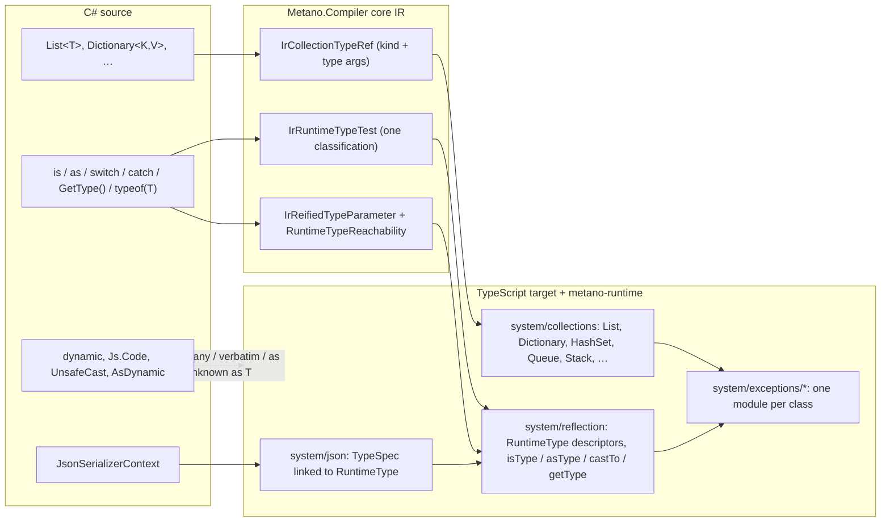

# Feature Specification: BCL collections as runtime types, runtime type descriptors

**Feature Branch**: `spec/011-runtime-collections-and-types`

**Created**: 2026-11-01

**Status**: Draft (spec change request; revised after the first critic pass)

**Input**: GitHub issue [danfma/metano#335](https://github.com/danfma/metano/issues/335), "Introduce runtime collection types and runtime type descriptors", the maintainer brief and its three amendments (`dynamic` is supported; a per-target inline-code function; the `UnsafeCast<T>()` / `AsDynamic()` escape hatches), and the two critic reviews of PR #349, which made **tree-shaking of the runtime and of generated code mandatory** and measured which emission shapes bundlers keep (research R13). The findings that ground every requirement are in [research.md](./research.md) (R1–R14).

**Traceability**: a 3.0.0 breaking change. It extends these legacy requirement families of the baseline: types and collections (`FR-015`–`FR-018`), semantic transformation and pattern matching (`FR-005`–`FR-014`, especially `FR-013` and `FR-014`), serialization (`FR-032`–`FR-034`) and diagnostics (`FR-038`–`FR-040`). It adds rows to the baseline [feature-support matrix](../001-project-baseline-evolution/baseline/feature-support-matrix.md) and reserves `MS0045`–`MS0056` in the [diagnostic catalog](../001-project-baseline-evolution/baseline/diagnostic-catalog.md) (`MS0044` belongs to #334 / PR #355). As in features 002–010, FR identifiers are local to this feature and are cited as "011 FR-0NN".

**Related specs**: [009-polymorphic-json](../009-polymorphic-json/spec.md) and [010-csharp-unions](../010-csharp-unions/spec.md) consume the runtime tests and descriptors defined here. Neither is edited by this PR; the requirements of theirs that change are listed in [Interaction with specs 009 and 010](#interaction-with-specs-009-and-010). The existing non-shakable namespace emissions (branded companions, nested types, runtime `UUID`, `ImmutableCollection`) are tracked by [#361](https://github.com/danfma/metano/issues/361), which is part of the 3.0.0 release gate (FR-040); the flat `sideEffects: false` that `PackageJsonWriter` writes today is the bug [#368](https://github.com/danfma/metano/issues/368), fixed by FR-045.

## Overview

Metano maps `List<T>` to a native JS array and `Dictionary<K,V>` to a native `Map`, and lowers every collection member through templates that encode Array semantics (`Count` → `length`, `RemoveAt` → `splice`, `Clear` → `length = 0`; research R1). Only `HashSet<T>` is a runtime class. Three consequences follow:

1. **No C# exceptions.** `list[10]` on a three-element list is `undefined`, a dictionary indexer miss is `undefined`, `Stack.Pop()` on an empty stack is `undefined`.
2. **No runtime identity.** `is List<T>`, `is IList<T>`, `is IEnumerable<T>`, `is T` for an open `T`, `typeof(T)`, `GetType()` and typed `catch` either report MS0001 or silently do the wrong thing (`catch (InvalidOperationException e)` catches everything; research R3).
3. **IIFEs.** Where a collection step is a template rather than a method, null-conditional chains and evaluate-once sites render as immediately-invoked functions (research R2).

This feature makes the BCL collections real `metano-runtime` classes that implement `Iterable<T>`, introduces `JsArray<T>` for the native array, makes BCL exceptions real runtime classes, replaces IIFEs with runtime helpers, and adds **runtime type descriptors** (`RuntimeType`) consumed by `is` / `as` / patterns, typed `catch`, `GetType()`, `typeof(T)` and the JSON context. Every emission shape is chosen so that **what is not used bundles to zero bytes** (D17, research R13). Three interop features complete it: `dynamic` as TS `any`, a per-target inline-code function (`Js.Code`), and the `UnsafeCast<T>()` / `AsDynamic()` escape hatches.



## Maintainer decisions (normative)

- **D1 — Own runtime collections.** `List<T>`, `Dictionary<K,V>`, `HashSet<T>`, `Queue<T>`, `Stack<T>`, the read-only views and the immutable collections mapped today become `metano-runtime` classes. They are **not** `Array` subclasses and **not** array copies. They implement `Iterable<T>`, so `for..of`, spread and `Array.from` work (FR-001, FR-002).
- **D2 — `JsArray<T>`.** A dedicated C# type maps to the native JS `Array` (FR-004). `T[]` keeps mapping to the native array.
- **D3 — `List<T>` ↔ `JsArray<T>` conversion** is explicit (OD-1; FR-005).
- **D4 — Runtime helpers, never IIFEs.** Where semantics need evaluate-once, bounds checks or a C# exception, the emitted code calls a runtime helper or a method of the runtime class. No IIFE and no composite expression at the call site (FR-009, FR-010).
- **D5 — Classes test nominally** with `instanceof`. The descriptor is a lazily memoized, string-keyed static getter on the constructor that returns a pure data literal (no runtime import), so `GetType()` returns the concrete derived type; objects created without `new` lose identity and fall back (FR-018).
- **D6 — Interfaces implemented by classes** test nominally: the class descriptor lists its interfaces (FR-019).
- **D7 — `[PlainObject]`** is a shape: `is` / `as` / `switch` become a structural guard with an overlap warning; `GetType()` on a known static plain-object type is a compile-time constant; `GetType()` on an `object` that may hold one warns and answers `object`; no `$type` field is injected (FR-020).
- **D8 — Generics.** Only runtime collections carry type-argument descriptors, and only when the compilation asks a runtime question about that collection kind; native arrays and `JsArray` erase; closed generic types get a memoized specialized descriptor; an open `T` used at runtime inside a generic body gets a hidden descriptor parameter, added only when the body needs it (FR-008, FR-023, FR-024).
- **D9 — Primitives.** `int` versus `double` is decided from the static type where possible, otherwise with an `Int32` guard; the limit is documented (FR-022).
- **D10 — Typed catch** is one JS `catch` with an `instanceof` chain over real runtime exception classes, in TS and in Dart (FR-013 to FR-016).
- **D11 — `dynamic` is supported**, without type guarantees, as in TS: it maps to `any` (Dart: `dynamic`), operations on it pass straight through, and an implicit conversion from `dynamic` emits nothing (FR-030).
- **D12 — Inline target code.** A per-target function, `Js.Code("…")` / `Js.Code<T>("…")`, emits a compile-time-constant string verbatim (FR-031 to FR-034). Dart gets its own equivalent later.
- **D13 — Escape hatches.** `x.UnsafeCast<T>()` is a compile-time-only reinterpretation and `x.AsDynamic()` turns any value into `dynamic`; the explicit C# cast `(T)x` and `as T` stay **checked** whenever descriptors can answer (FR-035, FR-036).
- **D14 — Zero cost.** Descriptors, descriptor imports and type-argument tuples are emitted only for types reached by a runtime question (`is` / `as` / patterns / explicit downcasts / `catch` / serialization / `GetType()` / `typeof`), and a type that is not reached contributes nothing to the bundle (FR-027, NFR-002).
- **D15 — Deepkit lessons.** Borrow the typed-object-literal descriptor, thunks, emit-only-what-is-used and closure-composed serializers; do not copy the transformer, the bytecode VM, the `new Function` JIT or the structural `is<T>` (research R10, NFR-003).
- **D16 — One 3.0.0.** Everything ships in one major together with #328 (the `Metano.Build` split), spec 010 (unions) and spec 009 (polymorphic JSON), with migration notes (FR-040).
- **D17 — Tree-shaking is mandatory.** Neither the runtime nor generated code may contain a module-scope side effect (a `[ModuleEntryPoint]` module is the one exception, and it is declared in `sideEffects`, FR-045), a merged `namespace` with members, an `export enum`, a registry, a computed-symbol class key, an eager descriptor or a descriptor that imports the runtime; `sideEffects` must be truthful; unused means 0 bytes; the per-symbol budgets of NFR-008 are a CI gate (FR-043 to FR-045, NFR-006 to NFR-010; research R13). The pre-existing namespace emissions (#361) are part of the 3.0.0 release gate and are allowlisted, shrinking, until they land (FR-043).
- **D18 — `EqualityComparer<T>.Default` semantics.** Collections key and search with `defaultEquals` / `defaultHashCode` (user `equals()` / `hashCode()` when present, reference identity otherwise, SameValueZero for `NaN`), never with the structural `equals` of `system/equality` (research R14; FR-006).

## User Scenarios & Testing *(mandatory)*

### User Story 1 - Collections behave like .NET collections (Priority: P1)

A developer writes ordinary C# over `List<T>`, `Dictionary<K,V>`, `Queue<T>` and `Stack<T>`. The generated TypeScript uses `metano-runtime` classes whose members mirror the BCL: out-of-range access throws `ArgumentOutOfRangeException`, a missing key throws `KeyNotFoundException`, `Contains` on a record list uses the record's `equals`, and `foreach` / spread / LINQ keep working because every collection is an `Iterable<T>`.

**Why this priority**: every other story builds on the collection classes, and this is the breaking change that defines 3.0.0.

**Independent Test**: transpile `samples/SampleTodo` and run `targets/js/sample-todo` tests: `TodoList.Items` is a `List<TodoItem>`, `items.get(99)` throws `ArgumentOutOfRangeException`, and `[...items]` yields the elements.

**Acceptance Scenarios**:

1. **Given** `var xs = new List<int> { 1, 2 }; xs.Add(3);`, **When** transpiled, **Then** the output is `const xs = List.of([1, 2]); xs.add(3);` and `xs.count` is `3` at runtime. No IIFE is emitted, and no reflection import appears (the compilation asks no runtime question about `List`).
2. **Given** `xs[5]` on a three-element list, **When** run, **Then** `ArgumentOutOfRangeException` is thrown with .NET's message (`Index was out of range. Must be non-negative and less than the size of the collection. (Parameter 'index')`).
3. **Given** `dict["missing"]`, **When** run, **Then** `KeyNotFoundException` is thrown with .NET's message (`The given key 'missing' was not present in the dictionary.`); `dict.TryGetValue(k, out v)` keeps today's tuple lowering.
4. **Given** `Dictionary<Point, string>` with a record key, **When** two keys that are `equals()` are used, **Then** they address the same entry; two distinct instances of a class without `equals()` are two keys (reference identity, as `EqualityComparer<T>.Default`), which neither today's native `Map` (reference only) nor `system/equality.equals` (structural) gives.
5. **Given** `queue.Dequeue()` or `stack.Pop()` on an empty collection, **When** run, **Then** `InvalidOperationException` (`Queue empty.` / `Stack empty.`) is thrown. `foreach` over a `Stack<T>` enumerates top-first.
6. **Given** `foreach (var x in list)`, `[..list]`, `list.Select(...)` and `Array.from(list)` in hand-written TS, **When** run, **Then** all enumerate the list; `Array.isArray(list)` is `false`, `list instanceof List` is `true`, and `JSON.stringify(list)` yields the element array (`toJSON`).
7. **Given** `int[] a = …; IReadOnlyList<int> r = a;`, **When** transpiled, **Then** the conversion emits `List.adopt(a, { fixedSize: true })` (zero copy, shared storage) so `r.count` and `r.get(0)` work; `((IList<int>)a).Add(1)` throws `NotSupportedException` as in .NET; `(int[])r` and `r is int[]` unwrap the adopted array.
8. **Given** `HashSet<T>.Add(x)`, **When** transpiled, **Then** the call returns a `boolean` as in C# (today's runtime returns `this`), and `set.count` replaces `set.size`.
9. **Given** `dict[k] += 1`, `list[i]++`, `dict[k] ??= v` and `(list[i], list[j]) = (list[j], list[i])`, **When** transpiled, **Then** the output is `dict.update(k, (v) => v + 1)`, `list.update(i, (v) => v + 1)`, `dict.update(k, (v) => v ?? value)` and the existing tuple-temporary lowering over `get` / `set`; no IIFE and no double evaluation of `k` / `i`.

### User Story 2 - Runtime helpers replace IIFEs (Priority: P1)

A developer writes `order?.Items.Clear()`, `GetNext().Items[^1]` or `x as Order` with a side-effecting operand. The output calls a method or a runtime helper that evaluates its receiver once and throws the C# exception; it never contains an immediately-invoked function or a composite expression such as `$this.length = 0`.

**Independent Test**: the goldens `null-conditional-guards.ts` and `index-and-range.ts` contain no `(() =>` or `(($` sequence after regeneration.

**Acceptance Scenarios**:

1. **Given** `order?.Items.Clear()`, **When** transpiled, **Then** the output is `order?.items.clear();`, a native optional chain, because `clear` is a method of the runtime class; no `$receiver` block and no IIFE is emitted. `order?.Items.Remove(x)` in expression position is `order?.items.remove(x) ?? null` under the existing null-conditional typing.
2. **Given** `GetNext().Items[^1]`, **When** transpiled, **Then** the output is `getNext().items.fromEnd(1)`, which evaluates `getNext()` once and throws `ArgumentOutOfRangeException` when the list is empty.
3. **Given** `arr[^1]` on a `T[]` or `JsArray<T>`, **When** transpiled, **Then** the output is `fromEnd(arr, 1)` (a runtime helper that throws `IndexOutOfRangeException` on an empty array).
4. **Given** `Compute() as Order`, **When** transpiled, **Then** the output is `asType(compute(), Order.$runtimeType)` (one evaluation; `null` when the test fails), never `((v) => v instanceof Order ? v : null)(compute())`.
5. **Given** `new List<int>(capacity: Next())`, **When** transpiled, **Then** the output is `List.withCapacity<number>(next())` (the argument is evaluated once), never the `BindSideEffectsInSourceOrder` IIFE.
6. **Given** `stack.Peek()` where `stack` is `GetStack()`, **When** transpiled, **Then** `getStack()` appears once in the output.

### User Story 3 - Runtime type questions are answered nominally (Priority: P1)

A library has an abstract factory `Shape Create(string kind)` that returns `Circle` or `Square`. A caller writes `shape.GetType().Name`, `shape is IHasArea`, `shape switch { Circle c => …, Square s => … }` and `catch (InvalidOperationException e)`. The output answers each one the way C# does, through descriptors attached to the constructors, and types that no code asks about carry no descriptor.

**Independent Test**: a golden `runtime-types-factory.ts` plus a bun test that asserts `getType(create("circle")) === Circle.$runtimeType`, `getType(create("circle")).name === "Circle"`, `isType(shape, IHasArea$runtimeType)`, and that `Blob`, an unrelated class in the same sample that nothing tests, has no `$runtimeType` getter and that a bundle of the sample's entry point does not contain `"Blob"`.

**Acceptance Scenarios**:

1. **Given** `shape.GetType()` where `shape` is `Circle` at runtime, **When** run, **Then** the result is the `Circle` descriptor (`name: "Circle"`, `fullName: "Geometry.Circle"`), not `Shape`'s, and `shape.GetType() == typeof(Circle)` is `true` (descriptor identity).
2. **Given** `o is IHasArea` where `o` is a `Circle` instance whose class declares `IHasArea`, **When** run, **Then** the result is `true`; for an unrelated class instance with a structurally identical `area` member it is `false` (nominal).
3. **Given** `o is IHasArea` where `o` is a plain object (no constructor descriptor) and a `[PlainObject]` type in the compilation implements `IHasArea`, **When** run, **Then** the structural guard of that plain-object type answers (OD-8); with no such type the result is `false`.
4. **Given** `catch (ArgumentNullException e) { … } catch (ArgumentException e) when (e.Message.Length > 3) { … } catch (Exception e) { … }`, **When** transpiled, **Then** one JS `catch (e$)` is emitted with `if (e$ instanceof ArgumentNullException) … else if (e$ instanceof ArgumentException && tryFilter(() => e$.message.length > 3)) … else { const e = toException(e$); … }`; a non-matching throwable is rethrown when no catch-all exists.
5. **Given** `catch (Exception e) when (IsTransient(e)) { … } catch (FormatException e) { … }`, **When** transpiled, **Then** the first arm binds `const e = toException(e$)` before its filter and is **not** a catch-all: the chain continues to the `FormatException` arm and ends with `else throw e$`.
6. **Given** `throw new InvalidOperationException("x")`, **When** transpiled, **Then** the output is `throw new InvalidOperationException("x")` with a value import from `metano-runtime/system/exceptions/invalid-operation-exception`; `e instanceof Error` stays `true`; the `catch` of scenario 4 needs no descriptor and no reflection import, and a bundle that throws one exception contains no `system/reflection` code (the getter returns a literal, FR-018).
7. **Given** a class `Blob` that no `is` / `as` / pattern / downcast / `catch` / serialization / `GetType()` / `typeof` reaches, **When** transpiled, **Then** its output is byte-identical to 2.x except for collection-member changes, and a bundle that does not import it contains no byte of it (NFR-002, NFR-009).
8. **Given** `JSON.parse(text) as Circle` written by hand in TS, or `{ ...circle }`, **When** `getType(value)` runs, **Then** the result is the `Object` descriptor (identity is lost; documented), while `copyRecordWith(circle, { r: 2 })` (Metano's `with`) keeps `Circle`.

### User Story 4 - Generic code can ask about `T` (Priority: P2)

A developer writes `T Parse<T>(string s)` with `if (typeof(T) == typeof(int))`, or `bool IsA<T>(object o) => o is T`, or `new T()` under `where T : new()`. The method gains one hidden trailing parameter that carries `T`'s descriptor, call sites pass the closed descriptor, and methods whose bodies never ask about `T` keep their signature.

**Independent Test**: a golden `reified-type-parameters.ts` plus a bun test that calls `isA<number>(5, Int32Type)` and `isA(new Circle(), Circle.$runtimeType)`.

**Acceptance Scenarios**:

1. **Given** `bool IsA<T>(object o) => o is T;` and a call `IsA<Circle>(x)`, **When** transpiled, **Then** the output is `export function isA<T>(o: unknown, T$type: RuntimeType<T>): boolean { return isType(o, T$type); }` and the call is `isA(x, Circle.$runtimeType)`.
2. **Given** `T First<T>(IEnumerable<T> xs)` whose body never names `T` at runtime, **When** transpiled, **Then** its signature is unchanged (no hidden parameter).
3. **Given** `IsA<int>(o)`, `IsA<List<string>>(o)` and `IsA<U>(o)` from inside another reified method, **When** transpiled, **Then** the arguments are `Int32Type`, `listType(StringType)` (memoized, so two call sites share one descriptor object) and `U$type`.
4. **Given** an interface method `void Visit<T>(T x)` whose implementation in one class uses `is T`, **When** transpiled, **Then** the interface member, every implementation and every call site carry the hidden parameter (implementation-group propagation); a sibling **overload** `Visit(int x)` is untouched.
5. **Given** a generic method with `is T` whose group is converted to a delegate (`Func<object, bool> f = IsA<Circle>`), **When** transpiled, **Then** the conversion emits `(o) => isA(o, Circle.$runtimeType)`.
6. **Given** `class Box<T> { public bool Holds(object o) => o is T; public static bool Accepts(object o) => o is T; }`, `class IntBox : Box<int>` and `class Pair<U> : Box<List<U>>`, **When** transpiled, **Then** `Box`'s constructor gains a trailing hidden parameter stored in the non-enumerable per-class slot `$typeArguments$Box`, `Accepts` gains its own hidden parameter (a static cannot read the slot), `new Box<int>()` passes `[Int32Type]`, `IntBox` passes `[Int32Type]` to `super` and defines no slot of its own, `Pair<U>` passes `[listType($typeArgs[0])]` to `super` and defines its own slot `$typeArguments$Pair` (each slot is defined exactly once, by its declaring class, so no `defineProperty` runs twice), `box.GetType()` returns the memoized `Box<int>` descriptor specialized from the most-derived slot, and `box with { … }` keeps every slot.
7. **Given** `is T` inside an `[Emit]`-mapped extern, inside an `[External]` interface member, inside a `[JsCallable]` delegate's body, or in an implementation group whose interface member comes from a referenced package without the parameter, **When** transpiled, **Then** `MS0054` (error) names the position that cannot carry a hidden parameter.
8. **Given** a hidden parameter added to a public member of an `[EmitPackage]` library or an `[ExportedAsModule]` function, **When** transpiled, **Then** `MS0050` (warning) states that JS callers must pass the descriptor, once per member.
9. **Given** `default(T)` in a body where `T` is not otherwise reified, **When** transpiled, **Then** the output is today's `null` with #291's existing diagnostic; where `T` is reified for another reason the output is `T$type.default()`, which is a zeroed instance for a struct `T`.

### User Story 5 - Plain objects are shapes (Priority: P2)

A developer tests `o is UserDto` where `UserDto` is `[PlainObject]`. The output calls the synthesized structural guard, and the build warns when another reachable `[PlainObject]` has a compatible shape, mirroring MS0039 for unions. `GetType()` is a constant where the static type is known and no derived plain object exists.

**Acceptance Scenarios**:

1. **Given** `o is UserDto u`, **When** transpiled, **Then** the output is `isUserDto(o)` with the binding, and `isUserDto` is synthesized in `UserDto`'s file whether or not `[GenerateGuard]` is present (as 009 FR-019 and 010 FR-041 do).
2. **Given** `[PlainObject] record A(string Name)` and `[PlainObject] record B(string Name, int Age)` both reachable from the tested expression's static type, **When** `o is A` is transpiled, **Then** `MS0047` (warning) names `A` and `B` and the shared members; the output is emitted.
3. **Given** `UserDto dto = …; dto.GetType()` where no `[PlainObject]` derives from `UserDto`, **When** transpiled, **Then** the output is the constant `UserDto$runtimeType` (no runtime call); with a derived plain object the call is `getType(dto)` plus `MS0048`.
4. **Given** `object o = …; o.GetType()` where a `[PlainObject]` in the compilation is assignable to `object`, **When** transpiled, **Then** `MS0048` (warning) is reported once per call site, and at runtime a plain object answers the `Object` descriptor.
5. **Given** a `[PlainObject]` DTO serialized through the JSON context, **When** written, **Then** no `$type` or other identity field is added; `[JsonPolymorphic]` remains the only discriminator (009).

### User Story 6 - `dynamic`, inline code and escape hatches (Priority: P2)

A developer manipulates raw JS data: `dynamic cfg = Js.Code("globalThis.__config"); string name = cfg.appName; var el = Js.Code<HtmlElement>($"document.querySelector({selector})"); var dto = raw.UnsafeCast<UserDto>(); var any = order.AsDynamic(); any.extra = 1;`. Each construct erases to idiomatic TS and none needs a facade declaration.

**Acceptance Scenarios**:

1. **Given** `dynamic d = …; d.foo.bar(1)[2] + d.n`, **When** transpiled, **Then** the output is `d.foo.bar(1)[2] + d.n` with `d: any`; member names are emitted verbatim (OD-11).
2. **Given** `string s = d;`, `F(d)` for `void F(string s)`, `return d;` from a `string`-returning method, `if (d)`, `$"{d}"` and `foreach (string x in d)`, **When** transpiled, **Then** each implicit conversion from `dynamic` emits nothing: no check, no helper, no diagnostic (D11; the value is whatever JS holds).
3. **Given** `(int)d`, `(Circle)d` and `(IHasArea)d`, **When** transpiled, **Then** the explicit casts are checked: `(int)d` applies the static explicit numeric conversion Metano already emits for `(int)someDouble` (`Math.trunc` with the overflow rule of that lowering), `(Circle)d` is `castTo(d, Circle.$runtimeType)` and `(IHasArea)d` is `castTo(d, IHasArea$runtimeType)`, each throwing `InvalidCastException` on mismatch. (.NET throws `RuntimeBinderException` for a failed dynamic cast; the message differs and is documented.)
4. **Given** `d is Circle c`, `d as IHasArea`, `d switch { int n => … }`, **When** transpiled, **Then** the descriptor-based tests of US3 apply unchanged.
5. **Given** `new List<int> { d }` where `d` is the receiver, a `dynamic` argument to a `ref` / `out` parameter, or `(Money)d` where `Money` declares a user-defined conversion, **When** transpiled, **Then** `MS0053` (error) names the construct.
6. **Given** `Js.Code("performance.now()")`, **When** transpiled, **Then** the output is `(performance.now())` typed `any`; `Js.Code<double>("performance.now()")` is `(performance.now()) as number`.
7. **Given** `Js.Code($"{el}.scrollIntoView({{ block: {mode} }})")` where `el` and `mode` are C# locals, **When** transpiled, **Then** the holes are the transpiled expressions (`el.scrollIntoView({ block: mode })`), the literal parts are verbatim, and an `[Import]` facade referenced in a hole pulls its import (OD-13).
8. **Given** `Js.Code(someVariable)` (not a constant), **When** transpiled, **Then** `MS0052` (error); a hole placed inside a JS string literal in the text (`"'{name}'"`) gets `MS0056` (warning).
9. **Given** `Js.Code(...)` or a `JsArray<T>` reference in a project compiled for Dart, **When** transpiled, **Then** `MS0051` (error), unless the containing member carries `[Ignore(TargetLanguage.Dart)]`.
10. **Given** `raw.UnsafeCast<UserDto>()`, **When** transpiled, **Then** the output is `raw as unknown as UserDto` (TS) or `raw as UserDto` (Dart, which cannot be unchecked; research R7) and no diagnostic is reported.
11. **Given** `(List<string>)o` where `o` is a `JsArray<string>`-typed value or an erased generic, **When** transpiled, **Then** the cast is unchecked and `MS0055` names it, suggesting `UnsafeCast<T>()` as the warning-free spelling.
12. **Given** `order.AsDynamic().extra = 1`, **When** transpiled, **Then** the output is `(order as any).extra = 1` (TS) / `(order as dynamic).extra = 1` (Dart). **Given** `order.AsDynamic().Total`, **Then** the output reads the verbatim member `Total`, which does **not** exist on the Metano object whose emitted member is `total`; the four-way table (FR-037) states this prominently.

### User Story 7 - JSON uses the same descriptors (Priority: P2)

A context that reaches `List<Clip>`, `Dictionary<string, Clip>` and a polymorphic `Clip` deserializes `List<Clip>` into a runtime `List`, dispatches writes through the class descriptors, and keeps spec 009's wire format byte-for-byte.

**Acceptance Scenarios**:

1. **Given** a `List<Clip>` property, **When** deserialized, **Then** the result is a runtime `List<Clip>` whose elements are class instances; a `Clip[]` or `JsArray<Clip>` property yields a native array.
2. **Given** a polymorphic base reached through `TypeSpec.runtimeType`, **When** written, **Then** the variant is resolved through the value's descriptor (009 FR-005 `byCtor` stays valid: the constructor is the descriptor's owner).
3. **Given** every fixture of spec 009's conformance sample, **When** round-tripped, **Then** the bytes are unchanged (the wire format does not depend on the in-memory collection class).

### User Story 8 - Nothing unused reaches the bundle (Priority: P1)

A consumer bundles a generated package with bun, esbuild, Rollup or webpack. Every runtime module, descriptor, exception class and collection class that the entry point does not use is absent from the output, and the sizes of what is used stay inside the budgets.

**Independent Test**: `cd targets/js/metano-runtime && bun test test/tree-shaking` passes: every entry of `size-budgets.json` is within `maxGzip`, contains none of its `mustNotContain` strings, and a side-effect-only import of each module bundles to 0 bytes (NFR-006–NFR-010, FR-043).

**Acceptance Scenarios**:

1. **Given** `import "metano-runtime"` and nothing else, **When** bundled with bun, esbuild and Rollup (`moduleSideEffects: true`), **Then** the output is ≤ 0.1 KB gz (today: 16 B).
2. **Given** an entry that uses only `List`, **When** bundled, **Then** the output is ≤ 2.5 KB gz and contains no `Dictionary`, `HashSet`, `Exception` subclass other than `ArgumentOutOfRangeException` / `InvalidOperationException` / `NotSupportedException`, and no `Temporal`.
3. **Given** an entry that throws one `InvalidOperationException`, **When** bundled, **Then** the output is ≤ 0.5 KB gz and contains no other exception class.
4. **Given** an entry that calls `isType(x, Circle.$runtimeType)` on a generated `Circle`, **When** bundled, **Then** the output is ≤ 1.2 KB gz for `isType` + `getType` + the one descriptor, and contains no `Square`.
5. **Given** a generated `[StrictUnionGuard]` base, **When** bundled with `sideEffects: false`, **Then** the strict dispatch still works, because variants are reached through thunks on the base descriptor, not through a registry.
6. **Given** every golden under `tests/Metano.Tests/Expected/`, **When** the TUnit side-effect scan runs, **Then** no file outside the allowlist contains a call in a top-level statement or initializer that is not immediately preceded by `/*#__PURE__*/`, an `export namespace` with runtime members, an `export enum`, or a computed class key other than `[Symbol.iterator]`; `[ModuleEntryPoint]` goldens are exempt, and the allowlist names only the #361 shapes.

### User Story 9 - Dart does not regress (Priority: P3)

**Acceptance Scenarios**:

1. **Given** the Dart samples, **When** transpiled, **Then** `List`, `Map`, `Set` are emitted as today; an `IrCollectionTypeRef` for `Queue` / `Stack` maps to `Queue` (`dart:collection`) / a documented gap (FR-038).
2. **Given** `is T` in a generic body, **When** transpiled for Dart, **Then** no hidden parameter is added (Dart reifies natively) and the output is `x is T`.
3. **Given** typed catch clauses, **When** transpiled for Dart, **Then** one `catch (e$)` with an `is` chain is emitted (not a sequence of `on T` clauses, because a `rethrow` inside `on T` skips the later clauses; FR-015).
4. **Given** `x.UnsafeCast<T>()`, `x.AsDynamic()` and `dynamic`, **When** transpiled for Dart, **Then** the outputs are `x as T`, `x as dynamic` and `dynamic`.

### Edge Cases

- **Arrays converted to list interfaces.** `IReadOnlyList<int> r = new[] { 1, 2 }` is legal C#, and arrays implement `IList<T>`. The conversion emits `List.adopt(arr, { fixedSize: true })` (shared storage, zero copy; FR-003): `add` / `insert` / `remove` / `removeAt` / `clear` throw `NotSupportedException` (`Collection was of a fixed size.`), `set` writes through. The `Array` category unwraps it: `(int[])r` and `r is int[]` use `asArray(v)`, which returns the backing array of a fixed-size adopted list. Divergences: `r is List<int>` is `true` in TS and `false` in C#; `ReferenceEquals(arr, (object)r)` is `false` in TS and `true` in C# (the wrapper is a distinct object). Both are documented.
- **Collections with an erased element descriptor.** A collection constructed where the compilation asks no runtime question about its kind, or where an argument is a non-reified `T`, carries no `$typeArguments$<Class>` slot (FR-008). An `is List<string>` test against such a list is `true` (wildcard). Deterministic, documented; the alternative (make every `new List<T>()` reify `T`) would make hidden parameters viral.
- **`JsArray<T>` and `T[]` erase.** `o is string[]` / `o is JsArray<string>` emit `asArray(o) !== null` and `MS0046` (warning); `o is object[]` is the one case without the warning, because C# arrays are covariant and `Array.isArray` is exact for it.
- **Identity loss.** A value created by `JSON.parse`, by spread `{ ...obj }`, by `Object.assign({}, obj)`, or by an external library has prototype `Object.prototype`: `instanceof` fails, `getType` answers `Object`, interface tests fall back to plain-object guards (OD-8). Metano's own `with` (`copyRecordWith`, `record-copy.ts` L26-36, `Object.create(proto)`) preserves the prototype and, after FR-024, copies every non-enumerable `$typeArguments$<Class>` slot.
- **Duplicated package copies.** Two copies of a generated package or of `metano-runtime` in one bundle (version skew, a `node_modules` duplicate) give two `List` classes and two descriptor objects: `instanceof` and descriptor identity fail across the copies, as they do for any class-based library. Documented in `docs/runtime-types.md`; the `metano-runtime` peer-dependency range is the mitigation.
- **Primitives.** `object o = 1.0; o is int` is `true` in TS (`isInt32(1)`), `false` in C#. `o is double` is `true` for a boxed `int` in TS, `false` in C#. `o is float` and `o is decimal` both pass any number. `o is char` passes any one-character string. `getType` on a `number` answers `Int32Type` when `isInt32` passes and `DoubleType` otherwise, so `GetType()` and `is int` agree; on a `string` `StringType`, on a `boolean` `BooleanType`, on a `bigint` `BigIntegerType`. Where the static type is a primitive, an enum, a struct or a sealed type, the compiler folds `is` / `as` / `GetType()` / `typeof` to a constant and reports nothing (C# itself warns CS0183/CS0184).
- **`NullReferenceException`.** The runtime class exists for user `throw` and `catch`, but a native `TypeError` thrown by JS for a null member access is **not** translated: `catch (NullReferenceException)` does not catch it. `catch (Exception e)` does, wrapping it through `toException`.
- **`catch (Exception e)` and non-Error throwables.** JS can throw any value. The catch-all arm binds `e` to `toException(e$)`: an `Exception` passes through; a `DOMException` named `AbortError` (a cancelled `fetch`) becomes `TaskCanceledException`; any other `Error` is wrapped in an `Exception` whose `message`, `stack` and `innerException` (`cause`) mirror it; any other value becomes `Exception(String(value))`. `throw;` rethrows the original `e$`, so wrapping never changes what propagates.
- **Catch filters.** A `when` filter that throws counts as `false` (C# semantics): every filter is wrapped in `tryFilter(() => …)`. Filters run **before** inner `finally` blocks in C# (the first pass of two-pass exception handling); the JS chain evaluates them inside `catch`, i.e. **after** inner `finally` blocks. This ordering difference is documented and not diagnosed.
- **Reified `T` and `params` / optional parameters.** The hidden parameter is trailing, so it goes **before** a `params` rest parameter and, when a preceding parameter is optional, is declared with a default of `UnknownType` (OD-7). Call sites that Metano generates always pass it positionally (passing `undefined` for omitted optional arguments in between, as the existing optional-argument lowering does).
- **Overloads and reified parameters.** The hidden parameter belongs to one signature. In an overload group lowered to a dispatcher, the reified overload's arity includes it and the dispatcher's arity check counts it; sibling overloads are untouched. Only override / interface-implementation groups propagate it (FR-024).
- **`GetType()` on a union** stays the spec 010 MS0043 warning: a union is erased, so the answer is the case type.
- **`typeof(T)` where `T` is a pointer, `void` or an open generic definition (`typeof(List<>)`)** reports `MS0049`; `typeof(dynamic)` is already CS1962 in C#. `typeof(List<string>)` is the memoized `listType(StringType)`.
- **`Type` API surface.** Supported: `Name`, `FullName`, `Namespace`, `IsInterface`, `IsClass`, `IsValueType`, `IsGenericType`, `GenericTypeArguments`, `IsInstanceOfType(o)`, `IsAssignableFrom(t)`, `==` / `!=` / `Equals` (identity), `ToString()` (`FullName`). Everything else (`GetMethod`, `GetProperties`, `Activator.CreateInstance`, `MakeGenericType`) reports `MS0049`. The descriptor carries no member metadata, which keeps D14's zero cost.
- **`new T()` under `where T : new()`.** Today MS0019 ("generics are erased"). With a reified `T`, `new T()` lowers to `T$type.create()` where the descriptor of a class with a public parameterless constructor carries `create`; a `T` whose descriptor cannot construct throws `MissingMethodException` at runtime, as .NET does. MS0019 is retired for reified sites and kept for sites that cannot be reified (`MS0054` names them).
- **`default(T)`.** `default(T)` is **not** a reification trigger (it would make hidden parameters viral for the most common generic idiom). Where `T` is reified for another reason, `default(T)` lowers to `T$type.default()` (`0`, `false`, `""`, `0n` for primitives; a zeroed instance `new T()` for a struct lowered to a class; `null` otherwise), which closes #291 for reified sites. Otherwise it keeps today's `null` and #291's existing behaviour.
- **`dynamic` operators.** `+`, `-`, comparison and `==` on `dynamic` operands pass through as JS operators. JS and the DLR agree on numbers and strings in the common cases and disagree on `==` with mixed types (`1 == "1"`), on `+` with `null`, and on integer division. These are documented divergences (OD-12); Metano does not emit the DLR binder. A failed dynamic conversion throws `RuntimeBinderException` on .NET and `InvalidCastException` in TS (for the explicit casts FR-030 checks).
- **`dynamic` member naming.** No symbol exists, so no `[Name]` lookup and no camelCase: `d.AppName` emits `d.AppName` (OD-11). On a Metano object reached through `AsDynamic()`, the C# member `Total` is emitted as `total`, so `x.AsDynamic().Total` is `undefined` at runtime; `docs/runtime-types.md` states this in the four-way table and the `AsDynamic()` doc comment repeats it.
- **`Js.Code` in statement position.** When the call is an expression statement, the string is emitted verbatim as statement text (it may contain several statements); in expression position it is emitted in parentheses. A `Js.Code<T>` whose result is unused is still an expression statement.
- **`Js.Code` holes.** A hole is any C# expression; it is transpiled by the normal pipeline and spliced at the hole. A hole that is a method group of an `[Import]` facade pulls the import; any other identifier inside the literal text is opaque and pulls nothing (FR-032). A hole inside a JS string literal of the text (`'{name}'`) is almost always a mistake (the value is interpolated as code, not quoted) and gets `MS0056` (warning).
- **`UnsafeCast<T>()` on .NET.** The C# implementation is `(T)value!`, which throws `InvalidCastException` on .NET when the type is wrong, while TS silently succeeds (OD-15). `AsDynamic()` returns its argument on .NET, so dynamic member access binds through the DLR there.
- **Enumeration during mutation.** Every runtime collection keeps a version counter; `add` / `insert` / `set` / `remove` / `clear` increment it and an iterator whose version differs throws `InvalidOperationException` (`Collection was modified; enumeration operation may not execute.`) on its next step. Exceptions that mirror .NET Core 3.0+: `Dictionary.remove` and `Dictionary.clear` do not invalidate enumeration. The per-step check is one integer compare and is inside the NFR-001 budget for `for..of`.
- **Dictionary order after removals.** .NET reuses freed slots, so an entry added after a removal may enumerate in the freed position; the runtime `Dictionary` always enumerates in insertion order. Documented divergence (OD-18).
- **Cross-package collections.** A library compiled with 2.x exposes arrays where 3.0 consumers expect `List`. There is no shim: library and consumer must be on the same major (FR-040 migration notes).

## Requirements *(mandatory)*

### Functional Requirements

#### A. Runtime collections (D1, D2, D3, D18)

- **FR-001 — Inventory and mapping.** The TypeScript target MUST map these C# types to `metano-runtime` classes exported from `metano-runtime/system/collections` (today's mapping in research R1):

  | C# | 3.0 TS type | Replaces |
  |---|---|---|
  | `List<T>` | `List<T>` | `T[]` |
  | `IList<T>`, `ICollection<T>`, `IReadOnlyList<T>`, `IReadOnlyCollection<T>` | the runtime interfaces of the same name | `T[]` / `Iterable<T>` |
  | `Dictionary<K,V>`, `IDictionary<K,V>`, `IReadOnlyDictionary<K,V>`, `ConcurrentDictionary<K,V>`, `SortedDictionary<K,V>` (OD-18) | `Dictionary<K,V>` / the runtime interfaces | native `Map<K,V>` |
  | `Dictionary<K,V>.KeyCollection` / `.ValueCollection`, `dict.Keys` / `dict.Values` | `KeyCollection<K>` / `ValueCollection<V>` live read-only views | snapshot arrays |
  | `HashSet<T>`, `ISet<T>`, `IReadOnlySet<T>`, `SortedSet<T>` (OD-18), `ImmutableHashSet<T>` | `HashSet<T>` (reworked) / the runtime interfaces | runtime `HashSet<T>` |
  | `Queue<T>` | `Queue<T>` (ring buffer) | `T[]` |
  | `Stack<T>` | `Stack<T>` | `T[]` |
  | `ImmutableList<T>`, `ImmutableArray<T>` (OD-17) | `ImmutableList<T>` | `T[]` + `ImmutableCollection.*` |
  | `ReadOnlyCollection<T>` (`list.AsReadOnly()`, `Array.AsReadOnly`) | `ReadOnlyList<T>` | `T[]` |
  | `KeyValuePair<K,V>` | the tuple `[K, V]` (unchanged) | — |
  | `IEnumerable<T>`, `IQueryable<T>`, `IOrderedEnumerable<T>` | `Iterable<T>` (unchanged) | — |
  | `T[]` | native `T[]` (unchanged) | — |
  | `JsArray<T>` (new, FR-004) | native `T[]` | — |

  The core IR MUST represent the collection kinds with one `IrCollectionTypeRef(Kind, TypeArguments)` (data-model.md), replacing the `IrArrayTypeRef` / `IrMapTypeRef` / `IrSetTypeRef` overloads of meaning for these types; `IrArrayTypeRef` stays for `T[]` and `JsArray<T>`. The Dart mapping of the node lands in the same PR (FR-038). Every mapped member of these types MUST map to a member of the runtime class; a C# member that the runtime class does not implement reports `MS0001` at the call site (no silent `undefined`).
- **FR-002 — Shape.** Every runtime collection class MUST: not extend `Array`; not copy on construction from an `Iterable` beyond one pass; implement `Iterable<T>` (`[Symbol.iterator]`, the one computed key bundlers special-case); expose `count` (not `length` / `size`); declare **no `#private` fields** (they break Solid / Vue / MobX proxies) and keep its storage in non-enumerable string-keyed fields defined in the constructor (`_items`, `_version`, `$typeArguments$List`), so that `Object.keys`, spread and structural `equals` see nothing; implement `toJSON()` (the element array for lists / sets / queues / stacks, an object of `String(key)` → value for dictionaries) so that `JSON.stringify` has a defined result; reference other runtime classes only where a member returns one (`slice` → `List`, `keys` → `KeyCollection`); and expose its type-argument descriptors through the per-class slot of FR-008 when present. `Array.isArray(collection)` MUST be `false`. LINQ operators stay standalone functions over `Iterable<T>` (ADR-0012); no collection method wraps the pipe.
- **FR-003 — Interfaces and conversions.** The runtime MUST export TS interfaces `IReadOnlyCollection<T> extends Iterable<T>`, `IReadOnlyList<T>`, `ICollection<T>`, `IList<T>`, `IReadOnlyDictionary<K,V>`, `IDictionary<K,V>`, `IReadOnlySet<T>`, `ISet<T>` with the camelCase members of their BCL counterparts (contracts/runtime-collections.md), implemented by the classes of FR-001. `IEnumerable<T>` stays `Iterable<T>`. Because native arrays do not implement these interfaces, the core MUST emit `List.adopt(array, { fixedSize: true })` at every C# conversion (implicit or explicit) from `T[]` / `JsArray<T>` to `IList<T>`, `ICollection<T>`, `IReadOnlyList<T>` or `IReadOnlyCollection<T>`; `adopt` shares the array's storage (zero copy), and the fixed-size flag makes `add` / `insert` / `remove` / `removeAt` / `clear` throw `NotSupportedException`. The `Array` category of FR-021 unwraps an adopted fixed-size list (`asArray`), so `(T[])list` and `is T[]` answer as in C#. Conversions to `IEnumerable<T>` emit nothing.
- **FR-004 — `JsArray<T>`.** `Metano.Interop.JsArray<T>` (namespace per OD-14) MUST be a C# class that implements `IList<T>` and `IReadOnlyList<T>` (backed by a `List<T>` on .NET) and maps to the native TS `T[]`: its members map to the Array API (`Length` → `length`, `Push`, `Pop`, `Shift`, `Unshift`, `Slice`, `Splice`, `IndexOf`, `Includes`, `Map`, `Filter`, `ForEach`, `Join`, `Reverse`, `Sort`, `At`, the indexer → `arr[i]`), the C# `T[]` → `JsArray<T>` implicit conversion emits nothing (both are the native array), and `JsArray<T>` is TS-only (`MS0051` in any other target, FR-033). It exists so that interop signatures (`[Import]` facades, `[JsCallable]` callbacks, JSX props) can name the native array without using `T[]`'s C# semantics.
- **FR-005 — `List<T>` ↔ `JsArray<T>` conversion** (OD-1). The runtime and the C# surface MUST provide explicit conversions: `list.ToJsArray()` → `list.toArray()` (copy), `JsArray.From(list)` → `Array.from(list)` (copy), `JsArray.AsList()` → `List.adopt(arr)` (zero copy, shared storage, growable), `List.From(arr)` → `List.from(arr)` (copy). No implicit conversion is declared between `List<T>` and `JsArray<T>`, so no copy is hidden at a call site. `T[]` → `JsArray<T>` is implicit and free (FR-004).
- **FR-006 — Semantic parity.** The runtime classes MUST reproduce .NET semantics for every mapped member (contracts/runtime-collections.md): bounds-checked `get` / `set` / `insert` / `removeAt` throwing `ArgumentOutOfRangeException`; `Dictionary.get` throwing `KeyNotFoundException`; `get(null)` / `containsKey(null)` / `add(null, …)` throwing `ArgumentNullException`; `add` throwing `ArgumentException` on a duplicate key; `Queue.dequeue` / `peek` and `Stack.pop` / `peek` throwing `InvalidOperationException` on empty; `HashSet.add` / `remove` and `Dictionary.remove` returning `boolean`; **`EqualityComparer<T>.Default` semantics** (D18) for `contains`, `indexOf`, `lastIndexOf`, `remove` and for dictionary / set keys, through `defaultEquals` / `defaultHashCode` in `system/collections/default-comparer.ts`: a user `equals(other)` / `hashCode()` when the value declares them (records, user overrides), reference identity otherwise, SameValueZero for `NaN`, and the primitive fast path (`===` / value hash); never the structural `equals` of `system/equality` (research R14). A record that holds a collection compares that field by reference, as .NET does. Insertion order on enumeration; `Stack` enumerating top-first; `Queue` dequeuing in O(1); the enumeration-version rule of Edge Cases. Comparer constructor overloads (`IEqualityComparer<T>`) MUST be mapped to a comparer parameter of the runtime classes.
- **FR-007 — Mapping layer.** The declarative mappings in `src/Metano/Runtime/{Lists,Dictionaries,Sets,Queues,Stacks,ImmutableCollections,Enumerators}.cs` MUST be rewritten so that every instance member maps to the camelCase member of the runtime class with no template (`Count` → `count`, `Add` → `add`, `RemoveAt` → `removeAt`, `GetRange` → `getRange`, `ConvertAll` → `convertAll`, `BinarySearch` → `binarySearch`, …), keeping templates only where C# and runtime arities differ (`TryGetValue` → the `[found, value]` tuple, `GetValueOrDefault`). Constructors map to factories: `new List<T>()` → `new List<T>()`, `new List<T>(capacity)` → `List.withCapacity<T>(n)`, `new List<T>(src)` → `List.from(src)`, collection initializers and collection expressions → `List.of([...])` / `HashSet.of([...])`; a dictionary initializer in the `{ { k, v } }` form → `Dictionary.of([[k, v], …])` (`add` semantics: a duplicate key throws) and in the `{ [k] = v }` form → `Dictionary.assign([[k, v], …])` (indexer semantics: last wins). The `IrLetExpression` + `IrSequenceExpression` initializer lowering (research R2) is not used for collections. `ToList()` MUST be a LINQ terminal `toList()` that returns a `List<T>`; `ToArray()` keeps returning a native array; `ToDictionary` / `ToHashSet` return the runtime classes. `Stack.GetEnumerator` is mapped (top-first). The `Enumerable.from` wrapper entries of `Linq.cs` are deleted, since the pipe is the live path (research R1).
- **FR-008 — Type-argument descriptors.** A runtime collection MAY carry the descriptors of its type arguments in a non-enumerable string-keyed slot named after the declaring class (`$typeArguments$List`, `$typeArguments$Dictionary`, …), defined exactly once in that class's constructor from an optional trailing argument (a subclass that closes the arguments passes them to `super` and defines no slot; a generic subclass defines its own slot, FR-024). The compiler passes that argument **only when the compilation asks a runtime question about that collection kind** (an `is` / `as` / pattern / downcast / `GetType()` / `typeof` whose target is a `CollectionType` of the same kind, anywhere in the compilation, computed by `RuntimeTypeReachability`); otherwise no argument and no reflection import is emitted, so a plain `new List<int>()` costs nothing. When passed, each argument is its descriptor if the argument type is reached or primitive, and `UnknownType` otherwise (including a non-reified `T`). A collection built by the runtime (`toList()`, `slice`, `getRange`, `keys`) copies its source's field when present. A test against a collection type compares type arguments **by identity for invariant classes** (`List<T>`, `Dictionary<K,V>`, `HashSet<T>`) and **by assignability for covariant interfaces** (`IEnumerable<out T>`, `IReadOnlyList<out T>`, `IReadOnlyCollection<out T>`: `List<string>` is `IEnumerable<object>`), treating an absent slot or `UnknownType` as a wildcard (Edge Cases). `copyRecordWith` MUST copy every `$typeArguments$<Class>` slot.

#### B. Runtime helpers instead of IIFEs (D4)

- **FR-009 — No IIFE for collection semantics.** The TypeScript target MUST NOT produce `TsImmediateInvocation` for: null-conditional chains whose steps are collection members (they become native optional chains, because the steps are methods); index-from-end and range expressions; `as` casts; collection initializers and collection expressions; constructor templates that drop an argument (replaced by factories with full arity); BCL exception argument reordering (replaced by the runtime constructors, FR-013); indexer compound assignments (FR-010). `IrLetExpression` stays in the IR for the sites it still serves (lifted nullable operators, tuple equality, extension setters), and switch-expression / pattern-binding IIFEs are out of scope. A composite template (`$this.length = 0`, `($this.find($0) ?? null)`, a template that names `$this` twice) MUST NOT exist in the collection mapping files; a test scans the mapping assembly for templates with two `$this` occurrences.
- **FR-010 — Index semantics.** `list[i]` reads MUST lower to `list.get(i)` and writes to `list.set(i, v)` (OD-3), both bounds-checked; a compound assignment, increment or `??=` through an indexer (`list[i] += 1`, `list[i]++`, `dict[k] ??= v`) MUST lower to `list.update(i, (v) => …)` / `dict.update(k, (v) => …)`, which read, apply and write once (a `dict.update` on a missing key throws `KeyNotFoundException`, as the C# read does; the postfix form returns the old value through `updateReturningOld`); a tuple swap keeps the existing tuple-temporary lowering over `get` / `set`; `list[^n]` → `list.fromEnd(n)`; `list[a..b]` → `list.slice(a, b)` (a new `List`); `arr[^n]` on `T[]` / `JsArray<T>` → the runtime helper `fromEnd(arr, n)` (throws `IndexOutOfRangeException`); `arr[a..b]` → `arr.slice(a, b)`. A receiver with side effects is evaluated once because the receiver is the single receiver of a method call or helper; no let-binding is needed. `arr[i]` on a native array stays the native, unchecked access (OD-4; documented divergence). `dict[k]` reads → `dict.get(k)` (throws), writes → `dict.set(k, v)`.
- **FR-011 — Package exports and conditions.** `targets/js/metano-runtime/package.json#exports` MUST gain explicit entries `./system/collections`, `./system/collections/*`, `./system/exceptions`, `./system/exceptions/*` and `./system/reflection` beside today's `.`, `./system/json`, `./system/linq` and the wildcards. Today the runtime's `exports` carry no `source` / `types` conditions and the spec 007 smoke test has no bundler step (research R1), so this feature MUST add both: each managed entry lists `source` (→ `.ts`) first, then `types` and `import` (the same condition set spec 008 writes for generated packages), and the smoke test gains the bundler step of FR-043. Generated imports of collection classes use `metano-runtime/system/collections` (or the per-class subpath for exceptions). `sideEffects: false` MUST remain truthful (NFR-007).
- **FR-012 — Dictionary views.** `dict.Keys` / `dict.Values` MUST be live read-only views (`KeyCollection<K>` / `ValueCollection<V>`: `count`, `contains`, iteration, `toArray`) rather than snapshot arrays; `Keys.Count` / `Values.Count` / `Keys.Contains` keep folding to the dictionary's `count` / `containsKey` (`DictionaryKeysContainsRewriter`). Enumerating a dictionary yields `[K, V]` tuples, so `foreach (var (k, v) in dict)` and `kv.Key` / `kv.Value` keep today's lowering.

#### C. Exceptions (D10)

- **FR-013 — Runtime exception classes.** `metano-runtime/system/exceptions/` MUST contain **one module per class** (`exception.ts`, `system-exception.ts`, `invalid-operation-exception.ts`, …) re-exported by `system/exceptions/index.ts`, so that an unused class is never bundled, and a separate `to-exception.ts` for `toException`. Classes: `Exception` (extends `Error`; `message`, `innerException` (also set as `cause`), `stackTrace` (`stack`), `name` = the class name, `toString()` as .NET formats it: `Namespace.Type: message`), `SystemException`, `InvalidOperationException`, `ArgumentException` (`paramName`), `ArgumentNullException`, `ArgumentOutOfRangeException` (`actualValue`), `KeyNotFoundException`, `IndexOutOfRangeException`, `FormatException`, `ArithmeticException`, `OverflowException : ArithmeticException`, `DivideByZeroException : ArithmeticException`, `NotSupportedException`, `NotImplementedException`, `InvalidCastException`, `NullReferenceException` (OD-9), `MissingMethodException`, `ObjectDisposedException : InvalidOperationException`, `OperationCanceledException`, `TaskCanceledException : OperationCanceledException`. Spec 009's `JsonException` and `NotSupportedException` MUST become members of this hierarchy (their "extend `Error`" contract holds transitively). Constructors take the roles that `IrExceptionConstructionExtractor` already classifies (message, paramName, actualValue, innerException) and apply its `DefaultMessages` when the message is omitted. Each class carries the **lazy** `$runtimeType` getter of FR-018, which returns a data literal and imports nothing from `system/reflection` (no eager descriptor: typed catch and `is X` use `instanceof` and never read it; a thrown exception costs its own module only, NFR-008).
- **FR-014 — Construction and type position.** `new X(...)` for a BCL exception MUST emit the runtime class with the role-mapped arguments (replacing `new Error(...)`); the type position (`IrToTsTypeMapper` L109-110) MUST map a BCL exception to its runtime class instead of `Error`; `is InvalidOperationException` MUST be `instanceof InvalidOperationException`. A user exception that derives from a BCL exception extends the runtime class. A BCL exception type outside FR-013's list reports `MS0001` at a `throw` site (emitted as `Exception` with the C# type name in the message) and `MS0045` at a `catch` / `is` / `as` site (no widening to `Exception`, which would catch too much).
- **FR-015 — Typed catch.** The core IR MUST carry each catch clause's type, variable and `when` filter (`IrCatchClause.Filter`; `ExtractCatch` reads `CatchFilterClauseSyntax`, which today it does not). **Both** targets MUST render a `try` with typed clauses as one `catch (e$)` whose body is an `if` / `else if` chain in source order (TS: `instanceof`; Dart: `is`, because a `rethrow` inside an `on T` clause skips the later `on` clauses), each arm `e$ instanceof <Class>` joined with `&& tryFilter(() => <filter>)` for a `when` clause (a throwing filter is `false`); `catch (Exception e)` **without** a filter and an untyped `catch` are the catch-all `else` whose `e` is `toException(e$)`; `catch (Exception e) when (…)` binds `const e = toException(e$)` before its filter and is an ordinary arm that later clauses may follow; without a catch-all the chain ends with `else throw e$;`. `throw;` inside any arm rethrows `e$`. The variable name is the C# name; an unnamed clause binds nothing. `finally` is unchanged. The TS bridge builds a `TsTryStatement` AST node (replacing `MapTry`'s raw string rendering, research R3) and the printer prints it. The filter-before-inner-`finally` ordering difference is documented (Edge Cases).
- **FR-016 — Helpers throw the runtime exceptions.** Every runtime helper and collection member that reproduces a .NET failure MUST throw the class of FR-013 with .NET's message: the collection members of FR-006, `fromEnd`, `castTo` (`InvalidCastException`, FR-026), integer division (`DivideByZeroException`, `integer-division.ts`), number parsing (`FormatException` / `OverflowException`, `number-parsing.ts`), `T$type.create()` (`MissingMethodException`), `getType(null)` (`NullReferenceException`). The `assertX` guards keep throwing `TypeError`: they are TS-level shape assertions for hand-written callers, not lowerings of a C# exception.

#### D. Runtime type descriptors (D5–D9, D14, D17)

- **FR-017 — The `RuntimeType` model.** `metano-runtime/system/reflection` MUST export a closed, `kind`-discriminated descriptor union `RuntimeType<T = unknown>` (contracts/runtime-types.md): `class` (constructor, `base` thunk, `interfaces` thunk list, `typeArguments`, optional `create`, `default`, and `variants` thunks for `[StrictUnionGuard]` bases), `interface` (`fullName`, `baseInterfaces`, `plainImplementers` thunk list), `plainObject` (`guard`), `primitive` (`Int32Type`, `DoubleType`, `StringType`, … — constants are suffixed `Type` so they never shadow the `String` / `Boolean` / `Symbol` globals), `enum` / `stringEnum`, `array` (erased element), `collection` (`List` / `Dictionary` / … with `typeArguments` and `variance`), `nullable`, `union` (spec 010's cases), `delegate`, `unknown`, `object`. Each descriptor is a **typed TS object literal written out by the compiler** (classes, interfaces, plain objects, enums, unions, primitives) — never a factory call, so a descriptor imports nothing from `system/reflection` and a program that uses a class pays for the literal alone — references other descriptors through **thunks** (`() => …`) so cycles and cross-module references resolve lazily, and the generic factories (`nullableType`, `specialize`, `withImplementers`, the collection factories) are **memoized** on argument identity so that `typeof(List<string>)` is one object everywhere. The collection descriptor factories (`listType`, `dictionaryType`, …) live in `system/collections` (next to the classes they name), so `reflection` never imports `collections`. Every descriptor exposes a self-contained, duck-typed `test(value): boolean` (no central dispatch on `kind`; `isType` is `(v, t) => t.test(v)`), `name`, `fullName` and `namespace`; assignability is a reflection **function** that reads the data (`isAssignableFrom(target, source)` walks `base` / `baseInterfaces` / `interfaces` / `typeArguments`), not a method on the literal, so the literal stays data. Temporal descriptors test by `Symbol.toStringTag` (`"Temporal.PlainDate"`, …), never by `instanceof Temporal.*`, so the polyfill is never pulled in (research R13). There is no member metadata (D14).
- **FR-018 — Class descriptors and `GetType()`.** A transpiled class or record that FR-027 marks as *reached* MUST declare a **string-keyed, lazily memoized static getter** (research R13: the only class-member shape every measured bundler drops when unused):

  ```ts
  let Circle$rt: ClassType<Circle> | undefined;
  export class Circle extends Shape implements IHasArea {
    static get $runtimeType(): ClassType<Circle> {
      return (Circle$rt ??= { kind: "class", name: "Circle", fullName: "Geometry.Circle", namespace: "Geometry", ctor: Circle,
        base: () => Shape.$runtimeType, interfaces: [() => IHasArea$runtimeType], isAbstract: false, isValueType: false,
        test: (v) => v instanceof Circle });
    }
  }
  ```

  The getter returns a **pure data literal** and imports nothing from `system/reflection` (a used class keeps its getter body, so a factory call there would pull the runtime into every program that uses the class; measured 0.58 KB vs 0.35 KB gz for one thrown exception, research R13). No computed-symbol key, no eager static initializer, no `/*#__PURE__*/`-wrapped static (esbuild keeps computed-symbol statics regardless). `GetType()` MUST lower to `getType(x)`, which returns `x.constructor.$runtimeType` only when `Object.hasOwn(x.constructor, "$runtimeType")` (an inherited getter must not answer for a derived class that has none), so a derived instance returned through a base-typed factory answers the derived descriptor; otherwise it falls back: primitives by `typeof` (`Int32Type` when `isInt32` passes, else `DoubleType`; `StringType`, `BooleanType`, `BigIntegerType`), native arrays to the erased `ArrayType`, runtime collections and reified classes to their own descriptor (specialized from the **most-derived** `$typeArguments$<Class>` slot when present), a plain object (prototype `Object.prototype` or `null`) to `ObjectType`, and any other constructor to a synthesized anonymous `class` descriptor named by `constructor.name`, memoized per constructor in a `WeakMap`. `copyRecordWith` keeps the prototype, so `with` preserves `GetType()`. Where the receiver's static type is a primitive, an enum, a struct, a sealed class or a static `[PlainObject]` without derived plain objects, the compiler folds `GetType()` to the constant descriptor.
- **FR-019 — Interface descriptors and nominal tests.** An interface that FR-027 marks as reached MUST emit a separate export in its own file, `export const IFoo$runtimeType: InterfaceType<IFoo> = { kind: "interface", …, test: (v) => … }` — a data literal, which needs no `/*#__PURE__*/` and no import (no merged namespace: a TS `namespace` with members is an IIFE every bundler keeps; research R13). A class descriptor MUST list every interface the C# class implements, directly or through its bases, as thunks. `o is IFoo` MUST lower to `isType(o, IFoo$runtimeType)`, whose `test` walks `o.constructor.$runtimeType` (own, FR-018) and its `base` chain and compares interface descriptors by identity (nominal). When `o` has no constructor descriptor and is a plain object, the test evaluates the `plainImplementers` guards of the `[PlainObject]` types that implement `IFoo`, in the deterministic order of 009 FR-019 (OD-8); with no implementers it returns `false`. When the interface's descriptor comes from a referenced package and the consumer declares `[PlainObject]` implementers of it, the consumer emits an augmented descriptor at the test site, `isType(o, withImplementers(IFoo$runtimeType, [Dto$runtimeType]))`, memoized on its arguments; no registration, no mutation of the library descriptor. The generated `isIFoo` shape guard of `[GenerateGuard]` is unchanged and remains the validation tool for trust boundaries; it is no longer what `is IFoo` emits.
- **FR-020 — `[PlainObject]` as a shape.** `o is Dto`, `o as Dto`, a `Dto` pattern and a `Dto` overload-dispatch test MUST lower to the synthesized structural guard `isDto(o)` (the `TypeGuardBuilder` output, synthesized as in 009 FR-019 and 010 FR-041 whether or not `[GenerateGuard]` is present). A reached plain-object type also emits the literal `export const Dto$runtimeType: PlainObjectType<Dto> = { kind: "plainObject", …, guard: isDto, test: isDto }`. The compiler MUST report `MS0047` (warning) once per `(tested type, overlapping type)` pair when another `[PlainObject]` type assignable to the tested expression's static type *covers* the tested type in the sense of 009 FR-019 rule 3 (same required members with compatible kinds); the output is still emitted and the guard answers structurally. `dto.GetType()` with a static `[PlainObject]` type and **no derived `[PlainObject]`** in the compilation MUST be the constant `Dto$runtimeType`; with derived plain objects it is `getType(dto)` plus `MS0048`. `GetType()` on a receiver whose static type is `object`, `dynamic`, an interface that a `[PlainObject]` implements, or an unconstrained type parameter MUST report `MS0048` (warning) and answer `ObjectType` at runtime for a plain object. No `$type` or identity property is ever added to a plain object (`$type` is also 009's default wire discriminator, which is why descriptors are named `$runtimeType`).
- **FR-021 — One classification.** `IrRuntimeTypeTest.Of` (`src/Metano.Compiler/IR/IrRuntimeTypeTest.cs`) MUST be extended with these categories, and MUST remain the only decision table: `Instanceof` (classes, records, transpiled and BCL exceptions, runtime collections by class, temporal types by tag), `Interface(descriptor)`, `Structural(guard)` (plain objects; replaces `Guard` for them), `Typeof(primitive, validating)` with `validating` set when the static type cannot decide (FR-022), `ArrayTuple(arity)` (`[JsTuple]`, kept), `Array` (native arrays / `JsArray` through `asArray`, with `MS0046` when the element is not `object`), `Collection(kind, typeArguments, variance)` (`instanceof` the runtime class plus the type-argument rule of FR-008), `Reified(T)` (`isType(v, T$type)`), `Iterable` (`isIterable(v)`, OD-19), `Null` (`is null`), `Object` (`v != null`), `Union(cases)` (010 FR-019), `Constant(result)` (the static fold of FR-022), `None` (delegates, pointer, `void`). `IrTypeCheckBuilder.Generate` (the dispatcher table, research R3), `IrRuntimeRequirementScanner.ResolveTypeCheckHelper`, `BuildTypeTest`, the JSON case tests and the union guard MUST all render from it (010 NFR-004). A `None` test reports `MS0045` (error, OD-20) instead of today's MS0001 warning plus placeholder.
- **FR-022 — Primitives.** Where the tested expression's static type is a primitive, enum, struct or sealed type, the compiler MUST fold `is` / `as` / a type pattern / `GetType()` / `typeof` to its constant result (`Constant`) and report nothing (Roslyn already reports CS0183 / CS0184). Where the static type is `object`, `dynamic`, an interface or a type parameter, an integer primitive test MUST use the validating runtime helper (`isInt32`, `isInt64`, `isByte`, …) and a floating / decimal test `typeof === "number"`; `char` uses `isChar`. `getType` on a `number` answers `Int32Type` when `isInt32` passes, else `DoubleType`, so it agrees with `is int`. The `int` / `double` limit (research R9) is documented in `docs/runtime-types.md`.
- **FR-023 — Closed generics.** A closed generic type at a call site (`typeof(List<string>)`, `is Box<int>`, a reified argument `IsA<List<int>>`) MUST produce a **memoized** specialized descriptor through the runtime factories (`listType(StringType)`, `specialize(Box.$runtimeType, [Int32Type])`), keyed by the identity of the argument descriptors, so that descriptor equality (`==` on `Type`) is reference equality. Memoization lives in the runtime (a `Map` per factory keyed on a tuple of argument identities); the compiler emits only the factory call.
- **FR-024 — Reified type parameters.** When a generic method's body, or a member body of a generic class, contains a *runtime question* about one of its own type parameters `T` — `is T`, `as T`, a `T` pattern, `typeof(T)`, `(T)x` with `T` the target, `new T()`; `x.GetType()` on a `T`-typed value, `new List<T>()` and `default(T)` do **not** count (the first reads the value, the second needs no descriptor, the third keeps today's `null` unless `T` is reified anyway; Edge Cases) — the core MUST add a hidden parameter `T$type: RuntimeType<T>` (`IrReifiedTypeParameter`, data-model.md):
  - **Position** (OD-7): trailing, after every declared parameter, before a `params` rest parameter; declared with the default `UnknownType` only when a preceding parameter is optional.
  - **Generic classes**: the class-level descriptors are a trailing constructor parameter stored in a non-enumerable string-keyed **per-declaring-class slot** `$typeArguments$<Class>` (`Object.defineProperty` in that class's constructor, exactly once; no computed class key), read by that class's instance members. A **static** member that asks about a class type parameter gets its own hidden parameter, because a static cannot read a slot. A **derived** class passes its base's arguments to `super` (`class IntBox : Box<int>` → `super(v, [Int32Type])`, no slot of its own; `class Pair<U> : Box<List<U>>` → `super(v, [listType($typeArgs[0])])` and then its own slot `$typeArguments$Pair`), so a base slot and a derived slot coexist and neither is redefined. `getType` specializes from the most-derived slot. `copyRecordWith` copies every `$typeArguments$<Class>` slot, so `with` keeps them.
  - **Propagation**: the hidden parameter is a property of the whole **override / interface-implementation group** (never of an overload group: overloads are distinct signatures, and a dispatcher counts the hidden parameter in that overload's arity): if any override, interface implementation or base declaration needs it, the interface member, every override and every implementation carry it, and `MS0054` is reported when a member of the group cannot (an `[Emit]` / `[Import]` extern, an `[External]` interface, a `[JsCallable]` body, a `[ModuleEntryPoint]`, an operator, a `[Queryable]` lambda, or a member of a **referenced package** whose emitted signature has no such parameter). Local functions and lambdas inside a reified body capture the parameter; a generic local function or lambda with its own reified parameter follows the same rule.
  - **Call sites**: every call passes the closed descriptor (`Int32Type`, `Circle.$runtimeType`, `IFoo$runtimeType`, `Dto$runtimeType`, `listType(...)`, or the caller's own `U$type`); a method-group-to-delegate conversion emits a lambda that captures the descriptor; a delegate type's signature never carries hidden parameters.
  - **Interop**: a hidden parameter on a member reachable by JS callers (public in an `[EmitPackage]` library, `[ExportedAsModule]`, an interface of a `[JsxComponentBuilder]`, a `[JsCallable]`-typed parameter) reports `MS0050` (warning) once per member; the runtime exports `UnknownType` so hand-written callers can pass it when they accept wildcard semantics.
  - **Dart**: no hidden parameter; the IR flag is ignored and `is T` renders natively (FR-038).
  - **Bodies that never ask** keep their signature byte-for-byte (NFR-002).
- **FR-025 — `GetType()`, `typeof` and the `Type` surface.** `GetType()` → `getType(x)` or the constant fold (FR-018); `typeof(C)` → `C.$runtimeType` for a class, `IFoo$runtimeType` / `Dto$runtimeType` / `E$runtimeType` for an interface, plain object or enum, `Int32Type` / `StringType` / … for primitives, a factory call for a closed generic (FR-023), `T$type` for a reified parameter; `typeof(T)` for a non-reified `T` is a reification trigger (FR-024). `System.Type` maps to `RuntimeType`. The `Type` members listed in Edge Cases are mapped (`Name` → `name`, …, `IsInstanceOfType` → `test`, `IsAssignableFrom` → `isAssignableFrom(t, other)`, `==` → `===`); any other member, `typeof(void)`, an open generic definition and pointer types report `MS0049` (error).
- **FR-026 — `is` / `as` / casts through helpers.** `x is T` lowers to the category's expression (FR-021). `x as T` MUST lower to `asType(x, <descriptor>)` for every category except `Constant` and `Instanceof` with a stable operand (which keeps `x instanceof C ? x : null`); `asType` evaluates `x` once and returns `null` on failure. A C# explicit **reference** conversion or **unboxing** conversion `(T)x` (a downcast, an interface cast, `(T)obj` with reified `T`, an explicit cast from `dynamic`) MUST lower to `castTo(x, <descriptor>)`, which throws `InvalidCastException` (`Unable to cast object of type 'A' to type 'B'.`) on mismatch (D13), and the cast **reaches** `T` (FR-027). Identity, implicit reference (upcast), boxing and numeric conversions emit what they emit today; an explicit numeric conversion from `dynamic` emits the static numeric conversion of its target. When the category is `Array` with a non-`object` element, `Collection` with an unverifiable argument, a delegate, or a non-reified `T`, the cast is **unchecked** (`x as unknown as T`) and `MS0055` is reported (FR-035 names the warning-free spelling).
- **FR-027 — Reachability and emission policy (D14).** A descriptor (and its import) MUST be emitted for a type only when the compilation *reaches* it. `RuntimeTypeReachability` (core, deterministic breadth-first in declaration order) reaches a type through: an `is` / `as` / pattern / dispatch test of it; an explicit downcast to it (FR-026); `typeof(X)`; a reified argument naming it; a JSON context spec (FR-028); a `plainImplementers` entry; being an interface a reached class lists; and `GetType()` on a receiver whose static type is a **class `C`** (reaches `C` and every transpiled type in the compilation derived from `C`). `GetType()` on a receiver typed **`object`, `Exception`, an interface, or a type parameter reaches nothing** (the fallback of FR-018 answers by `constructor.name` or `ObjectType`; `MS0048` warns where a plain object may be the value); for a **constrained** type parameter (`where T : C` / `where T : IFoo`) the rule of `C` / of an interface applies. An interface receiver reaches the transpiled implementers of that interface in the compilation only when the interface is itself transpiled (never for a BCL interface). When a reached interface's descriptor comes from a referenced package, the consumer's own classes that implement it are reached (so their descriptors list it). A class descriptor's `base` and `interfaces` thunks force the descriptors they name. Transpiled and runtime exception classes always carry their lazy getter (a data literal, FR-018; it costs its own bytes only when the class is bundled and nothing from `system/reflection`). A type that is not reached MUST emit no descriptor, no `$runtimeType` getter, no reflection import and no `$typeArguments$<Class>` argument (NFR-002). The `IrRuntimeRequirementScanner` MUST import `isType`, `asType`, `castTo`, `getType`, `withImplementers`, the primitive descriptors and the factories only when the output uses them. For an `[EmitPackage]` library, OD-6 decides whether every public type is reached by default.
- **FR-028 — JSON integration.** `TypeSpec<T>` MUST gain an optional `runtimeType?: () => RuntimeType<T>` thunk, emitted by the context for every object spec whose type is reached (a JSON-reachable type is reached), and `TypeDescriptor` MUST gain the kinds `list`, `dictionary`, `hashSet` (existing, kept), `queue`, `stack`, `immutableList` and `readOnlyList`, each deserializing into the runtime class and serializing through iteration; `array` is kept for `T[]` / `JsArray<T>`; `map` is removed (`Dictionary` replaces the native `Map`). 009 FR-005's constructor dispatch (`byCtor`) is unchanged in behaviour and MAY read the constructor through `runtimeType`; 009 FR-019's `[PlainObject]` variant `test` MUST be the same guard function that FR-020 emits (one guard per type). The wire format of spec 009 does not change (US7-3).
- **FR-029 — Union and strict-guard interaction.** Spec 010's case tests MUST come from the classification of FR-021 with no union-local rule (010 FR-019 already requires this), so an interface case is tested nominally with the plain-object fallback, a `List<T>` case is `Collection`, a `T[]` case is `Array`, and an `IEnumerable<T>` case is `Iterable` (OD-19). A reached union emits the literal `export const U$runtimeType: UnionType<U> = { kind: "union", cases: [() => …], test: … }` as a separate export, so a member-less union stays type-only when unreached (010 FR-017). The `[StrictUnionGuard]` runtime registry (`UnionGuardRegistry`, `registerUnionGuard`, `getUnionGuard`; ADR-0009) MUST be retired: the base's strict guard function `isShape` dispatches through a `variants` table of thunks **local to the guard function** (`const variants = [() => isCircleDto, …]` inside `isShape`'s module, generated from the same variant discovery `TypeGuardBuilder.TryFindDiscriminatedVariants` uses), not through the base's descriptor, so using `Shape` or `Circle` without the guard pulls no variant guard; a module-level `registerUnionGuard(...)` is a side effect that `sideEffects: false` lets every bundler drop (research R13; the pre-existing defect is #368's second case). The consequences for 010's FR-013 domains, FR-014 and D13 are listed under [Interaction with specs 009 and 010](#interaction-with-specs-009-and-010).

#### E. `dynamic` (D11)

- **FR-030 — `dynamic`.** The core MUST map `IDynamicTypeSymbol` to a new `IrDynamicTypeRef` (today it falls to `IrUnknownTypeRef`, research R6), rendered as `any` in TS and `dynamic` in Dart. The extractor MUST lower every dynamically bound operation (Roslyn `IDynamicMemberReferenceOperation`, `IDynamicInvocationOperation`, `IDynamicIndexerAccessOperation`, `IDynamicObjectCreationOperation`, and binary / unary / compound-assignment operations with a `dynamic` operand) to the ordinary IR node of its syntactic shape with the receiver typed `dynamic`: member access, invocation (positional arguments only), indexing, `new` and operators pass straight through; member names are emitted **verbatim** (no camelCase, no `[Name]`; OD-11). An **implicit** conversion from `dynamic` to any static type — an assignment, a variable initializer, an argument, a `return`, a condition, an interpolation hole, a `foreach` element — MUST emit nothing: no check, no helper, no diagnostic (D11: `dynamic` has no type guarantee, as in TS). An **explicit** cast `(T)d` MUST follow FR-026: checked through `castTo` when a descriptor can answer; the static explicit numeric conversion already emitted for `(T)double` when `T` is a numeric primitive; unchecked with `MS0055` when nothing can answer; `MS0053` when `T` declares a user-defined conversion (the DLR would bind it at runtime; TS cannot). `is` / `as` / patterns on a `dynamic` value use FR-021. Named arguments, `ref` / `out` arguments, collection or object initializers on a `dynamic` receiver, dynamic `await` / `foreach` over a non-iterable / `using` / event accessors, and a user-defined operator with a `dynamic` operand report `MS0053` (error). Descriptors are never consulted for a pass-through operation. The behavioural differences between the DLR binder and JS (`==` with mixed types, `+` with `null`, integer division, overload resolution on the receiver's runtime type, `RuntimeBinderException` vs `InvalidCastException`, verbatim member names on Metano objects) are documented in `docs/runtime-types.md` and not diagnosed (OD-12). `TranspileHelper` MUST reference `Microsoft.CSharp.dll` so dynamic operations bind in tests.

#### F. Inline target code (D12)

- **FR-031 — API and argument.** `Metano.Interop.Js` (OD-14) MUST expose `static dynamic Code(string code)` and `static T Code<T>(string code)`; on .NET both throw `PlatformNotSupportedException`. The `code` argument MUST be a compile-time constant string expression (a literal, a `const`, `nameof`, a concatenation of those) **or** an interpolated string whose literal parts are constant and whose holes are C# expressions (OD-13); anything else reports `MS0052` (error). The TS target emits the text verbatim: in expression position wrapped in parentheses (`(…)`), typed `any` for `Code` and `(…) as T` for `Code<T>` (OD-15); in expression-statement position as statement text, unwrapped. Holes are transpiled by the normal expression pipeline (naming, mapping, evaluate-once rules) and spliced at the hole; `{{` / `}}` escape braces as in C#. A hole that falls inside a JS string literal of the text reports `MS0056` (warning; Edge Cases).
- **FR-032 — Imports.** The literal text is opaque: `ImportCollector` MUST NOT parse it and it pulls no import. A hole that references an `[Import]` facade (a method group, a type, a static member) pulls that facade's import through the existing `IrTemplateExpression.ExternalImports` path and is spliced as the facade's emitted name, which is the documented way to use an npm symbol inside inline code. A hole that references a runtime helper or a transpiled type pulls its normal import.
- **FR-033 — Target isolation.** `Js.Code`, `JsArray<T>` and every other member of `Metano.Interop.Js` are TypeScript-only. A reference reached by a non-TypeScript emission MUST report `MS0051` (error) at the reference, unless the containing member or type is ignored for that target (`[Ignore(TargetLanguage.Dart)]`, resolved by `SymbolHelper.HasIgnore(symbol, target)`). The Dart equivalent (`Metano.Interop.Dart.Code`) is reserved and out of scope (OD-16 records a constant-folding alternative for a later spec).
- **FR-034 — Relationship to `[Emit]`, `[Import]` and `[MapMethod]`** (documentation, `docs/bcl-mappings.md` "Adding your own mappings"). `[MapMethod]` / `[MapProperty]` map an existing BCL member for every call site; `[Emit]` and `[Import]` declare a reusable, typed facade for a JS API; `Js.Code` is a **use-site** escape hatch for one-off glue with no declaration, no type and no reuse. The doc recommends facades for anything called twice or exposed in a signature, and `Js.Code` for the rest; it also states that `Js.Code` bodies are invisible to the import collector, the runtime-requirement scanner, the tree-shaking scan (FR-043 treats the text as opaque) and the diagnostics, and that the incremental cache is correct because the text changes with the source.

#### G. Escape hatches (D13)

- **FR-035 — `UnsafeCast<T>()`.** `Metano.Interop.InteropExtensions.UnsafeCast<T>(this object? value)` (OD-14) MUST lower to `value as unknown as T` in TS and to `value as T` in Dart (Dart has no unchecked cast; research R7). It is compile-time only: no runtime check, no descriptor, no helper call, no diagnostic, and no reification trigger when `T` is a type parameter. On .NET it is `(T)value!`, which throws `InvalidCastException` for a wrong type while TS succeeds silently; OD-15 decides whether that divergence is documented or the method is target-only. `UnsafeCast<T>()` is the documented warning-free spelling of every cast that `MS0055` reports.
- **FR-036 — `AsDynamic()`.** `InteropExtensions.AsDynamic(this object? value)` MUST lower to `(value as any)` in TS and `(value as dynamic)` in Dart, and returns its argument on .NET. It is the entry point into pass-through member access on a typed value (FR-030) and never involves a descriptor. Its doc comment MUST state that member names after it are verbatim, so a Metano member `Total` is reached as `total`.
- **FR-037 — The four-way relationship** MUST be documented in `docs/runtime-types.md` with one table:

  | Spelling | Direction | Runtime check | Result static type | Use |
  |---|---|---|---|---|
  | `dynamic d` | none (a static type) | none; implicit conversions out of it are unchecked | `dynamic` → `any` | raw JS / Dart data, member access bound at runtime; **member names verbatim** |
  | `x.AsDynamic()` | typed → dynamic | none | `dynamic` | call members TS/Dart has but C# does not know; **a Metano member `Total` is `total` here** |
  | `x.UnsafeCast<T>()` | unknown / dynamic / erased → typed | none (TS), checked (Dart), checked (.NET) | `T` | data of a known shape without identity |
  | `(T)x`, `x as T`, `x is T` | unknown / dynamic → typed | descriptor-based when answerable, else unchecked + `MS0055` | `T` / `T?` / `bool` | ordinary C# |

#### H. Dart target

- **FR-038 — Dart implications.** Every IR node this feature adds MUST land with its Dart mapping in the same PR (CI diff-checks `targets/flutter`): `IrCollectionTypeRef` maps `List` / `ImmutableList` / `ReadOnlyList` → `List`, `Dictionary` → `Map`, `HashSet` → `Set`, `Queue` → `Queue` (`dart:collection`), `Stack` → a documented gap (`MS0001` at the type reference until a `metano_runtime` Dart `Stack` exists, #173); `IrDynamicTypeRef` → `dynamic`; `IrRuntimeTypeTest` categories render natively (`x is T`, no descriptors, no hidden parameters); typed catch renders the single-catch chain of FR-015 with `is` tests and `when` filters inside the chain; BCL exceptions map to their Dart counterparts where one exists (`ArgumentError`, `RangeError`, `StateError`, `FormatException`, `UnsupportedError`) and to `Exception` otherwise (shape-only; bodies are not emitted today, #175); `UnsafeCast` / `AsDynamic` → `as T` / `as dynamic`; `Js.*` and `JsArray<T>` → `MS0051`. Runtime collections, descriptors and reified parameters are not needed in Dart because the language already provides nominal `is`, reified generics and throwing collections (research R7). Dart tests cover each item.

#### I. Release, tests, documentation, tree-shaking

- **FR-039 — Benchmark harness.** `targets/js/metano-runtime/bench/collections.bench.ts` (`mitata`, `bun run bench`) MUST implement the cases of plan.md § Benchmark plan and print the ratio to each native baseline; it is a review artifact, not a CI gate, and its table is recorded in `docs/runtime-types.md` before the collection stage merges (NFR-001, SC-003). It is not run in this spec PR.
- **FR-040 — 3.0.0 and migration.** The feature MUST ship in one major release with #328, spec 009 and spec 010: the first commit that changes the `List<T>` mapping uses `feat!:` with a `BREAKING CHANGE:` footer, and `.releaserc.json` maps it to `major`. The release notes MUST carry the migration notes of [Migration](#migration-300) and `docs/getting-started.md` the minimum tool / runtime versions. Library and consumer packages must be on the same major (Edge Cases). **#361** (flat exports for the pre-existing namespace emissions) and **#368** (the `sideEffects` list, FR-045) are part of the 3.0.0 release gate: the release MUST NOT ship while the FR-043 allowlist is non-empty.
- **FR-041 — Tests.** Goldens under `tests/Metano.Tests/Expected/` for every acceptance scenario of US1–US6 (`collections-*`, `runtime-helpers-*`, `typed-catch-*`, `runtime-types-*`, `reified-*`, `plain-object-tests-*`, `dynamic-*`, `inline-code-*`, `escape-hatches-*`); one test per diagnostic reason (`MS0045`–`MS0056`) asserting code, severity, location and, for warnings, that the output is emitted; runtime tests (`targets/js/metano-runtime/test/system/{collections,exceptions,reflection}/`) for every member of contracts/runtime-collections.md and every `test` of every descriptor kind plus `asType` / `castTo` / `getType` / `withImplementers`; the regenerated samples (`targets/js/sample-*`) build with `tsgo --strict` and pass their bun tests; spec 009's conformance fixtures are unchanged; Dart tests for FR-038; a scan test for composite templates (FR-009); the tree-shaking suites of FR-043.
- **FR-042 — Documentation.** `docs/bcl-mappings.md` (collections, exceptions, the `Js.Code` section of FR-034), `docs/serialization.md` (FR-028), a new `docs/runtime-types.md` (descriptors, `GetType()` limits, primitives, `dynamic` divergences, the FR-037 table, reified parameters and `MS0050`, duplicated-package identity, the catch-filter ordering, the benchmark and size tables), `README.md` (3.0.0), the attribute catalog (`JsArray`, `Js`, `InteropExtensions` are not attributes but are listed under "Interop surface"), and the CHANGELOG migration notes.
- **FR-043 — Tree-shaking CI check (D17).** The repository MUST gain:
  - `targets/js/metano-runtime/test/tree-shaking/` with `size-budgets.json` (one entry per row of NFR-008: `entry`, `maxGzip`, `mustNotContain`), a `bun:test` suite that builds each entry with `Bun.build({ minify: true })` **and** with `esbuild` (`--bundle --minify --format=esm`), measures `Bun.gzipSync(output).byteLength`, asserts the budget and the absent strings, and a **side-effect-only import suite** that, for every runtime module (and every runtime subpath export), bundles `import "<module>"` and asserts **0 bytes** of module code. The suite MUST NOT trust the package's `sideEffects` flag (Rollup 4 + `@rollup/plugin-node-resolve` honours `sideEffects: false` even under `treeshake.moduleSideEffects: true`, so a registry module bundles to 1 B and a naive check passes on the very defect it exists to catch; research R13): it bundles a **copy of each `dist` module placed outside any package that declares `sideEffects`** (local files are treated as side-effectful), or forces `moduleSideEffects: true` from a `resolveId` hook, and runs the same entries through bun and esbuild with their equivalent settings; bun, esbuild and Rollup are dev dependencies of the runtime package;
  - a TUnit scan over `tests/Metano.Tests/Expected/*.ts` that fails on **a call in a top-level statement or initializer that is not immediately preceded by `/*#__PURE__*/`**, an `export namespace` with runtime members, an `export enum`, or a computed class key other than `[Symbol.iterator]` (numeric enums are emitted as `const` objects, FR-044). `[ModuleEntryPoint]` goldens are exempt (their top-level code is the feature; their modules are declared in `sideEffects`, FR-045). Until #361 lands, the scan reads an explicit **allowlist** of the pre-existing #361 shapes (`branded-value-object.ts`, `nested-types-static-class.ts`, the runtime `UUID` module) that MUST only shrink: adding an entry fails the build, and the list MUST be empty before 3.0.0 ships (FR-040);
  - the same two suites run over a regenerated sample package (`targets/js/sample-runtime-types`) with its own `size-budgets.json` and its entry-point module asserted as **kept** under a side-effect-only import (FR-045);
  - both wired into `ci.yml` and `release.yml` as gates before `semantic-release`, beside the spec 007 smoke test, which gains the bundler step (FR-011).
- **FR-044 — Numeric enums.** The TS target MUST emit a C# numeric enum as `export const E = { A: 0, B: 1 } as const;` plus a type alias instead of `export enum` (an `enum` compiles to an IIFE that every bundler keeps; research R13), which is the shape `[StringEnum]` already uses today (`Expected/string-enum.ts`: an `as const` object plus `type Color = typeof Color[keyof typeof Color]`; unchanged). The alias depends on `[Flags]`: a plain numeric enum gets the closed union `export type E = (typeof E)[keyof typeof E];` (exhaustive switches keep working); a **`[Flags]`** enum gets `export type E = number;`, because `E.A | E.B` and `e |= E.B` produce `number`, which no branded or closed alias accepts without a cast at every site (TS2322), and C# itself treats a flags enum as its integer domain. Goldens: `numeric-enum-const.ts` and `numeric-enum-flags.ts` (the latter type-checks `p = Perms.Read | Perms.Write; p |= Perms.Execute;` under `tsgo --strict`). Enum descriptors (`E$runtimeType`) are literals (FR-019). This is the one FR that changes output for code without runtime questions, and it is listed in NFR-002 and the migration notes.
- **FR-045 — `sideEffects` as the entry-point list (#368).** `PackageJsonWriter` MUST write `"sideEffects": ["./dist/<entry>.js", …]`, listing every `[ModuleEntryPoint]` module of the package and nothing else, instead of today's flat `false` (`PackageJsonWriter.cs` L137), which lets every bundler drop a side-effect-only import of an entry-point module. The list is `[]` for a package without entry points (equivalent to `false` for bundlers, truthful by construction). Regeneration MUST upgrade a flat `false` that the writer wrote and keep a user-curated value, as the writer already does for `exports` / `imports` entries. A test asserts the array for a sample with an entry point; the sample tree-shaking suite asserts that the entry module survives a side-effect-only import (FR-043).

### Non-Functional Requirements

- **NFR-001 — Collection overhead.** Measured with the benchmark of plan.md (Bun, `mitata`, 1e6 elements, median of 10 runs) against the native baseline: `List.get` / `set` in a tight loop ≤ 2.0× `arr[i]`; `List.add` ≤ 1.5× `push`; `for..of` over a `List` (including the version check) ≤ 1.5× over an array; `Dictionary` with string / number keys ≤ 1.5× native `Map` for `get` / `set` / `has`; `Dictionary` with record keys ≤ 3× `Map` (hashing is new work, not overhead); `HashSet` unchanged or faster than 2.x; memory per `List` = one array + a constant (no per-element overhead). A result above a budget blocks the release until the design is revisited (OD-3 and OD-4 are the levers).
- **NFR-002 — Zero cost when unused.** For a type that no runtime question reaches (FR-027's list, explicit downcasts included), the 3.0 output differs from 2.x only by the collection-member changes of FR-007 / FR-010, the exception-class changes of FR-014 and the numeric-enum shape of FR-044; no descriptor getter, no `$runtimeType` export, no hidden parameter, no `$typeArguments$<Class>` argument and no reflection import is added. A test transpiles a pinned fixture without runtime questions, collections, exceptions or numeric enums (`tests/Metano.Tests/Fixtures/NoRuntimeQuestions/`, records + methods + a string enum) before and after the descriptor stages and asserts an **empty** diff; a second test transpiles `SampleTodo` and asserts that every diff hunk is one of the allowed shapes of NFR-010; both bundles contain no byte of `system/reflection`.
- **NFR-003 — No runtime code generation.** The runtime MUST NOT use `new Function`, `eval` or dynamic `import()` for descriptors, collections, exceptions or JSON (CSP-safe; research R10).
- **NFR-004 — Single classification.** No second runtime-type-test decision table exists after this feature (FR-021 absorbs `IrTypeCheckBuilder.Generate`'s table); a test asserts that the dispatcher, pattern, JSON and union paths render identical tests for the same type.
- **NFR-005 — Determinism.** Reachability, descriptor order, hidden-parameter order, overlap diagnostics and `plainImplementers` order are stable across runs and independent of file order.
- **NFR-006 — No module-scope side effects.** Neither `metano-runtime` nor generated code may contain **a call in a top-level statement or initializer that is not immediately preceded by `/*#__PURE__*/`** (this covers `register*()` calls and eager static initializers that call a function), a `namespace` with runtime members, an `export enum`, a computed class key other than `[Symbol.iterator]`, or a mutation of an imported binding. Descriptors are lazy getters returning data literals, or exported data literals; memoized factories are called only inside functions and getters. Exceptions: `[ModuleEntryPoint]` modules (declared in `sideEffects`, FR-045) and, until #361 lands, the shrinking allowlist of FR-043. Verified by the FR-043 scans with exactly this rule.
- **NFR-007 — Truthful `sideEffects`.** For every module of `metano-runtime` and of a generated package that is not an entry point, a side-effect-only import bundles to **0 bytes** of that module in a check that does **not** trust the package's `sideEffects` flag (FR-043: a copy of the module outside any package, or `moduleSideEffects` forced in a `resolveId` hook; Rollup, esbuild and bun). Entry-point modules are listed in `sideEffects` (FR-045) and are asserted as kept. A feature that needs a registration (the retired `UnionGuardRegistry`) is redesigned, never exempted.
- **NFR-008 — Per-symbol budgets** (minified + gzipped, measured by FR-043 across bun and esbuild; the larger counts):

  | Entry | Budget |
  |---|---|
  | `import "metano-runtime"` (root, nothing used) | ≤ 0.1 KB |
  | `List` alone (full surface) | ≤ 2.5 KB |
  | `Dictionary` alone | ≤ 3.0 KB |
  | `HashSet` alone | ≤ 1.6 KB |
  | `Queue` alone / `Stack` alone | ≤ 1.2 KB each |
  | one exception class (`throw new InvalidOperationException()`, literal getter) | ≤ 0.5 KB |
  | `isType` + `getType` + one class descriptor | ≤ 1.2 KB |
  | one primitive descriptor (`Int32Type` with `isInt32`) | ≤ 0.2 KB |
  | LINQ `where` + `select` + `toArray` | ≤ 0.5 KB |
  | any entry that does not use a temporal type | contains no `Temporal` |

- **NFR-009 — Unused means 0 bytes.** Every exported class, descriptor, factory and helper of the runtime, and every generated type, descriptor and guard, is absent from a bundle whose entry does not reach it; `mustNotContain` strings in the budget files pin the representative cases (US8).
- **NFR-010 — Zero cost is really zero.** NFR-002's "no reflection import" is measured, not asserted: the NFR-002 fixture's bundle is compared byte-for-byte against the same fixture built before the descriptor stages (no difference allowed), and `SampleTodo`'s bundle against its pre-descriptor build with exactly these allowed differences: collection member names and factories (FR-007 / FR-010), per-class exception imports and classes (FR-013 / FR-014), the numeric-enum shape (FR-044), the `sideEffects` list (FR-045). Any other hunk fails the test.
- **NFR-011 — Target-agnostic core.** `IrCollectionTypeRef`, `IrDynamicTypeRef`, `IrReifiedTypeParameter`, the classification categories, reachability and the typed-catch clause data live in `Metano.Compiler`; the TS and Dart targets only render (each renders the single-catch chain from the same clause list).

### Key Entities

- **Runtime collection**: a `metano-runtime` class that mirrors one BCL collection, implements `Iterable<T>`, throws .NET exceptions, keys with `defaultEquals` / `defaultHashCode`, and may carry its type-argument descriptors.
- **`JsArray<T>`**: the C# name of the native JS array; erases to `T[]`.
- **`RuntimeType`**: the kind-discriminated, thunk-linked, memoized descriptor of one C# type; a lazy static getter on classes, a pure export for everything else; nominal tests for classes and interfaces, structural tests for plain objects.
- **Reified type parameter**: a generic parameter whose descriptor is passed as a hidden trailing parameter because the body asks a runtime question about it.
- **Runtime exception**: a `metano-runtime` class in the `Exception` hierarchy, one module each, with .NET's default messages.
- **Reachability**: the set of types for which a descriptor is emitted (FR-027).
- **Inline code**: a `Js.Code` call whose constant text is emitted verbatim with transpiled holes.
- **Escape hatch**: `UnsafeCast<T>()` / `AsDynamic()`, compile-time-only reinterpretations.
- **Size budget**: a `size-budgets.json` entry (`entry`, `maxGzip`, `mustNotContain`) checked by FR-043.

## Success Criteria *(mandatory)*

- **SC-001**: Every `targets/js/sample-*` consumer builds under `tsgo --strict` and passes its bun tests after regeneration, and `grep -c "(() =>" targets/js/sample-*/src` reports 0 outside switch-expression lowerings.
- **SC-002**: The runtime test suite covers 100% of the lines of `system/collections`, `system/exceptions` and `system/reflection`.
- **SC-003**: The NFR-001 benchmark reports every budget met, and the numbers are recorded in `docs/runtime-types.md`.
- **SC-004**: The `NoRuntimeQuestions` fixture produces byte-identical output before and after the descriptor stages, `SampleTodo` differs only by the NFR-010 allowed hunks, and neither bundle contains a byte of `system/reflection` (NFR-002, NFR-010).
- **SC-005**: Each `MS0045`–`MS0056` reason has a test asserting code, severity and location.
- **SC-006**: Spec 009's conformance fixtures round-trip byte-for-byte with runtime collections in memory.
- **SC-007**: The US3 factory scenario and the US4 reified scenario run in bun with the asserted results.
- **SC-008**: `bun test test/tree-shaking` passes in `metano-runtime` and in `sample-runtime-types` on every PR, every budget of NFR-008 holds, every side-effect-only import of a non-entry module bundles to 0 bytes without trusting `sideEffects` (NFR-007), the entry-point module is kept, and the FR-043 allowlist is empty at the 3.0.0 release.

## Interaction with specs 009 and 010

Listed here; the specs themselves are edited in follow-up PRs once this spec is accepted.

**Spec 009 (polymorphic JSON)**:

| 009 requirement | Change |
|---|---|
| FR-004 / FR-019 (`[PlainObject]` variants, `test` guard) | `test` is the guard FR-020 synthesizes; one guard per type (no second synthesis path). |
| FR-005 (`byCtor` dispatch) | Unchanged behaviour; may read the constructor through `TypeSpec.runtimeType`. |
| FR-008 (`JsonException`, `NotSupportedException` extend `Error`) | They extend `Exception` (FR-013), one module each, which extends `Error`; the contract holds transitively and `catch (JsonException)` becomes a typed catch. |
| FR-030 / FR-035 (roots) | A `List<T>` / `Dictionary<K,V>` root deserializes into the runtime class; `KeyValuePair` stays rejected. |
| FR-034 (`ValueSpec`) | Unchanged. |
| FR-038 (`arrayConverter` over `Iterable`) | Still required; the `list` / `queue` / `stack` descriptors reuse it for writing. |
| `MapDescriptor` (`map` kind) | Replaced by `dictionary`; non-string keys hash through `defaultHashCode` and the wire form stays `String(key)`. |
| `$type` default discriminator | Unchanged; this spec names descriptors `$runtimeType` so the two never collide on a plain object. |
| runtime-api.md `TypeSpec` | Gains `runtimeType?: () => RuntimeType<T>` (additive). |

**Spec 010 (C# unions)**:

| 010 requirement | Change |
|---|---|
| D2 / FR-041 (interface cases get a synthesized structural guard) | An interface case is tested nominally through its descriptor with the plain-object fallback of FR-019 (OD-8); the synthesized `isX` is emitted only for `[PlainObject]` cases. |
| FR-013 domains (`array` covers `T[]`, `List<T>`…) | `T[]` / `JsArray<T>` are `array`; `List<T>` and the other runtime collections are `instanceof C`; `IEnumerable<T>` is a new `iterable` domain that overlaps every `array`, `instanceof` collection and `string`. `union U(List<int>, int[])` no longer overlaps. |
| FR-014 (`MS0040` for an open `T`, `Iterable<T>`, a non-transpilable class) | An open `T` is testable when reified (FR-024), so the reason moves to "an open `T` at a site that cannot be reified" (`MS0054`); `IEnumerable<T>` is testable (`isIterable`, OD-19) and overlaps instead (MS0039); a non-transpilable class with a descriptor (BCL exception) is testable. |
| FR-016 / MS0043 (`GetType()` on a union) | Unchanged: erasure still answers the case type. |
| FR-017 / US7-7 (member-less unions are type-only) | Still true when the union is not reached; a reached union gets a **separate** `U$runtimeType` pure export (FR-029), never a namespace. |
| D13 / FR-042 (companion `namespace U { … }` for body members) | A `namespace` with members is an IIFE every bundler keeps (research R13), so it violates D17 / NFR-006. To be raised jointly with 010: emit flat exports in the union's module (`export function seconds(self: Clip)`) consumed through `import * as Clip from "./clip"`, which keeps `Clip.seconds(c)` at call sites; same design as #361 for branded and nested types. |
| FR-019 categories | The list of categories is FR-021's. |
| FR-035 (`isId(5.5)` uses `isInt32`) | Unchanged; FR-022 makes the validating helper the rule for every `object`-typed input, not only guards. |
| NFR-004 | Satisfied by FR-021 for the dispatcher table too. |

**ADR-0009 (`[StrictUnionGuard]` + `UnionGuardRegistry`)**: superseded for the registry part by FR-029 (a variant table local to the base's guard function); the shape-validation part stands.

**Duplicated package copies** break `instanceof` and descriptor identity across copies (Edge Cases); 009's `byCtor` dispatch and 010's `instanceof` case tests already have this property, and the documentation now says so in one place.

**No contradiction remains** with 009's wire format or 010's erasure: both specs depend on the *capability* of a per-type runtime test, which this spec supplies in one table.

## Migration (3.0.0)

Shipped with #328 (`Metano.Build` → `Metano.Build.TypeScript`), spec 009 (`deserialize` returns `T | null`) and spec 010 (SDK 11, Roslyn 5.9). This feature's notes:

- **Generated code**: `List<T>` members are methods (`count`, `add`, `get(i)`, `set(i, v)`, `update`, `fromEnd`, `clear`, …); `Dictionary<K,V>` is a runtime class (`get(k)` throws on a miss; use `tryGetValue` / `getValueOrDefault`); `HashSet.add` returns `boolean`, `size` → `count`, `has` → `contains`, `delete` → `remove`; `Queue` / `Stack` / `ImmutableList` / `ReadOnlyList` are classes; `Keys` / `Values` are live views; numeric enums are `const` objects, not `enum`s, and a `[Flags]` enum's type is `number` (FR-044); branded companions and nested types become flat exports (#361).
- **Hand-written TS consuming generated APIs**: receive `List` / `Dictionary` instead of arrays / `Map`: use `for..of`, spread, `Array.from`, `list.toArray()`, `List.adopt(array)`, `List.from(iterable)`, `Dictionary.from(map)`; `JSON.stringify` works through `toJSON`.
- **Exceptions**: runtime helpers throw `metano-runtime/system/exceptions/*` classes (all `instanceof Error`); typed `catch` now filters — a `catch (SpecificException)` that used to catch everything now rethrows non-matching throwables, so previously swallowed errors surface.
- **Runtime tests**: `is List<T>` / `is IFoo` / `is T` / typed `catch` / `GetType()` / `typeof` work; sites that reported MS0001 may now report `MS0045`–`MS0056`.
- **`[StrictUnionGuard]`**: `registerUnionGuard` / `getUnionGuard` / `UnionGuardRegistry` are removed; strict dispatch is built into the base guard through descriptor thunks and now survives bundling.
- **JSON**: `List<T>` properties and roots deserialize to `List`, `Dictionary<K,V>` to `Dictionary`; the wire format is unchanged.
- **Package**: new `exports` subpaths `./system/collections`, `./system/exceptions`, `./system/reflection` (plus per-class exception subpaths) with `source` / `types` / `import` conditions; `addEntry`, `listRemove`, `ImmutableCollection` and the union-guard registry are removed from the root barrel; generated `package.json` files get `sideEffects: ["./dist/<entry>.js", …]` instead of `false` (FR-045), which bundlers read as before for packages without entry points.
- **Interop surface**: `Metano.Interop` (`JsArray<T>`, `Js.Code`, `InteropExtensions`) ships in the `Metano` package.
- **Same major on both sides** of a cross-package reference; one copy of `metano-runtime` per bundle.

## Open decisions

Each has a recommendation; the maintainer decides before `/speckit-tasks`. OD-21 (the severity of `MS0055`) lives next to its code in [contracts/diagnostics.md](./contracts/diagnostics.md); OD-22 is at the end of this list.

- **OD-1 — `List<T>` ↔ `JsArray<T>` conversion.** (a) Explicit methods only (`ToJsArray()`, `JsArray.From`, `AsList()`, `List.From`; FR-005); (b) implicit conversion operators on `JsArray<T>` lowered to copies; (c) both. **Recommend (a)**: a copy is O(n) and must be visible at the call site; a zero-copy `adopt` is offered where sharing is wanted; `T[]` → `JsArray<T>` stays implicit because it is free.
- **OD-2 — Collection member naming.** (a) C#-like camelCase (`count`, `add`, `contains`, `remove`, `clear`); (b) JS-like (`size`, `has`, `delete`); (c) both as aliases. **Recommend (a)**: the mapping layer becomes name-only (FR-007), the runtime reads as .NET, and JS consumers reach the data through `Iterable`; aliases double the API surface for no semantic gain.
- **OD-3 — Indexer lowering.** (a) `list.get(i)` / `list.set(i, v)` / `list.update(i, f)`; (b) a `Proxy` that intercepts numeric keys so `list[i]` stays; (c) unchecked `list._items[i]`. **Recommend (a)**: (b) is an order of magnitude slower and breaks NFR-001; (c) gives up the exception that motivates D1.
- **OD-4 — Bounds checks on native arrays.** (a) `arr[i]` unchecked (only `[^n]` and ranges go through helpers); (b) every `arr[i]` → `arrayAt(arr, i)`. **Recommend (a)**: C# arrays are the interop type by design; the check would tax every JS boundary and every tight loop.
- **OD-5 — Descriptor naming.** (a) classes: a string-keyed lazy static getter `$runtimeType` returning a data literal; interfaces, plain objects, enums, unions: a separate exported data literal `X$runtimeType`; (b) a module-level `X$runtimeType` const for classes too (loses the `constructor`-based `GetType()` lookup); (c) a computed-symbol static (rejected: esbuild keeps every class that has one, research R13). **Recommend (a)**: the string key cannot clash with user members named by the naming policy (no C# member emits a leading `$`), `getType` reads it through `Object.hasOwn`, and every measured bundler drops the unused getter with the class.
- **OD-6 — Cross-package emission.** A library cannot know which of its types a consumer will test. (a) An `[EmitPackage]` library emits descriptor getters for every public transpiled type (lazy, so they cost nothing until read; consumers stay used-only); (b) used-only everywhere, consumers synthesize a descriptor from metadata for a library type they test (works for `instanceof` and `GetType().Name`, not for the interface list unless the library emitted it); (c) a CLI / `metano.json` switch `runtimeTypes: used | all | none`. **Recommend (a) with (c) as the override**: a lazy getter on an unused class is shaken with the class, so (a) is free in bundles and complete for consumers.
- **OD-7 — Hidden parameter position.** (a) Trailing (before `params`, defaulted after an optional); (b) leading. **Recommend (a)**: the common signatures stay readable and JS callers that ignore it get wildcard semantics only when the parameter is defaulted.
- **OD-8 — Interface tests on plain objects.** (a) Fall back to the `plainImplementers` guards, with `withImplementers` for cross-package augmentation (FR-019); (b) `false` for every plain object. **Recommend (a)**: a `[PlainObject] record Dto : IFoo` is a declared implementer and 009 FR-019 already evaluates guards only for plain objects, so (a) is consistent and (b) would make `is IFoo` wrong for deserialized DTOs.
- **OD-9 — Exception set.** (a) The FR-013 list including `NullReferenceException` as a class with no `TypeError` translation; (b) without `NullReferenceException`; (c) with `TypeError` translated in `catch`. **Recommend (a)**: user code throws and catches it, and translating `TypeError` would misreport unrelated JS errors.
- **OD-10 — Conversions from `dynamic`. RESOLVED by the maintainer** (first critic pass): implicit conversions emit nothing; explicit casts follow FR-026; numeric targets use the static numeric conversion; unanswerable casts are unchecked with `MS0055`. Kept here as the record of the earlier alternatives (all conversions checked; all unchecked).
- **OD-11 — `dynamic` member naming.** (a) Verbatim; (b) the naming policy (camelCase + `[Name]` lookup by name). **Recommend (a)**: there is no symbol to look up, and the use case is foreign data whose keys are not Metano's; the Metano-object pitfall (`Total` vs `total`) is documented in the FR-037 table and the `AsDynamic()` doc comment.
- **OD-12 — DLR divergence.** (a) Documentation only; (b) a warning at every `dynamic` operation; (c) a warning only at operators (`==`, `+`, `/`) with a `dynamic` operand. **Recommend (a)**: `dynamic` is opt-in by its nature and a per-operation warning would be noise; `MS0053` covers the constructs that cannot pass through.
- **OD-13 — Inline-code placeholders.** (a) Interpolation holes (`$"{el}.focus()"`); (b) `$0`…`$n` positional placeholders with extra arguments; (c) C# locals by name as Kotlin does. **Recommend (a)**: holes are typed C# expressions that go through the normal pipeline (naming, imports, evaluate-once) and read naturally; (c) is unsafe because Metano renames locals and temporaries; (b) is `[Emit]`'s shape and stays available through `[Emit]`.
- **OD-14 — Namespace and names.** (a) `Metano.Interop` with `Js.Code`, `JsArray<T>`, `InteropExtensions.UnsafeCast` / `AsDynamic`; (b) `Metano.Annotations.TypeScript` (attributes today) with `Ts.Js(...)`; (c) `Metano.Runtime`. **Recommend (a)**: these are callable types, not attributes or mapping declarations, and `Js` reads as the target runtime the way Kotlin's `js()` does; `Dart.Code` sits beside it later.
- **OD-15 — `Js.Code<T>` cast and `UnsafeCast` on .NET.** For `Code<T>`: (a) `(…) as T`; (b) `(…) as unknown as T`. **Recommend (a)**: TS reports an impossible cast (TS2352), which is a real signal, and `any` always converts. For `UnsafeCast` on .NET: (a) document the divergence (throws on .NET, silent in TS); (b) make it target-only (`MS0051` outside TS). **Recommend (a)**: the same source must keep compiling and running on .NET for tests, and a throw on .NET is the safer side.
- **OD-16 — Target gating.** (a) `[Ignore(Target)]` + `MS0051` (FR-033); (b) add `Metano.Interop.Target.Language`, a per-target constant that the compiler folds (`if (Target.Language == TargetLanguage.TypeScript) …` eliminates the other branch), like Kotlin's `expect` / `actual` in one file. **Recommend (a) for 3.0.0** and (b) as a follow-up spec: (b) needs a constant-folding pass and a story for the eliminated branch's imports.
- **OD-17 — `ImmutableArray<T>`.** (a) Both `ImmutableList<T>` and `ImmutableArray<T>` map to one `ImmutableList<T>` class; (b) a separate `ImmutableArray<T>` class with `IsDefault`. **Recommend (a)**: the two differ in .NET by allocation strategy, not by semantics visible to transpiled code; `IsDefault` is rare and reports MS0001.
- **OD-18 — Sorted and concurrent collections; dictionary order.** (a) `SortedSet` / `SortedDictionary` / `ConcurrentDictionary` map to the unordered classes (documented: enumeration order is insertion order, also after removals, unlike .NET's slot reuse); (b) sorted implementations in the runtime. **Recommend (a)** for 3.0.0; (b) is additive later.
- **OD-19 — `IEnumerable<T>` test.** (a) `isIterable(v)` (`Symbol.iterator` present; strings included, as in C# where `string : IEnumerable<char>`); (b) keep it untestable (010 FR-014). **Recommend (a)**: it is the exact JS counterpart of the protocol, and the overlap with arrays / collections / strings is reported by MS0039 where it matters (unions).
- **OD-20 — Severity of `MS0045`.** (a) Error; (b) Warning with a throwing placeholder (today's MS0001 shape). **Recommend (a)**: a placeholder that throws at runtime is worse than a build failure, and 3.0.0 can change the severity.
- **OD-22 — A warning for `x.AsDynamic().Member` that misses a renamed member.** When the static type of `x` declares a member `Member` whose emitted name differs (`Total` → `total`, or a `[Name]` rename), the verbatim dynamic access reads `undefined` at runtime. (a) Add a warning (it would take the next free code, `MS0057`, when accepted) at the member access, suppressed when the names coincide; (b) documentation only (FR-036 / FR-037). **Recommend (a)**: the check needs only the receiver's static type and the naming policy, which the compiler already has, the false-positive rate is near zero (a JS-added member that shadows a renamed C# member is the one case), and the pitfall is otherwise invisible until runtime.

## Assumptions

- V8 / JavaScriptCore inline monomorphic method calls on a class whose shape is stable, so `list.get(i)` approaches `arr[i]` in a hot loop (NFR-001 verifies; the budgets are the gate).
- Consumers accept that a `List` is not an `Array` for JS code; `Iterable`, `toJSON` and the explicit conversions cover interop.
- The Roslyn `IDynamic*Operation` family is available in 5.9.0 for every dynamic construct listed in FR-030 (it has existed since Roslyn 2.x).
- The bundler behaviour measured in research R13 (bun 1.x, esbuild 0.24 / 0.28, Rollup 4 + terser, webpack 5) holds for the versions CI pins; FR-043 re-measures on every PR.
- The feature-support matrix, the diagnostic catalog and the ADR index are updated in this PR; the spec 009 / 010 edits follow in their own PRs.

## Dependencies

- PR #298 (`IrRuntimeTypeTest`, merged): extended, not replaced (FR-021).
- Spec 010 FR-041 / spec 009 FR-019 (synthesized plain-object guards): reused by FR-020.
- Spec 009 FR-038 (`Iterable` serialization): reused by FR-028.
- #328 (`Metano.Build` split): the same 3.0.0 release (FR-040).
- #334 / PR #355: takes `MS0044`, which is why this spec starts at `MS0045`.
- #361: flat exports for the existing namespace emissions (branded, nested, `UUID`, `ImmutableCollection`); part of the 3.0.0 release gate (FR-040); this spec adds no new namespace and removes `ImmutableCollection`.
- #368: the flat `sideEffects: false` of `PackageJsonWriter` (fixed by FR-045, same release gate).
- #291 (`default(T)`), #296 (role-bound constructor mappings), #173 (Dart BCL surface), #175 (Dart exceptions): touched by FR-013 / FR-024 / FR-038; each keeps its issue.
- ADR-0027 (this PR) records the core decision; `0026` stays reserved by spec 010's plan (first reservation wins).
