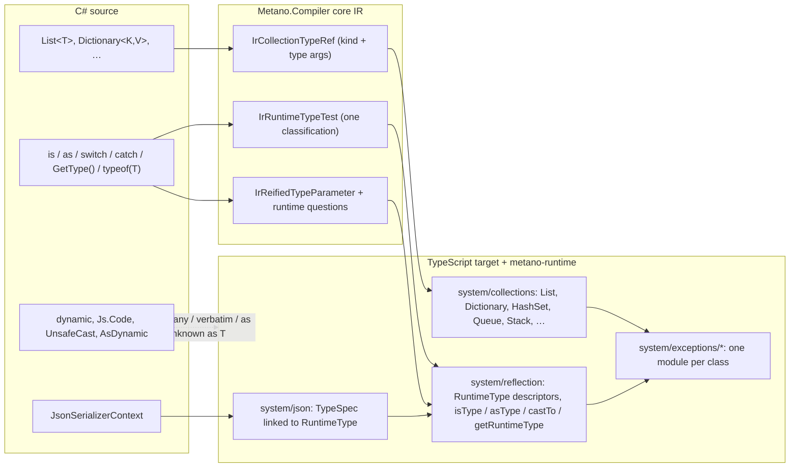

# Feature Specification: BCL collections as runtime types, runtime type descriptors

**Feature Branch**: `spec/011-runtime-collections-and-types`

**Created**: 2026-11-01

**Status**: Draft (spec change request; revised after the first critic pass; the maintainer's decisions of 2026-11-02 and 2026-11-16 are applied)

**Input**: GitHub issue [danfma/metano#335](https://github.com/danfma/metano/issues/335), "Introduce runtime collection types and runtime type descriptors", the maintainer brief and its three amendments (`dynamic` is supported; a per-target inline-code function; the `UnsafeCast<T>()` / `AsDynamic()` escape hatches), and the two critic reviews of PR #349, which made **tree-shaking of the runtime and of generated code mandatory** and measured which emission shapes bundlers keep (research R13). The findings that ground every requirement are in [research.md](./research.md) (R1–R16; R16 is the runtime `List<T>` spike behind the decisions of 2026-11-16).

**Traceability**: a 3.0.0 breaking change. It extends these legacy requirement families of the baseline: types and collections (`FR-015`–`FR-018`), semantic transformation and pattern matching (`FR-005`–`FR-014`, especially `FR-013` and `FR-014`), serialization (`FR-032`–`FR-034`) and diagnostics (`FR-038`–`FR-040`). It adds rows to the baseline [feature-support matrix](../001-project-baseline-evolution/baseline/feature-support-matrix.md) and reserves `MS0045`–`MS0058` in the [diagnostic catalog](../001-project-baseline-evolution/baseline/diagnostic-catalog.md) (`MS0044` belongs to #334 / PR #355). As in features 002–010, FR identifiers are local to this feature and are cited as "011 FR-0NN".

**Related specs**: [009-polymorphic-json](../009-polymorphic-json/spec.md) (shipping in 3.0.0) and [010-csharp-unions](../010-csharp-unions/spec.md) (deferred to 3.1.0 per `W4-C18`) consume the runtime tests and descriptors defined here. Neither is edited by this PR; the requirements of theirs that change are listed in [Interaction with specs 009 and 010](#interaction-with-specs-009-and-010). The existing non-shakable namespace emissions (branded companions, nested types, runtime `UUID`, `ImmutableCollection`) become pure object literals and module-level classes in stage 011a (FR-040), and [#361](https://github.com/danfma/metano/issues/361) stays open for per-member shaking; the flat `sideEffects: false` that `PackageJsonWriter` writes today is the bug [#368](https://github.com/danfma/metano/issues/368), fixed by FR-045.

## Overview

Metano maps `List<T>` to a native JS array and `Dictionary<K,V>` to a native `Map`, and lowers every collection member through templates that encode Array semantics (`Count` → `length`, `RemoveAt` → `splice`, `Clear` → `length = 0`; research R1). Only `HashSet<T>` is a runtime class. Three consequences follow:

1. **No C# exceptions.** `list[10]` on a three-element list is `undefined`, a dictionary indexer miss is `undefined`, `Stack.Pop()` on an empty stack is `undefined`.
2. **No runtime identity.** `is List<T>`, `is IList<T>`, `is IEnumerable<T>`, `is T` for an open `T`, `typeof(T)`, `GetType()` and typed `catch` either report MS0001 or silently do the wrong thing (since #628 the catch clauses lower to one `catch` with a chain, and since #651 BCL exceptions are runtime classes that typed `catch` tests by `instanceof`; `toException` normalization, `tryFilter` and descriptors are still missing; research R3).
3. **IIFEs.** Where a collection step is a template rather than a method, null-conditional chains and evaluate-once sites render as immediately-invoked functions (research R2).

This feature makes the BCL collections real `metano-runtime` classes that implement `Iterable<T>`, introduces `JsArray<T>` for the native array, makes BCL exceptions real runtime classes, replaces IIFEs with runtime helpers, and adds **runtime type descriptors** (`RuntimeType`) consumed by `is` / `as` / patterns, typed `catch`, `GetType()`, `typeof(T)` and the JSON context. Every emission shape is chosen so that **what is not used bundles to zero bytes** (D17, research R13). Three interop features complete it: `dynamic` as TS `any`, a per-target inline-code function (`Js.Code`), and the `UnsafeCast<T>()` / `AsDynamic()` escape hatches.



## Maintainer decisions (normative)

- **D1 — Own runtime collections.** `List<T>`, `Dictionary<K,V>`, `HashSet<T>`, `Queue<T>`, `Stack<T>`, the read-only views and the immutable collections mapped today become `metano-runtime` classes (D20 narrowed the 3.0.0 scope; D24 restored it: every collection ships in 3.0.0, FR-054). They are **not** `Array` subclasses and **not** array copies. They implement `Iterable<T>`, so `for..of`, spread and `Array.from` work (FR-001, FR-002).
- **D2 — `JsArray<T>`.** A dedicated C# type maps to the native JS `Array` (FR-004). `T[]` keeps mapping to the native array.
- **D3 — `List<T>` ↔ `JsArray<T>` conversion** is explicit (OD-1; FR-005).
- **D4 — Runtime helpers, never IIFEs.** Where semantics need evaluate-once, bounds checks or a C# exception, the emitted code calls a runtime helper or a method of the runtime class. No IIFE and no composite expression at the call site (FR-009, FR-010).
- **D5 — Classes test nominally** with `instanceof`. The descriptor is a lazily memoized, string-keyed static getter on the constructor that returns a pure data literal (no runtime import), so `GetType()` returns the concrete derived type; objects created without `new` lose identity and fall back (FR-018). A `Symbol` key was considered for the getter and rejected: esbuild keeps every class that has a computed-symbol class member, so the descriptor key stays a plain string (research R13).
- **D6 — Interfaces implemented by classes** test nominally: the class descriptor lists its interfaces (FR-019).
- **D7 — `[PlainObject]`** is a shape: `is` / `as` / `switch` become a structural guard with an overlap warning; `GetType()` on a known static plain-object type is a compile-time constant; `GetType()` on an `object` that may hold one warns and answers `object`; no `$type` field is injected (FR-020).
- **D8 — Generics.** Only runtime collections carry type-argument descriptors, and only when the compilation asks a runtime question about that collection kind; native arrays and `JsArray` erase; closed generic types get a memoized specialized descriptor; an open `T` used at runtime inside a generic body gets a hidden descriptor parameter, added only when the body needs it (FR-008, FR-023, FR-024).
- **D9 — Primitives.** `int` versus `double` is decided from the static type where possible; at run time a `number` is classified by `getNumberType` (`Int32Type` or `DoubleType`) and a `bigint` by range (`Int64Type`, `UInt64Type` or `BigIntegerType`, FR-048); the limit is documented (FR-022).
- **D10 — Typed catch** is one JS `catch` with an `instanceof` chain over real runtime exception classes, in TS and in Dart (FR-013 to FR-016).
- **D11 — `dynamic` is supported**, without type guarantees, as in TS: it maps to `any` (Dart: `dynamic`), operations on it pass straight through, and an implicit conversion from `dynamic` emits nothing (FR-030).
- **D12 — Inline target code.** A per-target function, `Js.Code("…")` / `Js.Code<T>("…")`, emits a compile-time-constant string verbatim (FR-031 to FR-034). Dart gets its own equivalent later.
- **D13 — Escape hatches.** `x.UnsafeCast<T>()` is a compile-time-only reinterpretation and `x.AsDynamic()` turns any value into `dynamic`; the explicit C# cast `(T)x` and `as T` stay **checked** whenever descriptors can answer (FR-035, FR-036).
- **D14 — Zero cost.** Descriptors, descriptor imports and type-argument tuples are emitted only for types reached by a runtime question (`is` / `as` / patterns / explicit downcasts / `catch` / serialization / `GetType()` / `typeof`), and a type that is not reached contributes nothing to the bundle (FR-027, NFR-002).
- **D15 — Deepkit lessons.** Borrow the typed-object-literal descriptor, thunks, emit-only-what-is-used and closure-composed serializers; do not copy the transformer, the bytecode VM, the `new Function` JIT or the structural `is<T>` (research R10, NFR-003).
- **D16 — One 3.0.0.** Everything ships in one major together with #328 (the `Metano.Build` split), spec 010 (unions) and spec 009 (polymorphic JSON), with migration notes (FR-040).
- **D17 — Tree-shaking is mandatory.** Neither the runtime nor generated code may contain a module-scope side effect (a `[ModuleEntryPoint]` module is the one exception, and it is declared in `sideEffects`, FR-045), a merged `namespace` with members, an `export enum`, a registry, a computed-symbol class key, an eager descriptor or a descriptor that imports the runtime; `sideEffects` must be truthful; unused means 0 bytes; the per-symbol budgets of NFR-008 are a CI gate (FR-043 to FR-045, NFR-006 to NFR-010; research R13). The pre-existing namespace emissions are removed in stage 011a (FR-040), so no allowlist entry remains (FR-043).
- **D18 — `EqualityComparer<T>.Default` semantics.** Collections key and search with `defaultEquals` / `defaultHashCode` (user `equals()` / `hashCode()` when present, reference identity otherwise, SameValueZero for `NaN`), never with the structural `equals` of `system/equality` (research R14; FR-006).
- **D19 — Boxing is explicit at boxing conversions** (decided 2026-11-02). A value of an enum or `[InlineWrapper]` type that undergoes a C# boxing conversion becomes a runtime `Boxed` value (`box(value, E$runtimeType)`), so `GetType()`, `ToString()` and `Equals` answer as in .NET for the common `object` / logging cases; generic instantiations, plain numbers, strings and booleans stay raw (FR-050, FR-051, OD-23).

### Decisions of 2026-11-16 (collections scope, array interop, performance gate)

Taken after a throwaway spike implemented a runtime `List<T>` end to end (research R16).

- **D20 — Initial collection scope** (superseded the same day by D24: nothing is deferred). Metano 3.0.0 waits for runtime collections, with a reduced initial scope: `List<T>`, `HashSet<T>`, `Dictionary<TKey, TValue>`, `Queue<T>` and `Stack<T>`, together with what these five need to be consumed as C# consumes them (the BCL interfaces they implement and the dictionary key / value views). Every other collection type (`ImmutableList<T>`, `ImmutableArray<T>`, `ReadOnlyCollection<T>`, `ImmutableDictionary<K,V>`, `IImmutableDictionary<K,V>`, `ConcurrentDictionary<K,V>`, `SortedDictionary<K,V>`, `SortedList<K,V>`, and the own semantics of `SortedSet<T>` / `ImmutableHashSet<T>`) moves to the later stage 011h; those requirements stay in this spec, marked deferred (FR-054).
- **D21 — Explicit array interop.** Interop between a runtime collection and a native JS array is an explicit conversion written in C#, never a conversion the compiler inserts (FR-003's identity-preserving wrap of a conversion that C# itself performs is not one; FR-055 states the exception). `ToArray()` returns a detached shallow copy (FR-055). Zero-copy views of a `List<T>`, whose mutations are shared with the list, are explicitly named: `AsJsArray()` (a mutable JS array), `AsSpan()` (element writes and in-place operations, no length change; also reachable through .NET's own `CollectionsMarshal.AsSpan(list)`) and `AsReadOnlySpan()` (read-only) (FR-056). The runtime `List<T>` holds a native JS array internally and never replaces it, which is what makes the views free and keeps them live (FR-057).
- **D22 — The performance requirement stays a release gate** (its ratio form is replaced by D25's absolute budget). NFR-001 is not relaxed. The spike measured indexed get / set at 4.7× `arr[i]` on Node and 1.28× on Bun against the 2.0× limit, so the design of stage 011c must address the indexer; NFR-001 now names the engines and the measurement the gate applies to.
- **D23 — Consumer migration.** Hand-written TypeScript that consumes generated collections changes: it iterates, or converts with `toArray()` (copy) or a view, instead of using array members; framework bindings that require an array (`<For each>`) take `toArray()` or a view ([Migration](#migration-300)).

### Decisions of 2026-11-16, second set (after the first review round)

- **D24 — Full collection scope (supersedes D20).** Nothing is deferred. 3.0.0 ships every collection this spec covers: the five of D20 plus `ReadOnlyCollection<T>` (and `AsReadOnly()`), `ImmutableList<T>`, `ImmutableArray<T>`, `ImmutableHashSet<T>`, `ImmutableDictionary<K,V>` / `IImmutableDictionary<K,V>`, `ConcurrentDictionary<K,V>`, `SortedDictionary<K,V>`, `SortedSet<T>` and `SortedList<K,V>` (FR-054). Design: `ConcurrentDictionary` is a sibling of the runtime `Dictionary` (composition over a shared hash core) with the concurrent API, safe without locks because JavaScript shares no object between threads; `Immutable*` is copy-on-write first, with structural sharing only if a benchmark requires it; `Sorted*` are sorted structures with comparers.
- **D25 — Absolute overhead budget (replaces the ratio of D22).** The maintainer accepts the cost of the abstraction and wants the fastest design. NFR-001 becomes an absolute per-operation overhead budget against the native array / `Map` baseline, measured on Node.js and Bun in the hot-helper shape (a kernel called many times, not one long loop, which V8 runs as on-stack-replacement code and which distorts the result), the larger engine counting, with the numbers recorded per release. The budgets and the design come from the indexer experiment (research R17, FR-057).
- **D26 — Production checks opt-out** (mechanism amended by W4-33: the runtime ships a checked and an unchecked dist selected by the `metano-unchecked` condition; generated code keeps the define guard, FR-058). A bundle-time constant may remove the bounds checks and the version tracking from production bundles; checks are on by default; disabling them changes semantics, so it is explicit and documented (FR-058).
- **D27 — Array to interface: option A confirmed.** The conversions C# itself performs from an array to a list interface use FR-003's identity-preserving `List.adopt(arr, { fixedSize: true })`; FR-003 and FR-055 stand as worded. (`Array.AsReadOnly(arr)` and `list.AsReadOnly()` produce a `ReadOnlyList`, its own class, not an adopted `List`; FR-054.)

### Decisions of 2026-11-18 (Dart before 3.0.0)

- **D28 — Dart only keeps compiling until after 3.0.0.** TypeScript is the priority of 3.0.0. Until 3.0.0 ships, the Dart target only has to keep compiling: the existing Dart output stays byte-identical, and an IR node this feature adds MAY lower to an `MS0001` placeholder in Dart. FR-038 (the Dart mapping of each IR node) and the plan's rule that every stage ships its Dart mapping in the same PR are **deferred to after 3.0.0**; User Story 9's scenarios 1, 3 and 4 are deferred with it (scenario 2 holds today: Dart reifies `is T` natively).

- **D29 — Stage 011b decisions (2026-11-18).** They supersede the conflicting sentences of FR-019, FR-021, FR-026, FR-027, FR-028, FR-053 and OD-6, which point here.
  - **Only a descriptor read reaches.** A type is reached by code that reads its descriptor: a descriptor passed to `castTo` / `asType` / `isType` (`as` on an operand that is not stable renders `asType` and reaches), a `GetType()` receiver under FR-027's receiver rules, `typeof(X)`, a `base` / `interfaces` / `plainImplementers` thunk of a reached descriptor, `[EmitRuntimeType]`, and the public types of an `[EmitPackage]` library (below). A test rendered as `instanceof` (a class `is`, a type pattern, a dispatcher branch, a `catch` arm, `as` on a stable operand) does not reach. A reached interface reaches every transpiled class whose `AllInterfaces` contains it, and a reached class reaches its whole base chain, so `Circle → Mid → Shape` never answers `Mid` with `Shape`'s descriptor.
  - **JSON is not a root yet.** A JSON context spec reaches its type only once FR-028's `runtimeType` thunk is emitted; the thunk moves to stage 011c together with FR-028's collection half.
  - **Nominal interfaces everywhere.** An interface parameter of an overload dispatcher and `is IFoo` on a `[GenerateGuard]` interface test nominally (`isType(v, IFoo$runtimeType)`, with the plain-object fallback of OD-8), no longer `typeof === "object"` / `isIFoo(v)`. Both are breaking changes listed in the 3.0.0 migration notes; the stage commits are `feat!:`.
  - **Libraries are complete.** In an `[EmitPackage]` library every public class always carries its `$runtimeType` getter and every public interface, plain object and enum always emits its `X$runtimeType` literal (OD-6 (a); shaken when unused). A consumer reads `.$runtimeType` / `X$runtimeType` of a library type directly. `[EmitRuntimeType]` keeps its meaning for every other project (and for non-public types). `castTo` / `asType` accept a constructor or a descriptor. A checked cast to a class keeps #669's form `castTo(x, Ctor)`, which tests by `instanceof`, reads no descriptor and reaches nothing, so #669's goldens and NFR-002 do not move; its message names the class's own descriptor `fullName` when the class has one (`Object.hasOwn`) and `constructor.name` otherwise. An `[Import]` / `[NoEmit]` class, which never has a getter, uses the same form. A cast to an interface, plain object, enum or primitive passes the descriptor and reaches it.
  - **Stage scope.** Stage 011b also delivers FR-046, FR-047, FR-048, FR-049 (membership test and `enumFromRaw`), FR-053 and boxing (FR-050, FR-051, `MS0058`, US3-9).

- **D30 — Stage 011c runtime API freeze (2026-11-19, wave 4 hand-in R0).** [contracts/runtime-collections.md](./contracts/runtime-collections.md) up to § 011h classes is the exact TypeScript API of stage 011c (module paths, signatures, the `_items` / `_version` / `$typeArguments$<Class>` ABI, the `__METANO_CHECKS__` guard text, the cold throw helpers with .NET's probed messages, the JSON collection kinds, and the C# member → emitted TS table). Corrections the existing code forced, which supersede the conflicting sentences of D18, FR-006, FR-028, FR-054 and FR-058 (each listed in the contract's "Corrections the code forced" table):
  - The collections key and search through `elementEquals` / `elementHashCode` (`system/collections/default-comparer.ts`), where this spec says `defaultEquals` / `defaultHashCode`: `system/equality.ts` already exports a `defaultEquals` (open-typed record fields, #674) that compares arrays element-wise for tuples; `elementEquals` delegates to it except that a top-level array compares by reference, as .NET compares an array element.
  - `HashSet` is rebuilt over the internal `hash-core.ts` shared with `Dictionary` (and 011h's classes), for insertion-order enumeration and O(1) reference keys; its 2.x members stay until the compiler stops emitting them.
  - `tryGetValue` / `tryDequeue` / `tryPeek` / `tryPop` / `find` / `findLast` take the value C# stores on a miss (`default(T)`), not `null`.
  - Enumeration invalidation follows .NET 10 as probed: overwriting an existing `Dictionary` key does not invalidate; `HashSet.remove` / `clear` / `exceptWith` / `intersectWith` / `removeWhere` do not; `Stack`'s enumerator uses its own message.
  - FR-058's constant is named `__METANO_CHECKS__` (confirmed); the lowered `foreach` reads it once into a function-local `$c` (final, W4-27) that also guards its `_version` capture. The runtime members' guard is final too (W4-33): the runtime folds it into a checked and an unchecked dist (FR-058).
  - Comparer factories put the comparer before `typeArguments`; the dictionary views live in `dictionary-views.ts`; interface descriptor tests are nominal through each class literal's data `interfaces` list (`CollectionType` gains `interfaces` and `closeFor`, contracts/runtime-types.md); the collection classes' `$runtimeType` literals import nothing from reflection and close themselves over an instance's slot through `closeFor`, so `getRuntimeType` reaches the closing code only when a collection is in the program (W4-24 (f)); the TS interfaces declare only what their C# interfaces declare (W4-13); the JSON collection kinds carry a context-written `create` closure.
  - `Comparer<T>.Default` orders strings ordinally (as LINQ's `orderBy` does today); .NET's culture-sensitive order is a documented divergence.
- **D31 — Stage 011c, group J decisions (2026-11-19, wave 4).** They refine FR-008, FR-027, FR-028, MS0046 and the W4-17 rule.
  - **JSON is a root.** Every object entry of a `JsonSerializerContext` whose type is a class, record or struct with a descriptor (the entries the context constructs, FR-049) is reached, and its `TypeSpec` carries `runtimeType: () => C.$runtimeType` (the open descriptor of a generic class). A `[PlainObject]` or interface entry has no class and gets no thunk. The runtime reads nothing through the thunk yet; it is the descriptor link 009 FR-005 may use.
  - **What questions a collection (FR-008).** The questioned class kinds are the class kinds a test, `as`, pattern, `GetType()` or `typeof` names, plus every runtime class that implements a questioned interface kind (the one implementer table of `RuntimeCollections`; a drift test keeps it equal to the runtime class literals' `interfaces` lists, so a class 011h adds joins `is IDictionary` only through both). An overload-dispatcher parameter and an explicit cast do not question: a dispatcher branch tests by `instanceof` over the classes (arguments erased, W4-18), and a collection cast stays the unchecked assertion or `asList` (W4-46). A construction of a questioned class passes the trailing `typeArguments` in every form: the constructor, `of` / `from` / `assign` / `withCapacity` / `adopt`, collection initializers and expressions, the set-literal factory, the JSON `create` closures, a C# subclass that closes the arguments (`super(…, [Int32Type])`) and the LINQ terminals (`toList(typeArguments?)`, `toDictionary(…, typeArguments?)`, `toHashSet(typeArguments?)`, a trailing optional parameter; the compiler knows `TResult`).
  - **No wildcard for a concrete argument (W4-65 B2).** When a kind is questioned, every construction passes a descriptor for each concrete type argument, and a class argument is reached (it gets its descriptor): `new List<Point>()` carries `[Point.$runtimeType]` and `List<string>` does not match it. `UnknownType` stays only for an open type parameter `T` (not reified until stage 011d) and for a type with no descriptor, a documented limit tied to 011d. A generic subclass `MyList<T> : List<T>` passes its own argument into the `List` slot (`super(…, [T$type])` once `T` is reified, else `[UnknownType]`). A value without a slot (built by a separately compiled library, or a runtime-built collection with no source slot) still matches every argument; listed limit.
  - **Collection tests are descriptor tests.** `x is List<int>`, `x is IList<int>`, `x is Dictionary<string, int>`, a type pattern and `as` render through the descriptor factory of the kind (`isType(x, listType(Int32Type))`, `iListType`, `dictionaryType`, …), which tests `instanceof` (a class) or the nominal `interfaces` entries (an interface) and then the type arguments under FR-008's rule. This replaces the erased `instanceof Dictionary` / `instanceof HashSet` of 2.x and of the 011c flip. A tested type argument that is a described class is reached; one without a descriptor is `UnknownType` (wildcard). A construction slot argument follows the rule above.
  - **Covariance needs a reference conversion (W4-65 B1).** In a covariant position (`IReadOnlyList<out T>`, `IReadOnlyCollection<out T>`, `IEnumerable<out T>`) the tested argument matches only when the actual argument is a reference type (not a primitive, enum, struct or nullable) assignable to it; otherwise it requires identity. So `(object)new List<int>() is IReadOnlyList<object>` and `is IReadOnlyCollection<int?>` are `false`, as in .NET, and `List<string>` is `IReadOnlyList<object>`.
  - **W4-17: MS0001 where a user type implements the interface.** A transpiled type (class, struct or record) or a public type of a referenced `[TranspileAssembly]` library `C` has no collection descriptor. The reachability phase reports `MS0001` at an `is` / `as` / pattern against a collection interface `I` only when some such `C` converts implicitly to the tested type (`ClassifyConversion(C, tested).IsImplicit`, matching original definitions as the fallback for a generic `C`) AND the operand's static type can hold `C` (`object`, a type parameter, or a type `C` converts to implicitly). The site lowers to the throwing placeholder, never to `false`. Without such a `C` the test lowers normally. A class kind is not affected (`class IntList : List<int>` is an `instanceof List`). Dispatcher branches keep `instanceof` over the runtime classes: a user implementer does not match them, as before 3.0 (listed limit). A user-class entry form that would make these tests nominal is a follow-up.
  - **`MS0046` reason 2 fires where the argument check degrades**: a tested collection whose type argument has no descriptor (a type parameter that is not reified, a type without a descriptor) and is not `object`. The test still compiles; that argument is `UnknownType`, so it matches every value.

## User Scenarios & Testing *(mandatory)*

### User Story 1 - Collections behave like .NET collections (Priority: P1)

A developer writes ordinary C# over `List<T>`, `Dictionary<K,V>`, `Queue<T>` and `Stack<T>`. The generated TypeScript uses `metano-runtime` classes whose members mirror the BCL: out-of-range access throws `ArgumentOutOfRangeException`, a missing key throws `KeyNotFoundException`, `Contains` on a record list uses the record's `equals`, and `foreach` / spread / LINQ keep working because every collection is an `Iterable<T>`.

**Why this priority**: every other story builds on the collection classes, and this is the breaking change that defines 3.0.0.

**Independent Test**: transpile `samples/SampleTodo` and run `targets/js/sample-todo` tests: `TodoList.Items` is a `List<TodoItem>`, `items.get(99)` throws `ArgumentOutOfRangeException`, and `[...items]` yields the elements.

**Acceptance Scenarios**:

1. **Given** `var xs = new List<int> { 1, 2 }; xs.Add(3);`, **When** transpiled, **Then** the output is `const xs = List.of([1, 2]); xs.add(3);` and `xs.count` is `3` at runtime. No IIFE is emitted, and no reflection import appears (the compilation asks no runtime question about `List`).
2. **Given** `xs[5]` on a three-element list, **When** run, **Then** `ArgumentOutOfRangeException` is thrown with .NET's message (`Index was out of range. Must be non-negative and less than the size of the collection. (Parameter 'index')`).
3. **Given** `dict["missing"]`, **When** run, **Then** `KeyNotFoundException` is thrown with .NET's message (`The given key 'missing' was not present in the dictionary.`); `dict.TryGetValue(k, out v)` keeps today's tuple lowering.
4. **Given** `Dictionary<Point, string>` with a record key, **When** two keys that are `equals()` are used, **Then** they address the same entry; two distinct instances of a class without `equals()` are two keys (reference identity, as `EqualityComparer<T>.Default`), which neither today's native `Map` (reference only) nor `system/equality.equals` (structural) gives.
5. **Given** `queue.Dequeue()` or `stack.Pop()` on an empty collection, **When** run, **Then** `InvalidOperationException` (`Queue empty.` / `Stack empty.`) is thrown. `foreach` over a `Stack<T>` enumerates top-first.
6. **Given** `foreach (var x in list)`, `[..list]`, `list.Select(...)` and `Array.from(list)` in hand-written TS, **When** run, **Then** all enumerate the list; `Array.isArray(list)` is `false`, `list instanceof List` is `true`, and `JSON.stringify(list)` yields the element array (`toJSON`). Array members are not available on a `List` (`list[0]`, `list.length` and `list.map` are `undefined`); hand-written TS uses iteration, `list.toArray()` or a view (FR-055, FR-056, D23).
7. **Given** `int[] a = …; IReadOnlyList<int> r = a;`, **When** transpiled, **Then** the conversion emits `List.adopt(a, { fixedSize: true })` (zero copy, shared storage) so `r.count` and `r.get(0)` work; `((IList<int>)a).Add(1)` throws `NotSupportedException` as in .NET; `(int[])r` and `r is int[]` unwrap the adopted array.
8. **Given** `HashSet<T>.Add(x)`, **When** transpiled, **Then** the call returns a `boolean` as in C# (today's runtime returns `this`), and `set.count` replaces `set.size`.
9. **Given** `dict[k] += 1;`, `list[i]++;` (statements, `k` / `i` locals), `GetList()[Next()] += 2;`, `dict[k] ??= v` and `(list[i], list[j]) = (list[j], list[i])`, **When** transpiled, **Then** the output is `dict.set(k, dict.get(k) + 1)`, `list.set(i, list.get(i) + 1)`, `$r = getList(), $i = next(), $r.set($i, $r.get($i) + 2);` with `let $r, $i;` at the head of the enclosing statement list (FR-010's direct form with the non-reusable parts bound once, the statement row of contracts/runtime-collections.md § Indexer compound assignments; amended in 011c so the spec states one shape), `dict.get(k) ?? (dict.set(k, $t = v), $t)` (the `??=` shape of contracts/runtime-collections.md § Indexer compound assignments, amended by D30: it writes only when the value is null); the tuple swap reports `MS0001`, as on main (deconstruction into existing variables or elements is not modelled, spec 003 research D7; building it is a follow-up); no IIFE and no double evaluation of a receiver or index.
10. **Given** `int[] a = list.ToArray(); a[0] = 99; list.Add(4);`, **When** run, **Then** `list.get(0)` is unchanged and `a.length` stays the count at the time of the call: the array is a detached shallow copy, as in .NET (FR-055). `queue.ToArray()`, `stack.ToArray()` (top first) and `set.ToArray()` are copies too.
11. **Given** `JsArray<int> js = list.AsJsArray(); Span<int> s = list.AsSpan(); ReadOnlySpan<int> r = list.AsReadOnlySpan(); s[0] = 7; js.Push(5);`, **When** transpiled and run, **Then** the output is `const js = asJsArray(list); const s = asSpan(list); const r = asReadOnlySpan(list); s[0] = 7; js.push(5);`, no copy is made, `list.get(0)` is `7`, `list.count` grew by one, and `r` sees both changes; `CollectionsMarshal.AsSpan(list)` emits the same `asSpan(list)`, and a `null` list gives an empty span (FR-056, FR-057).
12. **Given** `var s = new SortedSet<int> { 3, 1, 2 }`, `var im = ImmutableList.Create(1, 2)`, `var cd = new ConcurrentDictionary<string, int>()` and `var ro = list.AsReadOnly()`, **When** run, **Then** `[...s]` is `[1, 2, 3]`, `im.Add(3)` returns a new `ImmutableList` and leaves `im` at two elements, `cd.GetOrAdd("a", 1)` returns `1` and inserts once, and `ro` reflects a later `list.Add` while its `IList<T>` mutators throw `NotSupportedException` (FR-054).

### User Story 2 - Runtime helpers replace IIFEs (Priority: P1)

A developer writes `order?.Items.Clear()`, `GetNext().Items[^1]` or `x as Order` with a side-effecting operand. The output calls a method or a runtime helper that evaluates its receiver once and throws the C# exception; it never contains an immediately-invoked function or a composite expression such as `$this.length = 0`.

**Independent Test**: the goldens `null-conditional-guards.ts` and `index-and-range.ts` contain no `(() =>` or `(($` sequence after regeneration.

**Acceptance Scenarios**:

1. **Given** `order?.Items.Clear()`, **When** transpiled, **Then** the output is `order?.items.clear();`, a native optional chain, because `clear` is a method of the runtime class; no `$receiver` block and no IIFE is emitted. `order?.Items.Remove(x)` in expression position is `order?.items.remove(x) ?? null` under the existing null-conditional typing.
2. **Given** `GetNext().Items[^1]`, **When** transpiled, **Then** the output is `getNext().items.fromEnd(1)`, which evaluates `getNext()` once and throws `ArgumentOutOfRangeException` when the list is empty.
3. **Given** `arr[^1]` on a `T[]` or `JsArray<T>`, **When** transpiled, **Then** the output is `fromEnd(arr, 1)` (a runtime helper that throws `IndexOutOfRangeException` on an empty array).
4. **Given** `Compute() as Order`, **When** transpiled, **Then** the output is `asType(compute(), Order.$runtimeType)` (one evaluation; `null` when the test fails), never `((v) => v instanceof Order ? v : null)(compute())`.
5. **Given** `new List<int>(capacity: Next())`, **When** transpiled, **Then** the output is `List.withCapacity<number>(next())` (the argument is evaluated once), never the `BindSideEffectsInSourceOrder` IIFE.
6. **Given** `stack.Peek()` where `stack` is `GetStack()`, **When** transpiled, **Then** `getStack()` appears once in the output.

### User Story 3 - Runtime type questions are answered nominally (Priority: P1)

A library has an abstract factory `Shape Create(string kind)` that returns `Circle` or `Square`. A caller writes `shape.GetType().Name`, `shape is IHasArea`, `shape switch { Circle c => …, Square s => … }` and `catch (InvalidOperationException e)`. The output answers each one the way C# does, through descriptors attached to the constructors, and types that no code asks about carry no descriptor.

**Independent Test**: a golden `runtime-types-factory.ts` plus a bun test that asserts `getRuntimeType(create("circle")) === Circle.$runtimeType`, `getRuntimeType(create("circle")).name === "Circle"`, `isType(shape, IHasArea$runtimeType)`, and that `Blob`, an unrelated class in the same sample that nothing tests, has no `$runtimeType` getter and that a bundle of the sample's entry point does not contain `"Blob"`.

**Acceptance Scenarios**:

1. **Given** `shape.GetType()` where `shape` is `Circle` at runtime, **When** run, **Then** the result is the `Circle` descriptor (`name: "Circle"`, `fullName: "Geometry.Circle"`), not `Shape`'s, and `shape.GetType() == typeof(Circle)` is `true` (descriptor identity).
2. **Given** `o is IHasArea` where `o` is a `Circle` instance whose class declares `IHasArea`, **When** run, **Then** the result is `true`; for an unrelated class instance with a structurally identical `area` member it is `false` (nominal).
3. **Given** `o is IHasArea` where `o` is a plain object (no constructor descriptor) and a `[PlainObject]` type in the compilation implements `IHasArea`, **When** run, **Then** the structural guard of that plain-object type answers (OD-8); with no such type the result is `false`.
4. **Given** `catch (ArgumentNullException e) { … } catch (ArgumentException e) when (e.Message.Length > 3) { … } catch (Exception e) { … }`, **When** transpiled, **Then** one JS `catch (e$)` is emitted that first normalizes (`const e0 = toException(e$);`) and then `if (e0 instanceof ArgumentNullException) … else if (e0 instanceof ArgumentException && tryFilter(() => e0.message.length > 3)) … else { const e = e0; … }`; a non-matching throwable is rethrown as the original (`else throw e$`) when no catch-all exists.
5. **Given** `catch (Exception e) when (IsTransient(e)) { … } catch (FormatException e) { … }`, **When** transpiled, **Then** the chain starts with `const e0 = toException(e$);`, the first arm is `tryFilter(() => isTransient(e0))` and binds `const e = e0`, and is **not** a catch-all: the chain continues to `e0 instanceof FormatException` and ends with `else throw e$` (the original).
6. **Given** `throw new InvalidOperationException("x")`, **When** transpiled, **Then** the output is `throw new InvalidOperationException("x")` with a value import from `metano-runtime/system/exceptions/invalid-operation-exception`; `e instanceof Error` stays `true`; the `catch` of scenario 4 needs no descriptor and no reflection import, and a bundle that throws one exception contains no `system/reflection` code (the getter returns a literal, FR-018).
7. **Given** a class `Blob` that no `is` / `as` / pattern / downcast / `catch` / serialization / `GetType()` / `typeof` reaches, **When** transpiled, **Then** its output is byte-identical to 2.x except for collection-member changes, and a bundle that does not import it contains no byte of it (NFR-002, NFR-009).
8. **Given** `JSON.parse(text) as Circle` written by hand in TS, or `{ ...circle }`, **When** `getRuntimeType(value)` runs, **Then** the result is the `Object` descriptor (identity is lost; documented), while `copyRecordWith(circle, { r: 2 })` (Metano's `with`) keeps `Circle`.
9. **Given** `object o = Color.Red; var t = o.GetType(); var s = o.ToString(); var eq = o.Equals(Color.Red);`, **When** transpiled and run with boxing on, **Then** the boxing conversion is `box(Color.Red, Color$runtimeType)` and `getRuntimeType(o) === Color$runtimeType`, `toString(o)` is `"Red"` and `o.Equals(Color.Red)` is `defaultEquals(o, box(Color.Red, Color$runtimeType))`, which is `true` (the argument is boxed too, as in C#; a box never equals a raw value, FR-051); `List<Color>` elements and `T` = `Color` stay raw.
10. **Given** a hand-written `getRuntimeTypeFromType(Circle)`, `getRuntimeTypeFromType(Color$runtimeType)` and `getRuntimeTypeFromType(class {})`, **When** run, **Then** the first two return the descriptor and the last throws `ArgumentException` (FR-047).
11. **Given** `[EmitRuntimeType] public interface IFoo { }` (or `[assembly: EmitRuntimeType]` in a library with no `is` / `as` / `typeof` over its types), **When** transpiled, **Then** `IFoo$runtimeType` (respectively the descriptor of every public type of the assembly) is emitted and exported (FR-046), although no code in the compilation reaches it (FR-053); a type without the attribute in the same library emits none; a library with neither emits descriptors only where reached.

### User Story 4 - Generic code can ask about `T` (Priority: P2)

A developer writes `T Parse<T>(string s)` with `if (typeof(T) == typeof(int))`, or `bool IsA<T>(object o) => o is T`, or `new T()` under `where T : new()`. The method gains one hidden trailing parameter that carries `T`'s descriptor, call sites pass the closed descriptor, and methods whose bodies never ask about `T` keep their signature.

**Independent Test**: a golden `reified-type-parameters.ts` plus a bun test that calls `isA<number>(5, Int32Type)` and `isA(new Circle(), Circle.$runtimeType)`.

**Acceptance Scenarios**:

1. **Given** `bool IsA<T>(object o) => o is T;` and a call `IsA<Circle>(x)`, **When** transpiled, **Then** the output is `export function isA<T>(o: unknown, T$type: RuntimeType<T>): boolean { return isType(o, T$type); }` and the call is `isA(x, Circle.$runtimeType)`.
2. **Given** `T First<T>(IEnumerable<T> xs)` whose body never names `T` at runtime, **When** transpiled, **Then** its signature is unchanged (no hidden parameter).
3. **Given** `IsA<int>(o)`, `IsA<List<string>>(o)` and `IsA<U>(o)` from inside another reified method, **When** transpiled, **Then** the arguments are `Int32Type`, `listType(StringType)` (memoized, so two call sites share one descriptor object) and `U$type`.
4. **Given** an interface method `void Visit<T>(T x)` whose implementation in one class uses `is T`, **When** transpiled, **Then** the interface member, every implementation and every call site carry the hidden parameter (implementation-group propagation); a sibling **overload** `Visit(int x)` is untouched.
5. **Given** a generic method with `is T` whose group is converted to a delegate (`Func<object, bool> f = IsA<Circle>`), **When** transpiled, **Then** the conversion emits `(o) => isA(o, Circle.$runtimeType)`.
6. **Given** `class Box<T> { public bool Holds(object o) => o is T; public static bool Accepts(object o) => o is T; }`, `class IntBox : Box<int>` and `class Pair<U> : Box<List<U>>`, **When** transpiled, **Then** `Box`'s constructor gains a trailing hidden parameter stored in the non-enumerable per-class slot `$typeArguments$Box`, `Accepts` gains its own hidden parameter (a static cannot read the slot), `new Box<int>()` passes `[Int32Type]`, `IntBox` passes `[Int32Type]` to `super` and defines no slot of its own, `Pair<U>` passes `[listType($typeArgs[0])]` to `super` and defines its own slot `$typeArguments$Pair` (each slot is defined exactly once, by its declaring class, so no `defineProperty` runs twice), `box.GetType()` returns the memoized `Box<int>` descriptor specialized from the most-derived slot, and `box with { … }` keeps every slot.
7. **Given** `is T` inside an `[Emit]`-mapped extern, inside an `[External]` interface member, inside a `[JsCallable]` delegate's body, or in an implementation group whose interface member comes from a referenced package without the parameter, **When** transpiled, **Then** `MS0054` (error) names the position that cannot carry a hidden parameter.
8. **Given** a hidden parameter added to a public member of an `[EmitPackage]` library or an `[ExportedAsModule]` function, **When** transpiled, **Then** `MS0050` (warning) states that JS callers must pass the descriptor, once per member.
9. **Given** `default(T)` in a body where `T` is not otherwise reified, **When** transpiled, **Then** the output is today's `null` with #291's existing diagnostic; where `T` is reified for another reason the output is `T$type.default()`, which is a zeroed instance for a struct `T`.

### User Story 5 - Plain objects are shapes (Priority: P2)

A developer tests `o is UserDto` where `UserDto` is `[PlainObject]`. The output calls the synthesized structural guard, and the build warns when another reachable `[PlainObject]` has a compatible shape, mirroring MS0039 for unions. `GetType()` is a constant where the static type is known and no derived plain object exists.

**Acceptance Scenarios**:

1. **Given** `o is UserDto u`, **When** transpiled, **Then** the output is `isUserDto(o)` with the binding, and `isUserDto` is synthesized in `UserDto`'s file whether or not `[GenerateGuard]` is present (as 009 FR-019 and 010 FR-041 do).
2. **Given** `[PlainObject] record A(string Name)` and `[PlainObject] record B(string Name, int Age)` both reachable from the tested expression's static type, **When** `o is A` is transpiled, **Then** `MS0047` (warning) names `A` and `B` and the shared members; the output is emitted.
3. **Given** `UserDto dto = …; dto.GetType()` where no `[PlainObject]` derives from `UserDto`, **When** transpiled, **Then** the output is the constant `UserDto$runtimeType` (no runtime call); with a derived plain object the call is `getRuntimeType(dto)` plus `MS0048`.
4. **Given** `object o = …; o.GetType()` where a `[PlainObject]` in the compilation is assignable to `object`, **When** transpiled, **Then** `MS0048` (warning) is reported once per call site, and at runtime a plain object answers the `Object` descriptor.
5. **Given** a `[PlainObject]` DTO serialized through the JSON context, **When** written, **Then** no `$type` or other identity field is added; `[JsonPolymorphic]` remains the only discriminator (009).

### User Story 6 - `dynamic`, inline code and escape hatches (Priority: P2)

A developer manipulates raw JS data: `dynamic cfg = Js.Code("(globalThis as any).__config"); string name = cfg.appName; var el = Js.Code<HtmlElement>($"document.querySelector({selector})"); var dto = raw.UnsafeCast<UserDto>(); var any = order.AsDynamic(); any.extra = 1;`. Each construct erases to idiomatic TS and none needs a facade declaration.

**Acceptance Scenarios**:

1. **Given** `dynamic d = …; d.foo.bar(1)[2] + d.n`, **When** transpiled, **Then** the output is `d.foo.bar(1)[2] + d.n` with `d: any`; member names are emitted verbatim (OD-11).
2. **Given** `string s = d;`, `F(d)` for `void F(string s)`, `return d;` from a `string`-returning method, `if (d)`, `$"{d}"` and `foreach (string x in d)` (a `for…of`), **When** transpiled, **Then** each implicit conversion from `dynamic` emits nothing: no check, no helper, no diagnostic (D11; the value is whatever JS holds).
3. **Given** `(int)d`, `(Circle)d` and `(IHasArea)d`, **When** transpiled, **Then** the explicit casts are checked: `(int)d` converts through the `numberFromDynamic(d, "Int32", checked)` helper, which dispatches on the runtime value (`bigintFromDynamic` and `decimalSourceFromDynamic` for the 64-bit and `decimal` targets; FR-030, stage 011e), `(Circle)d` is `castTo(d, Circle.$runtimeType)` and `(IHasArea)d` is `castTo(d, IHasArea$runtimeType)`, each throwing `InvalidCastException` on mismatch. (.NET throws `RuntimeBinderException` for a failed dynamic cast; the message differs and is documented.)
4. **Given** `d is Circle c`, `d as IHasArea`, `d switch { int n => … }`, **When** transpiled, **Then** the descriptor-based tests of US3 apply unchanged.
5. **Given** `new C(d) { P = 1 }` (an initializer on a dynamically bound `new`; `new List<int> { d }` binds to its single `Add` and passes), a `ref` / `out` argument on a call whose receiver is `dynamic`, `(Money)d` or `Money m = d;` where `Money` declares a user-defined conversion, or `Console.WriteLine(d)` (several candidates that are not one transpiled overload group with a dispatcher), **When** transpiled, **Then** `MS0053` (error) names the construct; `await d` passes through as `await d`.
6. **Given** `Js.Code("performance.now()")`, **When** transpiled, **Then** the output is `(performance.now())` typed `any`; `Js.Code<double>("performance.now()")` is `(performance.now()) as number`.
7. **Given** `Js.Code($"{el}.scrollIntoView({{ block: {mode} }})")` where `el` and `mode` are C# locals, **When** transpiled, **Then** the holes are the transpiled expressions (`el.scrollIntoView({ block: mode })`), the literal parts are verbatim, and an `[Import]` facade referenced in a hole pulls its import (OD-13).
8. **Given** `Js.Code(someVariable)` (not a constant), **When** transpiled, **Then** `MS0052` (error); a hole placed inside a JS string literal in the text (`"'{name}'"`) gets `MS0056` (warning).
9. **Given** `Js.Code(...)` or a `JsArray<T>` reference in a project compiled for Dart, **When** transpiled, **Then** `MS0051` (error), unless the containing member carries `[Ignore(TargetLanguage.Dart)]`.
10. **Given** `raw.UnsafeCast<UserDto>()`, **When** transpiled, **Then** the output is `raw as unknown as UserDto` (TS) or `raw as UserDto` (Dart, which cannot be unchecked; research R7) and no diagnostic is reported.
11. **Given** `(List<string>)o` where `o` is a `JsArray<string>`-typed value or an erased generic, **When** transpiled, **Then** the cast is unchecked and `MS0055` names it, suggesting `UnsafeCast<T>()` as the warning-free spelling.
12. **Given** `order.AsDynamic().extra = 1`, **When** transpiled, **Then** the output is `(order as any).extra = 1` (TS) / `(order as dynamic).extra = 1` (Dart). **Given** `order.AsDynamic().Total`, **Then** the output reads the verbatim member `Total`, which does **not** exist on the Metano object whose emitted member is `total`, and `MS0057` warns; the four-way table (FR-037) states this prominently. Dart reports `MS0001` for a member access on an `AsDynamic()` result until after 3.0 (D28), so the Dart form of this scenario is deferred.

### User Story 7 - JSON uses the same descriptors (Priority: P2)

A context that reaches `List<Clip>`, `Dictionary<string, Clip>` and a polymorphic `Clip` deserializes `List<Clip>` into a runtime `List`, dispatches writes through the class descriptors, and keeps spec 009's wire format byte-for-byte.

**Acceptance Scenarios**:

1. **Given** a `List<Clip>` property, **When** deserialized, **Then** the result is a runtime `List<Clip>` whose elements are class instances; a `Clip[]` or `JsArray<Clip>` property yields a native array.
2. **Given** a polymorphic base reached through `TypeSpec.runtimeType`, **When** written, **Then** the variant is resolved through the value's descriptor (009 FR-005 `byCtor` stays valid: the constructor is the descriptor's owner).
3. **Given** every fixture of spec 009's conformance sample, **When** round-tripped, **Then** the bytes are unchanged (the wire format does not depend on the in-memory collection class).

### User Story 8 - Nothing unused reaches the bundle (Priority: P1)

A consumer bundles a generated package with bun, esbuild, Rollup or webpack. Every runtime module, descriptor, exception class and collection class that the entry point does not use is absent from the output, and the sizes of what is used stay inside the budgets.

**Independent Test**: `cd targets/js/metano-runtime && bun test test/tree-shaking` passes: every entry of `size-budgets.json` is within `maxGzip`, contains none of its `mustNotContain` strings, and a side-effect-only import of each module bundles to 0 bytes (NFR-006–NFR-010, FR-043).

**Acceptance Scenarios**:

1. **Given** `import "metano-runtime"` and nothing else, **When** bundled with bun, esbuild and Rollup (`moduleSideEffects: true`), **Then** the output is ≤ 0.1 KB gz (today: 16 B).
2. **Given** an entry that uses only `List`, **When** bundled, **Then** the output is ≤ 2.5 KB gz and contains no `Dictionary`, `HashSet`, `Exception` subclass other than `ArgumentOutOfRangeException` / `InvalidOperationException` / `NotSupportedException`, and no `Temporal`.
3. **Given** an entry that throws one `InvalidOperationException`, **When** bundled, **Then** the output is ≤ 0.65 KB gz and contains no other exception class.
4. **Given** an entry that calls `isType(x, Circle.$runtimeType)` on a generated `Circle`, **When** bundled, **Then** the output is ≤ 1.7 KB gz (NFR-008) for `isType` + `getRuntimeType` + the one descriptor, and contains no `Square`.
5. **Given** a generated `[StrictUnionGuard]` base `Shape` with variants `Circle` / `Square`, **When** bundled with `sideEffects: false`, **Then** the strict dispatch still works, because `isShape` lives in its own module (`shape.guard.ts`) that imports the base and the variants, with no registry; **and** **Given** `import "./shape"` evaluated first, unbundled, in Bun, **Then** no `ReferenceError` / TDZ error occurs, because the base module never imports a variant (FR-029).
6. **Given** every golden under `tests/Metano.Tests/Expected/`, **When** compiled with tsgo and each compiled module is bundled as a side-effect-only import with every package external, **Then** every golden outside the allowlist bundles to nothing but its external `import` statements (no code is evaluated at module load); `[ModuleEntryPoint]` goldens are exempt, and the allowlist is empty.

### User Story 9 - Dart does not regress (Priority: P3)

**Deferred to after 3.0.0** (D28), except scenario 2. Until then Dart output stays byte-identical and a new IR node may lower to an `MS0001` placeholder.

**Acceptance Scenarios**:

1. **Given** the Dart samples, **When** transpiled, **Then** `List`, `Map`, `Set` are emitted as today; an `IrCollectionTypeRef` for `Queue` / `Stack` maps to `Queue` (`dart:collection`) / a documented gap (FR-038).
2. **Given** `is T` in a generic body, **When** transpiled for Dart, **Then** no hidden parameter is added (Dart reifies natively) and the output is `x is T`.
3. **Given** typed catch clauses, **When** transpiled for Dart, **Then** one `catch (e$)` with an `is` chain is emitted (not a sequence of `on T` clauses, because a `rethrow` inside `on T` skips the later clauses; FR-015). Until then (#628) Dart keeps the `on T catch (e)` sequence and reports MS0001 for an exception filter.
4. **Given** `x.UnsafeCast<T>()`, `x.AsDynamic()` and `dynamic`, **When** transpiled for Dart, **Then** the outputs are `x as T`, `x as dynamic` and `dynamic`.

### Edge Cases

- **Arrays converted to list interfaces.** `IReadOnlyList<int> r = new[] { 1, 2 }` is legal C#, and arrays implement `IList<T>`. The conversion emits `List.adopt(arr, { fixedSize: true })` (shared storage, zero copy; FR-003): `add` / `insert` / `remove` / `removeAt` throw `NotSupportedException` (`Collection was of a fixed size.`) and `clear` throws `NotSupportedException` (`Collection is read-only.`), as .NET's array does (D30); `set` writes through. The `Array` category unwraps it: `(int[])r` and `r is int[]` use `asArray(v)`, which returns the backing array of a fixed-size adopted list. Divergences: `r is List<int>` is `true` in TS and `false` in C#; `ReferenceEquals(arr, (object)r)` is `false` in TS and `true` in C# (the wrapper is a distinct object). Both are documented. This wrapper is not an interop conversion in the sense of D21: it renders a conversion that the C# source performs (an array *is* an `IList<T>` in .NET), it copies nothing, and the storage stays shared, so it is the exception that FR-055 names (D27).
- **Views of a `List<T>`** (FR-056, FR-057). A view is the list's own backing array, so it never goes stale: in .NET a span taken before the list grows keeps pointing at the old buffer, and writes through it are lost; in TS every view reads and writes the current elements. Element writes during a `foreach`: through `AsSpan()` they are not detected in either runtime (a span write bumps no version in .NET either); through `AsJsArray()` .NET detects them (its `JsArray<T>` writes through the list's indexer, which bumps the version) and TS does not, a divergence FR-057 lists. A length change through `AsJsArray()` is detected by the next enumeration step in both runtimes (FR-057). Documented divergences: the non-staleness, the `AsJsArray()` element write, and that the no-length-change rule of `AsSpan()` and the read-only rule of `AsReadOnlySpan()` are enforced by the TS types only.
- **Collections with an erased element descriptor.** A collection constructed where the compilation asks no runtime question about its kind, or where an argument is a non-reified `T`, carries no `$typeArguments$<Class>` slot (FR-008). An `is List<string>` test against such a list is `true` (wildcard). Deterministic, documented; the alternative (make every `new List<T>()` reify `T`) would make hidden parameters viral.
- **`JsArray<T>` and `T[]` erase.** `o is string[]` / `o is JsArray<string>` emit `asArray(o) !== null` and `MS0046` (warning); `o is object[]` is the one case without the warning, because C# arrays are covariant and `Array.isArray` is exact for it.
- **Identity loss.** A value created by `JSON.parse`, by spread `{ ...obj }`, by `Object.assign({}, obj)`, or by an external library has prototype `Object.prototype`: `instanceof` fails, `getRuntimeType` answers `Object`, interface tests fall back to plain-object guards (OD-8). Metano's own `with` (`copyRecordWith`, `record-copy.ts` L26-36, `Object.create(proto)`) preserves the prototype and, after FR-024, copies every non-enumerable `$typeArguments$<Class>` slot.
- **Duplicated package copies.** Two copies of a generated package or of `metano-runtime` in one bundle (version skew, a `node_modules` duplicate) give two `List` classes and two descriptor objects: `instanceof` and descriptor identity fail across the copies, as they do for any class-based library. Documented in `docs/runtime-types.md`; the `metano-runtime` peer-dependency range is the mitigation.
- **Primitives.** `object o = 1.0; o is int` is `true` in TS (`isInt32(1)`), `false` in C#. `o is double` is `true` for a boxed `int` in TS, `false` in C#. `o is float` and `o is decimal` both pass any number (`decimal` is tested by `Symbol.toStringTag === "Decimal"`, never by `instanceof`, FR-048). `o is char` passes any one-character string. `getRuntimeType` on a `number` calls `getNumberType(n)` (FR-048): an integer inside the int32 range answers `Int32Type` and anything else (a fraction, `NaN`, an infinity, an integer beyond int32) answers `DoubleType`; so `byte` / `short` / `int` values are indistinguishable, and so are `1.0` and `1`, and plain numbers, strings and booleans are never boxed (FR-050), which is the precision gap of the `object`-typed number. On a `string` the answer is `StringType`, on a `boolean` `BooleanType`, on a `bigint` (spec 012 maps `long`, `ulong` and `BigInteger` to it) `Int64Type` inside the int64 range, `UInt64Type` inside the uint64 range and `BigIntegerType` beyond. Where the static type is a primitive, an enum, a struct or a sealed type, the compiler folds `is` / `as` / `GetType()` / `typeof` to a constant and reports nothing (C# itself warns CS0183/CS0184).
- **`NullReferenceException`** (OD-9 variant (c')). The runtime class exists for user `throw` and `catch`, and `toException(e)` converts a JS `TypeError` into a `NullReferenceException` whose `innerException` / `cause` is the original `TypeError`, preserving its message and stack (FR-052). A typed catch chain that has an arm for `NullReferenceException` or any ancestor of it (`SystemException`, `Exception`) tests the converted value, so `catch (NullReferenceException)`, `catch (SystemException)`, `catch (Exception e)`, `GetType()` and `when` filters all see the NRE wrapper. A bare `throw;` rethrows the **original** caught value, never the wrapper. Only `TypeError` is translated; `RangeError`, `SyntaxError` and every other `Error` are wrapped in `Exception` as before. The imprecision is documented: a `TypeError` thrown deliberately by third-party JS (or by a failed JSON / API call) also surfaces as `NullReferenceException`.
- **`catch (Exception e)` and non-Error throwables.** JS can throw any value. The catch-all arm binds `e` to `toException(e$)`: an `Exception` passes through; a `DOMException` named `AbortError` (a cancelled `fetch`) becomes `TaskCanceledException`; any other `Error` is wrapped in an `Exception` whose `message`, `stack` and `innerException` (`cause`) mirror it; any other value becomes `Exception(String(value))`. `throw;` rethrows the original `e$`, so wrapping never changes what propagates (an explicit `throw e;` throws the converted value, as in C#).
- **Catch filters.** A `when` filter that throws counts as `false` (C# semantics): every filter is wrapped in `tryFilter(() => …)`. Filters run **before** inner `finally` blocks in C# (the first pass of two-pass exception handling); the JS chain evaluates them inside `catch`, i.e. **after** inner `finally` blocks. This ordering difference is documented and not diagnosed.
- **Reified `T` and `params` / optional parameters.** The hidden parameter is trailing, so it goes **before** a `params` rest parameter and, when a preceding parameter is optional, is declared with a default of `UnknownType` (OD-7). Call sites that Metano generates always pass it positionally (passing `undefined` for omitted optional arguments in between, as the existing optional-argument lowering does).
- **Overloads and reified parameters.** The hidden parameter belongs to one signature. In an overload group lowered to a dispatcher, the reified overload's arity includes it and the dispatcher's arity check counts it; sibling overloads are untouched. Only override / interface-implementation groups propagate it (FR-024).
- **`GetType()` on a union** stays the spec 010 MS0043 warning: a union is erased, so the answer is the case type.
- **`typeof(T)` where `T` is a pointer, `void` or an open generic definition (`typeof(List<>)`)** reports `MS0049`; `typeof(dynamic)` is already CS1962 in C#. `typeof(List<string>)` is the memoized `listType(StringType)`.
- **`Type` API surface.** Supported: `Name`, `FullName`, `Namespace`, `IsInterface`, `IsClass`, `IsValueType`, `IsGenericType`, `GenericTypeArguments`, `IsInstanceOfType(o)`, `IsAssignableFrom(t)`, `==` / `!=` / `Equals` (identity), `ToString()` (`FullName`). Everything else (`GetMethod`, `GetProperties`, `Activator.CreateInstance`, `MakeGenericType`) reports `MS0049`. The descriptor carries no member metadata, which keeps D14's zero cost.
- **`new T()` under `where T : new()`.** Today MS0019 ("generics are erased"). With a reified `T`, `new T()` lowers to `T$type.create()` where the descriptor of a class with a public parameterless constructor carries `create`; a `T` whose descriptor cannot construct throws `MissingMethodException` at runtime, as .NET does. MS0019 is retired for reified sites and kept for sites that cannot be reified (`MS0054` names them).
- **`default(T)`.** `default(T)` is **not** a reification trigger (it would make hidden parameters viral for the most common generic idiom). Where `T` is reified for another reason, `default(T)` lowers to `T$type.default()` (`0`, `false`, `""`, `0n` for primitives; a zeroed instance `new T()` for a struct lowered to a class; `null` otherwise), which closes #291 for reified sites. Otherwise it keeps today's `null` and #291's existing behaviour.
- **`dynamic` operators.** `+`, `-`, comparison and `==` on `dynamic` operands pass through as JS operators. JS and the DLR agree on numbers and strings in the common cases and disagree on `==` with mixed types (`1 == "1"`), on `+` with `null`, and on integer division. These are documented divergences (OD-12); Metano does not emit the DLR binder. A failed dynamic conversion throws `RuntimeBinderException` on .NET and `InvalidCastException` in TS (for the explicit casts FR-030 checks).
- **`dynamic` member naming.** No symbol exists, so no `[Name]` lookup and no camelCase: `d.AppName` emits `d.AppName` (OD-11). On a Metano object reached through `AsDynamic()`, the C# member `Total` is emitted as `total`, so `x.AsDynamic().Total` is `undefined` at runtime; `docs/runtime-types.md` states this in the four-way table and the `AsDynamic()` doc comment repeats it.
- **`Js.Code` in statement position.** When the call is an expression statement, the string is emitted verbatim as statement text (it may contain several statements); in expression position it is emitted in parentheses. A `Js.Code<T>` whose result is unused is still an expression statement. The statement text ends with `;` unless its last non-blank character already is `;` (a trailing `}` still gets one: `const o = { a: 1 }` or `x = () => {}` followed by a line that starts with `(` would otherwise merge under ASI); when the text ends inside a `//` line comment, the `;` goes on a new line. The core marks the statement form with its own node (`IrInlineCodeStatement`); the `;` rule belongs to the TypeScript bridge (stage 011f).
- **`Js.Code` holes.** A hole is any C# expression; it is transpiled by the normal pipeline and spliced at the hole. A hole that is a method group of an `[Import]` facade pulls the import; any other identifier inside the literal text is opaque and pulls nothing (FR-032). A hole inside a JS string literal of the text (`'{name}'`) is almost always a mistake (the value is interpolated as code, not quoted) and gets `MS0056` (warning). An interpolated-string argument is always split into its literal parts and holes, even when C# folds it to a constant because every hole is a constant string (`$"document.querySelector({Selector})"` with `const string Selector = "#app"`): the hole is still code, transpiled to the constant's reference or value, never pasted as its unquoted text. A hole with an alignment or format clause (`{x,8}`, `{x:F2}`) reports `MS0052`, because the hole is code, not formatted text. A hole is spliced as an operand: it is parenthesised when its precedence is below member access, when it is an unsigned numeric literal, or when it starts with an object literal or a function expression (`$"{a + b}.toFixed()"` → `(a + b).toFixed()`, `$"{1}.toString()"` → `(1).toString()`). An interpolated string nested in a concatenation (`"a" + $"{x}"`) reports `MS0052`; a `const string` built by interpolation and then passed by name is a constant and pastes its folded value. Literal parts are read from their constant value, so raw (`$"""…"""`) and `$$` strings unescape as C# does. `Js.Code` used as a method group (not invoked) reports `MS0052`, and `UnsafeCast` / `AsDynamic` used as a method group report `MS0001`: no JS function stands behind them. Whether a hole falls inside a JS string literal (`MS0056`) is decided by the TypeScript target, which owns the JS lexical rules; the core keeps only the C# facts (the text / hole split, the constant and hole checks of `MS0052`) and the hole's source location (stage 011f).
- **`UnsafeCast<T>()` on .NET.** The C# implementation is `(T)value!`, which throws `InvalidCastException` on .NET when the type is wrong, while TS silently succeeds (OD-15, decided: checked on .NET, unchecked in TS, documented; a cross-runtime conformance corpus is future work tracked by [#373](https://github.com/danfma/metano/issues/373)). `AsDynamic()` returns its argument on .NET, so dynamic member access binds through the DLR there.
- **Enumeration during mutation.** Every runtime collection keeps a version counter; `add` / `insert` / `set` / `remove` / `clear` increment it and an iterator whose version differs throws `InvalidOperationException` (`Collection was modified; enumeration operation may not execute.`) on its next step. Exceptions that mirror .NET Core 3.0+: `Dictionary.remove` and `Dictionary.clear` do not invalidate enumeration. The per-step check is two integer compares (the version, and for a `List` the backing array's `length`, FR-057) and is inside the NFR-001 budget for `for..of`.
- **Dictionary order after removals.** .NET reuses freed slots, so an entry added after a removal may enumerate in the freed position; the runtime `Dictionary` always enumerates in insertion order. Documented divergence (OD-18).
- **Cross-package collections.** A library compiled with 2.x exposes arrays where 3.0 consumers expect `List`. There is no shim: library and consumer must be on the same major (FR-040 migration notes).
- **Enums at runtime** (FR-049). `o is Color` on an `object` is a membership test against the declared values (for `[Flags]`, every valid bit combination). Two divergences from .NET, both documented: `(Color)99` boxed tests `false` in TS (`true` in C#, where any underlying value is a `Color`), and a raw `1` reaching the test from JS tests `true` (it is not a boxed `Color`, C# would say `false` for a boxed `int`). `Enum.ToObject` / `Enum.Parse` lower to `enumFromRaw(E$runtimeType, raw)` with .NET's semantics (FR-049).
- **Boxing and its limits** (FR-050, FR-051). A `Boxed` value exists only where C# performs a boxing conversion of an enum or `[InlineWrapper]` type. `List<Color>` and `T` = `Color` stay raw (reified generics keep the element type, and `T` questions use the hidden descriptor), a boxed value converted back to `T` or to `Color` is unwrapped by the cast, and a raw value that reaches an unboxing site from JS is accepted (mixed representations are tolerated; the membership test of FR-049 applies). `ReferenceEquals((object)c, (object)c)` is `false` in both runtimes (two boxes). **Not boxed, documented divergences:** conversions to an interface (`IComparable`, `IFormattable`, a user interface on an `[InlineWrapper]`) stay raw; an enum without a descriptor (a BCL enum such as `DayOfWeek`, an `[Import]` / `[NoEmit]` enum, an enum of a non-Metano assembly) stays raw; a conversion to an interop-bound `object` slot stays raw (FR-050). A package compiled with `[assembly: DisableBoxing]` consumed by one that boxes, or the reverse, is tolerated, as the mixed representations above. With the opt-out, the type questions on an `object` that holds an enum or wrapper are answered as for raw values and `MS0058` warns.
- **Plain objects carry no type marker** (FR-020). Decided after comparing Kotlin/JS, whose external interfaces and `@JsPlainObject` types have no runtime identity. A marker would make `GetType()` depend on provenance (a wire object from `JSON.parse` lacks it, a constructed one has it), `structuredClone` drops symbol keys while a spread copies them, and `toEqual` comparisons see them.

## Requirements *(mandatory)*

### Functional Requirements

#### A. Runtime collections (D1, D2, D3, D18)

- **FR-001 — Inventory and mapping.** The TypeScript target MUST map these C# types to `metano-runtime` classes exported from `metano-runtime/system/collections` (today's mapping in research R1):

  | C# | 3.0 TS type | Replaces |
  |---|---|---|
  | `List<T>` | `List<T>` | `T[]` |
  | `IList<T>`, `ICollection<T>`, `IReadOnlyList<T>`, `IReadOnlyCollection<T>` | the runtime interfaces of the same name | `T[]` / `Iterable<T>` |
  | `Dictionary<K,V>`, `IDictionary<K,V>`, `IReadOnlyDictionary<K,V>` | `Dictionary<K,V>` / the runtime interfaces | native `Map<K,V>` |
  | `ConcurrentDictionary<K,V>` | `ConcurrentDictionary<K,V>` (a sibling of `Dictionary` over a shared hash core, FR-054) | native `Map<K,V>` |
  | `ImmutableDictionary<K,V>`, `IImmutableDictionary<K,V>` | `ImmutableDictionary<K,V>` (copy-on-write, FR-054) / the runtime interface | native `Map<K,V>` |
  | `SortedDictionary<K,V>` / `SortedList<K,V>` (OD-18) | `SortedDictionary<K,V>` (red-black tree) / `SortedList<K,V>` (sorted arrays), FR-054 | no type mapping (a bare named reference); a collection expression over them builds a native `Map` |
  | `Dictionary<K,V>.KeyCollection` / `.ValueCollection`, `dict.Keys` / `dict.Values` | `KeyCollection<K>` / `ValueCollection<V>` live read-only views | snapshot arrays |
  | `HashSet<T>`, `ISet<T>`, `IReadOnlySet<T>` | `HashSet<T>` (reworked) / the runtime interfaces | runtime `HashSet<T>` |
  | `SortedSet<T>` (OD-18) | `SortedSet<T>` (red-black tree, FR-054) | runtime `HashSet<T>` |
  | `ImmutableHashSet<T>`, `IImmutableSet<T>` | `ImmutableHashSet<T>` (copy-on-write, FR-054) / the runtime interface | runtime `HashSet<T>` |
  | `Queue<T>` | `Queue<T>` (amortized O(1) `dequeue`) | `T[]` |
  | `Stack<T>` | `Stack<T>` | `T[]` |
  | `ImmutableList<T>`, `ImmutableArray<T>` (OD-17), `IImmutableList<T>` | `ImmutableList<T>` (copy-on-write, FR-054) / its sibling `ImmutableArray<T>` (OD-17 amendment) / the runtime interface | `T[]` + `ImmutableCollection.*` |
  | `ReadOnlyCollection<T>` (`list.AsReadOnly()`, `Array.AsReadOnly`, `new ReadOnlyCollection<T>(source)`) | `ReadOnlyList<T>` (a live read-only view, FR-054) | no mapping (a bare named reference) |
  | `KeyValuePair<K,V>` | the tuple `[K, V]` (unchanged) | — |
  | `IEnumerable<T>`, `IQueryable<T>`, `IOrderedEnumerable<T>` | `Iterable<T>` (unchanged) | — |
  | `T[]` | native `T[]` (unchanged) | — |
  | `JsArray<T>` (new, FR-004) | native `T[]` | — |
  | `Span<T>` / `ReadOnlySpan<T>` (the views of FR-056; a span over a `T[]` too), decided by the **type**: `ReadOnlySpan<char>` → `string`; every other `ReadOnlySpan<T>` → `ReadonlyArray<T>`; every `Span<T>`, `Span<char>` included → the runtime `Span<T>` interface | the value is the viewed array (or the string for `ReadOnlySpan<char>`); every conversion to `ReadOnlySpan<char>` whose source is not a `string` (`char[]`, the implicit `Span<char>` → `ReadOnlySpan<char>`, `List<char>.AsReadOnlySpan()`) reports `MS0001`, because its value would be an array under a `string` type | a bare named reference (`Span<T>`, `ReadOnlySpan<T>`) that the output does not declare (the mapper's fallback) |

  The core IR MUST represent the collection kinds with one `IrCollectionTypeRef(Kind, TypeArguments)` (data-model.md), replacing the `IrArrayTypeRef` / `IrMapTypeRef` / `IrSetTypeRef` overloads of meaning for these types; `IrArrayTypeRef` stays for `T[]` and `JsArray<T>`. The Dart mapping of the node lands in the same PR (FR-038; deferred by D28: until then the Dart target maps each 011c `IrCollectionKind` to the Dart type its 2.x IR produced, `List` / `Map` / `Set`, so its output stays byte-identical, and the kinds that 011h adds keep their 2.x IR until 011h). Every mapped member of these types MUST map to a member of the runtime class; a C# member that the runtime class does not implement reports `MS0001` at the call site (no silent `undefined`).
- **FR-002 — Shape.** Every runtime collection class MUST: not extend `Array`; not copy on construction from an `Iterable` beyond one pass; implement `Iterable<T>` (`[Symbol.iterator]`, the one computed key bundlers special-case); expose `count` (not `length` / `size`); declare **no `#private` fields** (they break Solid / Vue / MobX proxies) and keep its storage in non-enumerable string-keyed data properties defined through `Object.defineProperty` in the constructor, always the same ones in the same order (`_items`, `_version`, `$typeArguments$List`, the last set to `undefined` when no descriptors are passed), so that every construction path yields one hidden class and `Object.keys`, spread, structural `equals`, `toEqual` and `structuredClone` see nothing (the migration notes rely on it); these storage fields are part of the runtime's public `.d.ts` (no `@internal` / `stripInternal`), because generated code reads `_items` and `_version` (FR-057); implement `toJSON()` (the element array for lists / sets / queues / stacks, an object of `String(key)` → value for dictionaries) so that `JSON.stringify` has a defined result; reference other runtime classes only where a member returns one (`slice` → `List`, `keys` → `KeyCollection`); and expose its type-argument descriptors through the per-class slot of FR-008 when present. `Array.isArray(collection)` MUST be `false`. LINQ operators stay standalone functions over `Iterable<T>` (ADR-0012); no collection method wraps the pipe.
- **FR-003 — Interfaces and conversions.** The runtime MUST export TS interfaces `IReadOnlyCollection<T> extends Iterable<T>`, `IReadOnlyList<T>`, `ICollection<T>`, `IList<T>`, `IReadOnlyDictionary<K,V>`, `IDictionary<K,V>`, `IReadOnlySet<T>`, `ISet<T>` with the camelCase members of their BCL counterparts (contracts/runtime-collections.md), implemented by the classes of FR-001. `IEnumerable<T>` stays `Iterable<T>`. Because native arrays do not implement these interfaces, the core MUST emit `List.adopt(array, { fixedSize: true })` at every C# conversion (implicit or explicit) from `T[]` / `JsArray<T>` to `IList<T>`, `ICollection<T>`, `IReadOnlyList<T>` or `IReadOnlyCollection<T>`; `adopt` shares the array's storage (zero copy), and the fixed-size flag makes `add` / `insert` / `remove` / `removeAt` / `clear` throw `NotSupportedException`. The `Array` category of FR-021 unwraps an adopted fixed-size list (`asArray`), so `(T[])list` and `is T[]` answer as in C#. Conversions to `IEnumerable<T>` emit nothing.
- **FR-004 — `JsArray<T>`.** `Metano.Interop.JsArray<T>` (namespace per OD-14) MUST be a C# class that implements `IList<T>` and `IReadOnlyList<T>` (backed by a `List<T>` on .NET) and maps to the native TS `T[]`: its members map to the Array API (`Length` → `length`, `Push`, `Pop`, `Shift`, `Unshift`, `Slice`, `Splice`, `IndexOf`, `Includes`, `Map`, `Filter`, `ForEach`, `Join`, `Reverse`, `Sort`, `At`, the indexer → `arr[i]`), the C# `T[]` → `JsArray<T>` implicit conversion emits nothing (both are the native array), and `JsArray<T>` is TS-only (`MS0051` in any other target, FR-033). It exists so that interop signatures (`[Import]` facades, `[JsCallable]` callbacks, JSX props) can name the native array without using `T[]`'s C# semantics.
- **FR-005 — `List<T>` ↔ `JsArray<T>` conversion** (OD-1; refined by D21: `ToArray()` is the copy of FR-055 and `AsJsArray()` the zero-copy view of FR-056). The runtime and the C# surface MUST provide explicit conversions: `list.ToJsArray()` → `list.toArray()` (copy, the same as `ToArray()`), `JsArray.From(list)` → `Array.from(list)` (copy), `JsArray.AsList()` → `List.adopt(arr)` (zero copy, shared storage, growable), `List.From(arr)` → `List.from(arr)` (copy). No implicit conversion is declared between `List<T>` and `JsArray<T>`, so no copy is hidden at a call site. `T[]` → `JsArray<T>` is implicit and free (FR-004).
- **FR-006 — Semantic parity** (amended by D30: `elementEquals` / `elementHashCode`, the enumeration rules as probed). The runtime classes MUST reproduce .NET semantics for every mapped member (contracts/runtime-collections.md): bounds-checked `get` / `set` / `insert` / `removeAt` throwing `ArgumentOutOfRangeException`; `Dictionary.get` throwing `KeyNotFoundException`; `get(null)` / `containsKey(null)` / `add(null, …)` throwing `ArgumentNullException`; `add` throwing `ArgumentException` on a duplicate key; `Queue.dequeue` / `peek` and `Stack.pop` / `peek` throwing `InvalidOperationException` on empty; `HashSet.add` / `remove` and `Dictionary.remove` returning `boolean`; **`EqualityComparer<T>.Default` semantics** (D18) for `contains`, `indexOf`, `lastIndexOf`, `remove` and for dictionary / set keys, through `defaultEquals` / `defaultHashCode` in `system/collections/default-comparer.ts`: a user `equals(other)` / `hashCode()` when the value declares them (records, user overrides), reference identity otherwise, SameValueZero for `NaN`, and the primitive fast path (`===` / value hash); never the structural `equals` of `system/equality` (research R14). A record that holds a collection compares that field by reference, as .NET does. Insertion order on enumeration; `Stack` enumerating top-first; `Queue` dequeuing in O(1); the enumeration-version rule of Edge Cases. Comparer constructor overloads (`IEqualityComparer<T>`) MUST be mapped to a comparer parameter of the runtime classes.
- **FR-007 — Mapping layer.** The declarative mappings in `src/Metano/Runtime/{Lists,Dictionaries,Sets,Queues,Stacks,ImmutableCollections,Enumerators}.cs` MUST be rewritten (`ImmutableCollections.cs` and the read-only, immutable, sorted and concurrent entries in stage 011h, FR-054) so that every instance member maps to the camelCase member of the runtime class with no template (`Count` → `count`, `Add` → `add`, `RemoveAt` → `removeAt`, `GetRange` → `getRange`, `ConvertAll` → `convertAll`, `BinarySearch` → `binarySearch`, …), keeping templates only where C# and runtime arities differ (`TryGetValue` → the `[found, value]` tuple, `GetValueOrDefault`). Constructors map to factories: `new List<T>()` → `new List<T>()`, `new List<T>(capacity)` → `List.withCapacity<T>(n)`, `new List<T>(src)` → `List.from(src)`, collection initializers and collection expressions → `List.of([...])` / `HashSet.of([...])`; a dictionary initializer in the `{ { k, v } }` form → `Dictionary.of([[k, v], …])` (`add` semantics: a duplicate key throws) and in the `{ [k] = v }` form → `Dictionary.assign([[k, v], …])` (indexer semantics: last wins). The `IrLetExpression` + `IrSequenceExpression` initializer lowering (research R2) is not used for collections. `ToList()` MUST be a LINQ terminal `toList()` that returns a `List<T>`; `ToArray()` keeps returning a native array; `ToDictionary` / `ToHashSet` return the runtime classes. `Stack.GetEnumerator` is mapped (top-first). The `Enumerable.from` wrapper entries of `Linq.cs` are deleted, since the pipe is the live path (research R1).
- **FR-008 — Type-argument descriptors.** A runtime collection MAY carry the descriptors of its type arguments in a non-enumerable string-keyed slot named after the declaring class (`$typeArguments$List`, `$typeArguments$Dictionary`, …), defined exactly once in that class's constructor from an optional trailing argument, **always** (its value is `undefined` when the argument is absent, so the slot does not change the object's shape; FR-002) (a subclass that closes the arguments passes them to `super` and defines no slot; a generic subclass defines its own slot, FR-024). The compiler passes that argument **only when the compilation asks a runtime question about that collection kind** (an `is` / `as` / pattern / `GetType()` / `typeof` whose target is a `CollectionType` of the same kind, or of an interface kind the class implements, anywhere in the compilation, computed by `RuntimeTypeReachability`; D31 lists what does not question); otherwise no argument and no reflection import is emitted, so a plain `new List<int>()` costs nothing. When passed, each argument is its descriptor if the argument type is reached or primitive, and `UnknownType` otherwise (including a non-reified `T`). A collection built by the runtime (`toList()`, `slice`, `getRange`, `keys`) copies its source's field when present. A test against a collection type compares type arguments **by identity for invariant classes** (`List<T>`, `Dictionary<K,V>`, `HashSet<T>`) and **by reference-conversion assignability for covariant interfaces** (`IEnumerable<out T>`, `IReadOnlyList<out T>`, `IReadOnlyCollection<out T>`: `List<string>` is `IEnumerable<object>`), requiring a reference conversion for covariance (D31), treating an absent slot or `UnknownType` as a wildcard (Edge Cases). `copyRecordWith` MUST copy every `$typeArguments$<Class>` slot.

#### B. Runtime helpers instead of IIFEs (D4)

- **FR-009 — No IIFE for collection semantics.** The TypeScript target MUST NOT produce `TsImmediateInvocation` for: null-conditional chains whose steps are collection members (they become native optional chains, because the steps are methods); index-from-end and range expressions; `as` casts; collection initializers and collection expressions; constructor templates that drop an argument (replaced by factories with full arity); BCL exception argument reordering (replaced by the runtime constructors, FR-013); indexer compound assignments (FR-010). `IrLetExpression` stays in the IR for the sites it still serves (lifted nullable operators, tuple equality, extension setters), and switch-expression / pattern-binding IIFEs are out of scope. A composite template (`$this.length = 0`, `($this.find($0) ?? null)`, a template that names `$this` twice) MUST NOT exist in the collection mapping files; a test scans the mapping assembly for templates with two `$this` occurrences.
- **FR-010 — Index semantics.** `list[i]` reads MUST lower to `list.get(i)` and writes to `list.set(i, v)` (OD-3), both bounds-checked; a compound assignment, increment or `??=` through an indexer (`list[i] += 1`, `list[i]++`, `dict[k] ??= v`) lowers as follows. **Direct form (MUST, D25, research R17):** an `op=` or an increment / decrement in statement position through a `List` or `Dictionary` indexer lowers to `x.set(i, x.get(i) op v)` when the receiver and the index are reusable (a local, a parameter, a constant or `this`; a property is not reusable, since `Items[i] += 1` would call its getter twice), or after the lowering binds a non-reusable receiver or index once to a temporary in statement position; C#'s order holds (the read precedes the right-hand side, the write follows). **`??=` and expression positions (amended by D30):** `??=` never uses the closure form; it and every non-reusable or value-used update follow the shapes of contracts/runtime-collections.md § Indexer compound assignments (statement-level temporaries assigned inline in a comma expression; `??=` writes only on null). **Fallback (closure form, class receivers only):** `list.update(i, (v) => …)` / `dict.update(k, (v) => …)`, for an increment whose value is used, and where no binding is possible (an expression position with a non-reusable receiver or index), which read, apply and write once (a `dict.update` on a missing key throws `KeyNotFoundException`, as the C# read does; the postfix form returns the old value through `updateReturningOld`); a tuple swap (`(list[i], list[j]) = (list[j], list[i])`) keeps the `MS0001` it reports on main (deconstruction into existing variables or elements is not modelled, spec 003 research D7; amended in 011c, a follow-up builds it); `list[^n]` → `list.fromEnd(n)`; `list[a..b]` → `list.slice(a, b)` (a new `List`); `arr[^n]` on `T[]` / `JsArray<T>` → the runtime helper `fromEnd(arr, n)` (throws `IndexOutOfRangeException`); `arr[a..b]` → `arr.slice(a, b)`. In the closure `update` form and in the helpers (`fromEnd`, `slice`), a receiver with side effects is evaluated once because it is the single receiver of a method call or helper; the direct form binds it as stated above. `arr[i]` on a native array stays the native, unchecked access (OD-4; documented divergence). `dict[k]` reads → `dict.get(k)` (throws), writes → `dict.set(k, v)`.
- **FR-011 — Package exports and conditions** (amended by W4-33: every managed entry, the wildcards included, also maps the **`metano-unchecked`** condition to the same path under `dist-unchecked/`, listed after `source` and `types` and before `import` / `default`; `files` ships both dists; FR-058). `targets/js/metano-runtime/package.json#exports` MUST gain explicit entries `./system/collections`, `./system/collections/*`, `./system/exceptions`, `./system/exceptions/*` and `./system/reflection` beside today's `.`, `./system/json`, `./system/linq` and the wildcards. Today the runtime's `exports` carry no `source` / `types` conditions and the spec 007 smoke test has no bundler step (research R1), so this feature MUST add both: each managed entry lists `source` (→ `.ts`) first, then `types` and `import` (the same condition set spec 008 writes for generated packages), and the smoke test gains the bundler step of FR-043. Generated imports of collection classes use `metano-runtime/system/collections` (or the per-class subpath for exceptions). `sideEffects: false` MUST remain truthful (NFR-007).
- **FR-012 — Dictionary views.** `dict.Keys` / `dict.Values` MUST be live read-only views (`KeyCollection<K>` / `ValueCollection<V>`: `count`, `contains`, iteration, `toArray`) rather than snapshot arrays; `Keys.Count` / `Values.Count` / `Keys.Contains` keep folding to the dictionary's `count` / `containsKey` (`DictionaryKeysContainsRewriter`). Enumerating a dictionary yields `[K, V]` tuples, so `foreach (var (k, v) in dict)` and `kv.Key` / `kv.Value` keep today's lowering.

*FR-054–FR-058 apply the maintainer's decisions of 2026-11-16 (D20–D27) and close this group.*

- **FR-054 — Collection scope** (D24; supersedes D20). Every collection of FR-001 ships in 3.0.0: stage 011c delivers FR-001–FR-012 and FR-055–FR-058 for `List<T>`, `HashSet<T>`, `Dictionary<K,V>`, `Queue<T>` and `Stack<T>`, their interfaces, the dictionary views and `JsArray<T>`; stage 011h delivers FR-001–FR-012 for the classes below, each with its `IrCollectionKind`, descriptor factory (FR-008, FR-017), JSON kind (FR-028) and Dart mapping (FR-038; the Dart `Stack` stays the open gap #173), and deletes the runtime `ImmutableCollection` namespace. Each class is its own module, so an unused one bundles to 0 bytes (NFR-009).
  - **`ReadOnlyList<T>`** (`ReadOnlyCollection<T>`): its own class (not a `List`, so `is List<T>` is `false`, as in .NET), a live read-only view over an `IList<T>` or a native array; `count` and reads follow the source; the mutators of its `IList<T>` / `ICollection<T>` surface throw `NotSupportedException`, as in .NET. `list.AsReadOnly()` lowers to the free helper `asReadOnly(list)` and `Array.AsReadOnly(arr)` / `new ReadOnlyCollection<T>(source)` to `new ReadOnlyList(source)`, in `ReadOnlyList`'s own module, so a bundle that uses only `List` pulls neither.
  - **`ConcurrentDictionary<K,V>`**: a **sibling** of the runtime `Dictionary<K,V>`, not a subclass (`is Dictionary<K,V>` is `false`, as in .NET): both compose one internal hash core module (buckets, `defaultEquals` / `defaultHashCode` keying), and `ConcurrentDictionary` implements `IDictionary<K,V>` / `IReadOnlyDictionary<K,V>` with the concurrent API (`GetOrAdd`, `AddOrUpdate`, `TryAdd`, `TryUpdate`, `TryRemove`, `TryGetValue`, `ToArray`, …) and .NET's single-call semantics. Like .NET's, its enumerator does not throw when the dictionary changes, and `Keys` / `Values` are snapshots (new read-only collections), not live views. It needs no lock: JavaScript runs one thread per isolate, the parallel requests of a server interleave only at `await` points, and workers (`worker_threads`, Bun workers, Web Workers) share no object (they exchange structured clones; only a `SharedArrayBuffer` is shared, and the runtime collections never use one), so no data race on a collection can exist. Documented: compound user logic that spans an `await` (`if (!d.ContainsKey(k)) { await LoadAsync(); d[k] = v; }`) can still interleave with another request, exactly as in .NET async code; a single call such as `GetOrAdd` is atomic in both runtimes.
  - **`ImmutableList<T>`** (for `ImmutableList<T>` and `ImmutableArray<T>`, OD-17), **`ImmutableHashSet<T>`**, **`ImmutableDictionary<K,V>`**: copy-on-write over one array (`ImmutableList`) or one `hash-core` table (`ImmutableHashSet`, `ImmutableDictionary`, the core shared with `Dictionary`); every mutator returns a new instance after an O(n) copy, except `Add` / `AddRange` of a new element on the newest version of the storage, which appends in place to the shared storage (amortized O(1); each version sees only the elements it was built with, research R18), and reads cost what the mutable class's reads cost. .NET implements them as balanced trees with O(log n) mutators and structural sharing; the runtime adopts structural sharing only if a benchmark shows copy-on-write to be the bottleneck (documented complexity divergence; revisitable). The interfaces `IImmutableList<T>`, `IImmutableSet<T>` and `IImmutableDictionary<K,V>` are runtime interfaces that these classes implement. Copy-on-write makes `n` successive `Add` calls O(n²); the threshold that forces structural sharing is a budget: building a 1e4-element `ImmutableList` / `ImmutableHashSet` / `ImmutableDictionary` by repeated `Add` MUST take ≤ 50 ms on the NFR-001 reference machine (normalized as NFR-001 does; estimated, measured in 011h), and the docs point bulk construction to builders and `CreateRange`. Builders are their own small classes over a `List` / `HashSet` / `Dictionary` (`ImmutableListBuilder<T>`, `ImmutableHashSetBuilder<T>`, `ImmutableDictionaryBuilder<K,V>`, each in its own module; `builder is List<T>` is `false`, as in .NET): `ToBuilder()` / `CreateBuilder()` construct one, and `ToImmutable()` lowers to the free helper `toImmutableList(builder)` (`toImmutableHashSet`, `toImmutableDictionary`), which copies.
  - **`SortedSet<T>`**, **`SortedDictionary<K,V>`**: a red-black tree ordered by the comparer (the `Comparer<T>.Default` semantics of `List.sort()`, or the `IComparer<T>` / `Comparison<T>` constructor argument), as .NET implements them: O(log n) add, remove and lookup, in-order enumeration, `Min` / `Max` / `GetViewBetween` without sorting per call. A sorted array with binary search was considered: lookups are also O(log n) and more cache-friendly, but insertion and removal shift elements in O(n), so building from n unsorted items is O(n²) where .NET guarantees O(n log n). The tree is chosen for complexity parity; the choice is revisitable if a benchmark shows a chunked sorted array (a B-tree-like layout) faster at the sizes measured.
  - **`SortedList<K,V>`**: two parallel sorted arrays (keys, values) with binary search, as .NET implements it: O(log n) lookup, O(n) insert and remove, O(1) index access (`Keys[i]`, `Values[i]`, `IndexOfKey`); the complexity is .NET's own. Dart maps it to `SplayTreeMap`, which has no index access, so on Dart the index members (`Keys[i]`, `Values[i]`, `GetKeyAtIndex`, `GetValueAtIndex`, `IndexOfKey`, `IndexOfValue`, `RemoveAt`) report `MS0001`.
  - **Routing**: `CollectionKindResolver` maps each type to its own `IrCollectionKind`. It MUST NOT reuse today's `IsDictionaryLike` / `IsSetLike` / `IsCollectionLike` groupings, which put mutable, concurrent and immutable types in one bucket (an immutable dictionary must never become the mutable `Dictionary`).
  - **Tuple elements and keys**: a `List<(…)>` lookup, a `HashSet<(…)>` or a `Dictionary<(…), V>` keeps today's `MS0001` (`IrExpressionExtractor.TupleCollections.cs`) in 3.0.0: a C# tuple lowers to a JS array, and `defaultEquals` cannot tell it from a `T[]` element, which must compare by reference; a compiler-supplied structural comparer for tuple-typed elements is a follow-up.
- **FR-055 — `ToArray()` is a copy** (D21). `ToArray()` on each in-scope collection MUST return a new native array that is a **shallow copy** detached from the collection, as in .NET: later changes to either side are not seen by the other. `List<T>.ToArray()` → `list.toArray()`, implemented as a `slice()` of the backing array; `Queue<T>.ToArray()` → front to back; `Stack<T>.ToArray()` → top first; `HashSet<T>` and `Dictionary<K,V>` (LINQ `ToArray()`) → enumeration order (`[K, V]` tuples for a dictionary). The compiler MUST NOT insert `toArray()`, a view or any other conversion between a runtime collection and a native array where the C# source has none: every crossing to a native array is written in C# as `ToArray()`, `ToJsArray()`, `JsArray.From`, `AsJsArray()`, `AsSpan()`, `AsReadOnlySpan()` or `CollectionsMarshal.AsSpan` (or, in hand-written TS, the runtime members of the same names). **The one exception** is the identity-preserving wrap and unwrap of FR-003 for a conversion that C# itself performs between `T[]` and the list interfaces (D27): `List.adopt(arr, { fixedSize: true })` at the conversion to the interface, and `asArray(v)` for `(T[])r` and `is T[]`; both share storage and copy nothing.
- **FR-056 — Zero-copy views of a `List<T>`** (D21). The C# surface MUST provide three views of a list's elements, each the list's backing array itself (no copy, O(1)), so that a write through the view is a write to the list and the reverse. Each C# call lowers to a free, tree-shakable runtime helper of `metano-runtime/system/collections` that also handles `null` (the `List` instance members `asJsArray()` / `asSpan()` / `asReadOnlySpan()` exist for hand-written TS):

  | C# | Declared in | .NET behaviour | TS emission and type | What the TS type allows | `null` receiver |
  |---|---|---|---|---|---|
  | `list.AsJsArray()` | `Metano.Interop.InteropExtensions` (OD-14; JS interop) | a `JsArray<T>` that wraps the same `List<T>` instance (no copy; FR-004's .NET backing), so every change, length changes included, is shared and goes through the list's members | `asJsArray(list)` : `T[]` | everything a JS array allows; TS-only (`MS0051` in other targets, FR-033) | throws `ArgumentNullException` on both sides |
  | `list.AsSpan()`, `CollectionsMarshal.AsSpan(list)` | `Metano.Collections.ListViewExtensions` (a small static class of the `Metano` package, not JS interop: Dart maps it too); its .NET body is `CollectionsMarshal.AsSpan(list)` | a `Span<T>` over the list's buffer: element reads and writes and the in-place span operations (`Sort`, `Reverse`, `Fill`, `Clear`, `CopyTo`), no length change | `asSpan(list)` : `Span<T>` | index reads and writes and the in-place members that keep the length (`sort`, `reverse`, `fill`, `copyWithin`) plus the read-only array members; no `push`, `pop`, `shift`, `unshift`, `splice` or `length` assignment | an empty span on both sides (TS: a fresh empty array) |
  | `list.AsReadOnlySpan()` | `Metano.Collections.ListViewExtensions`; its .NET body is `CollectionsMarshal.AsSpan(list)` converted to `ReadOnlySpan<T>` | a `ReadOnlySpan<T>`: reads only | `asReadOnlySpan(list)` : `ReadonlyArray<T>` | reads only | an empty span on both sides |

  The implicit conversion `Span<T>` → `ReadOnlySpan<T>` emits nothing. `Span<T>` is a TS interface exported by `metano-runtime/system/collections`: `interface Span<T> extends ReadonlyArray<T> { [index: number]: T; sort(…): this; reverse(): this; fill(…): this; copyWithin(…): this }`; a native array is assignable to it, so a span over a `T[]` keeps its value, and the `span.Reverse()` / `span.Sort(comparison)` lowerings that exist today (`src/Metano/Runtime/Spans.cs`, `reverse()` / `sort(cmp)`) keep type-checking (research R16). A range or `Slice` over a span is not a shared view: it is not lowered today and reports `MS0001` (`IrExpressionExtractor.IndexAndRange.cs`, `IsSliceableRangeAccess`), and this feature does not change that. `Span<T>` and `ReadOnlySpan<T>` are `ref struct`s: the spec relies on the C# compiler to forbid storing one in a field, capturing it in a lambda or keeping it across an `await`, so a span view cannot outlive the C# scope that took it (a `JsArray<T>` can, which is why `AsJsArray()` exists). Views exist for `List<T>` only: `Queue<T>` keeps a ring buffer and `Stack<T>` enumerates top-first, so neither has a contiguous array in .NET order, and .NET offers no span over a `HashSet<T>` or a `Dictionary<K,V>` either. Dart: `AsSpan()` emits the list itself (`?? const []` for a nullable receiver), `AsReadOnlySpan()` `UnmodifiableListView(list)` (`dart:collection`), `AsJsArray()` reports `MS0051`.
- **FR-057 — Backing array and view invariants** (D21). The runtime `List<T>` MUST store its elements in one native JS array (`_items`, FR-002) and MUST keep that same array object for its whole lifetime: `add`, `insert`, `remove*`, `clear` (`length = 0`), `sort`, `reverse` and every other member mutate it in place and never assign a new array; `List.adopt(array)` makes the given array that object. `count` MUST be read from the array's `length` (no separate counter), so a length change made through `AsJsArray()` keeps `count` correct. The enumerator MUST record the array's `length` when it starts and treat a difference as a modification (`InvalidOperationException`, the enumeration rule of Edge Cases), so a length change through `AsJsArray()` during `foreach` is detected as .NET detects `JsArray.Push` on its wrapped list. Element writes through a view do not bump `_version`: for `AsSpan()` this matches .NET, where a span write bumps nothing. **ABI and lowering (the contract):** `_items` and `_version` (FR-002) are the fields generated code reads; they are declared in the runtime's public `.d.ts`. Generated code calls `get` / `set` for indexers (FR-010). `foreach` over an expression whose static type is `List<T>` MUST be lowered to an indexed loop over the backing array, with these semantics: the receiver is **always** bound once to a temporary (`const $l = <receiver>`, free for the JIT), even when it is a local or a parameter, because the body or a captured lambda may reassign that variable and the loop must keep comparing the original list's version; a `null` receiver throws on the first field read, which FR-052's `toException` reports as `NullReferenceException`, as C# does; the version and the recorded `length` are checked at the start of every step, including the step that finds no more elements, exactly where .NET's `MoveNext` checks (its `MoveNextRare` on the last call), so a modification is reported on the next step or on normal exit, and **never after a `break`, `return` or `throw` out of the body** (`foreach (var x in list) { if (p(x)) { list.Remove(x); break; } }` is valid C# and does not throw); `goto` and labels are not lowered by Metano (`goto` inside a `foreach` reports `MS0001` and the method body becomes a stub), and if `goto` is supported later the same no-check-after-leaving-the-body rule applies to it; the exception goes through an exported cold `throwModified()`. Every other `IEnumerable<T>` keeps `for..of`, and `[Symbol.iterator]` stays a version-checked iterator class for JS interop. No `#private` storage (FR-002: proxies cannot see through it). The design that meets NFR-001 (the bounds-check form, the cold throw functions, the field order, the alternatives rejected with their measurements) is recorded in plan.md § Benchmark plan and research R17; it is not normative beyond this contract and NFR-001. The runtime MUST NOT police views at run time (no `Proxy`, no frozen or sealed array: it would slow every access, OD-3, or break the list's own growth): the no-length-change rule of `AsSpan()` and the read-only rule of `AsReadOnlySpan()` are enforced by their TS types, as `readonly` is for any TS value, and a cast or untyped JS bypasses them. Documented divergences (`docs/runtime-types.md`, `docs/bcl-mappings.md`): (1) a TS view never goes stale, where a .NET span taken before the list reallocates keeps the old buffer; (2) an element write through `AsJsArray()` during `foreach` is not detected in TS, while in .NET it goes through the list's indexer setter, bumps the version and the next `MoveNext` throws; (3) a write past the end through `AsJsArray()` leaves holes that the list reads as `undefined`, which .NET's `JsArray<T>` (bounds-checked) does not allow; (4) a non-integer index from hand-written JS (`list.get(1.5)`) reads `undefined` instead of throwing, because the bounds check is one unsigned compare (compiled C# passes an `int` and cannot produce it).
- **FR-058 — Production checks opt-out** (D26; amended by D30: the name `__METANO_CHECKS__` is confirmed). The runtime MUST let a bundler remove, through a bundle-time constant, exactly these checks: the bounds checks of `List.get`, `set`, `update` / `updateReturningOld` and `fromEnd`, and the version tracking of **every** runtime collection (the `_version` stores and every enumeration check: `List`'s lowered `foreach` and iterators, and the iterators of `Dictionary`, `HashSet`, `Queue`, `Stack`, the dictionary views and the classes of FR-054). `insert`, `removeAt`, `getRange`, `removeRange` and every other check keep their checks always: without them `splice` / `slice` would silently corrupt or truncate data, and they are not hot paths. Other throws (`KeyNotFoundException`, empty `Queue` / `Stack`, `ArgumentNullException`, duplicate keys) stay.
  - **Mechanism** (amended by W4-33, 2026-11-19, after the R1 bake-off). Two switches, one per kind of code. **(1) `metano-runtime` ships two dists.** The runtime's source keeps the inline guard `(typeof __METANO_CHECKS__ === "undefined" || __METANO_CHECKS__)`; its build (`scripts/build-dists.ts`, after `tsgo`) folds the guard per file with esbuild (`define` + `minifySyntax`) into `dist/` (checks on: no guard read, no global read at run time) and `dist-unchecked/` (checks off: no check code at all). A consumer selects the unchecked dist with the **`metano-unchecked`** exports condition (FR-011), which every bundler and runtime resolves for the runtime wherever it is imported from, the app or a Metano-built library (generated packages ship one dist and rely on the define for their own code) (esbuild `conditions`, Vite `resolve.conditions`, `bun --conditions`, `node --conditions`). **(2) Generated code keeps the inline define guard.** The lowered `foreach` (FR-057) reads the guard once into a function-local `const $c`, the block's first declaration; an app's bundler `define` (`__METANO_CHECKS__: false`) folds it. The ambient `declare global { const __METANO_CHECKS__: boolean | undefined }` stays in the runtime's published types so generated code type-checks under `tsgo --strict`. A module-scope constant derived from the global stays forbidden in the runtime and in generated code: bun and esbuild do not substitute a folded `const` into its uses in a module with an import, and Rollup keeps a module-level read of the global under a side-effect-only import (measured in R1). Setting `globalThis.__METANO_CHECKS__` at run time is not a supported switch (the checked dist no longer reads it; only generated code does, once per loop). The `source` condition resolves the unfolded `.ts`, where the inline guard honours the define.
  - **Bundlers.** Elimination is promised, and verified by FR-043 (`test/tree-shaking/production-checks.test.ts`), for **bun**, **esbuild**, **Rollup** (+ `@rollup/plugin-replace`) and **Vite**: the unchecked dist carries no check code whatever the bundler, and the define removes the generated `foreach`'s checks. webpack (`resolve.conditionNames` + `DefinePlugin`) is documented as expected to work and unverified.
  - **Semantics when disabled:** an out-of-range read returns `undefined` instead of throwing `ArgumentOutOfRangeException`, a write past the end grows the array (with holes), and a modification during enumeration is not detected. It is therefore opt-in per bundle and documented in `docs/runtime-types.md` with the exact condition and `define` for Vite, esbuild and bun.
  - **Acceptance** (FR-043, bun, esbuild, Rollup and Vite, minified): a bundle that uses `List.get` / `set` and a lowered `foreach`, built from `dist-unchecked/` with `__METANO_CHECKS__` defined as `false`, stores to and reads `_version` nowhere outside the constructor (FR-002 keeps defining the field, so its name may remain), names no flag, and an out-of-range `get` returns `undefined`; built from `dist/` with nothing defined, the `_version` stores and reads and the bounds checks are present. Both dists list the same modules and each bundles to 0 B under a side-effect-only import (FR-043). The NFR-001 gate runs on the default build (`dist/`, no define).

#### C. Exceptions (D10)

- **FR-013 — Runtime exception classes.** `metano-runtime/system/exceptions/` MUST contain **one module per class** (`exception.ts`, `system-exception.ts`, `invalid-operation-exception.ts`, …) re-exported by `system/exceptions/index.ts`, so that an unused class is never bundled, and a separate `to-exception.ts` for `toException`. Classes: `Exception` (extends `Error`; `message`, `innerException` (also set as `cause`), `stackTrace` (`stack`), `name` = the class name, `toString()` as .NET formats it: `Namespace.Type: message`), `SystemException`, `InvalidOperationException`, `ArgumentException` (`paramName`), `ArgumentNullException`, `ArgumentOutOfRangeException` (`actualValue`), `KeyNotFoundException`, `IndexOutOfRangeException`, `FormatException`, `ArithmeticException`, `OverflowException : ArithmeticException`, `DivideByZeroException : ArithmeticException`, `NotSupportedException`, `NotImplementedException`, `InvalidCastException`, `NullReferenceException` (OD-9: the runtime class that `toException` produces from a JS `TypeError`, FR-052), `MissingMethodException`, `ObjectDisposedException : InvalidOperationException`, `OperationCanceledException`, `TaskCanceledException : OperationCanceledException`. Spec 009's `JsonException` and `NotSupportedException` MUST become members of this hierarchy (their "extend `Error`" contract holds transitively). Constructors take the roles that `IrExceptionConstructionExtractor` already classifies (message, paramName, actualValue, innerException) and apply its `DefaultMessages` when the message is omitted. Each class carries the **lazy** `$runtimeType` getter of FR-018, which returns a data literal and imports nothing from `system/reflection` (no eager descriptor: typed catch and `is X` use `instanceof` and never read it; a thrown exception costs its own module only, NFR-008).
  - **Status: delivered by #651** (3.0.0), except the lazy `$runtimeType` getter (FR-018, not implemented: typed catch and `is X` use `instanceof` and never read it); `to-exception.ts` (FR-015's `toException`, with `tryFilter`) was delivered by the second #651 slice. `MissingMethodException` extends `SystemException` directly (.NET's `MissingMemberException` / `MemberAccessException` are not defined). `ToString()` prints each class's .NET full name (`System.Collections.Generic.KeyNotFoundException`, `System.Threading.Tasks.TaskCanceledException`, `System.Text.Json.JsonException`); `ArgumentException` omits the parameter suffix for an empty name, `ArgumentOutOfRangeException` appends `Actual value was X.` and `ObjectDisposedException` `Object name: 'x'.` as .NET does. #651 also adds `TimeoutException` and `System.Runtime.CompilerServices.SwitchExpressionException` (an `InvalidOperationException`, thrown by a non-exhaustive switch expression with its unmatched value), the argument guards (`throwIfNull`, `throwIfNullOrEmpty`, `throwIfNullOrWhiteSpace`, the `ArgumentOutOfRangeException.ThrowIf*` comparisons, in `argument-guards.ts`) and `namedException` for exception types the runtime does not define. The classes are bound to their C# types by `[ExportFromBcl]` entries in `src/Metano/Runtime/Exceptions.cs` whose `FromPackage` is the class's module specifier.
- **FR-014 — Construction and type position.** `new X(...)` for a BCL exception MUST emit the runtime class with the role-mapped arguments (replacing `new Error(...)`), in the runtime constructor's role order, with `undefined` for a role omitted ahead of a passed one; a parameter named `innerException` or `inner` is the inner exception, and a role the mapped class does not take (`paramName`, `actualValue`, `objectName` passed to a project's own class) is folded into the message as .NET's text. The type position (`IrToTsTypeMapper`) MUST map a BCL exception to its runtime class instead of `Error`; `is InvalidOperationException` MUST be `instanceof InvalidOperationException`, and so MUST `as`, a type pattern, a switch arm, a `catch` clause and an overload-dispatcher arm. **Interim, until FR-015's `toException`:** a type test against `System.Exception` itself (`is` / `as` / pattern / switch arm / dispatcher arm) is `instanceof Error`, so a JavaScript error (a `TypeError`) is an `Exception`, as .NET's runtime errors are; `catch (Exception)` and a general `catch` take every value. A user exception that derives from a BCL exception extends the runtime class, and declares its .NET identity (`name` = its C# type name, unless the class declares a member emitted as `name`, and the runtime's `$typeName` / `$typeNamespace` hooks = its C# type name and namespace, which a C# member name cannot collide with), which `toString()` prints. A user exception's base call into `System.Exception` passes the composed default message (it names the user class). A BCL exception type outside the mapping reports `MS0001` at a `throw` / construction site and is emitted as the runtime `Exception` with .NET's message intact and the C# type name as its identity (`namedException("System.IO", "IOException", message, inner)`: `name` and `toString()` report `System.IO.IOException`); a user exception deriving from one extends `Exception` and reports `MS0001` at its base list; a `catch` / `is` / `as` / pattern site reports `MS0045` (no widening to `Exception`, which would catch too much). An exported exception type binds its runtime class, not its static members: a static member without its own declarative mapping keeps reporting `MS0001`.
  - **Status: delivered by #651** (3.0.0). One TypeScript resolver, `BclExceptionClasses`, keyed by `BclExportReader.ExportKey` (carried as `IrNamedTypeSemantics.ClrTypeName` and `IrExceptionConstruction.ExceptionTypeName`), reads the `[ExportFromBcl]` mapping for the type mapper, `extends`, construction, the `is` / `as` / pattern / `catch` tests and the overload-dispatcher checks; a structural guard tests the `instanceof` target the resolver attaches to the type (`TsNamedType.InstanceofTarget`). The core asks it through the `IrExtractionContext.HasExceptionRuntimeClass` port (Dart sets none and reports nothing). Constructor roles of the runtime classes: `(message, innerException)`, `ArgumentException (message, paramName, innerException)`, `ArgumentNullException (paramName, message, innerException)`, `ArgumentOutOfRangeException (paramName, actualValue, message, innerException)`, `ObjectDisposedException (objectName, message, innerException)`, `SwitchExpressionException (unmatchedValue, message, innerException)`, checked against the runtime sources and the reference assemblies by `RuntimeExceptionConstructorTests`; a project's own mapped class takes `(message, innerException)`. A `Version` on an exception `[ExportFromBcl]` whose `FromPackage` is a module specifier is ignored (no dependency is recorded). The `name` of a nested user exception joins its containing classes with `.` (.NET: `+`) and a generic one keeps its open name (``Box`1``, .NET adds the type arguments). An unmapped construction no longer prefixes `Message` with the type name (this PR changed the text above, which read "emitted as `Exception` with the C# type name in the message"). Known limitation: an overload dispatcher tries its arms in declaration order (`OverloadDispatchOrder` does not rank a derived parameter type ahead of its base), so with `F(Exception)` declared before `F(ArgumentException)` a call from hand-written JavaScript takes the `instanceof Error` arm for an `ArgumentException`; C# call sites bind statically and are not affected, and user exception classes behave the same in 2.x. A follow-up issue tracks ranking derived types first. A non-exhaustive switch expression throws `SwitchExpressionException(unmatchedValue)` through the role resolver: the runtime class takes the value first; a project's own mapped class receives .NET's message with the value written into it; an unmapped type keeps the value in the message of `namedException`.
- **FR-015 — Typed catch.** The core IR MUST carry each catch clause's type, variable and `when` filter (`IrCatchClause.Filter`; `ExtractCatch` reads `CatchFilterClauseSyntax` since #628). **Both** targets MUST render a `try` with typed clauses as one `catch (e$)` whose body is an `if` / `else if` chain in source order (TS: `instanceof`; Dart: `is`, because a `rethrow` inside an `on T` clause skips the later `on` clauses), **whenever the chain has any typed arm** (any clause that names an exception type, `Exception` included, with or without a filter) it first normalizes once, `const e0 = toException(e$);` (also mapping a cancelled `fetch`'s `AbortError` to `TaskCanceledException` and a `TypeError` to `NullReferenceException`, FR-052), and every arm is `e0 instanceof <Class>` joined with `&& tryFilter(() => <filter>)` for a `when` clause (a throwing filter is `false`); the variable, the filter and the body therefore see the normalized value, never the raw `TypeError`. `catch (Exception e)` **without** a filter and an untyped `catch` are the catch-all `else` whose `e` is `e0`; `catch (Exception e) when (…)` is an ordinary arm that later clauses may follow; without a catch-all the chain ends with `else throw e$;`. `throw;` inside any arm and the fall-through rethrow keep the **original** caught value `e$`, never the wrapper. A `try` with only an untyped `catch` has no variable and needs no normalization. The rule is deterministic (no analysis of which arms could match an NRE); the cost of the larger `toException` is a re-measured NFR-008 row. The variable name is the C# name; an unnamed clause binds nothing. `finally` is unchanged. The TS bridge builds a `TsTryStatement` AST node (replacing `MapTry`'s raw string rendering, research R3) and the printer prints it. The filter-before-inner-`finally` ordering difference is documented (Edge Cases).
  - **Status: partially delivered by #628 and #651** (2.x, ahead of the rest of this feature). Delivered: `IrCatchClause.Filter`, `IrRethrowStatement` for `throw;`, and the TypeScript single-`catch` chain in source order (`Bridge/IrToTsCatchChainBridge`), ending at the first clause that takes every value or in `else { throw e$; }`. **`toException` and `tryFilter` (second #651 slice):** a chain with an arm that observes the caught value as an exception (a clause that names an exception type, `Exception` included, and tests it, filters on it or reads its variable) starts with `const e0 = toException(e$);` and every arm tests and binds `e0`; `toException` (`metano-runtime/system/exceptions/to-exception.ts`, exported from the root barrel) passes an `Exception` through, turns a `TypeError` into `NullReferenceException`, an `AbortError` into `TaskCanceledException`, wraps any other `Error` (a `RangeError` included, FR-052) in an `Exception` that keeps `message` / `stack` and holds the original as `innerException` / `cause`, and turns any other thrown value into `Exception(String(value))`; a `when` filter is `tryFilter(() => cond)`, or `tryFilter((e) => cond, e0)` when it reads the clause's variable (a filter that throws is `false`); `throw;` keeps rethrowing the original `e$`. A general `catch`, and a `catch (Exception)` whose variable is unread, do not normalize. `tryFilter` lives in `to-exception.ts`, not in `system/reflection` as `contracts/runtime-types.md` sketches (that module does not exist yet), and is imported from the root `metano-runtime`. Interim divergences from the text above, until the rest of FR-013–FR-016 lands:
    - BCL identity was delivered by #651 (FR-014): a BCL-typed clause tests `instanceof` its runtime class, so the interim MS0001 for a BCL-typed clause ahead of a clause for another exception type is gone; a clause on a BCL exception outside FR-013's list reports MS0045. MS0001 still reports a clause on a type parameter and a filter that declares a variable or passes an `out` argument; Interim (FR-014): a clause, pattern or test on `System.Exception` takes any JavaScript `Error`. `catch (NullReferenceException)` around a `null` dereference took the `TypeError` by accident in 2.x (every BCL-typed clause tested `instanceof Error`), was missed between the #628 and #651 slices, and is caught again by `toException`.
    - the chain is emitted as raw text inside the existing raw `try` statement, not as a `TsTryStatement` node;
    - a lone clause that takes every exception keeps the plain `catch (e) { … }` unless it names `Exception` and reads its variable (then it normalizes), and an arm declares the clause's variable only when its body reads it;
    - Dart keeps its native `on T catch (e)` clauses (`throw;` prints `rethrow;`) and reports MS0001 for every exception filter, which it does not lower.
- **FR-016 — Helpers throw the runtime exceptions.** Every runtime helper and collection member that reproduces a .NET failure MUST throw the class of FR-013 with .NET's message: the collection members of FR-006, `fromEnd`, `castTo` (`InvalidCastException`, FR-026), integer division (`DivideByZeroException`, `integer-division.ts`), number parsing (`FormatException` / `OverflowException`, `number-parsing.ts`), `T$type.create()` (`MissingMethodException`), `getRuntimeType(null)` (`NullReferenceException`). The `assertX` guards keep throwing `TypeError`: they are TS-level shape assertions for hand-written callers, not lowerings of a C# exception.
  - **Status: partially delivered by #651.** The helpers that exist throw the FR-013 classes with .NET's messages: integer division (`DivideByZeroException`, also the 32-bit `intDiv`), number parsing and checked conversions (`FormatException` / `OverflowException`), `decimal.Parse` (`parseDecimalText`: .NET's `NumberStyles.Number` grammar and range, where decimal.js threw its own `DecimalError`), `stringReplace` (`ArgumentNullException` / `ArgumentException`), `addEntry` (`Dictionary.Add`: `ArgumentNullException` / `ArgumentException`), the LINQ terminals (`InvalidOperationException`, with .NET's with/without-predicate messages), `roundNumber` / `roundDecimal` (`ArgumentOutOfRangeException` / `ArgumentException`, were `RangeError`), the `DateOnly` / `TimeOnly` / `DateTime` component constructors (`plainDate`, `plainTime`, `plainDateTime`: `ArgumentOutOfRangeException`, where Temporal threw a `RangeError`), a negative array length (`arrayLength`: `OverflowException`), the `ThrowIf*` guards and the JSON serializer (`JsonException` / `NotSupportedException`). Caveat: the message texts are .NET's, but values quoted inside a message are formatted by JavaScript, not .NET (`true` for `True`, an ISO date for `1/2/2024`, `PT5M` for a `TimeSpan`'s `00:05:00`, `1e+21`, `[object Object]` for a record). The collection members of FR-006, `fromEnd`, `castTo`, `T$type.create()` and `getRuntimeType` do not exist yet. Known pending .NET failures that throw nothing or a JavaScript error (wrong in 2.x too): `List<T>` / array / `string` indexers out of range, a `Dictionary` indexer on a missing key, `Substring` / `PadLeft` / `new string(c, n)` with bad arguments, `Enumerable.Range` / `Repeat` / `ElementAt` / `Max` on bad input, `Guid.Parse`, decimal division by zero and narrowing conversions of a `decimal`, and the unmapped parsers (`int.Parse`, `double.Parse`, `Enum.Parse`, `DateTime.Parse`, `DateOnly.Parse`, `TimeSpan.Parse`, `Convert.ToInt32(string)`), which report `MS0001`. Kept as `Error` / `TypeError`: the expression-tree evaluator's MVP limits (`evaluateExprTree`), `JsonSerializer.specFor` for an unregistered type, the generated JSON contracts' "cannot deserialize abstract type" throws, the overload dispatchers' "No matching overload / constructor" and the `Unsupported expression` placeholder of an `MS0001` construct, none of which lowers a C# exception.

#### D. Runtime type descriptors (D5–D9, D14, D17)

- **FR-017 — The `RuntimeType` model.** `metano-runtime/system/reflection` MUST export a closed, `kind`-discriminated descriptor union `RuntimeType<T = unknown>` (contracts/runtime-types.md): `class` (constructor, `base` thunk, `interfaces` thunk list, `typeArguments`, optional `create` and `default`; a `[StrictUnionGuard]` base's variant table lives in its `<base>.guard.ts` module, FR-029, never on the descriptor), `interface` (`fullName`, `baseInterfaces`, `plainImplementers` thunk list), `plainObject` (`guard`), `primitive` (`Int32Type`, `DoubleType`, `StringType`, … — constants are suffixed `Type` so they never shadow the `String` / `Boolean` / `Symbol` globals), `enum` / `stringEnum`, `array` (erased element), `collection` (`List` / `Dictionary` / … with `typeArguments` and `variance`), `nullable`, `union` (spec 010's cases), `delegate`, `unknown`, `object`. Each descriptor is a **typed TS object literal written out by the compiler** (classes, interfaces, plain objects, enums, unions, primitives) — never a factory call, so a class or exception descriptor imports nothing from `system/reflection` and a program that uses a class pays for the literal alone; the exceptions are an interface literal, whose `test` calls `implementsInterface` (the nominal walk), so a class that lists a reached interface pulls that one function in, ; an enum literal imports nothing (FR-049: `isType` / `asType` / `castTo` unwrap a `Boxed` once, before delegating to `.test`, and every direct `.test()` call the compiler generates goes through `isType`) — references other descriptors through **thunks** (`() => …`) so cycles and cross-module references resolve lazily, and the generic factories (`nullableType`, `specialize`, `withImplementers`, the collection factories) are **memoized** on argument identity so that `typeof(List<string>)` is one object everywhere. The collection descriptor factories (`listType`, `dictionaryType`, …) live in `system/collections` (next to the classes they name), so `reflection` never imports `collections`. Every descriptor exposes a self-contained, duck-typed `test(value): boolean` (no central dispatch on `kind`; `isType` is `(v, t) => t.test(v)`), `name`, `fullName` and `namespace`; assignability is a reflection **function** that reads the data (`isAssignableFrom(target, source)` walks `base` / `baseInterfaces` / `interfaces` / `typeArguments`), not a method on the literal, so the literal stays data. Temporal descriptors test by `Symbol.toStringTag` (`"Temporal.PlainDate"`, …), never by `instanceof Temporal.*`, so the polyfill is never pulled in (research R13). There is no member metadata (D14).
- **FR-018 — Class descriptors and `GetType()`.** A transpiled class or record that FR-027 marks as *reached* MUST declare a **string-keyed, lazily memoized static getter** (research R13: the only class-member shape every measured bundler drops when unused):

  ```ts
  let Circle$rt: ClassType<Circle> | undefined;
  export class Circle extends Shape implements IHasArea {
    static get $runtimeType(): ClassType<Circle> {
      return (Circle$rt ??= { kind: "class", name: "Circle", fullName: "Geometry.Circle", namespace: "Geometry", ctor: Circle,
        base: () => Shape.$runtimeType, interfaces: [() => IHasArea$runtimeType], isAbstract: false, isValueType: false,
        test: (v) => v instanceof Circle });
    }
  }
  ```

  The getter returns a **pure data literal** and imports nothing from `system/reflection` except, through the `interfaces` thunks, the interface literals it lists (each of which imports `implementsInterface`; a class with no reached interface imports nothing) (a used class keeps its getter body, so a factory call there would pull the runtime into every program that uses the class; measured 0.58 KB vs 0.35 KB gz for one thrown exception, research R13). No computed-symbol key, no eager static initializer, no `/*#__PURE__*/`-wrapped static (esbuild keeps computed-symbol statics regardless; a `Symbol` key for the descriptor was considered and rejected for exactly that reason, so the key stays the string `$runtimeType`). `GetType()` MUST lower to `getRuntimeType(x)`, which returns `x.constructor.$runtimeType` only when `Object.hasOwn(x.constructor, "$runtimeType")` (an inherited getter must not answer for a derived class that has none), so a derived instance returned through a base-typed factory answers the derived descriptor; otherwise it falls back: a `Boxed` value to its boxed descriptor (FR-050), primitives by `typeof` (a `number` through `getNumberType`: `Int32Type`, `Int64Type` or `DoubleType`, FR-048; `StringType`, `BooleanType`, `BigIntegerType`; a `Symbol.toStringTag === "Decimal"` object to `DecimalType`), native arrays to the erased `ArrayType`, runtime collections and reified classes to their own descriptor (specialized from the **most-derived** `$typeArguments$<Class>` slot when present), a plain object (prototype `Object.prototype` or `null`) to `ObjectType`, and any other constructor to a synthesized anonymous `class` descriptor named by `constructor.name`, memoized per constructor in a `WeakMap`. `copyRecordWith` keeps the prototype, so `with` preserves `GetType()`. Where the receiver's static type is a primitive, an enum, a struct, a sealed class or a static `[PlainObject]` without derived plain objects, the compiler folds `GetType()` to the constant descriptor.
- **FR-019 — Interface descriptors and nominal tests** (amended by D29). An interface that FR-027 marks as reached MUST emit a separate export in its own file, `export const IFoo$runtimeType: InterfaceType<IFoo> = { kind: "interface", …, test: (v) => … }` — a data literal, which needs no `/*#__PURE__*/`; its `test` is the one place a descriptor imports a reflection function (`implementsInterface`), and a class that lists a reached interface therefore pulls that function in (no merged namespace: a TS `namespace` with members is an IIFE every bundler keeps; research R13). A class descriptor MUST list every interface the C# class implements, directly or through its bases, as thunks. `o is IFoo` MUST lower to `isType(o, IFoo$runtimeType)`, whose `test` walks `o.constructor.$runtimeType` (own, FR-018) and its `base` chain and compares interface descriptors by identity (nominal). When `o` has no constructor descriptor and is a plain object, the test evaluates the `plainImplementers` guards of the `[PlainObject]` types that implement `IFoo`, in the deterministic order of 009 FR-019 (OD-8); with no implementers it returns `false`. When the interface's descriptor comes from a referenced package and the consumer declares `[PlainObject]` implementers of it, the consumer emits an augmented descriptor at the test site, `isType(o, withImplementers(IFoo$runtimeType, [Dto$runtimeType]))`, memoized on its arguments; no registration, no mutation of the library descriptor. The generated `isIFoo` shape guard of `[GenerateGuard]` is unchanged and remains the validation tool for trust boundaries; it is no longer what `is IFoo` emits.
- **FR-020 — `[PlainObject]` as a shape.** `o is Dto`, `o as Dto`, a `Dto` pattern and a `Dto` overload-dispatch test MUST lower to the synthesized structural guard `isDto(o)` (the `TypeGuardBuilder` output, synthesized as in 009 FR-019 and 010 FR-041 whether or not `[GenerateGuard]` is present). A reached plain-object type also emits the literal `export const Dto$runtimeType: PlainObjectType<Dto> = { kind: "plainObject", …, guard: isDto, test: isDto }`. The compiler MUST report `MS0047` (warning) once per `(tested type, overlapping type)` pair when another `[PlainObject]` type assignable to the tested expression's static type *covers* the tested type in the sense of 009 FR-019 rule 3 (same required members with compatible kinds); the output is still emitted and the guard answers structurally. `dto.GetType()` with a static `[PlainObject]` type and **no derived `[PlainObject]`** in the compilation MUST be the constant `Dto$runtimeType`; with derived plain objects it is `getRuntimeType(dto)` plus `MS0048`. `GetType()` on a receiver whose static type is `object`, `dynamic`, an interface that a `[PlainObject]` implements, or an unconstrained type parameter MUST report `MS0048` (warning) and answer `ObjectType` at runtime for a plain object. No `$type` or identity property is ever added to a plain object (`$type` is also 009's default wire discriminator, which is why descriptors are named `$runtimeType`). The no-marker rule is deliberate: `GetType()` would depend on provenance (a wire object lacks the marker), `structuredClone` drops symbol keys, spread copies them and `toEqual` compares them; Kotlin/JS external interfaces and `@JsPlainObject` types likewise have no runtime identity.
- **FR-021 — One classification** (amended by D29 and by plan.md stage 011b: the core holds neutral categories, the TypeScript bridge decides the rendering). `IrRuntimeTypeTest.Of` (`src/Metano.Compiler/IR/IrRuntimeTypeTest.cs`) MUST be extended with these categories, and MUST remain the only decision table: `Instanceof` (classes, records, transpiled and BCL exceptions, runtime collections by class, temporal types by tag), `Interface(descriptor)`, `Structural(guard)` (plain objects; replaces `Guard` for them), `Typeof(primitive, validating)` with `validating` set when the static type cannot decide (FR-022), `ArrayTuple(arity)` (`[JsTuple]`, kept), `Array` (native arrays / `JsArray` through `asArray`, with `MS0046` when the element is not `object`), `Collection(kind, typeArguments, variance)` (`instanceof` the runtime class plus the type-argument rule of FR-008), `Reified(T)` (`isType(v, T$type)`), `Iterable` (`isIterable(v)`, OD-19), `Null` (`is null`), `Object` (`v != null`), `Union(cases)` (010 FR-019), `Constant(result)` (the static fold of FR-022), `None` (delegates, pointer, `void`). `IrTypeCheckBuilder.Generate` (the dispatcher table, research R3), `IrRuntimeRequirementScanner.ResolveTypeCheckHelper`, `BuildTypeTest`, the JSON case tests and the union guard MUST all render from it (010 NFR-004). A `None` test reports `MS0045` (error, OD-20) instead of today's MS0001 warning plus placeholder.
- **FR-022 — Primitives.** Where the tested expression's static type is a primitive, enum, struct or sealed type, the compiler MUST fold `is` / `as` / a type pattern / `GetType()` / `typeof` to its constant result (`Constant`) and report nothing (Roslyn already reports CS0183 / CS0184). Where the static type is `object`, `dynamic`, an interface or a type parameter, an integer primitive test MUST use the validating runtime helper (`isInt32`, `isInt64`, `isByte`, …) and a floating / decimal test `typeof === "number"`; `char` uses `isChar`. `getRuntimeType` on a `number` answers through `getNumberType` (FR-048), so it agrees with `is int` and `is long`. The `int` / `double` limit (research R9) is documented in `docs/runtime-types.md`.
- **FR-023 — Closed generics.** A closed generic type at a call site (`typeof(List<string>)`, `is Box<int>`, a reified argument `IsA<List<int>>`) MUST produce a **memoized** specialized descriptor through the runtime factories (`listType(StringType)`, `specialize(Box.$runtimeType, [Int32Type])`), keyed by the identity of the argument descriptors, so that descriptor equality (`==` on `Type`) is reference equality. Memoization lives in the runtime (a `Map` per factory keyed on a tuple of argument identities); the compiler emits only the factory call.
- **FR-024 — Reified type parameters.** When a generic method's body, or a member body of a generic class, contains a *runtime question* about one of its own type parameters `T` — `is T`, `as T`, a `T` pattern, `typeof(T)`, `(T)x` with `T` the target, `new T()`; `x.GetType()` on a `T`-typed value, `new List<T>()` and `default(T)` do **not** count (the first reads the value, the second needs no descriptor, the third keeps today's `null` unless `T` is reified anyway; Edge Cases) — the core MUST add a hidden parameter `T$type: RuntimeType<T>` (`IrReifiedTypeParameter`, data-model.md):
  - **Position** (OD-7): trailing, after every declared parameter, before a `params` rest parameter; declared with the default `UnknownType` only when a preceding parameter is optional.
  - **Generic classes**: the class-level descriptors are a trailing constructor parameter stored in a non-enumerable string-keyed **per-declaring-class slot** `$typeArguments$<Class>` (`Object.defineProperty` in that class's constructor, exactly once; no computed class key), read by that class's instance members. A **static** member that asks about a class type parameter gets its own hidden parameter, because a static cannot read a slot. A **derived** class passes its base's arguments to `super` (`class IntBox : Box<int>` → `super(v, [Int32Type])`, no slot of its own; `class Pair<U> : Box<List<U>>` → `super(v, [listType($typeArgs[0])])` and then its own slot `$typeArguments$Pair`), so a base slot and a derived slot coexist and neither is redefined. `getRuntimeType` specializes from the most-derived slot. `copyRecordWith` copies every `$typeArguments$<Class>` slot, so `with` keeps them.
  - **Propagation**: the hidden parameter is a property of the whole **override / interface-implementation group** (never of an overload group: overloads are distinct signatures, and a dispatcher counts the hidden parameter in that overload's arity): if any override, interface implementation or base declaration needs it, the interface member, every override and every implementation carry it, and `MS0054` is reported when a member of the group cannot (an `[Emit]` / `[Import]` extern, an `[External]` interface, a `[JsCallable]` body, a `[ModuleEntryPoint]`, an operator, a `[Queryable]` lambda, or a member of a **referenced package** whose emitted signature has no such parameter). Local functions and lambdas inside a reified body capture the parameter; a generic local function or lambda with its own reified parameter follows the same rule.
  - **Call sites**: every call passes the closed descriptor (`Int32Type`, `Circle.$runtimeType`, `IFoo$runtimeType`, `Dto$runtimeType`, `listType(...)`, or the caller's own `U$type`); a method-group-to-delegate conversion emits a lambda that captures the descriptor; a delegate type's signature never carries hidden parameters.
  - **Interop**: a hidden parameter on a member reachable by JS callers (public in an `[EmitPackage]` library, `[ExportedAsModule]`, an interface of a `[JsxComponentBuilder]`, a `[JsCallable]`-typed parameter) reports `MS0050` (warning) once per member; the runtime exports `UnknownType` so hand-written callers can pass it when they accept wildcard semantics.
  - **Dart**: no hidden parameter; the IR flag is ignored and `is T` renders natively (FR-038).
  - **Bodies that never ask** keep their signature byte-for-byte (NFR-002).
- **FR-025 — `GetType()`, `typeof` and the `Type` surface.** `GetType()` → `getRuntimeType(x)` or the constant fold (FR-018); `typeof(C)` → `C.$runtimeType` for a class, `IFoo$runtimeType` / `Dto$runtimeType` / `E$runtimeType` for an interface, plain object or enum, `Int32Type` / `StringType` / … for primitives, a factory call for a closed generic (FR-023), `T$type` for a reified parameter; `typeof(T)` for a non-reified `T` is a reification trigger (FR-024). Compiled C# `typeof(Foo)` keeps emitting `Foo.$runtimeType` directly; its hand-written-TS counterpart is `getRuntimeTypeFromType(Foo)` (FR-047). `System.Type` maps to `RuntimeType`. The `Type` members listed in Edge Cases are mapped (`Name` → `name`, …, `IsInstanceOfType` → `test`, `IsAssignableFrom` → `isAssignableFrom(t, other)`, `==` → `===`); any other member, `typeof(void)`, an open generic definition and pointer types report `MS0049` (error).
- **FR-026 — `is` / `as` / casts through helpers** (amended by D29: `castTo` / `asType` also accept a constructor). `x is T` lowers to the category's expression (FR-021). `x as T` MUST lower to `asType(x, <descriptor>)` for every category except `Constant` and `Instanceof` with a stable operand (which keeps `x instanceof C ? x : null`); `asType` evaluates `x` once and returns `null` on failure. A C# explicit **reference** conversion or **unboxing** conversion `(T)x` (a downcast, an interface cast, `(T)obj` with reified `T`, an explicit cast from `dynamic`) MUST lower to `castTo(x, <descriptor>)`, which throws `InvalidCastException` (`Unable to cast object of type 'A' to type 'B'.`) on mismatch (D13), and the cast **reaches** `T` (FR-027). Identity, implicit reference (upcast) and numeric conversions emit what they emit today; a boxing conversion of an enum or `[InlineWrapper]` type emits `box(...)` (FR-050) and a cast / `as` / pattern to that type unwraps the box; an explicit numeric conversion from `dynamic` emits the static numeric conversion of its target. When the category is `Array` with a non-`object` element, `Collection` with an unverifiable argument, a delegate, or a non-reified `T`, the cast is **unchecked** (`x as unknown as T`) and `MS0055` is reported (FR-035 names the warning-free spelling).
- **FR-027 — Reachability and emission policy (D14)** (amended by D29: only a descriptor read reaches; JSON from stage 011c; `[EmitPackage]` libraries are complete). A descriptor (and its import) MUST be emitted for a type only when the compilation *reaches* it. `RuntimeTypeReachability` (core, deterministic breadth-first in declaration order) reaches a type through: an `is` / `as` / pattern / dispatch test of it; an explicit downcast to it (FR-026); `typeof(X)`; a reified argument naming it; a JSON context spec (FR-028); a `plainImplementers` entry; being an interface a reached class lists; and `GetType()` on a receiver whose static type is a **class `C`** (reaches `C` and every transpiled type in the compilation derived from `C`). `GetType()` on a receiver typed **`object`, `Exception`, an interface, or a type parameter reaches nothing** (the fallback of FR-018 answers by `constructor.name` or `ObjectType`; `MS0048` warns where a plain object may be the value); for a **constrained** type parameter (`where T : C` / `where T : IFoo`) the rule of `C` / of an interface applies. An interface receiver reaches the transpiled implementers of that interface in the compilation only when the interface is itself transpiled (never for a BCL interface). When a reached interface's descriptor comes from a referenced package, the consumer's own classes that implement it are reached (so their descriptors list it). A class descriptor's `base` and `interfaces` thunks force the descriptors they name. Transpiled and runtime exception classes always carry their lazy getter (a data literal, FR-018; it costs its own bytes only when the class is bundled and nothing from `system/reflection`). A type that is not reached MUST emit no descriptor, no `$runtimeType` getter, no reflection import and no `$typeArguments$<Class>` argument (NFR-002). The `IrRuntimeRequirementScanner` MUST import `isType`, `asType`, `castTo`, `getRuntimeType`, `withImplementers`, the primitive descriptors and the factories only when the output uses them. For an `[EmitPackage]` library, OD-6 (decided) applies: an `[EmitPackage]` assembly emits descriptors for its types only where they are reached; a library author who knows that consumers will ask marks the types with `[EmitRuntimeType]` (on a type, or `[assembly: EmitRuntimeType]` for every public type), which **forces descriptor emission, i.e. marks the type as reached**, and is therefore one more reachability root of this FR. A boxing conversion of an enum or `[InlineWrapper]` type (FR-050) also reaches it.
- **FR-028 — JSON integration** (amended by D30: the collection kinds carry a context-written `create` closure, contracts/runtime-collections.md; and by D29: the `runtimeType` thunk, and with it JSON reachability, lands in stage 011c). `TypeSpec<T>` MUST gain an optional `runtimeType?: () => RuntimeType<T>` thunk, emitted by the context for every object spec whose type is reached (a JSON-reachable type is reached), and `TypeDescriptor` MUST gain the kinds `list`, `dictionary`, `hashSet` (existing, kept), `queue`, `stack`, `immutableList`, `readOnlyList`, `immutableHashSet`, `sortedSet`, and the dictionary-shaped `immutableDictionary`, `concurrentDictionary`, `sortedDictionary`, `sortedList` (FR-054; each with the wire form of its list, set or dictionary counterpart), each deserializing into the runtime class and serializing through iteration (`readOnlyList` only serializes: System.Text.Json does not deserialize `ReadOnlyCollection<T>` and throws `NotSupportedException`, and so does the runtime; a repeated key keeps its last value, as System.Text.Json does for every dictionary-shaped kind); `array` is kept for `T[]` / `JsArray<T>`; `map` is removed (`Dictionary` replaces the native `Map`). 009 FR-005's constructor dispatch (`byCtor`) is unchanged in behaviour and MAY read the constructor through `runtimeType`; 009 FR-019's `[PlainObject]` variant `test` MUST be the same guard function that FR-020 emits (one guard per type). The wire format of spec 009 does not change (US7-3).
- **FR-029 — Union and strict-guard interaction.** Spec 010's case tests MUST come from the classification of FR-021 with no union-local rule (010 FR-019 already requires this), so an interface case is tested nominally with the plain-object fallback, a `List<T>` case is `Collection`, a `T[]` case is `Array`, and an `IEnumerable<T>` case is `Iterable` (OD-19). A reached union emits the literal `export const U$runtimeType: UnionType<U> = { kind: "union", cases: [() => …], test: … }` as a separate export, so a member-less union stays type-only when unreached (010 FR-017). The `[StrictUnionGuard]` runtime registry (`UnionGuardRegistry`, `registerUnionGuard`, `getUnionGuard`; ADR-0009) MUST be retired, and the strict guard MUST be emitted in **its own module** (`shape.guard.ts` beside `shape.ts`; the module name follows the type's file name plus `.guard`): that module imports the base and every variant guard (`import { isCircleDto } from "./circle-dto"`, …), holds the `variants` thunk table, and exports `isShape`; the **base module never imports a variant** (a variant module runs `class Circle extends Shape` at load, so a base that imports it is an ESM cycle: Bun native throws `ReferenceError: Cannot access 'Shape' before initialization` and an esbuild bundle throws `superclass is not a constructor` when the base is imported first; thunks only delay the call, research R13; this cycle is why ADR-0009 used a registry). Callers of `isShape`, including the type-test lowering of FR-021 and 009's `[PlainObject]` variant `test`, import it from the guard module; the base's descriptor carries nothing about variants, so using `Shape` or `Circle` without the guard pulls no variant guard. A module-level `registerUnionGuard(...)` is a side effect that `sideEffects: false` lets every bundler drop (research R13; the pre-existing defect is #368's second case). Golden `strict-union-guard-module` (base, variants, guard module) plus a Bun test that imports the base module first, unbundled, and then calls `isShape`. The consequences for 010's FR-013 domains, FR-014 and D13 are listed under [Interaction with specs 009 and 010](#interaction-with-specs-009-and-010).

#### E. `dynamic` (D11)

- **FR-030 — `dynamic`.** The core MUST map `IDynamicTypeSymbol` to a new `IrDynamicTypeRef` (today it falls to `IrUnknownTypeRef`, research R6), rendered as `any` in TS and `dynamic` in Dart. The extractor MUST lower every dynamically bound operation (Roslyn `IDynamicMemberReferenceOperation`, `IDynamicInvocationOperation`, `IDynamicIndexerAccessOperation`, `IDynamicObjectCreationOperation`, and binary / unary / compound-assignment operations with a `dynamic` operand) to the ordinary IR node of its syntactic shape with the receiver typed `dynamic`: member access, invocation (positional arguments only), indexing, `new` and operators pass straight through; member names are emitted **verbatim** (no camelCase, no `[Name]`; OD-11). An **implicit** conversion from `dynamic` to any static type — an assignment, a variable initializer, an argument, a `return`, a condition, an interpolation hole, a `foreach` element — MUST emit nothing: no check, no helper, no diagnostic (D11: `dynamic` has no type guarantee, as in TS). An **explicit** cast `(T)d` MUST follow FR-026: checked through `castTo` when a descriptor can answer; the static explicit numeric conversion already emitted for `(T)double` when `T` is a numeric primitive; unchecked with `MS0055` when nothing can answer; `MS0053` when `T` declares a user-defined conversion (the DLR would bind it at runtime; TS cannot). `is` / `as` / patterns on a `dynamic` value use FR-021. Named arguments, `ref` / `out` arguments, collection or object initializers on a `dynamic` receiver, dynamic `await` / `foreach` over a non-iterable / `using` / event accessors, and a user-defined operator with a `dynamic` operand report `MS0053` (error). Descriptors are never consulted for a pass-through operation. The behavioural differences between the DLR binder and JS (`==` with mixed types, `+` with `null`, integer division, overload resolution on the receiver's runtime type, `RuntimeBinderException` vs `InvalidCastException`, verbatim member names on Metano objects) are documented in `docs/runtime-types.md` and not diagnosed (OD-12). `TranspileHelper` MUST reference `Microsoft.CSharp.dll` so dynamic operations bind in tests.
  - **Stage 011e design (decided by the maintainer on 2026-11-18, supersedes the conflicting sentences of this FR and of US6-5 above).** Probe of what Roslyn 5.9 binds (research R6): a member access, invocation or indexing whose receiver is `dynamic` is an `IDynamicMemberReferenceOperation` / `IDynamicInvocationOperation` / `IDynamicIndexerAccessOperation` with no symbol; so is a call or `new` whose receiver is statically typed but whose arguments include a `dynamic` value (`F(d)`, `k.M(d)`, `Console.WriteLine(d)`, `s.Contains(d)`, `new C(d)`), which carries the candidate set Roslyn resolves at run time (one candidate: `GetSymbolInfo` returns it; several: `CandidateReason.LateBound`). Every explicit cast from `dynamic` (`(int)d`, `(Circle)d`, `(IHasArea)d`, `(Money)d`, `(string)d`) is one `IConversionOperation` with `Conversion.IsDynamic` and no reference / unboxing / numeric / user-defined flag; `(object)d` is an identity conversion; `d as T` is an explicit reference conversion; `is` / switch patterns take `dynamic` as their input type; every implicit conversion out of `dynamic` (assignment, argument, `return`, `foreach`, the `if (d)` truth test) is an implicit `IsDynamic` conversion. The lowering follows that split:
    - **`dynamic` receiver** → the data-model nodes `IrDynamicMemberAccess` / `IrDynamicInvocation` / `IrDynamicIndexerAccess` (FR-030's "ordinary IR node of its syntactic shape" reads as these three for member access, invocation and indexing, since only they carry the verbatim-name rule; operators, assignments, increments and `?.` keep their ordinary nodes over them). Type arguments of a dynamic generic call (`d.M<int>()`) are dropped (a JS function has none; TS rejects type arguments on an `any` call), and with them any hidden reified argument stage 011d would pass (documented gap). **Exception (review correction):** the four `System.Object` members on a `dynamic` receiver, `d.ToString()`, `d.GetHashCode()`, `d.Equals(x)` and `d.GetType()`, lower as on an `object` receiver (the lowering of #506): verbatim `d.ToString()` throws "not a function" on every JS value, where main's `d.toString()` works.
    - **Statically typed receiver, `dynamic` argument**: one candidate → the ordinary call / `new` bound to that candidate (naming, `[Name]`, `[MapMethod]`, the static qualifier, named and `ref` arguments as for any call); several candidates → the overload dispatcher only when the group has one (decided through the overload registry, so a derived class's added overloads resolve to the base group's dispatcher) **and** the candidate set equals the dispatcher's branch set by symbol identity (an overload the dispatcher cannot reach, MS0063, fails the test); the core records a target-neutral late-bound-group fact, the TS bridge renders the dispatcher and Dart reports the `MS0001` placeholder. The dispatcher tests runtime values where the DLR uses the static types of the non-`dynamic` arguments (`M(3.0)` with `M(int)` / `M(double)` may pick `M(int)` in JS; documented gap); any other candidate set (a BCL method group such as `Console.WriteLine` or `string.Contains`, a group with no dispatcher: `[PlainObject]` constructors, conversion operators, spec 013's by-value fast paths) → `MS0053` reason 5, whose message suggests the `(object)d` cast that binds the call statically. Follow-up: when every candidate of a BCL group lowers to the same mapping, use it instead of reporting. With one candidate the argument is passed as is: `F(long x)` called as `F(d)` passes a `number` into a `bigint` parameter (documented gap, as for every implicit conversion out of `dynamic`). Today these emit an unmapped, sometimes unqualified call (`Console.writeLine(d)`, `s.contains(d)`, `sOv(d)` without `K.`).
    - **Explicit casts, split with 011b.** A numeric primitive target (review correction: not the cast from `double`, which crashes on a `bigint`, turns `null` into `0`, `"abc"` into `NaN` and saturates a `Decimal`) lowers to a target-neutral `IrDynamicNumericConversion` (target kind, checked context, lifted over `null` for `T?`), which TS renders as a `metano-runtime` helper dispatching on the runtime value: `numberFromDynamic(v, "Int32", checked)` for the targets held in a `number` (and `char`, a one-character string), `bigintFromDynamic(v, "Int64", checked)` for `long` / `ulong` / `BigInteger`, and `new Decimal(decimalSourceFromDynamic(v))` for `decimal`. A `number` that is an integer within the 32-bit range converts as an integer (wrapped, or range-checked in a checked context), any other `number` as a `double` (the saturating truncation of `(int)someDouble`), a `bigint` as a 64-bit integer, a `Decimal` as a `decimal` (truncated, `OverflowException` out of range); `null` lifts to `null` for `T?` and throws `InvalidCastException` otherwise, and any other value (a `string`, a `boolean`, an object) throws `InvalidCastException` where .NET throws `RuntimeBinderException`. Gaps: a `char` held in `d` is a one-character string, so only a `char` target accepts it; a whole `double` above the 32-bit range converts as a `double`. A target that declares a user-defined conversion → `MS0053` reason 4, which also covers an **implicit** conversion from `dynamic` to such a type (`Money m = d;`; emitting nothing would leave a raw value where a `Money` is expected). A reference-type or type-parameter target lowers as the same cast from `object` does at the time: until 011b lands that is `castTo(d, Circle)` (the `instanceof` check of #669) for a class with a runtime class and an unchecked `d as T` for an interface, `string` or a type parameter, with no `MS0055` (it does not exist yet); any other value-type target (an enum, `bool`, a struct, a branded or `[InlineWrapper]` struct) keeps today's unboxing lowering, the bare operand, and never gets `castTo`; `is` / `as` / patterns on a `dynamic` input lower as on an `object` input (`instanceof`, `typeof`, the guard of `[GenerateGuard]`, and `MS0001` for an interface `as` without a guard). Stage 011b reworks those lowerings for every operand type, so US6-3's interface `castTo` and US6-4's descriptor tests arrive with it and the `dynamic-explicit-casts` / `dynamic-patterns` goldens are regenerated there; 011e adds no `dynamic`-specific cast or test code that 011b must replace.
    - **`MS0053` scope** (contracts/diagnostics.md): `foreach` over `dynamic` and `await` of `dynamic` pass through as `for…of` / `await` (US6-2 lists `foreach (string x in d)` as a pass-through, and Roslyn never knows a `dynamic` collection is iterable, so reason 3's "not statically known to be iterable" would reject every one); a `dynamic` event accessor cannot be told from `d.E += x` (the binder decides at run time), so it passes through as a compound assignment (documented gap); a user-defined operator is reported only when the statically typed operand declares it (`money + d`; `d + d` is undetectable, a documented gap); a collection initializer element with a `dynamic` value binds to the single `Add` candidate as today (`new List<int> { d }` emits `push(d)`), and `MS0053` reason 1 is an initializer on a dynamically bound `new` (`new C(d) { P = 1 }`) or an element with several `Add` candidates; `using` on `dynamic` keeps today's `MS0001` (the `using` statement is not lowered for any operand; documented gap). The dropped type arguments of a dynamic generic call are a documented gap too.
    - **Operators with a `dynamic` operand** pass straight through as the JS operator: none of the typed lowerings applies (the `int` `| 0` wrap, `bigint` literals, `Decimal` methods, `char` code units, record `valueEquals`, the string-concatenation `ToString` lowering), so `d + 1L` is `d + 1`, not `d + 1n` (golden `dynamic-member-access`).
    - `TranspileHelper` already references `Microsoft.CSharp.dll`: it adds every assembly of the runtime directory. Roslyn binds `dynamic` operations without it; only emitting IL needs it (`CS0656`). A test pins that the test compilation sees it.
    - Dart (D28): `IrDynamicTypeRef` renders `dynamic` as `IrUnknownTypeRef` did; the three new nodes lower to the `MS0001` placeholder.
  - **Status: delivered by stage 011e** (3.0.0) as the design above describes, except: the TS bridge annotates an explicitly typed `dynamic` local `: any` (TypeScript would narrow it to its initializer); Dart keeps the symbol-less extraction it had before this FR (`IrExtractionContext.KeepsDynamicSourceForms`, the counterpart of `KeepsUserOperatorSourceForms`): no dynamic node, runtime conversion, late-bound binding or `MS0053` reaches it, so its output is byte-identical to the base (the "MS0001 placeholder" of D28 is not needed); `IrDynamicIndexerAccess` holds one index (a multi-index `d[i, j]` reports `MS0001`); a late-bound call compares the candidates with the group's overloads whose arity admits the call's argument count, since the dispatcher tests the count first, and carries no late-bound flag: a target names the group because the call has no `Overload`, as for any call it cannot bind; a compound assignment to a typed target (`i += d`, `c += d`) keeps the ordinary lowering, which converts the result back to the target's type as C# does, and only a `dynamic` target gets the plain operator; the numeric helpers dispatch on the runtime value and call the conversion helpers the compiler uses for the same cast from that type (`int32FromDouble`, `checkedNarrow`, `int64FromDecimal`, `bigIntegerFromDouble`, …), so messages match the static casts; a `decimal` target is `new Decimal(decimalSourceFromDynamic(d))`, the helper returning the exact text of a `bigint` or decimal so the barrel module does not load decimal.js; the `double` / `float` operators, which those types declare as members, count as predefined for reason 4 (only `decimal`'s are reported). Code: `Extraction/IrExpressionExtractor.Dynamic.cs`, `Extraction/LateBoundOverloadGroups.cs`, `Bridge/IrToTsDynamicBridge.cs`, `metano-runtime/src/system/dynamic-conversion.ts`; tests: `tests/Metano.Tests/DynamicTests.cs`, `metano-runtime/test/system/dynamic-conversion.test.ts`, `tests/Conformance/probes/DynamicProbes.cs`.

#### F. Inline target code (D12)

- **FR-031 — API and argument.** `Metano.Interop.Js` (OD-14) MUST expose `static dynamic Code(string code)` and `static T Code<T>(string code)`; on .NET both throw `PlatformNotSupportedException`. The `code` argument MUST be a compile-time constant string expression (a literal, a `const`, `nameof`, a concatenation of those) **or** an interpolated string whose literal parts are constant and whose holes are C# expressions (OD-13); anything else reports `MS0052` (error). The TS target emits the text verbatim: in expression position wrapped in parentheses (`(…)`), as `(…) as any` for `Code` and `(…) as T` for `Code<T>` (OD-15); in expression-statement position as statement text, unwrapped. Holes are transpiled by the normal expression pipeline (naming, mapping, evaluate-once rules) and spliced at the hole; `{{` / `}}` escape braces as in C#. A hole that falls inside a JS string literal of the text reports `MS0056` (warning; Edge Cases).
- **FR-032 — Imports.** The literal text is opaque: `ImportCollector` MUST NOT parse it and it pulls no import. A hole that references an `[Import]` facade (a method group, a type, a static member) pulls that facade's import through the existing `IrTemplateExpression.ExternalImports` path and is spliced as the facade's emitted name, which is the documented way to use an npm symbol inside inline code. A hole that references a runtime helper or a transpiled type pulls its normal import.
- **FR-033 — Target isolation.** `Js.Code`, `JsArray<T>` and every other member of `Metano.Interop.Js` are TypeScript-only. A reference reached by a non-TypeScript emission MUST report `MS0051` (error) at the reference, unless the containing member or type is ignored for that target (`[Ignore(TargetLanguage.Dart)]`, resolved by `SymbolHelper.HasIgnore(symbol, target)`). The Dart equivalent (`Metano.Interop.Dart.Code`) is reserved and out of scope (OD-16 records a constant-folding alternative for a later spec).
- **FR-034 — Relationship to `[Emit]`, `[Import]` and `[MapMethod]`** (documentation, `docs/bcl-mappings.md` "Adding your own mappings"). `[MapMethod]` / `[MapProperty]` map an existing BCL member for every call site; `[Emit]` and `[Import]` declare a reusable, typed facade for a JS API; `Js.Code` is a **use-site** escape hatch for one-off glue with no declaration, no type and no reuse. The doc recommends facades for anything called twice or exposed in a signature, and `Js.Code` for the rest; it also states that `Js.Code` bodies are invisible to the import collector, the runtime-requirement scanner, the golden bundle check (FR-043 treats the text as opaque) and the diagnostics, and that the incremental cache is correct because the text changes with the source.
  - **Status: FR-031 – FR-034 delivered by stage 011f** (3.0.0). `src/Metano/Interop/Js.cs`; the core split and `MS0052` in `Extraction/IrExpressionExtractor.Interop.cs` (`IrInlineCodeExpression` / `IrInlineCodeStatement` in `IR/IrInterop.cs`); `MS0051` by `Frontend/Roslyn/TargetSpecificReferenceRule.cs` over the shared `TranspiledReferenceWalker` (was `IgnoreReferenceValidator`), reading the internal `[TargetSpecific]` marker of the `Metano` package (`TargetSpecificInterop`); the TypeScript lowering and `MS0056` in `Bridge/IrToTsInlineCodeBridge.cs` + `Bridge/InlineCodeLexer.cs`. A method group of a static `[Import]` facade now carries its import (FR-032), inside a hole or not. Not yet: MS0052's reason 2 for a `dynamic` operation that `MS0053` rejects (with stage 011e); the FR-051 unboxing of a hole (with boxing). Dart: inline code reports `MS0001` and throws (D28). Limit: the `MS0056` lexer does not recognize regular-expression literals.

#### G. Escape hatches (D13)

- **FR-035 — `UnsafeCast<T>()`.** `Metano.Interop.InteropExtensions.UnsafeCast<T>(this object? value)` (OD-14) MUST lower to `value as unknown as T` in TS and to `value as T` in Dart (Dart has no unchecked cast; research R7). It is compile-time only: no runtime check, no descriptor, no helper call, no diagnostic, and no reification trigger when `T` is a type parameter. On .NET it is `(T)value!`, which throws `InvalidCastException` for a wrong type while TS succeeds silently; OD-15 decides whether that divergence is documented or the method is target-only. `UnsafeCast<T>()` is the documented warning-free spelling of every cast that `MS0055` reports.
- **FR-036 — `AsDynamic()`.** `InteropExtensions.AsDynamic(this object? value)` MUST lower to `(value as any)` in TS and `(value as dynamic)` in Dart, and returns its argument on .NET; where the interop-unboxing gate of FR-051 holds (the static type of `value` can hold a box and the compilation has a boxing conversion) the TS lowering is `(unbox(value) as any)`, so a `Boxed` never reaches the dynamic code. It is the entry point into pass-through member access on a typed value (FR-030) and never involves a descriptor. Its doc comment MUST state that member names after it are verbatim, so a Metano member `Total` is reached as `total`. A member access on an `AsDynamic()` result whose name matches a member of the receiver's static type that is emitted under a different name (`Total` → `total`, or a `[Name]` rename) reports `MS0057` (warning; OD-22), suppressed when the names coincide. TypeScript emits a member access on an `AsDynamic()` result verbatim, as the `dynamic` access of FR-030; Dart reports `MS0001` for it until after 3.0 (D28).
- **FR-037 — The four-way relationship** MUST be documented in `docs/runtime-types.md` with one table:

  | Spelling | Direction | Runtime check | Result static type | Use |
  |---|---|---|---|---|
  | `dynamic d` | none (a static type) | none; implicit conversions out of it are unchecked | `dynamic` → `any` | raw JS / Dart data, member access bound at runtime; **member names verbatim** |
  | `x.AsDynamic()` | typed → dynamic | none | `dynamic` | call members TS/Dart has but C# does not know; **a Metano member `Total` is `total` here** |
  | `x.UnsafeCast<T>()` | unknown / dynamic / erased → typed | none (TS), checked (Dart), checked (.NET) | `T` | data of a known shape without identity |
  | `(T)x`, `x as T`, `x is T` | unknown / dynamic → typed | descriptor-based when answerable, else unchecked + `MS0055` | `T` / `T?` / `bool` | ordinary C# |
  - **Status: FR-035 – FR-037 delivered by stage 011f** (3.0.0); FR-036's member access on an `AsDynamic()` result and `MS0057` delivered by the 011e/011f follow-up (E2): the access is the `dynamic` access of FR-030 (`(h as any).Total`, verbatim, also `?.`, `[i]`, calls, assignments, compound assignments and `++`), and `MS0057` warns when the static type of the `AsDynamic()` operand declares or inherits the member under another emitted name, asked through the `IrExtractionContext.EmittedMemberName` port (TypeScript: `[Name]` or camelCase); the access is still emitted. Not done: the "`dynamic` local initialised from it" form of contracts/diagnostics.md MS0057 (no flow tracking; only the direct `x.AsDynamic().M`). Dart keeps the interim `MS0001` guard (`KeepsDynamicSourceForms`, D28), so its output is unchanged. The FR-051 unboxing shipped with stage 011b: where the gate holds, `o.AsDynamic()` on an `object` is `(unbox(o) as Object as any)` (`BoxingTranspileTests.AsDynamicOnAnObject_UnboxesTheOperand`). `src/Metano/Interop/InteropExtensions.cs`; `IrUnsafeCastExpression` / `IrAsDynamicExpression`; TypeScript `value as unknown as T` / `(value as any)`; Dart lowers both to its cast (`as T` / `as dynamic`); Dart's `as T` is checked, a divergence from TypeScript's unchecked cast (research R7). The table lives in `docs/runtime-types.md` § Four-way table, with a status note for the `(T)x` row until stage 011b.

#### H. Dart target

- **FR-038 — Dart implications.** Every IR node this feature adds MUST land with its Dart mapping in the same PR (CI diff-checks `targets/flutter`): `IrCollectionTypeRef` maps `List` → `List`, `ImmutableList` → an unmodifiable `List` (`List.unmodifiable`), `ReadOnlyList` → `UnmodifiableListView`, `Dictionary` / `ConcurrentDictionary` → `Map`, `ImmutableDictionary` → `Map.unmodifiable`, `SortedDictionary` / `SortedList` → `SplayTreeMap` (`SortedList`'s index members report `MS0001` on Dart, FR-054), `HashSet` → `Set`, `ImmutableHashSet` → `Set.unmodifiable`, `SortedSet` → `SplayTreeSet` (`dart:collection`), `Queue` → `Queue` (`dart:collection`), `Stack` → a documented gap (`MS0001` at the type reference until a `metano_runtime` Dart `Stack` exists, #173); `IrDynamicTypeRef` → `dynamic`; `IrRuntimeTypeTest` categories render natively (`x is T`, no descriptors, no hidden parameters); typed catch renders the single-catch chain of FR-015 with `is` tests and `when` filters inside the chain; BCL exceptions map to their Dart counterparts where one exists (`ArgumentError`, `RangeError`, `StateError`, `FormatException`, `UnsupportedError`) and to `Exception` otherwise (shape-only; bodies are not emitted today, #175); `UnsafeCast` / `AsDynamic` → `as T` / `as dynamic`; `Js.*`, `JsArray<T>` and `AsJsArray()` → `MS0051`; `AsSpan()` → the list, `AsReadOnlySpan()` → `UnmodifiableListView(list)` (FR-056). Boxing (FR-050) is not needed in Dart either (a test asserts that the Dart output contains no box): its enums are classes and `is` is native. Runtime collections, descriptors and reified parameters are not needed in Dart because the language already provides nominal `is`, reified generics and throwing collections (research R7). Dart tests cover each item.
  - **Status: deferred to after 3.0.0** (D28). Until then the Dart target only keeps compiling: its existing output stays byte-identical and a new IR node may lower to an `MS0001` placeholder.

#### I. Release, tests, documentation, tree-shaking

- **FR-039 — Benchmark harness.** `targets/js/metano-runtime/bench/collections.bench.ts` MUST implement the cases of plan.md § Benchmark plan in the **hot-helper shape** of research R17 (each case is a kernel that makes one pass over a 1e4-element collection and is called 500 times, 5e6 operations per measurement; 10 untimed warm-up runs, 21 timed runs, a fresh process per case, the median), run it under Bun and under Node.js (`bun run bench`, `bun run bench:node`), and print per engine the absolute overhead per operation, `(median − native median) / operations` in nanoseconds, against the native array / `Map` / `Set` baseline. A long single loop (the spike's shape, which V8 runs as on-stack-replacement code) is printed as a diagnostic only. It is a review artifact and a release gate (NFR-001), not a CI job; its table, with the engine versions and the machine, is recorded in `docs/runtime-types.md` for every release (SC-003). It is not run in this spec PR.
- **FR-040 — 3.0.0 and migration.** The feature MUST ship in one major release with #328, spec 009 and spec 010: the first commit that changes the `List<T>` mapping uses `feat!:` with a `BREAKING CHANGE:` footer, and `release.config.mjs` maps it to `major`. The release notes MUST carry the migration notes of [Migration](#migration-300) and `docs/getting-started.md` the minimum tool / runtime versions. Library and consumer packages must be on the same major (Edge Cases). **No namespace IIFEs** and **#368** (the `sideEffects` list, FR-045) are part of the 3.0.0 release gate: both FR-043 allowlists are empty and the root-index and golden 0-byte assertions hold, the release MUST NOT ship otherwise. Stage 011a removed the pre-existing namespace emissions (maintainer decision of 2026-11-18, Option A): a `[Branded]` / `[InlineWrapper]` companion is module-level functions plus one pure object literal of them (`export const Money = { create, fromValue } as const;` beside `export type Money`), a nested type is a module-level `class Owner$Maker` exposed through a static getter `static get Maker() { return Owner$Maker; }` (a `static readonly Maker = Owner$Maker` copy is evaluated when the owner class is defined, a TDZ error for a nested class declared after its owner, such as one that extends it) with the type kept by an erased `export declare namespace Owner { type Maker = Owner$Maker; }` (generic aliases keep their type parameters, nested-of-nested types nest a namespace), and a reference from the owner's own file names `Owner$Maker` directly (the nested types of a container not emitted as a class — an interface, a `[PlainObject]`, a module-shaped static class — or of one with a nested type that emits module functions beside its declaration — a guard, `[PlainObject]` helpers, a branded companion, a nested module — keep their companion namespace; no golden or sample has that shape, and it is a follow-up). A nested enum's or interface's runtime type descriptor is a module-level literal the owner exposes through a getter too (`static get Kind$runtimeType()`), so it bundles to nothing only while its owner is unused: once the owner is reached, its static getters keep every nested descriptor. A nested type hidden with `new` overrides the inherited getter (`static override get Base(): typeof Derived$Base`); when the hiding type does not extend the hidden one (a hidden enum, or a class of another shape) TypeScript has no sound static side for it and reports TS2417 on the derived class, a follow-up, and the runtime `UUID` and `ImmutableCollection` take the companion shape; call sites, imports, cross-package metadata and the JSON `branded` descriptor are unchanged. #361 stays open as a refinement (per-member shaking through flat exports and namespace imports, its Option B) and is no longer a 3.0.0 gate.
- **FR-041 — Tests.** Goldens under `tests/Metano.Tests/Expected/` for every acceptance scenario of US1–US6 (`collections-*`, `runtime-helpers-*`, `typed-catch-*`, `runtime-types-*`, `reified-*`, `plain-object-tests-*`, `boxing-*` (including `boxing-nullable-enum`), `dynamic-*`, `inline-code-*`, `escape-hatches-*`); one test per diagnostic reason (`MS0045`–`MS0058`; MS0058 has two reasons) asserting code, severity, location and, for warnings, that the output is emitted; runtime tests (`targets/js/metano-runtime/test/system/{collections,exceptions,reflection}/`) for every member of contracts/runtime-collections.md and every `test` of every descriptor kind plus `asType` / `castTo` / `getRuntimeType` / `withImplementers`; the regenerated samples (`targets/js/sample-*`) build with `tsgo --strict` and pass their bun tests; spec 009's conformance fixtures are unchanged; Dart tests for FR-038; a scan test for composite templates (FR-009); the tree-shaking suites of FR-043.
- **FR-042 — Documentation.** `docs/bcl-mappings.md` (collections, exceptions, the `Js.Code` section of FR-034), `docs/serialization.md` (FR-028), a new `docs/runtime-types.md` (descriptors, `GetType()` limits, primitives, `dynamic` divergences, the FR-037 table, reified parameters and `MS0050`, duplicated-package identity, the catch-filter ordering, the benchmark and size tables), `README.md` (3.0.0), the attribute catalog (`JsArray`, `Js`, `InteropExtensions` are not attributes but are listed under "Interop surface"), and the CHANGELOG migration notes.
- **FR-043 — Tree-shaking CI check (D17).** The repository MUST gain:
  - `targets/js/metano-runtime/test/tree-shaking/` with `size-budgets.json` (one entry per row of NFR-008: `entry`, `maxGzip`, `mustNotContain`), a `bun:test` suite that builds each entry with `Bun.build({ minify: true })` **and** with `esbuild` (`--bundle --minify --format=esm`), measures `Bun.gzipSync(output).byteLength`, asserts the budget and the absent strings, and a **side-effect-only import suite** that, for every runtime module (and every runtime subpath export), bundles `import "<module>"` and asserts **0 bytes** of module code. The suite MUST NOT trust the package's `sideEffects` flag (Rollup 4 + `@rollup/plugin-node-resolve` honours `sideEffects: false` even under `treeshake.moduleSideEffects: true`, so a registry module bundles to 1 B and a naive check passes on the very defect it exists to catch; research R13): it bundles a **copy of each `dist` module in a temporary directory that contains its own `package.json` without a `sideEffects` field** (bundlers read the *nearest* `package.json` upward, so a directory without one inherits a stray parent's `sideEffects: false`; research R13), with **every third-party package marked external** (`@js-temporal/polyfill`, …), or forces `moduleSideEffects: true` from a `resolveId` hook, and runs the same entries through bun and esbuild with their equivalent settings; the suite MUST include a **canary**: a fixture module whose only content is a top-level call (`register();`) that MUST bundle to non-zero bytes under the same configuration, so a configuration that trusts the flag fails on the canary before it can pass on a real module; bun, esbuild and Rollup are dev dependencies of the runtime package;
  - a **golden bundle check** over `tests/Metano.Tests/Expected/*.ts` (a TUnit test that shells out to the same tooling): each golden is compiled with **tsgo** first (esbuild and bun compiling raw `.ts` drop unused `enum` / `namespace` IIFEs that the real tsgo-compiled `dist` keeps; research R13), the compiled module is bundled as a side-effect-only import (`import "./golden.js"`) with every package external and the non-trusting configuration above, and the test asserts that **nothing but the external `import` statements remains** — the rule is "no code evaluated at module load", which a line-level text scanner cannot express (it would flag the prescribed interface literal's `test: (v) => implementsInterface(...)`). `[ModuleEntryPoint]` goldens are exempt (their top-level code is the feature; their modules are declared in `sideEffects`, FR-045); they are listed in `tests/Metano.Tests/TreeShaking/entry-points.txt`, and the test fails when a listed golden's test source has no `[ModuleEntryPoint]` or the golden no longer runs code at load. Two explicit **allowlists**, empty since stage 011a removed the namespace emissions (FR-040), each feed one suite: `tests/Metano.Tests/TreeShaking/allowlist.txt` feeds the **golden bundle check** (it named the goldens with module-load code while 011a's parts landed); `targets/js/metano-runtime/test/tree-shaking/allowlist.json` feeds the **runtime side-effect suite** (it named the runtime modules with load-time code, last `system/uuid` and `system/collections/immutable-collection`). Both MUST only shrink: adding an entry fails the build (each test holds the maximal set in its code, so a growth also edits the test), a stale entry fails the build, and both MUST be empty before 3.0.0 ships (FR-040). While the runtime allowlist is non-empty, the side-effect-only import of the root `index` is asserted to contain **exactly the allowlisted modules' code and nothing else** (the polyfill external); the **0-byte root assertion is the 3.0.0 release gate** and becomes the standing check once the list is empty. The runtime's own pre-existing module-load effects that are not namespaces are rewritten in stage 011a rather than allowlisted: `temporal-helpers.ts` L3 builds `Temporal.PlainDate.from("0001-01-01")` at module scope (which pulls the 160 KB polyfill into every importer) and becomes a lazy getter; `property-naming-policy.ts` L120-125 assigns the `PropertyNamingPolicy` statics at module scope and becomes lazy static getters — and so are the others the suite found when it landed (about 25 modules: integer bounds, grammars, tables, the decimal clone), by the rule of research R13a (`/* @__PURE__ */` on pure calls, literal values for computed constants, `lazyValue` readers where an initializer reads imports; `system/decimal` stays an eagerly configured clone, annotated pure, so generated code is unchanged);
  - **Static state is pure-annotated** (stage 011a, maintainer-approved design of 2026-11-18): the initializer of every static class field that is a call or `new` (a `[JsonSerializable]` context's `_default`, a static constructor's `typeInitializer` slot, the overload-dispatch `Symbol` tokens, a static field initializer such as `static seed = B.fromV(1)`) prints `/* @__PURE__ */`, so a bundle that drops the type drops its initializer. This is C#'s own rule: a static initializer is part of the type's initialization, which never runs for a type no code touches, and a bundle keeps or drops a class as one unit, so one that keeps the type runs every initializer at load exactly as before. A module variable that holds a C# static field (`[NoContainer]` / `[ExportedAsModule]` state) is dropped on its own, while C# runs all of a type's static initializers once any member is touched, so it is annotated only when its initializer has no observable effect (a C# default, or a side-effect-free value by `IrEvaluationTraits.IsSideEffectFree`, such as a `decimal` literal's `new Decimal("0")`). A `[ModuleEntryPoint]` body statement is never annotated. The printer emits the annotation as part of the node (K10), and a pure-annotated static field drops its type annotation for an assertion (`static readonly _default = /* @__PURE__ */ new Ctx() as Ctx;`; a `unique symbol` token is inferred: `static readonly byX = /* @__PURE__ */ Symbol("…")`): tsgo drops a comment that follows a property's type annotation, and Biome removes the parentheses that would protect it. The golden bundle check compiles every golden with tsgo as emitted and again after Biome formats it with the repository's settings, so a formatter or a tsgo that loses the annotation fails it. Known limitation: Rollup drops a class whose only use is a dead read of a plain static field (`X.b;`, or an unused `const _ = X.b`), so that read no longer runs the initializers; C# would (beforefieldinit). Only types without a static constructor are affected (a static constructor's getters call `#$init()`, which is kept), and it is the rare "force initialization" idiom; the `initializersRunOnce` conformance row runs unbundled.
  - the same two suites run over a regenerated sample package (`targets/js/sample-runtime-types`) with its own `size-budgets.json` and its entry-point module asserted as **kept** under a side-effect-only import (FR-045);
  - both wired into `ci.yml` and `release.yml` as gates before `semantic-release`, beside the spec 007 smoke test, which gains the bundler step (FR-011).
- **FR-044 — Numeric enums.** The TS target MUST emit a C# numeric enum as `export const E = { A: 0, B: 1 } as const;` plus a type alias instead of `export enum` (in tsgo-compiled `dist` an `enum` is an IIFE that every bundler keeps; esbuild and bun compiling raw `.ts` happen to drop an unused one, which is why FR-043 checks tsgo output; research R13), which is the shape `[StringEnum]` already uses today (`Expected/string-enum.ts`: an `as const` object plus `type Color = typeof Color[keyof typeof Color]`; unchanged). The alias depends on `[Flags]`: a plain numeric enum gets the closed union `export type E = typeof E[keyof typeof E];` (the spelling the `[StringEnum]` alias prints; TypeScript parses it as `(typeof E)[keyof typeof E]`) (exhaustive switches keep working); a **`[Flags]`** enum gets the optional brand `export type E = number & { readonly __enum?: "E" };`, verified under `tsgo --strict` (research R13): `E.A | E.B`, `e |= E.B`, `e &= ~E.A`, `e ^ E.B`, the literal `0` (`default(E)`), `3` (what Metano emits for `(E)3` on a `[Flags]` enum; `3 as E` type-checks too), a `JSON.parse` result cast to `E`, `switch` over members, arrays and `===` comparisons all type-check, a plain `number` is assignable (as C# allows `(E)n`), and an assignment from a differently branded enum is rejected (TS2322), which `type E = number` would not give. A plain numeric enum's closed union does not take a `number`, so the TS bridge asserts every value C# types as the enum but TypeScript computes as a `number`: a cast to the enum (`(E)n` → `n as E`, `(E)3` → `3 as E`, `(E?)n` → `n as E | null`), a constant `0` C# converts to the enum implicitly (`E e = 0;`, `return 0;`, `Take(0)` → `0 as E`), and the result of an enum operator (`e + 1 as E`, `(e | E.B) as E`, `~e as E`, also for the non-null case of the lifted `E?` operators: `n == null ? null : n + 1 as E`), from the neutral `IrBinaryExpression.EnumResultType` / `IrUnaryExpression.EnumResultType` / `IrLiteral.EnumConversionType` facts the core records; a compound assignment or an increment writes through its target asserted as a number (`(e as number) += 1`, `(e as number)++`), because TypeScript would otherwise reject the store or narrow the variable to `number`. A cast between two plain enums with disjoint value sets is rejected by `tsgo` (TS2352) and is a documented limitation. Goldens: `numeric-enum-const.ts` and `numeric-enum-flags.ts` (the latter contains every operation above). Enum descriptors (`E$runtimeType`) are literals (FR-019); the `test` of an enum descriptor is the membership test of FR-049 (for a `[Flags]` enum, any valid bit combination of the declared members). The JSON converter's rejection of combined values is #369 (009 interaction table). This is the one FR that changes output for code without runtime questions, and it is listed in NFR-002 and the migration notes. **Amended for 64-bit enums (#701, wave 4; supersedes spec 012 DECIDED-15 / FR-058):** an enum whose underlying type is `long` or `ulong` MUST emit its member values as exact `bigint` literals (`export const Wide = { None: 0n, Low: 1n, High: 1099511627776n } as const;`, `ulong.MaxValue` → `18446744073709551615n`), and its alias is the closed union of those literals (`typeof E[keyof typeof E]`) or, for `[Flags]`, the brand `bigint & { readonly __enum?: "E" }` (verified under `tsgo --strict`: `|`, `&`, `^`, `~`, `0n`, `JSON.parse(..) as E`, `switch`, arrays and `===` type-check, another enum's brand is rejected). The one rule: **a 64-bit enum value is its underlying 64-bit integer**, so every operator and conversion on it lowers exactly as spec 012 lowers the same operation on `long` / `ulong` (contracts/ts-emission.md of spec 012), with this FR's enum assertions on the result: `a | b`, `a & b`, `a ^ b` stay native (an in-range result needs no reduction); `~u` on a `ulong` enum is `BigInt.asUintN(64, ~u)`; `e + 1`, `e - n`, `e++`, `e += 1` wrap through `BigInt.asIntN(64, …)` / `BigInt.asUintN(64, …)` (or the checked helpers in a checked context), a store being the read-modify-write assignment of spec 012 FR-024 (`e = BigInt.asIntN(64, e + 1n)`, so the `(e as number) += 1` form above is not used for 64-bit enums); comparisons and `switch` / `case` are the native `bigint` ones; the zero value and a constant `0` converted to the enum are `0n` (`E.Zero` when a member is zero, else `0n as E`, also in `new Array<E>(n).fill(0n as E)`). Conversions take the enum endpoint as its underlying kind (`IrNumericEndpoint.Kind`): `(long)e` / `(LongEnum)l` between the same kind are the operand itself (`as E` for the closed union), `(ulong)e` / `(int)e` / `(IntEnum)e` / `(double)e` and their inverses are spec 012's rows for `long` ↔ `ulong` / `int` / `double` (`BigInt.asUintN(64, e)`, `Number(BigInt.asIntN(32, e))`, `BigInt(i)`, `Number(e)`, `int64FromDouble(d)`). An enum of 32 bits or fewer is unchanged (byte-identical output). The descriptor's `values` hold the same `bigint` literals and its `test` is the underlying validator (`isInt64` / `isUInt64`, FR-049). `MS0064` is no longer reported (the code stays reserved, diagnostic catalog). Documented consequences: hand-written JS that treated such a value as a `number` must use `bigint` (a mixed `number` / `bigint` operation throws `TypeError`), and `JSON.stringify` of a raw value throws, as for any `long` (spec 012). Golden: `numeric-enum-int64.ts` (every operation above). Conformance: `Enum64Probes.*`. **Formatting is not the `long` path:** an enum's `ToString(format)`, `$"{e:X}"` and `string.Format` keep today's lowering for every enum width (unmapped, or `MS0001`) and never call `formatInt64`, because .NET formats an enum differently ("X" pads to 16 hex digits for a 64-bit enum, "G" / "F" print member names). **One core rule:** every core classifier that branches on an enum (the 64-bit overflow reduction, LINQ aggregate and 64-bit terminals, the JSON type classifier, hashing, zero values and array fill) reads the enum's representation through `IrNumericEndpoint.Kind` (the underlying kind): a 64-bit enum endpoint is a 64-bit integer value, an enum of 32 bits or fewer keeps its current classification; no site adds its own enum test.
- **FR-045 — `sideEffects` as the entry-point list (#368).** `PackageJsonWriter` MUST write `"sideEffects": ["./src/<entry>.ts", "./dist/<entry>.js", …]`, listing every `[ModuleEntryPoint]` module of the package under **both** the `source`-condition path (spec 008 resolves `source` to `.ts`) and the `dist` path, and nothing else, instead of today's flat `false` (`PackageJsonWriter.cs` L137), which lets every bundler drop a side-effect-only import of an entry-point module. A package without entry points keeps `"sideEffects": false` (equivalent to `[]` for bundlers, truthful by construction; the writer's output since #368). Regeneration MUST upgrade a flat `false` that the writer wrote and keep a user-curated value, as the writer already does for `exports` / `imports` entries. A test asserts the array for a sample with an entry point; the sample tree-shaking suite asserts that the entry module survives a side-effect-only import (FR-043).

##### FR-044 amendment: numeric enum casts (#708)

This amendment supersedes #701's "byte-identical output" / "current classification" statements for numeric casts and arithmetic involving enums of 32 bits or fewer. FR-048's runtime number classification is unaffected.

**Numeric casts through the underlying integer.** A numeric cast to an enum whose underlying type is `byte`, `sbyte`, `short`, `ushort`, `int` or `uint` MUST perform the same conversion as a cast to that underlying integer, before the TS enum assertion described in FR-044. This applies to plain and `[Flags]` numeric enums, including undeclared values; it is not the reference/unboxing cast of FR-026 or the `Enum.Parse` / `Enum.ToObject` conversion of FR-049. FR-044's bare `n as E` examples describe the assertion only: they do not erase a required numeric conversion. Unchecked integral narrowing MUST wrap in the underlying width; checked narrowing MUST throw `OverflowException` (`Arithmetic operation resulted in an overflow.`) when the value is outside the underlying range. Checked context includes `checked(...)`, `checked { }` and `CheckForOverflowUnderflow`; an inner `unchecked` overrides it. Lifted numeric casts MUST preserve `null`, convert only the non-null value and evaluate the operand once. Constant casts MUST keep Roslyn's folded value and the enum assertion. Conversions that cannot change the integer value MAY omit the numeric operation under the same range proof as the underlying integer cast.

**One numeric conversion rule.** The compiler MUST extend the underlying-endpoint path introduced by #701 and reuse `IrNumericConversion` and spec 012 FR-074 / FR-077's integer-narrowing machinery, retaining the enum result type for the TS assertion. It MUST NOT add an enum-specific wrapping/checking helper, a parallel conversion decision table or a new IR node. Conversions from a floating-point or 64-bit source continue through that source's existing underlying-integer conversion (012 FR-010–FR-019 / FR-070). The 64-bit enum representation and conversions of #701 remain unchanged. Dart output remains byte-identical for this wave; its semantic mapping is deferred until after v3 under the wave-4 FR-038 decision.

**Decimal source (#708 review follow-up).** An explicit decimal-to-enum cast MUST truncate toward zero through the decimal-to-integer conversion of the enum's underlying type, then assert the enum type. An out-of-range truncated value MUST throw `OverflowException` even inside `unchecked`, as .NET's decimal conversion always checks. Lifted casts preserve null and evaluate the operand once. The conversion MUST share the underlying integer's machinery, not an enum-specific decimal rule.

**Narrow enum arithmetic (#708 review follow-up).** Built-in arithmetic on enums of 32 bits or fewer (`e + n`, `e - n`, `e++`, `e--`, `e += n`, `e -= n`, including lifted forms) MUST wrap unchecked or throw `OverflowException` checked in the enum's underlying width. Enum subtraction yielding the underlying integer follows that result type. The compiler MUST select spec 012's existing integer reduction through `IrNumericEndpoint.Kind`, retaining the enum assertion after reduction, without a parallel enum arithmetic rule. Checked expressions, blocks and compilation options apply; an inner unchecked overrides them. Dart's existing output is preserved.

**Conformance acceptance matrix.** Each case below MUST have executable C# probe rows under `tests/Conformance/probes/`, a recorded .NET 10 result and matching Bun and Node raw-ESM results, with every process under a timeout. Each of the six underlying types MUST have unchecked wrapping, checked out-of-range and checked in-range rows. The full conformance set MUST report `0 CHANGED`.

| Cast / context | Required result on .NET 10, Bun and Node |
| --- | --- |
| `unchecked((ByteEnum)(-1))` and runtime `int -1` to `ByteEnum` | Underlying value `255`; constant and runtime paths agree |
| Runtime `int 128` to `SByteEnum`, `int 32768` to `ShortEnum`, `int -1` to `UShortEnum`, `uint 2147483648` to `IntEnum`, `int -1` to `UIntEnum`, all unchecked | Underlying values `-128`, `-32768`, `65535`, `-2147483648`, `4294967295`, respectively |
| The same six out-of-range runtime casts inside `checked(...)`, `checked { }` and a project with `CheckForOverflowUnderflow` | `OverflowException` with `Arithmetic operation resulted in an overflow.` |
| Runtime values at each underlying type's minimum and maximum, cast in a checked context | Preserve the boundary values, even if no enum member declares them |
| An inner unchecked narrowing inside a checked context | Wrap exactly as the unchecked underlying integer cast |
| Narrowing between numeric enums of different underlying widths or signedness, including `[Flags]` | Same wrap / checked overflow as the underlying integer conversion; preserve the destination enum assertion |
| Nullable numeric source to nullable narrow enum, for `null`, in-range and out-of-range inputs; a side-effecting source | Preserve `null`; convert the non-null value with the same wrap / checked overflow; evaluate the source once |
| Floating-point and 64-bit integer sources cast to a narrow enum | Same result / exception as the existing cast to its underlying integer; no new source-conversion rule |

#### J. Decisions of 2026-11-02 (additions)

- **FR-046 — Descriptors travel with the type.** A generated package MUST export the descriptors of its interfaces, plain objects, enums and unions (`X$runtimeType`) from the **same public entry as the type itself**: wherever the type is exported (its module, the namespace barrel, the `package.json#exports` subpath), the sibling descriptor export is reachable too, so a consumer that can name `IFoo` can write `isType(o, IFoo$runtimeType)`. A class descriptor needs nothing extra (it is a static of the class). The barrel re-export keeps each descriptor a separate named export, so an unused one is shaken (D17).
- **FR-047 — `getRuntimeTypeFromType`.** `metano-runtime/system/reflection` MUST export `getRuntimeTypeFromType(ctorOrDescriptor)`, the hand-written-TS counterpart of `typeof(Foo)`: it accepts a constructor that has an **own** `$runtimeType` (checked with `Object.hasOwn`) or a `RuntimeType` descriptor, returns the descriptor, and throws `ArgumentException` for anything else (an undescribed class, a plain function, a primitive value). Compiled C# `typeof(Foo)` is unchanged and emits `Foo.$runtimeType` directly. `GetType()` lowers to `getRuntimeType(value)` (FR-018).
- **FR-048 — Numbers and decimal.** `getRuntimeType(n)` for a `number` MUST call `getNumberType(n)`: an integer inside the int32 range returns `Int32Type`; anything else returns `DoubleType`. Since spec 012, `long`, `ulong` and `BigInteger` are a JS `bigint`, so a `bigint` answers by range: `Int64Type` inside the int64 range, `UInt64Type` inside the uint64 range, `BigIntegerType` beyond (amended in stage 011b; the earlier text classified a safe integer beyond int32 as `Int64Type`, which spec 012 made wrong). `byte`, `short` and `int` are indistinguishable, and so are `1.0` and `1` (documented in `docs/runtime-types.md`). A `decimal` is recognised by `Symbol.toStringTag === "Decimal"` (decimal.js 10.6 sets `P[Symbol.toStringTag] = 'Decimal'`, `decimal.mjs` L4905), never by `instanceof`, so decimal.js is not pulled into a bundle that does not otherwise use it. An `Int64` / `UInt64` enum's values are `bigint`s (FR-044 as amended for #701), so `enumFromRaw` (FR-049), which combines and wraps in the underlying width with `bigint`, returns that `bigint`, exact over the whole 64-bit range; whether it returns a `bigint` is decided by the descriptor's `underlying` (`Int64` / `UInt64`), not by the type of the first member value (amended in wave 4, #701; the earlier text documented a precision loss beyond 2^53). A raw 64-bit enum value that reaches `getRuntimeType` unboxed answers by the `bigint` range above (`Int64Type`, or `UInt64Type` beyond the int64 range), like any `long` / `ulong`.
- **FR-049 — Enum tests and conversion** (amended in stage 011b, maintainer decision of 2026-11-18). For an `object` input, `is E` (and `as E`, a type pattern, `(E)o`, a dispatcher branch) on a **numeric** enum, `[Flags]` included, MUST test what .NET tests: an integral number within the range of `E`'s underlying type, so `(Color)7` round-trips and `o is Color` on an undeclared value is `true`, as in C#; a `[StringEnum]` keeps string membership, its values being its members. The descriptor literal still carries `values` and `names` (for `GetValues` / `IsDefined` / boxed `toString`), and its `test` is that same rule (importing at most the underlying type's validator, never `system/reflection`), so the dispatcher, pattern, cast and descriptor tests stay one classification (NFR-004) (for a `long` / `ulong` enum the underlying validator is `isInt64` / `isUInt64`, a `bigint` in range, instead of the earlier `Number.isSafeInteger`; so in an overload dispatcher `M(WideEnum)` and `M(long)` both test `isInt64`, as `M(IntEnum)` and `M(int)` both test `isInt32` today, and declaration order decides; amended in wave 4, #701); membership against the declared values is `Enum.IsDefined` (its runtime helper). `isType` / `asType` / `castTo` unwrap a `Boxed` once before delegating to the `test` (FR-050), and a raw value is accepted. Documented divergence: a raw `1` from JS tests `true` (C# would say `false` for a boxed `int`). The runtime MUST export `enumFromRaw(E$runtimeType, raw)` for `Enum.ToObject` / `Enum.Parse`, faithful to .NET: for an integral `raw` (`Enum.ToObject`) it accepts **any** value and keeps an undeclared one (it never throws); for a string (`Enum.Parse`) it accepts a declared member name (case-sensitive unless `ignoreCase`; comma-separated names for `[Flags]`) or a numeric string, as .NET does, and throws `ArgumentException` only for an unknown **name** (`Requested value 'X' was not found.`). It is a separate function so it tree-shakes. Amended in stage 011b fix round 1 (the conformance rows of `RuntimeTypeShapeProbes`): a numeric string is accepted only as the whole trimmed text and must fit the underlying type (`OverflowException` otherwise), names are combined and integers wrapped in the underlying type's width (the descriptor's `underlying`), and the not-found message names the whole input. For a `[StringEnum]` a number maps through its members' C# values (`ordinals`); an undeclared one returns `String(raw)`, a deliberate Metano choice: .NET keeps `(E)5`, whose `ToString()` is `"5"`, and a string enum's values are strings. Amended in stage 011b B3 (boxing, maintainer request of 2026-11-18): with boxing on (no `[assembly: DisableBoxing]`), a test whose operand has the static type `object`, `ValueType` or `Enum` (`is E`, a type pattern, a constant pattern `o is E.Member`, a `switch` arm or `case` label over such a value) requires a `Boxed` of `E`, `isBoxOf(v, E$runtimeType)` (a constant also compares `unbox(v)`), because such a value holds an enum only as a box: `object n = 7; n is Color` is `false` and `object o = (Color)7; o is Color` is `true`, as in .NET. On an interface operand, whose conversion stays raw (FR-050), the test is `isType(v, E$runtimeType)` and accepts a box of `E` or a raw in-range value. Casts and `as` keep `castTo` / `asType` (a box or a raw in-range value), and dispatcher branches, which never see a box, keep the inline rule above. This replaces "a raw value is accepted" for those operands; documented divergence: a raw value that reaches such a test from JS, from a `[assembly: DisableBoxing]` package or through an open `T` (FR-050) tests `false`. With `[assembly: DisableBoxing]` the raw-value rule above applies. Amended in the wave-3 final fix round (#335, decision of 2026-11-19): until stage 011c brings `defaultEquals` collections, an object-typed BCL collection slot stores an enum raw (FR-050), so the B3 rule above failed every test of a value read back from one (`new List<object> { Color.Red }[0] is Color` was `false`). With boxing on, a test of an enum `E` on an operand of static type `object`, `ValueType`, `Enum`, an interface or a type parameter (a nullable of one included) therefore lowers to `isType(v, E$runtimeType)`, which accepts a box of `E` or a raw value in `E`'s underlying range (a `[StringEnum]` keeps membership): `is E`, a type pattern, `E { }`, a `switch` arm and a `case E:` label alike. A constant pattern compares `unboxFor(v, E$runtimeType) === E.Member` (a box of another type is never equal), a designator binds `unbox(v)`, the right operand of a conjunction after such a test (`o is E and not E.A`, `o is E and > E.A`) reads `unbox(v) as E`, and an unboxing cast that a test already narrowed (`o is E && (E)o == E.A`) still unwraps. `isBoxOf` stays exported but is no longer emitted. **Known divergence until 011c**, which restores the base behaviour: a raw integral number on such an operand tests as `E` (`object n = 7; n is Color` is `true` again, and a raw `5` read back from a `List<object>` is both an `int` and a `Color`). The conformance rows `RbAProbes.*` and `RbBProbes.*` and the raw-input `BoxPAProbes` / `BoxPBProbes` / `BoxPCProbes` rows record it; their `*Boxed` rows, which hold only boxes, match .NET.
- **FR-050 — Boxing conversions.** A value of an enum or `[InlineWrapper]` type that undergoes a C# **boxing conversion** (Roslyn `IConversionOperation` whose `Conversion.IsBoxing` is `true`, **restricted to conversions to `object`, `ValueType` and `Enum`**) MUST be lowered to `box(value, E$runtimeType)`, which yields a runtime `Boxed` value (one small class, `metano-runtime/system/reflection/box.ts`, exported from `system/reflection`; no module-scope effect; tree-shakable; no cost when unused). The conversion reaches the type (FR-027).
  - **Not boxed**: a generic instantiation (`List<Color>`, `T` = `Color`; a conversion from an open type parameter) stays raw, as in .NET's reified generics, and type questions about `T` use the hidden descriptor (FR-024). **Documented divergence:** `object o = value` where `value` has the open type `T` stays raw, whereas .NET boxes with the runtime type of `T`, so `o.GetType()` answers from the raw value (`getNumberType` for a numeric enum) unless a hidden descriptor for `T` is in scope; plain numbers, strings and booleans (`int`, `double`, `string` to `object`) stay raw, which is the precision gap of FR-048.
  - **Also not boxed**: (1) a conversion to an **interface** (`IComparable`, `IFormattable`, a user interface implemented by an `[InlineWrapper]`) stays raw (documented divergence: `((IComparable)Color.Red).GetType()` answers from the raw value); (2) an enum **without a descriptor** (a BCL enum such as `DayOfWeek`, an `[Import]` / `[NoEmit]` enum, an enum of a non-Metano assembly) stays raw, and a type question that can meet it reports `MS0058` (reason 2); (3) a conversion whose target slot is an **interop-bound `object` slot** (a `[PlainObject]` field, a `[JsTuple]` element, the `params object[]` of an `[Import]` / `[Emit]` member) stays raw, because JS reads that slot directly.
  - **BCL `object` slots (stage 011b B3, maintainer decision).** One classification of the slot a boxed value fills decides its form: a text-taking member (`Console` / `TextWriter` / `Debug` `Write` / `WriteLine`, `string.Concat`, `StringBuilder.Append` / `AppendLine` / `Insert`, `object.ToString()`) keeps the box and formats it through its .NET text (`String(v)`), so `Console.WriteLine((object)Color.Red)` prints `Red`; a numeric or identity-taking mapped parameter (`HasFlag`, `Convert.*`) and every value stored in or looked up from a BCL collection through an `object`-typed slot (initializers, `Add`, `Insert`, `Contains`, `IndexOf`, `Remove`, `ContainsKey`, `TryGetValue`, the indexer, collection expressions) is unboxed, so `List<object>.Contains(Color.Green)` finds it as in .NET until stage 011c's collections key by `defaultEquals`. Known divergence until then: a `HashSet<object>` holding `Color.Red` and `0` counts them as one.
  - **Stage 011b status (known divergence, follow-up):** the TypeScript target boxes enums only. An `[InlineWrapper]` value has no descriptor there, so it stays raw at a boxing conversion, as in 2.x: `((object)userId).GetType()` answers from the raw value and `Equals` compares raw values. The core still records the conversion; giving wrappers a descriptor and a box is a follow-up.
  - **Nullable** enum / wrapper (`Color?` to `object`): `c === null ? null : box(c, E$runtimeType)`; for an operand that is not a plain identifier the compiler emits the helper `boxNullable(c, E$runtimeType)`, which evaluates it once (no IIFE). Golden `boxing-nullable-enum.ts`.
  - **Unboxing sites** unwrap the box through `unbox` / `isType` / `asType` / `castTo`: a cast `(Color)o`, a pattern `o is Color c`, `as`, a `switch` on the type, **constant and relational patterns** on an `object` (`o is Color.Red`), `is Enum`, `is ValueType` and `case` labels over an `object`. **General rule:** any BCL mapping whose parameter is `object`, `Enum` or `ValueType` either unwraps its argument or uses a `Boxed`-aware helper; this names `Enum.HasFlag`, `Enum.GetName`, `Enum.IsDefined`, `Convert.*`, `Console.WriteLine(object)` / `string.Format` (Boxed-aware: the member name), `IComparable.CompareTo(object)` and the `compare` helper (`Comparer<object>.Default`, `Sort`, `OrderBy`) which orders boxes by their raw values. A raw value reaching an unboxing site from JS is accepted (mixed representations are tolerated) and the membership test of FR-049 applies.
  - `getRuntimeType(box)` returns the boxed descriptor, so `GetType()` is exact.
  - **Opt-out** (OD-23): `[assembly: DisableBoxing]` (planned attribute, listed in the attribute catalog) disables the lowering. With boxing disabled, a type question (`GetType()`, `is`, `as`, a cast or pattern) whose receiver is `object`, `ValueType`, `Enum` or an interface implemented by an enum / wrapper type of the compilation reports `MS0058` (warning); the answer is then the raw value's (`getNumberType` for a numeric enum). **Test matrix:** boxing conversions in arguments, returns, collection expressions, tuple elements, conditional arms and lambda returns each need a test (and one for the Dart output, which contains no box, FR-038).
- **FR-051 — Helpers understand `Boxed`; interop unboxes.** The runtime helpers MUST handle `Boxed`: `defaultEquals` / `defaultHashCode` (**.NET-strict and transitive**: a box equals another box only when the **type is the same and the value is equal**; a box never equals a raw value, as a boxed `Color.Red` is not equal to the `int` `0` in .NET, so `o.Equals(Color.Red)` is lowered with the argument boxed too; the same type is decided by comparing the descriptors' `fullName`, not by descriptor identity, so two boxes of one `metano-runtime` copy compare correctly even when the enum's package is installed twice; a box is recognised by its string brand field `$boxed === true`, not by `instanceof` (stage 011b, maintainer approval of 2026-11-18): no helper value-imports `Boxed`, so a program without a boxing conversion bundles no box code, and a `Boxed` created by a second copy of `metano-runtime` is still recognised; the documented limit is that any object carrying an own `$boxed: true` field is taken for a box; `defaultHashCode` of a box is the hash of its raw value, as .NET's boxed enum hashes (`Color.Green.GetHashCode() == ((object)Color.Green).GetHashCode()`), which agrees with this equality: boxes of two enums with one raw value hash alike but are not equal (amended in the wave-3 final fix round, #335)), `toString` / string interpolation / `string.Format` (a boxed enum renders its member name, as `Console.WriteLine((object)Color.Red)` prints `Red`; a boxed `[Flags]` combination renders `Read, Write`), and JSON (serializes the raw value; for a `long` / `ulong` enum the raw value is a `bigint` and the `numericEnum` converter writes and reads its exact digits through the int64 path of spec 012, the descriptor carrying `numberType: "System.Int64"` / `"System.UInt64"` on every slot, not only on a dictionary key, so the wire form is the JSON number .NET writes, e.g. `{"W":1099511627777}`, and a dictionary keyed by such an enum reads `bigint` keys; `numericEnumConverter` builds its member set from the `bigint` member values of a 64-bit enum (today it keeps `number` values only), reads through the int64 path (exact digits, range of `numberType`) and then applies its membership check, which stays as for every numeric enum (#369); amended in wave 4, #701). A 64-bit `[Flags]` value renders exactly at every bit (`Low, High` for `1L | 1L << 40`, `Low, Top` for `1UL | 1UL << 63`), since its value and its members are exact `bigint`s (#701). `Boxed` itself carries `toString()` (the .NET enum formatting, including undeclared values: `"99"`, a flags value with an undeclared bit prints the whole number, `(Perms)9` → `"9"`, as .NET 10 does; corrected in stage 011b from `"Read, 8"` after running .NET), `valueOf()` and `toJSON()` (both return `value`), so template strings, arithmetic and `JSON.stringify` in hand-written code behave. **Interop boundaries unbox**, **gated**: `unbox(value)` is emitted only when the argument's static type can hold a box (`object`, `ValueType`, `Enum`, `dynamic`, an open `T`) **and** the compilation has at least one boxing conversion (never under `[assembly: DisableBoxing]`); it applies to arguments of `[Import]` / `[Emit]` members, `Js.Code` holes, `dynamic` operations, `AsDynamic()` (FR-036) and values crossing to `JsArray<T>` or native callbacks. The unboxing is **shallow**: it unwraps the value itself, not boxes nested in an array or object it carries. `x.UnsafeCast<T>()` on a box leaves the box in place (it is unchecked and emits nothing, FR-035). Amended in the wave-3 final fix round (#335): an enum value's `Equals(object)` boxes its receiver as C# does, so `c.Equals(o)` is `defaultEquals(box(c, E$runtimeType), o)` (the call reaches `E`, FR-027) and a box of another enum with the same raw value is not equal.
- **FR-052 — `TypeError` as `NullReferenceException`** (OD-9 (c')). `toException(e)` MUST convert a JS `TypeError` into a `NullReferenceException` whose `innerException` / `cause` is the original `TypeError`, preserving `message` and `stack`. Every typed catch normalizes through `toException` first (FR-015: any typed arm triggers it), so `catch (NullReferenceException)`, `catch (SystemException)`, `GetType()` and `when` filters all see the NRE. A bare `throw;` MUST rethrow the **original** caught value, never the wrapper. Only `TypeError` is translated; `RangeError`, `SyntaxError` and every other `Error` are wrapped in `Exception` as before. Documented imprecision: a `TypeError` thrown deliberately by third-party JS also surfaces as `NullReferenceException`. `getRuntimeType(null)` still throws `NullReferenceException` (FR-016).
- **FR-053 — `[EmitRuntimeType]`** (OD-6, FR-027; amended by D29: an `[EmitPackage]` library already emits the descriptor of every public type, so the attribute matters for other projects and for non-public types). `Metano.Annotations.EmitRuntimeTypeAttribute` MUST be applicable to a type and to an assembly. On a type it forces the emission of that type's runtime descriptor (a lazy `$runtimeType` getter on a class, an exported `X$runtimeType` literal for an interface, plain object, enum or union), exactly as if a runtime question reached it, and the descriptor is exported with the type (FR-046). `[assembly: EmitRuntimeType]` does the same for every public transpiled type of the assembly. The forced types are roots of `RuntimeTypeReachability`, so the classes, interfaces and bases their descriptors name are reached too; nothing else changes (an unused descriptor is still shaken from a bundle, D14). Acceptance: US3 scenario 11.

### Non-Functional Requirements

- **NFR-001 — Collection overhead (release gate, D25).** The gate is an **absolute overhead per operation** over the native baseline, measured by FR-039 in the hot-helper shape on **each** of Node.js (V8; the LTS line `ci.yml` pins, 24 today) and Bun (JavaScriptCore), on the **default build** (the runtime as shipped, no `define`, so FR-058's checks are on); a budget holds only if it holds on both engines.
  - **Reference and normalization.** The budgets are nanoseconds on the **reference machine** of research R17: Apple M1 Pro, Node.js 24.11, Bun 1.4.2. Every run also measures, in the same process and shape, a **calibration kernel**: a native-array read-modify-write loop (`a[i] = a[i] + 1`), which costs C_ref = 0.59 ns per element on Node and 0.47 ns on Bun on the reference machine (R17's native `rmw` medians). The **gating number** is the normalized overhead, (variant median − baseline median) / operations × C_ref / C_measured, per engine; the larger of the two engines is compared with the budget. The raw nanoseconds, C_measured, the engine versions and the machine are recorded per release in `docs/runtime-types.md`.
  - **Budgets** (proposed from research R17; in brackets the normalized overhead R17 measured for the **`defineProperty` storage + unsigned-compare** variant that FR-002 requires, larger engine, unless the row says otherwise):

    | Operation | Baseline (same kernel over native data) | Budget |
    |---|---|---|
    | `List.get(i)`, sequential index | `a[i]` | ≤ 1.0 ns [0.45] |
    | `List.get(i)`, index read from a data array | `a[idx[j]]` | ≤ 1.75 ns on Node.js, ≤ 1.0 ns on Bun [0.74] (raised for bundled Node.js by the maintainer, W4-34, 2026-11-19: about 1 ns absolute per operation, the cost of the abstraction the maintainer accepted on 2026-11-16 (D25); Bun keeps 1.0 ns) |
    | `List.set(i, v)` | `a[i] = v` | ≤ 1.85 ns on Node.js, ≤ 1.0 ns on Bun [0.82] (raised again for Node.js by W4-37: run-to-run noise around the bounds compare and the `_version` store FR-057 requires, measured 1.74–1.79 ns; raised for bundled Node.js by the maintainer, W4-34, 2026-11-19: about 1 ns absolute per operation, the cost of the abstraction the maintainer accepted on 2026-11-16 (D25); Bun keeps 1.0 ns) |
    | `list[i] op= v`, direct form `set(i, get(i) op v)` (FR-010) | `a[i] = a[i] op v` | ≤ 1.6 ns on Node.js, ≤ 1.5 ns on Bun [0.86] (W4-37: run-to-run noise around the bounds compare and the `_version` store FR-057 requires, measured 1.49–1.56 ns on Node.js) |
    | `list[i] op= v`, closure fallback `update(i, f)` (FR-010) | `a[i] = a[i] op v` | ≤ 3.0 ns [estimated, not measured] |
    | `List.get(i)` at a polymorphic site: one generic kernel called on four lists of int, double, string and object elements, the double and object lists built with `List.adopt` (a second construction path), body `if (x !== last) s++; last = x;` | the same kernel over four native arrays | ≤ 2.0 ns [1.08] |
    | `List.add` | `a.push(v)` | ≤ 0.5 ns [0.05] |
    | `foreach` over a `List<T>`, per element (FR-057's lowered loop) | native `for (const x of a)` | ≤ 1.25 ns on Node.js, ≤ 0.5 ns on Bun (maintainer decision W4-27, 2026-11-19: the measured 1.04 ns per element on Node (Bun 0.00 ns) with the guard read once per loop is the .NET-mandated version and length compare itself (FR-057), not guard overhead; the budget is per engine, not the larger of the two) |
    | `Dictionary` / `ConcurrentDictionary` `get` / `set` / `containsKey` with string or number keys | `Map.get` / `Map.set` / `Map.has` | ≤ 2.0 ns [estimated] (over budget in R1, W4-35: the class implementation, two `Map` lookups and key validation per call, not the checks mechanism; hand-in R2's single-lookup hash core reduced it) **Final (011g, #720):** `containsKey` with string keys on Node.js is budgeted at **≤ 3.36 ns** (measured 3.05 + 10%); every other row and the Bun budgets stay at 2.0. |
    | `Dictionary` / `ConcurrentDictionary` `add` | `Map.has` + `Map.set` | ≤ 2.0 ns [estimated] (over budget in R1, W4-35: the class implementation, two `Map` lookups and key validation per call, not the checks mechanism; hand-in R2's single-lookup hash core reduced it) |
    | `HashSet` `add` / `contains` / `remove` with primitive elements | `Set.has` + `Set.add` / `Set.has` / `Set.delete` | ≤ 2.0 ns [estimated] (over budget in R1, W4-35: the class implementation, two `Map` lookups and key validation per call, not the checks mechanism; hand-in R2's single-lookup hash core reduced it) **Final (011g, #720):** `add` into a fresh set on Node.js ≤ **3.77 ns** (measured 3.42 + 10%) and `remove + add` on Node.js ≤ **2.67 ns** (measured 2.42 + 10%); `contains` and the Bun budgets stay at 2.0. |
    | `Queue.enqueue` / `dequeue` | `a.push(v)` / `a[head++]` | ≤ 1.5 ns [estimated] (over budget on Node.js in R1, W4-37; hand-in R2 made it an array with a head index) **Final (011g, #720):** Node.js ≤ **2.27 ns** (measured 2.06 + 10%); Bun stays at 1.5. |
    | `Stack.push` / `pop` / `peek` | `a.push(v)` / `a.pop()` / `a.at(-1)` | ≤ 1.5 ns [estimated] |

  - **HashSet against 2.x (011g, 2026-11-23).** The "unchanged or faster than 2.x" requirement is amended to "measured and reported": the reported FR-039 row (3.0 `HashSet.add` vs the vendored 2.x class) is informative, not a gate. Measured: Bun −1.62 ns (3.0 faster), Node.js +5.53 ns (3.0 slower). A `Set`-backed store inside `HashCore` is a post-3.0 optimization follow-up.
  - Operations without a native equivalent (record or reference keys hashed through `defaultHashCode`, the sorted and immutable classes) have no overhead budget: their absolute time per operation is recorded per release. **Scaling rule**: for `SortedSet` and `SortedDictionary`, the time per `add` / `remove` / `contains` at 1e5 elements MUST be ≤ 2.5× the time at 1e3; for `SortedList` the rule applies to reads only (`get`, `containsKey`, `indexOfKey`), because its insert and remove are O(n) by design, as in .NET. The immutable classes have FR-054's repeated-`Add` budget. Memory per `List` = one array + a constant (no per-element overhead). The `[Symbol.iterator]` path used by hand-written JS is reported, not gated. The estimated rows are confirmed by the first 011c measurement and change only by a recorded maintainer decision. A result above a budget blocks the release until the design is revisited (OD-3 and OD-4 are the levers). The long-loop shape is a diagnostic only: the spike's 4.7× on Node (research R16) was mostly an on-stack-replacement artefact (research R17). The views of FR-056 are not a substitute for meeting the budget, because generated code lowers `list[i]` to `get` / `set` (FR-010), never to a view.
- **NFR-002 — Zero cost when unused.** For a type that no runtime question reaches (FR-027's list, explicit downcasts included), the 3.0 output differs from 2.x only by the collection-member changes of FR-007 / FR-010, the exception-class changes of FR-014 and the numeric-enum shape of FR-044; no descriptor getter, no `$runtimeType` export, no hidden parameter, no `$typeArguments$<Class>` argument and no reflection import is added. A test transpiles a pinned fixture without runtime questions, collections, exceptions or numeric enums (`tests/Metano.Tests/Fixtures/NoRuntimeQuestions/`, records + methods + a string enum) before and after the descriptor stages and asserts an **empty** diff; a second test transpiles `SampleTodo` and asserts that every diff hunk is one of the allowed shapes of NFR-010; both bundles contain no byte of `system/reflection`.
- **NFR-003 — No runtime code generation.** The runtime MUST NOT use `new Function`, `eval` or dynamic `import()` for descriptors, collections, exceptions or JSON (CSP-safe; research R10).
- **NFR-004 — Single classification.** No second runtime-type-test decision table exists after this feature (FR-021 absorbs `IrTypeCheckBuilder.Generate`'s table); a test asserts that the dispatcher, pattern, JSON and union paths render identical tests for the same type.
- **NFR-005 — Determinism.** Reachability, descriptor order, hidden-parameter order, overlap diagnostics and `plainImplementers` order are stable across runs and independent of file order.
- **NFR-006 — No module-scope side effects.** Neither `metano-runtime` nor generated code may contain **a call in a top-level statement or initializer that is not immediately preceded by `/*#__PURE__*/`** (this covers `register*()` calls and eager static initializers that call a function), a `namespace` with runtime members, an `export enum`, a computed class key other than `[Symbol.iterator]`, or a mutation of an imported binding. Descriptors are lazy getters returning data literals, or exported data literals; memoized factories are called only inside functions and getters. The operational definition, used by every FR-043 check, is **"nothing is evaluated at module load"**: a tsgo-compiled module bundled as a side-effect-only import with every package external reduces to its external `import` statements. Exceptions: `[ModuleEntryPoint]` modules (declared in `sideEffects`, FR-045).
- **NFR-007 — Truthful `sideEffects`.** For every module of `metano-runtime` and of a generated package that is not an entry point, a side-effect-only import bundles to **0 bytes** of that module in a check that does **not** trust the package's `sideEffects` flag (FR-043: a copy of the module outside any package, or `moduleSideEffects` forced in a `resolveId` hook; Rollup, esbuild and bun). Entry-point modules are listed in `sideEffects` (FR-045) and are asserted as kept. A feature that needs a registration (the retired `UnionGuardRegistry`) is redesigned, never exempted.
- **NFR-008 — Per-symbol budgets** (minified + gzipped, measured by FR-043 across bun and esbuild; the larger counts):

  | Entry | Budget |
  |---|---|
  | `import "metano-runtime"` (root, nothing used) | ≤ 0.1 KB |
  | `List` alone (full surface) | ≤ 4586 B (raised from 2.5 KB by the maintainer, W4-25 (d): measured bun 4169 B / esbuild 4113 B + 10%; FR-016's exception classes (about 0.97 KB) plus `elementEquals` / `defaultEquals` (about 0.5 KB), shared when several collections are used; slimming the exceptions is a follow-up) |
  | `Dictionary` alone (with its key / value views) | ≤ 4506 B (raised from 3.0 KB, W4-25 (d): measured bun 4096 B / esbuild 4030 B + 10%; same reason) |
  | `HashSet` alone | ≤ 4283 B (raised from 1.6 KB, W4-25 (d): measured bun 3893 B / esbuild 3849 B + 10%; same reason) |
  | `Queue` alone / `Stack` alone | ≤ 3128 B / 2947 B (raised from 1.2 KB each, W4-25 (d): measured bun 2843 / 2679 B, esbuild 2786 / 2620 B + 10%; same reason) |
  | `List` + `Dictionary` + `HashSet` together | ≤ 7112 B (W4-25 (d): measured bun 6465 B / esbuild 6357 B + 10%; the shared cost counted once) |
  | `ReadOnlyList` alone | ≤ 0.8 KB (proposed; FR-043 measures) |
  | `ImmutableList` / `ImmutableHashSet` / `ImmutableDictionary` alone | ≤ 2.0 / 2.0 / 2.5 KB (proposed) |
  | `SortedSet` / `SortedDictionary` / `SortedList` alone | ≤ 2.5 / 3.0 / 2.5 KB (proposed) |
  | `ConcurrentDictionary` alone (with the shared hash core, without `Dictionary`) | ≤ 3.5 KB (proposed) |
  | one exception class (`throw new InvalidOperationException()`, literal getter) | ≤ 0.65 KB (raised from 0.5 KB in stage 011a: the real class with its full contract literal measured 0.58–0.60 KB) |
  | `isType` + `getRuntimeType` + one class descriptor | ≤ 2294 B (re-measured for stage 011d, W5-9 R6: bun 2085 B / esbuild 2062 B + 10%; +specialize/identity-memo generic class slot closure in `getRuntimeType`, with Decimal/Temporal `default`/`create` factories moved to separate modules) |
  | one primitive descriptor (`Int32Type` with `isInt32`) | ≤ 235 B (re-measured for stage 011d, W5-9 R6: bun 213 B / esbuild 211 B + 10%; +`default`/`create: () => 0` on `Int32Type`) |
  | LINQ `where` + `select` + `toArray` | ≤ 0.5 KB |
  | `box` + `Boxed` (a boxed enum) | ≤ 490 B (stage 011b B3, maintainer decisions: measured bun 485 B / esbuild 486 B; the flags text decomposes in value order through BigInt bit tests, exact for every underlying width on one code path, which costs 55 B over the 32-bit form; flags formatting alone is ~130 B) |
  | `toException` (the typed-catch normalization, FR-015 / FR-052) | to be measured (the larger `toException` now sits in every typed catch; FR-043 re-measures the exception budget) |
  | any entry that does not use a temporal type | contains no `Temporal` |

- **NFR-009 — Unused means 0 bytes.** Every exported class, descriptor, factory and helper of the runtime, and every generated type, descriptor and guard, is absent from a bundle whose entry does not reach it; `mustNotContain` entries in the budget files pin the representative cases (US8) with **string literals that survive minification** (a descriptor's `fullName` such as `"Geometry.Blob"`, an exception message such as `"Unable to cast object"`, a `Temporal.` tag), never a module path (a minified bundle has none); the absence of `system/reflection` is proved by NFR-010's byte comparison, not by a path string.
- **NFR-010 — Zero cost is really zero.** NFR-002's "no reflection import" is measured, not asserted: the NFR-002 fixture's bundle is compared byte-for-byte against the same fixture built before the descriptor stages (no difference allowed), and `SampleTodo`'s bundle against its pre-descriptor build with exactly these allowed differences: collection member names and factories (FR-007 / FR-010), per-class exception imports and classes (FR-013 / FR-014), the numeric-enum shape (FR-044), the `sideEffects` list (FR-045), and (stage 011b, maintainer decision of 2026-11-18) the D29 library descriptors (the class getters, the `X$runtimeType` literals and their barrel exports, because `SampleTodo` is an `[EmitPackage]` library). Any other hunk fails the test, and the `SampleTodo` bundle MUST contain none of the reflection functions (`castTo`, `getRuntimeType`, `isType`, `implementsInterface`); descriptor getters and literals are allowed. An enum test where no boxing can occur (a dispatcher branch, a `[StringEnum]` or numeric enum test) renders the descriptor's predicate inline, so it reads no descriptor and imports no `isType`. Measured in stage 011b (`bun build --minify` + gzip of `TodoList`, `TodoItem`, `Priority`): 1854 B before the descriptor stages, 1957 B after; the 103 B are the two class getters D29 keeps on the used library classes, and the bundle has no reflection function.
- **NFR-011 — Target-agnostic core.** `IrCollectionTypeRef`, `IrDynamicTypeRef`, `IrReifiedTypeParameter`, the classification categories, reachability and the typed-catch clause data live in `Metano.Compiler`; the TS and Dart targets only render (each renders the single-catch chain from the same clause list).
- **NFR-012 — Boxing cost** (FR-050). A `Boxed` value is a measured trade-off: in a Bun microbenchmark of 1–2 million values stored as `unknown`, a box costs about 5× the time and about 40 B against 8 B per element (the literal `{ value, type }` and the class form alike). The cost is paid **only at boxing conversions of enums and `[InlineWrapper]` types**; raw values, collections of enums, generic instantiations, numbers, strings and booleans never pay it, and the `Boxed` class is shaken from a bundle without a boxing conversion (budget row in NFR-008).

### Key Entities

- **Runtime collection**: a `metano-runtime` class that mirrors one BCL collection, implements `Iterable<T>`, throws .NET exceptions, keys with `defaultEquals` / `defaultHashCode`, and may carry its type-argument descriptors.
- **`JsArray<T>`**: the C# name of the native JS array; erases to `T[]`.
- **List view**: the backing array of a `List<T>` handed out without a copy (`AsJsArray()`, `AsSpan()`, `AsReadOnlySpan()`); writes are shared with the list and the TS type decides what may change (FR-056, FR-057).
- **`RuntimeType`**: the kind-discriminated, thunk-linked, memoized descriptor of one C# type; a lazy static getter on classes, a pure export for everything else; nominal tests for classes and interfaces, structural tests for plain objects.
- **Reified type parameter**: a generic parameter whose descriptor is passed as a hidden trailing parameter because the body asks a runtime question about it.
- **Runtime exception**: a `metano-runtime` class in the `Exception` hierarchy, one module each, with .NET's default messages.
- **Boxed value**: the runtime wrapper `box(value, E$runtimeType)` that an enum or `[InlineWrapper]` value becomes at a C# boxing conversion; unwrapped at unboxing sites and at interop boundaries.
- **Reachability**: the set of types for which a descriptor is emitted (FR-027).
- **Inline code**: a `Js.Code` call whose constant text is emitted verbatim with transpiled holes.
- **Escape hatch**: `UnsafeCast<T>()` / `AsDynamic()`, compile-time-only reinterpretations.
- **Size budget**: a `size-budgets.json` entry (`entry`, `maxGzip`, `mustNotContain`) checked by FR-043.

## Success Criteria *(mandatory)*

- **SC-001**: Every `targets/js/sample-*` consumer builds under `tsgo --strict` and passes its bun tests after regeneration, and `grep -c "(() =>" targets/js/sample-*/src` reports 0 outside switch-expression lowerings.
- **SC-002**: The runtime test suite covers 100% of the lines of `system/collections`, `system/exceptions` and `system/reflection`.
- **SC-003**: The NFR-001 benchmark, in the hot-helper shape, reports every absolute overhead budget met on both Node.js and Bun with the checks on, and the per-operation numbers of both engines (and the absolute times of the operations without a budget), with the engine versions, are recorded in `docs/runtime-types.md` for the release.
- **SC-010**: Every class of FR-054 passes its runtime tests (the .NET semantics of FR-006 for its surface, copy-on-write identity for the immutable classes, in-order enumeration with the default and a custom comparer for the sorted classes, the concurrent API, snapshot `Keys` / `Values` and `is Dictionary` = `false` of `ConcurrentDictionary`, `builder is List` = `false`), the repeated-`Add` budget of the immutable classes holds, and the FR-058 acceptance bundles pass; goldens `list-foreach-break-after-mutation`, `list-foreach-return`, and `list-foreach-throw` show that leaving the body after a mutation does not throw, `list-foreach-reassigned-receiver` that the loop keeps the original list, and `list-foreach-null-receiver` that a `null` list surfaces as `NullReferenceException`.
- **SC-004**: The `NoRuntimeQuestions` fixture produces byte-identical output before and after the descriptor stages, `SampleTodo` differs only by the NFR-010 allowed hunks, and neither bundle contains a byte of `system/reflection` (NFR-002, NFR-010).
- **SC-005**: Each `MS0045`–`MS0058` reason has a test asserting code, severity and location.
- **SC-006**: Spec 009's conformance fixtures round-trip byte-for-byte with runtime collections in memory.
- **SC-007**: The US3 factory scenario and the US4 reified scenario run in bun with the asserted results.
- **SC-008**: `bun test test/tree-shaking` passes in `metano-runtime` and in `sample-runtime-types` on every PR, every budget of NFR-008 holds, every side-effect-only import of a non-allowlisted, non-entry module bundles to 0 bytes without trusting `sideEffects` (NFR-007), the root `index` bundles to exactly the allowlisted modules' code until both FR-043 allowlists are empty and to 0 bytes at the 3.0.0 release, and the entry-point module is kept.
- **SC-009**: Runtime tests prove FR-055–FR-057: the `toArray()` result of every in-scope class is detached (a write on either side is not seen by the other); on a `List`, the helpers `asJsArray(list)`, `asSpan(list)` and `asReadOnlySpan(list)` return the backing array itself (`===`), before and after `add`, `insert`, `removeAll`, `clear`, `sort` and `reverse`; with `null` the span helpers return an empty array and `asJsArray` throws `ArgumentNullException`; a length change through `asJsArray()` during `for..of` throws `InvalidOperationException`; and a `tsgo --strict` fixture accepts index writes, `sort`, `reverse`, `fill` and `copyWithin` on a `Span<T>` and rejects `push`, `pop`, `shift`, `unshift`, `splice` and a `length` assignment, and rejects any write on the `asReadOnlySpan()` result.

## Interaction with specs 009 and 010

Listed here; the specs themselves are edited in follow-up PRs once this spec is accepted.

**Spec 009 (polymorphic JSON)**:

| 009 requirement | Change |
|---|---|
| FR-004 / FR-019 (`[PlainObject]` variants, `test` guard) | `test` is the guard FR-020 synthesizes; one guard per type (no second synthesis path). |
| FR-005 (`byCtor` dispatch) | Unchanged behaviour; may read the constructor through `TypeSpec.runtimeType`. |
| FR-008 (`JsonException`, `NotSupportedException` extend `Error`) | They extend `Exception` (FR-013), one module each, which extends `Error`; the contract holds transitively and `catch (JsonException)` becomes a typed catch. |
| FR-030 / FR-035 (roots) | A `List<T>` / `Dictionary<K,V>` root deserializes into the runtime class; `KeyValuePair` stays rejected. |
| FR-034 (`ValueSpec`) | Unchanged. |
| FR-038 (`arrayConverter` over `Iterable`) | Still required; the `list` / `queue` / `stack` descriptors reuse it for writing. |
| `MapDescriptor` (`map` kind) | Replaced by `dictionary`; non-string keys hash through `defaultHashCode` and the wire form stays `String(key)`. |
| `$type` default discriminator | Unchanged; this spec names descriptors `$runtimeType` so the two never collide on a plain object. |
| `numericEnum` descriptor / `numericEnumConverter` (`converters.ts` L214) | Rejects a `[Flags]` combination such as `3` (not a declared member) although STJ accepts any integer; the FR-044 brand makes the integer assignable, so only STJ parity is missing. Issue #369. |
| runtime-api.md `TypeSpec` | Gains `runtimeType?: () => RuntimeType<T>` (additive). |

**Spec 010 (C# unions)**:

| 010 requirement | Change |
|---|---|
| D2 / FR-041 (interface cases get a synthesized structural guard) | An interface case is tested nominally through its descriptor with the plain-object fallback of FR-019 (OD-8); the synthesized `isX` is emitted only for `[PlainObject]` cases. |
| FR-013 domains (`array` covers `T[]`, `List<T>`…) | `T[]` / `JsArray<T>` are `array`; `List<T>` and the other runtime collections are `instanceof C`; `IEnumerable<T>` is a new `iterable` domain that overlaps every `array`, `instanceof` collection and `string`. `union U(List<int>, int[])` no longer overlaps. |
| FR-014 (`MS0040` for an open `T`, `Iterable<T>`, a non-transpilable class) | An open `T` is testable when reified (FR-024), so the reason moves to "an open `T` at a site that cannot be reified" (`MS0054`); `IEnumerable<T>` is testable (`isIterable`, OD-19) and overlaps instead (MS0039); a non-transpilable class with a descriptor (BCL exception) is testable. |
| FR-016 / MS0043 (`GetType()` on a union) | Unchanged: erasure still answers the case type. |
| FR-017 / US7-7 (member-less unions are type-only) | Still true when the union is not reached; a reached union gets a **separate** `U$runtimeType` pure export (FR-029), never a namespace. |
| D13 / FR-042 (companion `namespace U { … }` for body members) | A `namespace` with members is an IIFE every bundler keeps (research R13), so it violates D17 / NFR-006. To be raised jointly with 010: emit flat exports in the union's module (`export function seconds(self: Clip)`) consumed through `import * as Clip from "./clip"`, which keeps `Clip.seconds(c)` at call sites; same design as #361 for branded and nested types. |
| FR-019 categories | The list of categories is FR-021's. |
| FR-035 (`isId(5.5)` uses `isInt32`) | Unchanged; FR-022 makes the validating helper the rule for every `object`-typed input, not only guards. |
| NFR-004 | Satisfied by FR-021 for the dispatcher table too. |

**ADR-0009 (`[StrictUnionGuard]` + `UnionGuardRegistry`)**: superseded for the registry part by FR-029 (the strict guard in its own `*.guard.ts` module that imports base and variants, so the base never imports a variant and the ESM cycle the registry avoided does not come back); the shape-validation part stands. Spec 010's synthesized guards (FR-041) and 009's `[PlainObject]` variant `test` import `isX` from the guard module when the type is a `[StrictUnionGuard]` base.

**Duplicated package copies** break `instanceof` and descriptor identity across copies (Edge Cases); 009's `byCtor` dispatch and 010's `instanceof` case tests already have this property, and the documentation now says so in one place.

**No contradiction remains** with 009's wire format or 010's erasure: both specs depend on the *capability* of a per-type runtime test, which this spec supplies in one table.

## Migration (3.0.0)

Shipped with #328 (`Metano.Build` → `Metano.Build.TypeScript`), spec 009 (`deserialize` returns `T | null`) and spec 010 (SDK 11, Roslyn 5.9). This feature's notes:

- **Generated code**: `List<T>` members are methods (`count`, `add`, `get(i)`, `set(i, v)`, `update`, `fromEnd`, `clear`, …); `Dictionary<K,V>` is a runtime class (`get(k)` throws on a miss; use `tryGetValue` / `getValueOrDefault`); `HashSet.add` returns `boolean`, `size` → `count`, `has` → `contains`, `delete` → `remove`; `Queue`, `Stack` and the classes of FR-054 (`ReadOnlyList`, `ImmutableList`, `ImmutableHashSet`, `ImmutableDictionary`, `SortedSet`, `SortedDictionary`, `SortedList`, `ConcurrentDictionary`) are classes; `Keys` / `Values` are live views; numeric enums are `const` objects, not `enum`s, and a `[Flags]` enum's type is the brand `number & { readonly __enum?: "E" }` (FR-044); branded companions and nested types become flat exports (#361).
- **Hand-written TS consuming generated APIs** (D23): receive `List` / `HashSet` / `Dictionary` / `Queue` / `Stack` instead of arrays / `Map`, and a `List` is not an array. What changes, measured by the spike (research R16):
  - Array members are gone, and some uses fail only at run time: `items[0]`, `items.length` and `items.map` are `undefined` on a `List` (a type error under `tsgo --strict` when the code is typed, silent in untyped or `any` code); `expect(items).toHaveLength(n)` fails; `structuredClone(items)` (and `postMessage`) yields a plain object without the elements, because the storage is non-enumerable (FR-002); `Array.isArray(items)` is `false`.
  - Replace them by iteration (`for..of`, spread, `Array.from`), by the members (`count`, `get(i)`, `contains`), or by an explicit conversion: `toArray()` for a detached copy (FR-055), or, on a `List`, `asReadOnlySpan()` / `asJsArray()` for a zero-copy view of the live elements (FR-056). In tests, assert on `list.count` or `list.toArray()`. To clone or post a collection, clone `toArray()` (or `toJSON()` for a dictionary).
  - Framework bindings that require an array take one explicitly: SolidJS `<For each={todo.items.toArray()}>` (or iterate the list). A binding that detects change by array identity needs `toArray()`, because a view is the same array object for the whole life of the list (FR-057).
  - Building a collection to pass in: `List.from(iterable)` (copy), `List.adopt(array)` (zero copy, shared), `Dictionary.from(map)`; `JSON.stringify` works through `toJSON`.
  - C# that hands a collection to JS (`[Import]` facades, JSX props, `[JsCallable]` callbacks) declares `JsArray<T>` or `T[]` and converts at the call with `ToArray()` or `AsJsArray()`; the compiler inserts no conversion (D21).
- **Read-only, immutable, sorted and concurrent collections** (FR-054): `ReadOnlyCollection<T>`, `ImmutableList<T>` / `ImmutableArray<T>`, `ImmutableHashSet<T>`, `ImmutableDictionary<K,V>`, `SortedSet<T>`, `SortedDictionary<K,V>`, `SortedList<K,V>` and `ConcurrentDictionary<K,V>` are runtime classes; values that were native arrays, `Map`s or the mutable `HashSet` in 2.x change shape like `List` does, and `ImmutableCollection.*` is gone.
- **Production checks** (FR-058): a bundle may set the checks constant to `false` to drop bounds checks and version tracking; out-of-range reads then return `undefined` and modification during `foreach` goes undetected, so do it only after the tests pass with the checks on.
- **Span signatures** (FR-001, FR-056): a public member typed `Span<T>` or `ReadOnlySpan<T>` changes its TS type, from a bare `Span<T>` / `ReadOnlySpan<T>` name that the output did not declare to the runtime `Span<T>` interface, `ReadonlyArray<T>`, or `string` for `ReadOnlySpan<char>`; every conversion to `ReadOnlySpan<char>` from something other than a `string` (`char[]`, a `Span<char>`, `List<char>.AsReadOnlySpan()`) now reports `MS0001`.
- **Exceptions**: runtime helpers throw `metano-runtime/system/exceptions/*` classes (all `instanceof Error`); typed `catch` now filters — a `catch (SpecificException)` that used to catch everything now rethrows non-matching throwables, so previously swallowed errors surface.
- **Runtime tests**: `is List<T>` / `is IFoo` / `is T` / typed `catch` / `GetType()` / `typeof` work; sites that reported MS0001 may now report `MS0045`–`MS0058`.
- **`[StrictUnionGuard]`**: `registerUnionGuard` / `getUnionGuard` / `UnionGuardRegistry` are removed; the strict guard `isShape` moves to `shape.guard.ts` (import it from there; the base's barrel re-exports it), dispatches through a local variant table and now survives bundling.
- **JSON**: `List<T>` properties and roots deserialize to `List`, `Dictionary<K,V>` to `Dictionary`; the wire format is unchanged.
- **Package**: new `exports` subpaths `./system/collections`, `./system/exceptions`, `./system/reflection` (plus per-class exception subpaths) with `source` / `types` / `import` conditions; `addEntry`, `listRemove` and the union-guard registry are removed from the root barrel (`ImmutableCollection` is removed by stage 011h); generated `package.json` files get `sideEffects: ["./src/<entry>.ts", "./dist/<entry>.js", …]` instead of `false` (FR-045), which bundlers read as before for packages without entry points.
- **Interop surface**: `Metano.Interop` (`JsArray<T>`, `Js.Code`, `InteropExtensions`, including `AsJsArray()`) and `Metano.Collections.ListViewExtensions` (`AsSpan()`, `AsReadOnlySpan()`) ship in the `Metano` package.
- **Enums and wrappers in `object`**: a boxing conversion produces a `Boxed` value (`box(value, E$runtimeType)`); JS code that receives one from a generated API should call `unbox` (generated code unboxes at the gated interop boundaries of FR-051), and `[assembly: DisableBoxing]` opts out (FR-050, OD-23).
- **Exceptions from JS errors**: a `TypeError` caught by generated code is a `NullReferenceException` (its `cause` is the `TypeError`); a bare `throw;` rethrows the original (FR-052).
- **Same major on both sides** of a cross-package reference; one copy of `metano-runtime` per bundle.

## Open decisions

Each had a recommendation; **the maintainer decided every one on 2026-11-02** and each entry below carries its decision (`Decided (a)` accepts the recommendation; OD-6, OD-9, OD-15 and OD-23 record the maintainer's refinements). OD-21 (the severity of `MS0055`) lives next to its code in [contracts/diagnostics.md](./contracts/diagnostics.md); OD-22 and OD-23 are at the end of this list. The requirements above already apply the decisions. The maintainer's decisions of 2026-11-16 (D20–D27) add notes to OD-1, OD-3, OD-17 and OD-18; D26 (the production checks opt-out) is specified directly as FR-058.

- **OD-1 — `List<T>` ↔ `JsArray<T>` conversion. Decided (a).** (a) Explicit methods only (`ToJsArray()`, `JsArray.From`, `AsList()`, `List.From`; FR-005); (b) implicit conversion operators on `JsArray<T>` lowered to copies; (c) both. **Recommend (a)**: a copy is O(n) and must be visible at the call site; a zero-copy `adopt` is offered where sharing is wanted; `T[]` → `JsArray<T>` stays implicit because it is free. **Note (2026-11-16, D21):** the explicit surface is extended by `ToArray()` as the copy (FR-055) and the named zero-copy views `AsJsArray()`, `AsSpan()` and `AsReadOnlySpan()` (FR-056); still no implicit conversion.
- **OD-2 — Collection member naming. Decided (a).** (a) C#-like camelCase (`count`, `add`, `contains`, `remove`, `clear`); (b) JS-like (`size`, `has`, `delete`); (c) both as aliases. **Recommend (a)**: the mapping layer becomes name-only (FR-007), the runtime reads as .NET, and JS consumers reach the data through `Iterable`; aliases double the API surface for no semantic gain.
- **OD-3 — Indexer lowering. Decided (a).** (a) `list.get(i)` / `list.set(i, v)` / `list.update(i, f)`; (b) a `Proxy` that intercepts numeric keys so `list[i]` stays; (c) unchecked `list._items[i]`. **Recommend (a)**: (b) is an order of magnitude slower and breaks NFR-001; (c) gives up the exception that motivates D1. **Note (2026-11-16, D22):** the spike measured plain `get` / `set` methods at 4.7× `arr[i]` on Node (1.28× on Bun), above the 2.0× gate; the lowering stays (a), and stage 011c must find an implementation of it that meets NFR-001 on both engines (research R16). **Note (2026-11-16, D25):** the 4.7× was mostly an on-stack-replacement artefact; NFR-001 is now an absolute per-operation budget, and research R17's design meets it.
- **OD-4 — Bounds checks on native arrays. Decided (a).** (a) `arr[i]` unchecked (only `[^n]` and ranges go through helpers); (b) every `arr[i]` → `arrayAt(arr, i)`. **Recommend (a)**: C# arrays are the interop type by design; the check would tax every JS boundary and every tight loop.
- **OD-5 — Descriptor naming. Decided (a).** (a) classes: a string-keyed lazy static getter `$runtimeType` returning a data literal; interfaces, plain objects, enums, unions: a separate exported data literal `X$runtimeType`; (b) a module-level `X$runtimeType` const for classes too (loses the `constructor`-based `GetType()` lookup); (c) a computed-symbol static (rejected: esbuild keeps every class that has one, research R13). **Recommend (a)**: the string key cannot clash with user members named by the naming policy (no C# member emits a leading `$`), `getRuntimeType` reads it through `Object.hasOwn`, and every measured bundler drops the unused getter with the class.
- **OD-6 — Cross-package emission. Decided (a), with the CLI switch (c) replaced by an attribute.** A library cannot know which of its types a consumer will test. (a) An `[EmitPackage]` library emits descriptor getters for every public transpiled type (lazy, so they cost nothing until read; consumers stay used-only); (b) used-only everywhere, consumers synthesize a descriptor from metadata for a library type they test (works for `instanceof` and `GetType().Name`, not for the interface list unless the library emitted it); (c) a CLI / `metano.json` switch `runtimeTypes: used | all | none`. **Recommend (a) with (c) as the override**: a lazy getter on an unused class is shaken with the class, so (a) is free in bundles and complete for consumers. **Decision:** (a); option (c), the CLI / `metano.json` switch, is replaced by the attribute `[EmitRuntimeType]` (on a type, or `[assembly: EmitRuntimeType]` for every public type), which forces descriptor emission, i.e. marks the type as reached for FR-027. It is listed as Planned in the attribute catalog. **Stage 011b (D29):** an `[EmitPackage]` library emits a descriptor for every public type unconditionally; `[EmitRuntimeType]` forces one in any other project.
- **OD-7 — Hidden parameter position. Decided (a).** (a) Trailing (before `params`, defaulted after an optional); (b) leading. **Recommend (a)**: the common signatures stay readable and JS callers that ignore it get wildcard semantics only when the parameter is defaulted.
- **OD-8 — Interface tests on plain objects. Decided (a).** (a) Fall back to the `plainImplementers` guards, with `withImplementers` for cross-package augmentation (FR-019); (b) `false` for every plain object. **Recommend (a)**: a `[PlainObject] record Dto : IFoo` is a declared implementer and 009 FR-019 already evaluates guards only for plain objects, so (a) is consistent and (b) would make `is IFoo` wrong for deserialized DTOs.
- **OD-9 — Exception set. Decided (c'), a variant of (c).** (a) The FR-013 list including `NullReferenceException` as a class with no `TypeError` translation; (b) without `NullReferenceException`; (c) with `TypeError` translated in `catch`. **Recommend (a)**: user code throws and catches it, and translating `TypeError` would misreport unrelated JS errors. **Decision (variant (c'))**: keep `NullReferenceException` as a runtime class, and let `toException(e)` convert a JS `TypeError` into a `NullReferenceException` whose `innerException` / `cause` is the original `TypeError` (message and stack preserved), so `catch (NullReferenceException)`, `catch (SystemException)`, `GetType()` and `when` filters all see the NRE; a bare `throw;` rethrows the original value, never the wrapper; only `TypeError` is translated; a `TypeError` thrown deliberately by third-party JS also surfaces as NRE (documented imprecision). See FR-052.
- **OD-10 — Conversions from `dynamic`. Decided earlier (first critic pass).** Resolution: implicit conversions emit nothing; explicit casts follow FR-026; numeric targets use the static numeric conversion; unanswerable casts are unchecked with `MS0055`. Kept here as the record of the earlier alternatives (all conversions checked; all unchecked).
- **OD-11 — `dynamic` member naming. Decided (a).** (a) Verbatim; (b) the naming policy (camelCase + `[Name]` lookup by name). **Recommend (a)**: there is no symbol to look up, and the use case is foreign data whose keys are not Metano's; the Metano-object pitfall (`Total` vs `total`) is documented in the FR-037 table and the `AsDynamic()` doc comment.
- **OD-12 — DLR divergence. Decided (a).** (a) Documentation only; (b) a warning at every `dynamic` operation; (c) a warning only at operators (`==`, `+`, `/`) with a `dynamic` operand. **Recommend (a)**: `dynamic` is opt-in by its nature and a per-operation warning would be noise; `MS0053` covers the constructs that cannot pass through.
- **OD-13 — Inline-code placeholders. Decided (a).** (a) Interpolation holes (`$"{el}.focus()"`); (b) `$0`…`$n` positional placeholders with extra arguments; (c) C# locals by name as Kotlin does. **Recommend (a)**: holes are typed C# expressions that go through the normal pipeline (naming, imports, evaluate-once) and read naturally; (c) is unsafe because Metano renames locals and temporaries; (b) is `[Emit]`'s shape and stays available through `[Emit]`.
- **OD-14 — Namespace and names. Decided (a).** (a) `Metano.Interop` with `Js.Code`, `JsArray<T>`, `InteropExtensions.UnsafeCast` / `AsDynamic`; (b) `Metano.Annotations.TypeScript` (attributes today) with `Ts.Js(...)`; (c) `Metano.Runtime`. **Recommend (a)**: these are callable types, not attributes or mapping declarations, and `Js` reads as the target runtime the way Kotlin's `js()` does; `Dart.Code` sits beside it later.
- **OD-15 — `Js.Code<T>` cast and `UnsafeCast` on .NET. Decided (a) for both: the `UnsafeCast` cast is checked on .NET and unchecked in TS, documented.** For `Code<T>`: (a) `(…) as T`; (b) `(…) as unknown as T`. **Recommend (a)**: TS reports an impossible cast (TS2352), which is a real signal, and `any` always converts. For `UnsafeCast` on .NET: (a) document the divergence (throws on .NET, silent in TS); (b) make it target-only (`MS0051` outside TS). **Recommend (a)**: the same source must keep compiling and running on .NET for tests, and a throw on .NET is the safer side. **Note:** a cross-runtime conformance corpus (C# programs whose output is compared between .NET and the transpiled Bun run) would pin this and every other documented divergence; it is future work outside 3.0.0, tracked by [#373](https://github.com/danfma/metano/issues/373), and is not specified here.
- **OD-16 — Target gating. Decided (a).** (a) `[Ignore(Target)]` + `MS0051` (FR-033); (b) add `Metano.Interop.Target.Language`, a per-target constant that the compiler folds (`if (Target.Language == TargetLanguage.TypeScript) …` eliminates the other branch), like Kotlin's `expect` / `actual` in one file. **Recommend (a) for 3.0.0** and (b) as a follow-up spec: (b) needs a constant-folding pass and a story for the eliminated branch's imports.
- **OD-17 — `ImmutableArray<T>`. Decided (a).** (a) Both `ImmutableList<T>` and `ImmutableArray<T>` map to one `ImmutableList<T>` class; (b) a separate `ImmutableArray<T>` class with `IsDefault`. **Recommend (a)**: the two differ in .NET by allocation strategy, not by semantics visible to transpiled code; `IsDefault` is rare and reports MS0001. **Note (2026-11-16, D20):** the decision stands; its implementation was first deferred to stage 011h, then kept in 3.0.0 by D24 (FR-054). **Amendment (2026-11-19, 011h compiler half, W4-47 F-b / F-d):** probes on .NET 10 showed visible differences (the indexer throws `IndexOutOfRangeException`, `CopyTo` / `BinarySearch` / `Sort` / `IndexOf` / `AddRange` / `ToString()` differ, and `ImmutableArray<T>.Builder` has no version check), so `ImmutableArray<T>` maps to its own `ImmutableArray<T>` class, a sibling of `ImmutableList<T>` over one internal core that holds the storage and every shared member (likewise `ImmutableArrayBuilder<T>` and `ImmutableListBuilder<T>`; siblings, not subclasses, per W4-66): still one implementation (contracts/runtime-collections.md § `ImmutableArray<T>`).
- **OD-18 — Sorted and concurrent collections; dictionary order. Decided (a).** (a) `SortedSet` / `SortedDictionary` / `ConcurrentDictionary` map to the unordered classes (documented: enumeration order is insertion order, also after removals, unlike .NET's slot reuse); (b) sorted implementations in the runtime. **Recommend (a)** for 3.0.0; (b) is additive later. **Note (2026-11-16, D24): superseded by (b).** The sorted collections get their own sorted runtime classes in 3.0.0 (FR-054); `ConcurrentDictionary` is a sibling of `Dictionary` over a shared hash core, with the concurrent API; `Dictionary` keeps insertion order after removals (the documented divergence stands).
- **OD-19 — `IEnumerable<T>` test. Decided (a).** (a) `isIterable(v)` (`Symbol.iterator` present; strings included, as in C# where `string : IEnumerable<char>`); (b) keep it untestable (010 FR-014). **Recommend (a)**: it is the exact JS counterpart of the protocol, and the overlap with arrays / collections / strings is reported by MS0039 where it matters (unions).
- **OD-20 — Severity of `MS0045`. Decided (a).** (a) Error; (b) Warning with a throwing placeholder (today's MS0001 shape). **Recommend (a)**: a placeholder that throws at runtime is worse than a build failure, and 3.0.0 can change the severity.
- **OD-22 — A warning for `x.AsDynamic().Member` that misses a renamed member. Decided (a): the warning is added and takes `MS0057`.** When the static type of `x` declares a member `Member` whose emitted name differs (`Total` → `total`, or a `[Name]` rename), the verbatim dynamic access reads `undefined` at runtime. (a) Add a warning (`MS0057`, `DynamicAccessToRenamedMember`) at the member access, suppressed when the names coincide; (b) documentation only (FR-036 / FR-037). **Recommend (a)**: the check needs only the receiver's static type and the naming policy, which the compiler already has, the false-positive rate is near zero (a JS-added member that shadows a renamed C# member is the one case), and the pitfall is otherwise invisible until runtime.
- **OD-23 — Boxing of enums and `[InlineWrapper]` types at boxing conversions. Decided (a).** (a) Boxing on by default for enums and `[InlineWrapper]` types, with an assembly-level opt-out (`[assembly: DisableBoxing]`); (b) opt-in per type (`[Boxed]`). **Recommend (a)**: it gives a correct `GetType()`, `ToString()` and `Equals` for the common logging / `object` cases without any annotation, and the opt-out exists for interop-heavy code that cannot afford the box (NFR-012). With the opt-out, a type question that meets an enum / wrapper in an `object` reports `MS0058` (FR-050). Specified by FR-050 and FR-051.

## Assumptions

- V8 / JavaScriptCore inline monomorphic method calls on a class whose shape is stable, so `list.get(i)` approaches `arr[i]` in a hot loop. **Revised (2026-11-16):** the spike showed this does not hold on V8 for a plain bounds-checked method (4.7× on Node, 1.28× on Bun; research R16); NFR-001 stays the gate, and meeting it on V8 is a design task of stage 011c, not an assumption. **Revised again (2026-11-16, research R17):** in regular (non-OSR) code TurboFan inlines `get` / `set` / `count`, and the remaining cost is the bounds compare and the `_version` store, both required by .NET; NFR-001 budgets that absolute cost.
- JavaScript shares no object between threads (one thread per isolate; workers exchange structured clones; the runtime collections never use a `SharedArrayBuffer`), so `ConcurrentDictionary` needs no lock (FR-054).
- Consumers accept that a `List` is not an `Array` for JS code; `Iterable`, `toJSON`, `toArray()` and the explicit views cover interop, and the hand-written-TS changes of the migration notes are acceptable for a major release (D23).
- A `List<T>` keeps one backing JS array for its life (FR-057), so a view handed to JS stays valid as long as the list; no runtime enforces the view types beyond TS checking.
- The Roslyn `IDynamic*Operation` family is available in 5.9.0 for every dynamic construct listed in FR-030 (it has existed since Roslyn 2.x).
- The bundler behaviour measured in research R13 (bun 1.x, esbuild 0.24 / 0.28, Rollup 4 + terser, webpack 5) holds for the versions CI pins; FR-043 re-measures on every PR.
- The feature-support matrix, the diagnostic catalog and the ADR index are updated in this PR; the spec 009 / 010 edits follow in their own PRs.

## Dependencies

- PR #298 (`IrRuntimeTypeTest`, merged): extended, not replaced (FR-021).
- Spec 010 FR-041 / spec 009 FR-019 (synthesized plain-object guards): reused by FR-020.
- Spec 009 FR-038 (`Iterable` serialization): reused by FR-028.
- #328 (`Metano.Build` split): the same 3.0.0 release (FR-040).
- #334 / PR #355: takes `MS0044`, which is why this spec starts at `MS0045`.
- #361: per-member shaking through flat exports and namespace imports for the former namespace emissions (branded, nested, `UUID`, `ImmutableCollection`); a refinement after stage 011a removed the namespaces (FR-040), not a 3.0.0 gate; this spec adds no new namespace and removes `ImmutableCollection` (stage 011h, FR-054).
- #368: the flat `sideEffects: false` of `PackageJsonWriter` (fixed by FR-045, same release gate).
- #369: the numeric-enum JSON converter rejects `[Flags]` combinations (009 interaction table).
- #291 (`default(T)`), #296 (role-bound constructor mappings), #173 (Dart BCL surface), #175 (Dart exceptions): touched by FR-013 / FR-024 / FR-038; each keeps its issue.
- ADR-0027 (this PR) records the core decision; `0026` stays reserved by spec 010's plan (first reservation wins).
