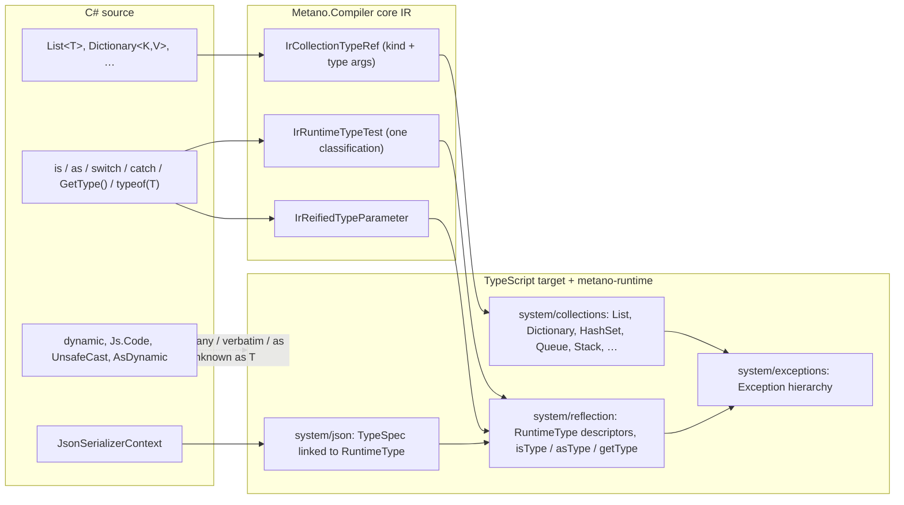

# Feature Specification: BCL collections as runtime types, runtime type descriptors

**Feature Branch**: `spec/011-runtime-collections-and-types`

**Created**: 2026-11-01

**Status**: Draft (spec change request)

**Input**: GitHub issue [danfma/metano#335](https://github.com/danfma/metano/issues/335), "Introduce runtime collection types and runtime type descriptors", plus the maintainer brief and its three amendments (`dynamic` is supported; a per-target inline-code function; the `UnsafeCast<T>()` / `AsDynamic()` escape hatches). The findings that ground every requirement are in [research.md](./research.md) (R1–R12).

**Traceability**: a 3.0.0 breaking change. It extends these legacy requirement families of the baseline: types and collections (`FR-015`–`FR-018`), semantic transformation and pattern matching (`FR-005`–`FR-014`, especially `FR-013` and `FR-014`), serialization (`FR-032`–`FR-034`) and diagnostics (`FR-038`–`FR-040`). It adds rows to the baseline [feature-support matrix](../001-project-baseline-evolution/baseline/feature-support-matrix.md) and reserves `MS0044`–`MS0054` in the [diagnostic catalog](../001-project-baseline-evolution/baseline/diagnostic-catalog.md). As in features 002–010, FR identifiers are local to this feature and are cited as "011 FR-0NN".

**Related specs**: [009-polymorphic-json](../009-polymorphic-json/spec.md) and [010-csharp-unions](../010-csharp-unions/spec.md) consume the runtime tests and descriptors defined here. Neither is edited by this PR; the requirements of theirs that change are listed in [Interaction with specs 009 and 010](#interaction-with-specs-009-and-010), and the shared 3.0.0 release in FR-036.

## Overview

Metano maps `List<T>` to a native JS array and `Dictionary<K,V>` to a native `Map`, and lowers every collection member through templates that encode Array semantics (`Count` → `length`, `RemoveAt` → `splice`, `Clear` → `length = 0`; research R1). Only `HashSet<T>` is a runtime class. Three consequences follow:

1. **No C# exceptions.** `list[10]` on a three-element list is `undefined`, a dictionary indexer miss is `undefined`, `Stack.Pop()` on an empty stack is `undefined`.
2. **No runtime identity.** `is List<T>`, `is IList<T>`, `is IEnumerable<T>`, `is T` for an open `T`, `typeof(T)`, `GetType()` and typed `catch` either report MS0001 or silently do the wrong thing (`catch (InvalidOperationException e)` catches everything; research R3).
3. **IIFEs.** Where a collection step is a template rather than a method, null-conditional chains and evaluate-once sites render as immediately-invoked functions (research R2).

This feature makes the BCL collections real `metano-runtime` classes that implement `Iterable<T>`, introduces `JsArray<T>` for the native array, makes BCL exceptions real runtime classes, replaces IIFEs with runtime helpers, and adds **runtime type descriptors** (`RuntimeType`) consumed by `is` / `as` / patterns, typed `catch`, `GetType()`, `typeof(T)` and the JSON context. Descriptors cost nothing for code that asks no runtime-type question. Three interop features complete it: `dynamic` as TS `any`, a per-target inline-code function (`Js.Code`), and the `UnsafeCast<T>()` / `AsDynamic()` escape hatches.

## Maintainer decisions (normative)

- **D1 — Own runtime collections.** `List<T>`, `Dictionary<K,V>`, `HashSet<T>`, `Queue<T>`, `Stack<T>`, the read-only views and the immutable collections mapped today become `metano-runtime` classes. They are **not** `Array` subclasses and **not** array copies. They implement `Iterable<T>`, so `for..of`, spread and `Array.from` work (FR-001, FR-002).
- **D2 — `JsArray<T>`.** A dedicated C# type maps to the native JS `Array` (FR-004). `T[]` keeps mapping to the native array.
- **D3 — `List<T>` ↔ `JsArray<T>` conversion** is explicit (OD-1 recommends explicit methods and rejects implicit conversions; FR-005).
- **D4 — Runtime helpers, never IIFEs.** Where semantics need evaluate-once, bounds checks or a C# exception, the emitted code calls a runtime helper or a method of the runtime class. No IIFE and no composite expression at the call site (FR-009, FR-010).
- **D5 — Classes test nominally** with `instanceof`. The descriptor is a symbol-keyed static on the constructor, so `GetType()` returns the concrete derived type; objects created without `new` lose identity and fall back (FR-018).
- **D6 — Interfaces implemented by classes** test nominally: the class descriptor lists its interfaces (FR-019).
- **D7 — `[PlainObject]`** is a shape: `is` / `as` / `switch` become a structural guard with an overlap warning; `GetType()` on a known static plain-object type is a compile-time constant; `GetType()` on an `object` that may hold one warns and answers `object`; no `$type` field is injected (FR-020).
- **D8 — Generics.** Only runtime collections carry type-argument descriptors; native arrays and `JsArray` erase; closed generic types get a memoized specialized descriptor; an open `T` used at runtime inside a generic body gets a hidden descriptor parameter, added only when the body needs it (FR-008, FR-023, FR-024).
- **D9 — Primitives.** `int` versus `double` is decided from the static type where possible, otherwise with an `Int32` guard; the limit is documented (FR-022).
- **D10 — Typed catch** is one JS `catch` with an `instanceof` chain over real runtime exception classes (FR-013 to FR-016).
- **D11 — `dynamic` is supported**, without type guarantees, as in TS: it maps to `any` (Dart: `dynamic`) and operations on it pass straight through (FR-030). *This replaces the brief's earlier "out of scope with a diagnostic".*
- **D12 — Inline target code.** A per-target function, `Js.Code("…")` / `Js.Code<T>("…")`, emits a compile-time-constant string verbatim (FR-031 to FR-034). Dart gets its own equivalent later.
- **D13 — Escape hatches.** `x.UnsafeCast<T>()` is a compile-time-only reinterpretation and `x.AsDynamic()` turns any value into `dynamic`; the C# cast `(T)x` and `as T` stay **checked** whenever descriptors can answer (FR-040, FR-041).
- **D14 — Zero cost.** Descriptors are emitted only for types reached by `is` / `as` / patterns / `catch` / serialization / `GetType()` / `typeof` (FR-027, NFR-002).
- **D15 — Deepkit lessons.** Borrow the typed-object-literal descriptor, thunks, emit-only-what-is-used and closure-composed serializers; do not copy the transformer, the bytecode VM, the `new Function` JIT or the structural `is<T>` (research R10, NFR-003).
- **D16 — One 3.0.0.** Everything ships in one major together with #328 (the `Metano.Build` split), spec 010 (unions) and spec 009 (polymorphic JSON), with migration notes (FR-036).

## User Scenarios & Testing *(mandatory)*

### User Story 1 - Collections behave like .NET collections (Priority: P1)

A developer writes ordinary C# over `List<T>`, `Dictionary<K,V>`, `Queue<T>` and `Stack<T>`. The generated TypeScript uses `metano-runtime` classes whose members mirror the BCL: out-of-range access throws `ArgumentOutOfRangeException`, a missing key throws `KeyNotFoundException`, `Contains` on a record list uses value equality, and `foreach` / spread / LINQ keep working because every collection is an `Iterable<T>`.

**Why this priority**: every other story builds on the collection classes, and this is the breaking change that defines 3.0.0.

**Independent Test**: transpile `samples/SampleTodo` and run `targets/js/sample-todo` tests: `TodoList.Items` is a `List<TodoItem>`, `items.get(99)` throws `ArgumentOutOfRangeException`, and `[...items]` yields the elements.

**Acceptance Scenarios**:

1. **Given** `var xs = new List<int> { 1, 2 }; xs.Add(3);`, **When** transpiled, **Then** the output is `const xs = List.of<number>(1, 2); xs.add(3);` and `xs.count` is `3` at runtime. No IIFE is emitted for the initializer.
2. **Given** `xs[5]` on a three-element list, **When** run, **Then** `ArgumentOutOfRangeException` is thrown with .NET's message (`Index was out of range. Must be non-negative and less than the size of the collection. (Parameter 'index')`).
3. **Given** `dict["missing"]`, **When** run, **Then** `KeyNotFoundException` is thrown with .NET's message (`The given key 'missing' was not present in the dictionary.`); `dict.TryGetValue(k, out v)` keeps today's tuple lowering.
4. **Given** `Dictionary<Point, string>` with a record key, **When** two equal-by-value keys are used, **Then** they address the same entry (keys hash through `hashCode` / `equals`), which today's native `Map` does not do.
5. **Given** `queue.Dequeue()` or `stack.Pop()` on an empty collection, **When** run, **Then** `InvalidOperationException` (`Queue empty.` / `Stack empty.`) is thrown. `foreach` over a `Stack<T>` enumerates top-first.
6. **Given** `foreach (var x in list)`, `[..list]`, `list.Select(...)` and `Array.from(list)` in hand-written TS, **When** run, **Then** all enumerate the list; `Array.isArray(list)` is `false` and `list instanceof List` is `true`.
7. **Given** `int[] a = …; IReadOnlyList<int> r = a;`, **When** transpiled, **Then** the conversion emits `List.adopt(a)` (zero copy, shared storage) so `r.count` and `r.get(0)` work; `is List<int>` on `r` is `true` in TS and `false` in C# (documented divergence, Edge Cases).
8. **Given** `HashSet<T>.Add(x)`, **When** transpiled, **Then** the call returns a `boolean` as in C# (today's runtime returns `this`), and `set.count` replaces `set.size`.

### User Story 2 - Runtime helpers replace IIFEs (Priority: P1)

A developer writes `order?.Items.Clear()`, `GetNext().Items[^1]` or `x as Order` with a side-effecting operand. The output calls a method or a runtime helper that evaluates its receiver once and throws the C# exception; it never contains an immediately-invoked function or a composite expression such as `$this.length = 0`.

**Independent Test**: the goldens `null-conditional-guards.ts` and `index-and-range.ts` contain no `(() =>` or `(($` sequence after regeneration.

**Acceptance Scenarios**:

1. **Given** `order?.Items.Clear()`, **When** transpiled, **Then** the output is `order?.items.clear();`, a native optional chain, because `clear` is a method of the runtime class; no `$receiver` block and no IIFE is emitted. `order?.Items.Remove(x)` in expression position is `order?.items.remove(x) ?? null` under the existing null-conditional typing.
2. **Given** `GetNext().Items[^1]`, **When** transpiled, **Then** the output is `getNext().items.fromEnd(1)`, which evaluates `getNext()` once and throws `ArgumentOutOfRangeException` when the list is empty.
3. **Given** `arr[^1]` on a `T[]` or `JsArray<T>`, **When** transpiled, **Then** the output is `fromEnd(arr, 1)` (a runtime helper that throws `IndexOutOfRangeException` on an empty array).
4. **Given** `Compute() as Order`, **When** transpiled, **Then** the output is `asType(compute(), Order)` (one evaluation; `null` when the test fails), never `((v) => v instanceof Order ? v : null)(compute())`.
5. **Given** `new List<int>(capacity: Next())`, **When** transpiled, **Then** the output is `List.withCapacity<number>(next())` (the argument is evaluated once), never the `BindSideEffectsInSourceOrder` IIFE.
6. **Given** `stack.Peek()` where `stack` is `GetStack()`, **When** transpiled, **Then** `getStack()` appears once in the output.

### User Story 3 - Runtime type questions are answered nominally (Priority: P1)

A library has an abstract factory `Shape Create(string kind)` that returns `Circle` or `Square`. A caller writes `shape.GetType().Name`, `shape is IHasArea`, `shape switch { Circle c => …, Square s => … }` and `catch (InvalidOperationException e)`. The output answers each one the way C# does, through descriptors attached to the constructors, and types that no code asks about carry no descriptor.

**Independent Test**: a golden `runtime-types-factory.ts` plus a bun test that asserts `create("circle").getType() === Circle[runtimeType]`, `getType(create("circle")).name === "Circle"`, `isType(shape, IHasArea.$type)` and that `Square`, which nothing tests, has no `static [runtimeType]` member.

**Acceptance Scenarios**:

1. **Given** `shape.GetType()` where `shape` is `Circle` at runtime, **When** run, **Then** the result is the `Circle` descriptor (`name: "Circle"`, `fullName: "Geometry.Circle"`), not `Shape`'s, and `shape.GetType() == typeof(Circle)` is `true` (descriptor identity).
2. **Given** `o is IHasArea` where `o` is a `Circle` instance whose class declares `IHasArea`, **When** run, **Then** the result is `true`; for an unrelated class instance with a structurally identical `area` member it is `false` (nominal).
3. **Given** `o is IHasArea` where `o` is a plain object (no constructor descriptor) and a `[PlainObject]` type in the compilation implements `IHasArea`, **When** run, **Then** the structural guard of that plain-object type answers (OD-8); with no such type the result is `false`.
4. **Given** `catch (ArgumentNullException e) { … } catch (ArgumentException e) { … } catch (Exception e) { … }`, **When** transpiled, **Then** one JS `catch (e$)` is emitted with `if (e$ instanceof ArgumentNullException) … else if (e$ instanceof ArgumentException) … else { const e = toException(e$); … }`; a non-matching throwable is rethrown when no catch-all exists.
5. **Given** `catch (FormatException) when (count > 3)`, **When** transpiled, **Then** the arm test is `e$ instanceof FormatException && count > 3`.
6. **Given** `throw new InvalidOperationException("x")`, **When** transpiled, **Then** the output is `throw new InvalidOperationException("x")` with a value import from `metano-runtime/system/exceptions`; `e instanceof Error` stays `true`.
7. **Given** a class `Square` that no `is` / `as` / pattern / `catch` / serialization / `GetType()` / `typeof` reaches, **When** transpiled, **Then** its output is byte-identical to 2.x except for collection-member changes (NFR-002).
8. **Given** `JSON.parse(text) as Circle` written by hand in TS, or `{ ...circle }`, **When** `getType(value)` runs, **Then** the result is the `object` descriptor (identity is lost; documented), while `copyRecordWith(circle, { r: 2 })` (Metano's `with`) keeps `Circle`.

### User Story 4 - Generic code can ask about `T` (Priority: P2)

A developer writes `T Parse<T>(string s)` with `if (typeof(T) == typeof(int))`, or `bool IsA<T>(object o) => o is T`, or `new List<T>()` inside a generic method, or `default(T)`. The method gains one hidden trailing parameter that carries `T`'s descriptor, call sites pass the closed descriptor, and methods whose bodies never ask about `T` keep their signature.

**Independent Test**: a golden `reified-type-parameters.ts` plus a bun test that calls `isA<number>(5, Int32)` and `isA(new Circle(), Circle[runtimeType])`.

**Acceptance Scenarios**:

1. **Given** `bool IsA<T>(object o) => o is T;` and a call `IsA<Circle>(x)`, **When** transpiled, **Then** the output is `export function isA<T>(o: unknown, T$type: RuntimeType<T>): boolean { return isType(o, T$type); }` and the call is `isA(x, Circle[runtimeType])`.
2. **Given** `T First<T>(IEnumerable<T> xs)` whose body never names `T` at runtime, **When** transpiled, **Then** its signature is unchanged (no hidden parameter).
3. **Given** `IsA<int>(o)`, `IsA<List<string>>(o)` and `IsA<U>(o)` from inside another reified method, **When** transpiled, **Then** the arguments are `Int32`, `listType(String)` (memoized, so two call sites share one descriptor object) and `U$type`.
4. **Given** an interface method `void Visit<T>(T x)` whose implementation in one class uses `is T`, **When** transpiled, **Then** the interface member, every implementation and every call site carry the hidden parameter (signature-level propagation).
5. **Given** a generic method with `is T` whose group is converted to a delegate (`Func<object, bool> f = IsA<Circle>`), **When** transpiled, **Then** the conversion emits `(o) => isA(o, Circle[runtimeType])`.
6. **Given** `class Box<T> { public bool Holds(object o) => o is T; }`, **When** transpiled, **Then** the constructor gains a trailing hidden parameter stored in a hidden field, `new Box<int>()` passes `Int32`, and `box.GetType()` returns the memoized `Box<int>` descriptor.
7. **Given** `is T` inside an `[Emit]`-mapped extern, inside an `[External]` interface member, or inside a `[JsCallable]` delegate's body, **When** transpiled, **Then** `MS0053` (error) names the position that cannot carry a hidden parameter.
8. **Given** a hidden parameter added to a public member of an `[EmitPackage]` library or an `[ExportedAsModule]` function, **When** transpiled, **Then** `MS0049` (warning) states that JS callers must pass the descriptor, once per member.

### User Story 5 - Plain objects are shapes (Priority: P2)

A developer tests `o is UserDto` where `UserDto` is `[PlainObject]`. The output calls the synthesized structural guard, and the build warns when another reachable `[PlainObject]` has a compatible shape, mirroring MS0039 for unions. `GetType()` is a constant where the static type is known.

**Acceptance Scenarios**:

1. **Given** `o is UserDto u`, **When** transpiled, **Then** the output is `isUserDto(o)` with the binding, and `isUserDto` is synthesized in `UserDto`'s file whether or not `[GenerateGuard]` is present (as 009 FR-019 and 010 FR-041 do).
2. **Given** `[PlainObject] record A(string Name)` and `[PlainObject] record B(string Name, int Age)` both reachable from the tested expression's static type, **When** `o is A` is transpiled, **Then** `MS0046` (warning) names `A` and `B` and the shared members; the output is emitted.
3. **Given** `UserDto dto = …; dto.GetType()`, **When** transpiled, **Then** the output is the constant `UserDto.$type` (no runtime call).
4. **Given** `object o = …; o.GetType()` where a `[PlainObject]` in the compilation is assignable to `object`, **When** transpiled, **Then** `MS0047` (warning) is reported once per call site, and at runtime a plain object answers the `object` descriptor.
5. **Given** a `[PlainObject]` DTO serialized through the JSON context, **When** written, **Then** no `$type` or other identity field is added; `[JsonPolymorphic]` remains the only discriminator (009).

### User Story 6 - `dynamic`, inline code and escape hatches (Priority: P2)

A developer manipulates raw JS data: `dynamic cfg = Js.Code("globalThis.__config"); string name = cfg.appName; var el = Js.Code<HtmlElement>($"document.querySelector({selector})"); var dto = raw.UnsafeCast<UserDto>(); var any = order.AsDynamic(); any.extra = 1;`. Each construct erases to idiomatic TS and none needs a facade declaration.

**Acceptance Scenarios**:

1. **Given** `dynamic d = …; d.foo.bar(1)[2] + d.n`, **When** transpiled, **Then** the output is `d.foo.bar(1)[2] + d.n` with `d: any`; member names are emitted verbatim (OD-11).
2. **Given** `string s = d;` and `(int)d`, **When** transpiled, **Then** both are checked conversions through the descriptors (`castTo(d, String)`, `castTo(d, Int32)`) that throw `InvalidCastException` on mismatch (D13, OD-10 records the alternative).
3. **Given** `d is Circle c`, `d as IHasArea`, `d switch { int n => … }`, **When** transpiled, **Then** the descriptor-based tests of US3 apply unchanged.
4. **Given** `new List<int> { d }`, a `dynamic` argument to a `ref` / `out` parameter, or a collection initializer on a `dynamic` receiver, **When** transpiled, **Then** `MS0052` (error) names the construct.
5. **Given** `Js.Code("performance.now()")`, **When** transpiled, **Then** the output is `(performance.now())` typed `any`; `Js.Code<double>("performance.now()")` is `(performance.now()) as number`.
6. **Given** `Js.Code($"{el}.scrollIntoView({{ block: {mode} }})")` where `el` and `mode` are C# locals, **When** transpiled, **Then** the holes are the transpiled expressions (`el.scrollIntoView({ block: mode })`), the literal parts are verbatim, and an `[Import]` facade referenced in a hole pulls its import (OD-13).
7. **Given** `Js.Code(someVariable)` (not a constant), **When** transpiled, **Then** `MS0051` (error).
8. **Given** `Js.Code(...)` or a `JsArray<T>` reference in a project compiled for Dart, **When** transpiled, **Then** `MS0050` (error), unless the containing member carries `[Ignore(TargetLanguage.Dart)]`.
9. **Given** `raw.UnsafeCast<UserDto>()`, **When** transpiled, **Then** the output is `raw as unknown as UserDto` (TS) or `raw as UserDto` (Dart, which cannot be unchecked; research R7) and no diagnostic is reported.
10. **Given** `(List<string>)o` where `o` is a `JsArray<string>`-typed value or an erased generic, **When** transpiled, **Then** the cast is unchecked and `MS0054` names it, suggesting `UnsafeCast<T>()` as the warning-free spelling.
11. **Given** `order.AsDynamic().extra = 1`, **When** transpiled, **Then** the output is `(order as any).extra = 1` (TS) / `(order as dynamic).extra = 1` (Dart).

### User Story 7 - JSON uses the same descriptors (Priority: P2)

A context that reaches `List<Clip>`, `Dictionary<string, Clip>` and a polymorphic `Clip` deserializes `List<Clip>` into a runtime `List`, dispatches writes through the class descriptors, and keeps spec 009's wire format byte-for-byte.

**Acceptance Scenarios**:

1. **Given** a `List<Clip>` property, **When** deserialized, **Then** the result is a runtime `List<Clip>` whose elements are class instances; a `Clip[]` or `JsArray<Clip>` property yields a native array.
2. **Given** a polymorphic base reached through `TypeSpec.runtimeType`, **When** written, **Then** the variant is resolved through the value's descriptor (009 FR-005 `byCtor` stays valid: the constructor is the descriptor's owner).
3. **Given** every fixture of spec 009's conformance sample, **When** round-tripped, **Then** the bytes are unchanged (the wire format does not depend on the in-memory collection class).

### User Story 8 - Dart does not regress (Priority: P3)

**Acceptance Scenarios**:

1. **Given** the Dart samples, **When** transpiled, **Then** `List`, `Map`, `Set` and `on T catch (e)` are emitted as today; an `IrCollectionTypeRef` for `Queue` / `Stack` maps to `Queue` (`dart:collection`) / a documented gap (FR-035).
2. **Given** `is T` in a generic body, **When** transpiled for Dart, **Then** no hidden parameter is added (Dart reifies natively) and the output is `x is T`.
3. **Given** `x.UnsafeCast<T>()`, `x.AsDynamic()` and `dynamic`, **When** transpiled for Dart, **Then** the outputs are `x as T`, `x as dynamic` and `dynamic`.

### Edge Cases

- **Arrays converted to list interfaces.** `IReadOnlyList<int> r = new[] { 1, 2 }` is legal C#, and arrays implement `IList<T>`. The conversion emits `List.adopt(arr)` (shared storage, zero copy; FR-003). Divergences: `r is List<int>` is `true` in TS and `false` in C#; `IList<T>.Add` on an adopted array succeeds in TS where C# throws `NotSupportedException` (fixed-size). Both are documented; the second is not detected in v1.
- **Collections with an erased element descriptor.** `new List<T>()` in a body where `T` is not reified carries the `unknown` element descriptor (FR-008). An `is List<string>` test against such a list is `true` (wildcard). Deterministic, documented; the alternative (make every `new List<T>()` reify `T`) would make hidden parameters viral.
- **`JsArray<T>` and `T[]` erase.** `o is string[]` / `o is JsArray<string>` emit `Array.isArray(o)` and `MS0045` (warning); `o is object[]` is reported too, because C# arrays are covariant and `Array.isArray` is the exact answer only for `object[]`, which is the one case without the warning.
- **Identity loss.** A value created by `JSON.parse`, by spread `{ ...obj }`, by `Object.assign({}, obj)`, or by an external library has prototype `Object.prototype`: `instanceof` fails, `getType` answers `object`, interface tests fall back to plain-object guards (OD-8). Metano's own `with` (`copyRecordWith`, `record-copy.ts` L26-36, `Object.create(proto)`) preserves the prototype.
- **Primitives.** `object o = 1.0; o is int` is `true` in TS (`isInt32(1)`), `false` in C#. `o is double` is `true` for a boxed `int` in TS, `false` in C#. `o is float` and `o is decimal` both pass any number. `o is char` passes any one-character string. `GetType()` on a `number` answers `Double`, on a `string` `String`, on a `boolean` `Boolean`, on a `bigint` `BigInteger`. Where the static type is a primitive the compiler folds the test to a constant and reports nothing (C# itself warns CS0183/CS0184).
- **`NullReferenceException`.** The runtime class exists for user `throw` and `catch`, but a native `TypeError` thrown by JS for a null member access is **not** translated: `catch (NullReferenceException)` does not catch it. `catch (Exception e)` does, wrapping it through `toException`.
- **`catch (Exception e)` and non-Error throwables.** JS can throw any value. The catch-all arm binds `e` to `toException(e$)`: an `Exception` passes through; an `Error` is wrapped in an `Exception` whose `message`, `stack` and `innerException` (`cause`) mirror it; any other value becomes `Exception(String(value))`. `throw;` rethrows the original `e$`, so wrapping never changes what propagates.
- **Reified `T` and `params` / optional parameters.** The hidden parameter is trailing, so it goes **before** a `params` rest parameter and, when a preceding parameter is optional, is declared with a default of `Unknown` (OD-7). Call sites that Metano generates always pass it positionally (passing `undefined` for omitted optional arguments in between, as the existing optional-argument lowering does).
- **Overload dispatch with reified parameters.** Overloads that differ only by a hidden parameter cannot exist (the hidden parameter is appended to every overload of the group, FR-024), so the dispatcher's arity check reads the declared C# arity.
- **`GetType()` on a union** stays the spec 010 MS0043 warning: a union is erased, so the answer is the case type.
- **`typeof(T)` where `T` is `dynamic`, a pointer, `void` or an open generic definition (`typeof(List<>)`)** reports `MS0048`. `typeof(List<string>)` is the memoized `listType(String)`.
- **`Type` API surface.** Supported: `Name`, `FullName`, `Namespace`, `IsInterface`, `IsClass`, `IsValueType`, `IsGenericType`, `GenericTypeArguments`, `IsInstanceOfType(o)`, `IsAssignableFrom(t)`, `==` / `!=` / `Equals` (identity), `ToString()` (`FullName`). Everything else (`GetMethod`, `GetProperties`, `Activator.CreateInstance`, `MakeGenericType`) reports `MS0048`. The descriptor carries no member metadata, which keeps D14's zero cost.
- **`new T()` under `where T : new()`.** Today MS0019 ("generics are erased"). With a reified `T`, `new T()` lowers to `T$type.create()` where the descriptor of a class with a public parameterless constructor carries `create`; a `T` whose descriptor cannot construct (an interface, a plain object, a primitive without a default) throws `MissingMethodException` at runtime, as .NET does. MS0019 is retired for reified sites and kept for sites that cannot be reified (MS0053 names them).
- **`default(T)`.** With a reified `T`, `default(T)` lowers to `T$type.defaultValue` (`0`, `false`, `""`… for primitives; `null` otherwise), which closes the type-correct `default(T)` gap of #291 for reified sites; a non-reified `T` keeps today's `null`.
- **`dynamic` operators.** `+`, `-`, comparison and `==` on `dynamic` operands pass through as JS operators. JS and the DLR agree on numbers and strings in the common cases and disagree on `==` with mixed types (`1 == "1"`), on `+` with `null`, and on integer division. These are documented divergences (OD-12); Metano does not emit the DLR binder.
- **`dynamic` member naming.** No symbol exists, so no `[Name]` lookup and no camelCase: `d.AppName` emits `d.AppName` (OD-11). A developer who wants `d.appName` writes it.
- **`Js.Code` in statement position.** When the call is an expression statement, the string is emitted verbatim as statement text (it may contain several statements); in expression position it is emitted in parentheses. A `Js.Code<T>` whose result is unused is still an expression statement.
- **`Js.Code` holes.** A hole is any C# expression; it is transpiled by the normal pipeline and spliced at the hole. A hole that is a method group of an `[Import]` facade pulls the import; any other identifier inside the literal text is opaque and pulls nothing (FR-032).
- **`UnsafeCast<T>()` on .NET.** The C# implementation is `(T)value!`, which throws `InvalidCastException` on .NET when the type is wrong, while TS silently succeeds (OD-15). `AsDynamic()` returns its argument on .NET, so dynamic member access binds through the DLR there.
- **Cross-package collections.** A library compiled with 2.x exposes arrays where 3.0 consumers expect `List`. There is no shim: library and consumer must be on the same major (FR-036 migration notes).

## Requirements *(mandatory)*

### Functional Requirements

#### A. Runtime collections (D1, D2, D3)

- **FR-001 — Inventory and mapping.** The TypeScript target MUST map these C# types to `metano-runtime` classes exported from `metano-runtime/system/collections` (today's mapping in research R1):

  | C# | 3.0 TS type | Replaces |
  |---|---|---|
  | `List<T>` | `List<T>` | `T[]` |
  | `IList<T>`, `ICollection<T>`, `IReadOnlyList<T>`, `IReadOnlyCollection<T>` | the runtime interfaces of the same name | `T[]` / `Iterable<T>` |
  | `Dictionary<K,V>`, `IDictionary<K,V>`, `IReadOnlyDictionary<K,V>`, `ConcurrentDictionary<K,V>`, `SortedDictionary<K,V>` (OD-18) | `Dictionary<K,V>` / the runtime interfaces | native `Map<K,V>` |
  | `Dictionary<K,V>.KeyCollection` / `.ValueCollection`, `dict.Keys` / `dict.Values` | `KeyCollection<K>` / `ValueCollection<V>` live read-only views | snapshot arrays |
  | `HashSet<T>`, `ISet<T>`, `IReadOnlySet<T>`, `SortedSet<T>` (OD-18), `ImmutableHashSet<T>` | `HashSet<T>` (reworked) / the runtime interfaces | runtime `HashSet<T>` |
  | `Queue<T>` | `Queue<T>` (ring buffer) | `T[]` |
  | `Stack<T>` | `Stack<T>` | `T[]` |
  | `ImmutableList<T>`, `ImmutableArray<T>` (OD-17) | `ImmutableList<T>` | `T[]` + `ImmutableCollection.*` |
  | `ReadOnlyCollection<T>` (`list.AsReadOnly()`, `Array.AsReadOnly`) | `ReadOnlyList<T>` | `T[]` |
  | `KeyValuePair<K,V>` | the tuple `[K, V]` (unchanged) | — |
  | `IEnumerable<T>`, `IQueryable<T>`, `IOrderedEnumerable<T>` | `Iterable<T>` (unchanged) | — |
  | `T[]` | native `T[]` (unchanged) | — |
  | `JsArray<T>` (new, FR-004) | native `T[]` | — |

  The core IR MUST represent the collection kinds with one `IrCollectionTypeRef(Kind, TypeArguments)` (data-model.md), replacing the `IrArrayTypeRef` / `IrMapTypeRef` / `IrSetTypeRef` overloads of meaning for these types; `IrArrayTypeRef` stays for `T[]` and `JsArray<T>`. The Dart target maps the new node to its native collections (FR-035).
- **FR-002 — Shape.** Every runtime collection class MUST: not extend `Array`; not copy on construction from an `Iterable` beyond one pass; implement `Iterable<T>` (`[Symbol.iterator]`); expose `count` (not `length` / `size`); carry no enumerable own properties other than its storage (so `JSON.stringify` of a collection is not a supported serialization path; the JSON context is, FR-028); and expose its type-argument descriptors through the hidden field of FR-008. `Array.isArray(collection)` MUST be `false`.
- **FR-003 — Interfaces and conversions.** The runtime MUST export TS interfaces `IReadOnlyCollection<T> extends Iterable<T>`, `IReadOnlyList<T>`, `ICollection<T>`, `IList<T>`, `IReadOnlyDictionary<K,V>`, `IDictionary<K,V>`, `IReadOnlySet<T>`, `ISet<T>` with the camelCase members of their BCL counterparts (contracts/runtime-collections.md), implemented by the classes of FR-001. `IEnumerable<T>` stays `Iterable<T>`. Because native arrays do not implement these interfaces, the core MUST emit `List.adopt(array)` at every C# conversion (implicit or explicit) from `T[]` / `JsArray<T>` to `IList<T>`, `ICollection<T>`, `IReadOnlyList<T>` or `IReadOnlyCollection<T>`; `adopt` shares the array's storage (zero copy). Conversions to `IEnumerable<T>` emit nothing.
- **FR-004 — `JsArray<T>`.** `Metano.Interop.JsArray<T>` (namespace per OD-14) MUST be a C# class that implements `IList<T>` and `IReadOnlyList<T>` (backed by a `List<T>` on .NET) and maps to the native TS `T[]`: its members map to the Array API (`Length` → `length`, `Push`, `Pop`, `Shift`, `Unshift`, `Slice`, `Splice`, `IndexOf`, `Includes`, `Map`, `Filter`, `ForEach`, `Join`, `Reverse`, `Sort`, `At`, the indexer → `arr[i]`), the C# `T[]` → `JsArray<T>` implicit conversion emits nothing (both are the native array), and `JsArray<T>` is TS-only (`MS0050` in any other target, FR-033). It exists so that interop signatures (`[Import]` facades, `[JsCallable]` callbacks, JSX props) can name the native array without using `T[]`'s C# semantics.
- **FR-005 — `List<T>` ↔ `JsArray<T>` conversion** (OD-1). The runtime and the C# surface MUST provide explicit conversions: `list.ToJsArray()` → `list.toArray()` (copy), `JsArray.From(list)` → `Array.from(list)` (copy), `JsArray.AsList()` → `List.adopt(arr)` (zero copy, shared storage), `List.From(arr)` → `List.from(arr)` (copy). No implicit conversion is declared between `List<T>` and `JsArray<T>`, so no copy is hidden at a call site. `T[]` → `JsArray<T>` is implicit and free (FR-004).
- **FR-006 — Semantic parity.** The runtime classes MUST reproduce .NET semantics for every mapped member (contracts/runtime-collections.md): bounds-checked `get` / `set` / `insert` / `removeAt` throwing `ArgumentOutOfRangeException`; `Dictionary.get` throwing `KeyNotFoundException`; `add` throwing `ArgumentException` on a duplicate key and `ArgumentNullException` on a `null` key; `Queue.dequeue` / `peek` and `Stack.pop` / `peek` throwing `InvalidOperationException` on empty; `HashSet.add` / `remove` and `Dictionary.remove` returning `boolean`; `contains`, `indexOf`, `remove` and dictionary / set keys using the runtime `equals` / `hashCode` helpers (`EqualityComparer<T>.Default` semantics: records and user `Equals` overrides compare by value), with a fast path for primitives; insertion order on enumeration; `Stack` enumerating top-first; `Queue` dequeuing in O(1). Comparer constructor overloads (`IEqualityComparer<T>`) MUST be mapped to a comparer parameter of the runtime classes.
- **FR-007 — Mapping layer.** The declarative mappings in `src/Metano/Runtime/{Lists,Dictionaries,Sets,Queues,Stacks,ImmutableCollections,Enumerators}.cs` MUST be rewritten so that every instance member maps to the camelCase member of the runtime class with no template (`Count` → `count`, `Add` → `add`, `RemoveAt` → `removeAt`, …), keeping templates only where C# and runtime arities differ (`TryGetValue` → the `[found, value]` tuple, `GetValueOrDefault`). Constructors map to factories: `new List<T>()` → `new List<T>()`, `new List<T>(capacity)` → `List.withCapacity<T>(n)`, `new List<T>(src)` → `List.from(src)`, collection initializers and collection expressions → `List.of(...)`, `Dictionary.of([[k, v], …])`, `HashSet.of(...)`; the `IrLetExpression` + `IrSequenceExpression` initializer lowering (research R2) is not used for collections. `ToList()` MUST be a LINQ terminal `toList()` that returns a `List<T>`; `ToArray()` keeps returning a native array; `ToDictionary` / `ToHashSet` return the runtime classes. `Stack.GetEnumerator` is mapped (top-first). The `Enumerable.from` wrapper entries of `Linq.cs` are deleted, since the pipe is the live path (research R1).
- **FR-008 — Type-argument descriptors.** A runtime collection MUST carry the descriptors of its type arguments in a hidden non-enumerable field, set at construction: the compiler passes them as a trailing constructor / factory argument when the arguments are statically **closed** (`new List<string>()` → `new List<string>(undefined, [String])`-style, exact shape in contracts/runtime-collections.md); when an argument is an open `T` that is not reified in that body, the `Unknown` descriptor is passed. A collection built by the runtime itself (`toList()`, `slice`, `keys`) inherits its source's descriptors where known. `is List<string>` MUST compare the element descriptor by identity and treat `Unknown` as a wildcard (Edge Cases).

#### B. Runtime helpers instead of IIFEs (D4)

- **FR-009 — No IIFE for collection semantics.** The TypeScript target MUST NOT produce `TsImmediateInvocation` for: null-conditional chains whose steps are collection members (they become native optional chains, because the steps are methods); index-from-end and range expressions; `as` casts; collection initializers and collection expressions; constructor templates that drop an argument (replaced by factories with full arity); BCL exception argument reordering (replaced by the runtime constructors, FR-013). `IrLetExpression` stays in the IR for the sites it still serves (lifted nullable operators, tuple equality, extension setters), and switch-expression / pattern-binding IIFEs are out of scope. A composite template (`$this.length = 0`, `($this.find($0) ?? null)`, a template that names `$this` twice) MUST NOT exist in the collection mapping files; a test scans the mapping assembly for templates with two `$this` occurrences.
- **FR-010 — Index semantics.** `list[i]` reads MUST lower to `list.get(i)` and writes to `list.set(i, v)` (OD-3), both bounds-checked; `list[^n]` → `list.fromEnd(n)`; `list[a..b]` → `list.slice(a, b)` (a new `List`); `arr[^n]` on `T[]` / `JsArray<T>` → the runtime helper `fromEnd(arr, n)` (throws `IndexOutOfRangeException` on an out-of-range index); `arr[a..b]` → `arr.slice(a, b)`. A receiver with side effects is evaluated once because the receiver is now the single argument of a method call or helper; no let-binding is needed. `arr[i]` on a native array stays the native, unchecked access (OD-4; documented divergence). `dict[k]` reads → `dict.get(k)` (throws), writes → `dict.set(k, v)`.
- **FR-011 — Package exports.** `targets/js/metano-runtime/package.json#exports` MUST add explicit entries `./system/collections`, `./system/exceptions` and `./system/reflection` (with `source` / `types` / `import` conditions as in spec 008), and the root barrel keeps re-exporting them. Generated imports of collection classes use `metano-runtime/system/collections`; the smoke test of spec 007 covers the new entries. Each module MUST be tree-shakable (`sideEffects: false` stays true: no module-level registration side effects).
- **FR-012 — Dictionary views.** `dict.Keys` / `dict.Values` MUST be live read-only views (`KeyCollection<K>` / `ValueCollection<V>`: `count`, `contains`, iteration) rather than snapshot arrays; `Keys.Count` / `Values.Count` / `Keys.Contains` keep folding to the dictionary's `count` / `containsKey` (`DictionaryKeysContainsRewriter`). Enumerating a dictionary yields `[K, V]` tuples, so `foreach (var (k, v) in dict)` and `kv.Key` / `kv.Value` keep today's lowering.

#### C. Exceptions (D10)

- **FR-013 — Runtime exception classes.** `metano-runtime/system/exceptions` MUST export `Exception` (extends `Error`; `message`, `innerException` (also set as `cause`), `stackTrace` (`stack`), `name` = the class name, `toString()` as .NET formats it: `Namespace.Type: message`), `SystemException`, `InvalidOperationException`, `ArgumentException` (`paramName`), `ArgumentNullException`, `ArgumentOutOfRangeException` (`actualValue`), `KeyNotFoundException`, `IndexOutOfRangeException`, `FormatException`, `OverflowException`, `DivideByZeroException`, `NotSupportedException`, `NotImplementedException`, `InvalidCastException`, `NullReferenceException` (OD-9), `MissingMethodException`, and `ObjectDisposedException`. Spec 009's `JsonException` and `NotSupportedException` MUST become members of this hierarchy (their "extend `Error`" contract holds transitively). Constructors take the roles that `IrExceptionConstructionExtractor` already classifies (message, paramName, actualValue, innerException) and apply its `DefaultMessages` when the message is omitted. Each class carries its descriptor (FR-018) because `catch` always tests it.
- **FR-014 — Construction and type position.** `new X(...)` for a BCL exception MUST emit the runtime class with the role-mapped arguments (replacing `new Error(...)`); the type position (`IrToTsTypeMapper` L109-110) MUST map a BCL exception to its runtime class instead of `Error`; `is InvalidOperationException` MUST be `instanceof InvalidOperationException`. A user exception that derives from a BCL exception extends the runtime class. An unmapped BCL exception type (one not in FR-013's list) maps to `Exception` and reports `MS0001` at the `throw` / `catch` / `is` site.
- **FR-015 — Typed catch.** A `try` with typed catch clauses MUST lower to one JS `catch (e$)` whose body is an `if` / `else if` chain in source order: `e$ instanceof <RuntimeClass>` for a BCL exception, `e$ instanceof <UserClass>` for a transpiled exception, joined with `&& (<filter>)` for a `when` clause; `catch (Exception e)` and an untyped `catch` are the catch-all `else` whose `e` is `toException(e$)`; without a catch-all the chain ends with `else throw e$;`. `throw;` inside any arm rethrows `e$`. The variable name is the C# name; an unnamed clause binds nothing. `finally` is unchanged. The lowering lives in the core (`IrCatchClause` already carries `ExceptionType`; the chain is built by the TS bridge from it), and the Dart printer keeps `on T catch (e)`.
- **FR-016 — Helpers throw the runtime exceptions.** Every runtime helper and collection member that reproduces a .NET failure MUST throw the class of FR-013 with .NET's message: the collection members of FR-006, `fromEnd`, `castTo` (`InvalidCastException`, FR-041), integer division (`DivideByZeroException`, `integer-division.ts`), number parsing (`FormatException` / `OverflowException`, `number-parsing.ts`), `addEntry` (deleted in favour of `Dictionary.add`), the `assertX` guards (`TypeError` → stays `TypeError`, because it is a TS-level assertion, not a C# exception), and `T$type.create()` (`MissingMethodException`).

#### D. Runtime type descriptors (D5–D9, D14)

- **FR-017 — The `RuntimeType` model.** `metano-runtime/system/reflection` MUST export a closed, `kind`-discriminated descriptor union `RuntimeType<T = unknown>` (contracts/runtime-types.md): `class` (constructor, `base` thunk, `interfaces` thunk list, `typeArguments`, optional `create` and `defaultValue`), `interface` (`fullName`, `baseInterfaces`, `plainImplementers` thunk list), `plainObject` (`test`: the synthesized guard), `primitive` (`Int32`, `Double`, `String`, … with `test`), `enum` / `stringEnum`, `array` (erased element), `collection` (`List` / `Dictionary` / … with `typeArguments`), `nullable`, `union` (spec 010's cases), `delegate`, `unknown`, `object`. Each descriptor is a typed TS object literal built by a factory (`classType(...)`, `interfaceType(...)`, `listType(elem)`, …), references other descriptors through **thunks** (`() => …`) so cycles and cross-module references resolve lazily, and the generic factories (`listType`, `dictionaryType`, `nullableType`, `classType` specializations) are **memoized** on their argument identities so that `typeof(List<string>)` is one object everywhere. Every descriptor exposes `test(value): boolean`, `name`, `fullName`, `namespace` and `is(other): boolean` (assignability). There is no member metadata (D14).
- **FR-018 — Class descriptors and `GetType()`.** A transpiled class or record that FR-027 marks as *reached* MUST declare `static readonly [runtimeType]: ClassType<Self> = classType({...})`, where `runtimeType` is a unique symbol exported by the runtime (`Symbol.for("metano-runtime/runtimeType")`, OD-5). `GetType()` MUST lower to `getType(x)`, which returns `x.constructor[runtimeType]` when present, so a derived instance returned through a base-typed factory answers the derived descriptor; otherwise it falls back: primitives by `typeof` (`Double` for any number, `String`, `Boolean`, `BigInteger`), native arrays to the erased `array` descriptor, runtime collections to their own descriptor (specialized from the hidden type arguments of FR-008), a plain object (prototype `Object.prototype` or `null`) to `object`, and any other constructor to a synthesized anonymous `class` descriptor named by `constructor.name`, memoized per constructor in a `WeakMap`. `copyRecordWith` keeps the prototype, so `with` preserves `GetType()`. `GetType()` on a static `[PlainObject]` type is the constant `X.$type` (FR-020).
- **FR-019 — Interface descriptors and nominal tests.** An interface that FR-027 marks as reached MUST emit `export namespace IFoo { export const $type: InterfaceType<IFoo> = interfaceType({...}) }` merged with the TS interface (OD-5). A class descriptor MUST list every interface the C# class implements, directly or through its bases, as thunks. `o is IFoo` MUST lower to `isType(o, IFoo.$type)`, whose `interface` branch walks `o.constructor[runtimeType]` and its `base` chain and compares interface descriptors by identity (nominal). When `o` has no constructor descriptor and is a plain object, the branch evaluates the `plainImplementers` guards of the `[PlainObject]` types in the compilation (and referenced packages) that implement `IFoo`, in the deterministic order of 009 FR-019 (OD-8); with no implementers it returns `false`. The generated `isIFoo` shape guard of `[GenerateGuard]` is unchanged and remains the validation tool for trust boundaries; it is no longer what `is IFoo` emits.
- **FR-020 — `[PlainObject]` as a shape.** `o is Dto`, `o as Dto`, a `Dto` pattern and a `Dto` overload-dispatch test MUST lower to the synthesized structural guard `isDto(o)` (the `TypeGuardBuilder` output, synthesized as in 009 FR-019 and 010 FR-041 whether or not `[GenerateGuard]` is present). The compiler MUST report `MS0046` (warning) once per `(tested type, overlapping type)` pair when another `[PlainObject]` type assignable to the tested expression's static type *covers* the tested type in the sense of 009 FR-019 rule 3 (same required members with compatible kinds); the output is still emitted and the guard answers structurally. `dto.GetType()` with a static `[PlainObject]` type MUST be the constant `Dto.$type`; `GetType()` on a receiver whose static type is `object`, `dynamic`, an interface that a `[PlainObject]` implements, or an unconstrained type parameter MUST report `MS0047` (warning) and answer `object` at runtime for a plain object. No `$type` or identity property is ever added to a plain object.
- **FR-021 — One classification.** `IrRuntimeTypeTest.Of` (`src/Metano.Compiler/IR/IrRuntimeTypeTest.cs`) MUST be extended with these categories, and MUST remain the only decision table: `Instanceof` (classes, records, transpiled and BCL exceptions, temporal types, runtime collections by class), `Interface(descriptor)`, `Structural(guard)` (plain objects; replaces `Guard` for them), `Typeof(primitive)` with a `validating` flag when the static type cannot decide (FR-022), `Array` (native arrays / `JsArray`, `Array.isArray`, with `MS0045` when the element is not `object`), `Collection(kind, typeArguments)` (`instanceof` the runtime class plus element-descriptor comparison), `Reified(T)` (`isType(v, T$type)`), `Iterable` (`isIterable(v)`, OD-19), `Null` (`is null`), `Object` (`v != null`), `Union(cases)` (010 FR-019), `None` (delegates, pointer, `void`). `IrTypeCheckBuilder.Generate` (the dispatcher table, research R3), `IrRuntimeRequirementScanner.ResolveTypeCheckHelper`, `BuildTypeTest`, the JSON case tests and the union guard MUST all render from it (010 NFR-004). A `None` test reports `MS0044` (error, OD-20) instead of today's MS0001 warning plus placeholder.
- **FR-022 — Primitives.** Where the tested expression's static type is a primitive, enum or branded type, the compiler MUST fold `is` / `as` / a type pattern to its constant result (`true` / `false`, or the identity for `as`) and report nothing (Roslyn already reports CS0183 / CS0184). Where the static type is `object`, `dynamic`, an interface or a type parameter, an integer primitive test MUST use the validating runtime helper (`isInt32`, `isInt64`, `isByte`, …) and a floating / decimal test `typeof === "number"`; `char` uses `isChar`. `GetType()` on a `number` answers `Double`. The `int` / `double` limit (research R9) is documented in `docs/runtime-types.md`.
- **FR-023 — Closed generics.** A closed generic type at a call site (`typeof(List<string>)`, `is Box<int>`, `new List<string>()`, a reified argument `IsA<List<int>>`) MUST produce a **memoized** specialized descriptor through the runtime factories (`listType(String)`, `classType.specialize(Box[runtimeType], [Int32])`), keyed by the identity of the argument descriptors, so that descriptor equality (`==` on `Type`) is reference equality. Memoization lives in the runtime (a `Map` per factory keyed on a tuple of argument identities); the compiler emits only the factory call.
- **FR-024 — Reified type parameters.** When a generic method's body (or a generic class's member bodies) contains a *runtime question* about one of its own type parameters `T` — `is T`, `as T`, a `T` pattern, `typeof(T)`, `new T()`, or `default(T)` where `T` is not known to be a reference type; `x.GetType()` on a `T`-typed value and `new List<T>()` do **not** count (the first reads the value, the second passes `Unknown`, FR-008) — the core MUST add a hidden parameter `T$type: RuntimeType<T>` to the signature (`IrReifiedTypeParameter`, data-model.md):
  - **Position** (OD-7): trailing, after every declared parameter, before a `params` rest parameter; declared with the default `Unknown` only when a preceding parameter is optional. For a generic **class**, the descriptors are a trailing constructor parameter stored in a hidden non-enumerable field, read by the members.
  - **Propagation**: the hidden parameter is a property of the whole override / implementation group: if any override, interface implementation or base declaration needs it, the interface member, every override and every implementation carry it, and `MS0053` is reported when a member of the group cannot (an `[Emit]` / `[Import]` extern, an `[External]` interface, a `[JsCallable]` body, a `[ModuleEntryPoint]`, an operator). Local functions and lambdas inside a reified body capture the parameter; a generic local function or lambda with its own reified parameter follows the same rule.
  - **Call sites**: every call passes the closed descriptor (`Int32`, `Circle[runtimeType]`, `IFoo.$type`, `Dto.$type`, `listType(...)`, or the caller's own `U$type`); a method-group-to-delegate conversion emits a lambda that captures the descriptor; a delegate type's signature never carries hidden parameters.
  - **Interop**: a hidden parameter on a member reachable by JS callers (public in an `[EmitPackage]` library, `[ExportedAsModule]`, an interface of a `[JsxComponentBuilder]`, a `[JsCallable]`-typed parameter) reports `MS0049` (warning) once per member; the runtime exports `Unknown` so hand-written callers can pass it when they accept wildcard semantics.
  - **Dart**: no hidden parameter; the IR flag is ignored and `is T` renders natively (FR-035).
  - **Bodies that never ask** keep their signature byte-for-byte (NFR-002).
- **FR-025 — `GetType()`, `typeof` and the `Type` surface.** `GetType()` → `getType(x)` (FR-018); `typeof(C)` → `C[runtimeType]` for a class, `IFoo.$type` / `Dto.$type` / `E.$type` for an interface, plain object or enum, `Int32` / `String` / … for primitives, a factory call for a closed generic (FR-023), `T$type` for a reified parameter; `typeof(T)` for a non-reified `T` is a reification trigger (FR-024). `System.Type` maps to `RuntimeType`. The `Type` members listed in Edge Cases are mapped (`Name` → `name`, …, `IsInstanceOfType` → `test`, `IsAssignableFrom` → `is`, `==` → `===`); any other member, `typeof(dynamic)`, `typeof(void)`, an open generic definition and pointer types report `MS0048` (error).
- **FR-026 — `is` / `as` / casts through helpers.** `x is T` lowers to the category's expression (FR-021). `x as T` MUST lower to `asType(x, <descriptor>)` for every category except the constant folds of FR-022 and `Instanceof` with a stable operand (which keeps `x instanceof C ? x : null`); `asType` evaluates `x` once and returns `null` on failure. A C# explicit **reference** conversion or **unboxing** conversion `(T)x` (a downcast, an interface cast, `(T)obj` with reified `T`, a cast from `dynamic`) MUST lower to `castTo(x, <descriptor>)`, which throws `InvalidCastException` (`Unable to cast object of type 'A' to type 'B'.`) on mismatch (D13). Identity, implicit reference (upcast), boxing and numeric conversions emit what they emit today. When the category is `Array` with a non-`object` element, `Collection` with an `Unknown` argument, or `None`, the cast is **unchecked** and `MS0054` is reported (FR-040 names the warning-free spelling).
- **FR-027 — Emission policy (D14).** A descriptor MUST be emitted for a type only when the compilation *reaches* it through: an `is` / `as` / pattern / dispatch test of it or of an interface it implements; a `catch` clause; `GetType()` on a receiver whose static type is it or a base; `typeof(X)`; a reified argument; a JSON context (FR-028); or a `plainImplementers` list. Reachability is computed once per compilation in the core (`RuntimeTypeReachability`, deterministic breadth-first in declaration order), and a class descriptor's `base` and `interfaces` thunks force the descriptors they name. For an `[EmitPackage]` library, OD-6 decides whether every public type is reached by default. A type that is not reached MUST emit no descriptor, no symbol import and no namespace merge (NFR-002). The `IrRuntimeRequirementScanner` MUST import `runtimeType`, `isType`, `asType`, `castTo`, `getType`, the primitive descriptors and the factories only when the output uses them.
- **FR-028 — JSON integration.** `TypeSpec<T>` MUST gain an optional `runtimeType?: () => RuntimeType<T>` thunk, emitted by the context for every object spec whose type has a descriptor (FR-027 treats a JSON-reachable type as reached), and `TypeDescriptor` MUST gain the kinds `list`, `dictionary`, `hashSet` (existing, kept), `queue`, `stack`, `immutableList` and `readOnlyList`, each deserializing into the runtime class and serializing through iteration; `array` is kept for `T[]` / `JsArray<T>`; `map` is removed (`Dictionary` replaces the native `Map`). 009 FR-005's constructor dispatch (`byCtor`) is unchanged in behaviour and MAY read the constructor through `runtimeType`; 009 FR-019's `[PlainObject]` variant `test` MUST be the same guard function that FR-020 emits (one guard per type). The wire format of spec 009 does not change (US7-3).
- **FR-029 — Union interaction.** Spec 010's case tests MUST come from the classification of FR-021 with no union-local rule (010 FR-019 already requires this), so an interface case is tested nominally with the plain-object fallback, a `List<T>` case is `Collection`, a `T[]` case is `Array`, and an `IEnumerable<T>` case is `Iterable` (OD-19). The consequences for 010's FR-013 domains and FR-014 are listed under [Interaction with specs 009 and 010](#interaction-with-specs-009-and-010).

#### E. `dynamic` (D11)

- **FR-030 — `dynamic`.** The core MUST map `IDynamicTypeSymbol` to a new `IrDynamicTypeRef` (today it falls to `IrUnknownTypeRef`, research R6), rendered as `any` in TS and `dynamic` in Dart. The extractor MUST lower every dynamically bound operation (Roslyn `IDynamicMemberReferenceOperation`, `IDynamicInvocationOperation`, `IDynamicIndexerAccessOperation`, `IDynamicObjectCreationOperation`, and binary / unary / compound-assignment operations with a `dynamic` operand) to the ordinary IR node of its syntactic shape with the receiver typed `dynamic`: member access, invocation (positional arguments only), indexing, `new` and operators pass straight through; member names are emitted **verbatim** (no camelCase, no `[Name]`; OD-11). Conversions from `dynamic` to a static type (implicit `string s = d;`, explicit `(int)d`) MUST be checked through `castTo` when the target has a descriptor (D13; OD-10 records the alternative) and unchecked with `MS0054` otherwise. `is` / `as` / patterns on a `dynamic` value use FR-021. Named arguments, `ref` / `out` arguments, collection initializers on a `dynamic` receiver, `dynamic` operands of `??=` with a non-dynamic target, and `await` on `dynamic` report `MS0052` (error). Descriptors are never consulted for a pass-through operation. The behavioural differences between the DLR binder and JS (`==` with mixed types, `+` with `null`, integer division, overload resolution on the receiver's runtime type) are documented in `docs/runtime-types.md` and not diagnosed (OD-12). `TranspileHelper` MUST reference `Microsoft.CSharp.dll` so dynamic operations bind in tests.

#### F. Inline target code (D12)

- **FR-031 — API and argument.** `Metano.Interop.Js` (OD-14) MUST expose `static dynamic Code(string code)` and `static T Code<T>(string code)`; on .NET both throw `PlatformNotSupportedException`. The `code` argument MUST be a compile-time constant string expression (a literal, a `const`, `nameof`, a concatenation of those) **or** an interpolated string whose literal parts are constant and whose holes are C# expressions (OD-13); anything else reports `MS0051` (error). The TS target emits the text verbatim: in expression position wrapped in parentheses (`(…)`), typed `any` for `Code` and `(…) as T` for `Code<T>` (OD-15); in expression-statement position as statement text, unwrapped. Holes are transpiled by the normal expression pipeline (naming, mapping, evaluate-once rules) and spliced at the hole; `{{` / `}}` escape braces as in C#.
- **FR-032 — Imports.** The literal text is opaque: `ImportCollector` MUST NOT parse it and it pulls no import. A hole that references an `[Import]` facade (a method group, a type, a static member) pulls that facade's import through the existing `IrTemplateExpression.ExternalImports` path and is spliced as the facade's emitted name, which is the documented way to use an npm symbol inside inline code. A hole that references a runtime helper or a transpiled type pulls its normal import.
- **FR-033 — Target isolation.** `Js.Code`, `JsArray<T>` and every other member of `Metano.Interop.Js` are TypeScript-only. A reference reached by a non-TypeScript emission MUST report `MS0050` (error) at the reference, unless the containing member or type is ignored for that target (`[Ignore(TargetLanguage.Dart)]`, resolved by `SymbolHelper.HasIgnore(symbol, target)`). The Dart equivalent (`Metano.Interop.Dart.Code`) is reserved and out of scope (OD-16 records a constant-folding alternative for a later spec).
- **FR-034 — Relationship to `[Emit]`, `[Import]` and `[MapMethod]`** (documentation, `docs/bcl-mappings.md` "Adding your own mappings"). `[MapMethod]` / `[MapProperty]` map an existing BCL member for every call site; `[Emit]` and `[Import]` declare a reusable, typed facade for a JS API; `Js.Code` is a **use-site** escape hatch for one-off glue with no declaration, no type and no reuse. The doc recommends facades for anything called twice or exposed in a signature, and `Js.Code` for the rest; it also states that `Js.Code` bodies are invisible to the import collector, the runtime-requirement scanner, the incremental cache fingerprint (they change with the source, so the cache is correct) and the diagnostics.

#### G. Escape hatches (D13)

- **FR-040 — `UnsafeCast<T>()`.** `Metano.Interop.InteropExtensions.UnsafeCast<T>(this object? value)` (OD-14) MUST lower to `value as unknown as T` in TS and to `value as T` in Dart (Dart has no unchecked cast; research R7). It is compile-time only: no runtime check, no descriptor, no helper call, no diagnostic, and no reification trigger when `T` is a type parameter. On .NET it is `(T)value!`, which throws `InvalidCastException` for a wrong type while TS succeeds silently; OD-15 decides whether that divergence is documented or the method is target-only. `UnsafeCast<T>()` is the documented warning-free spelling of every cast that `MS0054` reports.
- **FR-041 — `AsDynamic()`.** `InteropExtensions.AsDynamic(this object? value)` MUST lower to `(value as any)` in TS and `(value as dynamic)` in Dart, and returns its argument on .NET. It is the entry point into pass-through member access on a typed value (FR-030) and never involves a descriptor.
- **FR-042 — The four-way relationship** MUST be documented in `docs/runtime-types.md` with one table:

  | Spelling | Direction | Runtime check | Result static type | Use |
  |---|---|---|---|---|
  | `dynamic d` | none (a static type) | none | `dynamic` → `any` | raw JS / Dart data, member access bound at runtime |
  | `x.AsDynamic()` | typed → dynamic | none | `dynamic` | call members TS/Dart has but C# does not know |
  | `x.UnsafeCast<T>()` | unknown / dynamic / erased → typed | none (TS), checked (Dart), checked (.NET) | `T` | data of a known shape without identity |
  | `(T)x`, `x as T`, `x is T` | unknown / dynamic → typed | descriptor-based when answerable, else unchecked + `MS0054` | `T` / `T?` / `bool` | ordinary C# |

#### H. Dart target

- **FR-035 — Dart implications.** The Dart target MUST consume the new IR without a diagnostic regression: `IrCollectionTypeRef` maps `List` / `ImmutableList` / `ReadOnlyList` → `List`, `Dictionary` → `Map`, `HashSet` → `Set`, `Queue` → `Queue` (`dart:collection`), `Stack` → a documented gap (`MS0001` at the type reference until a `metano_runtime` Dart `Stack` exists, #173); `IrDynamicTypeRef` → `dynamic`; `IrRuntimeTypeTest` categories render natively (`x is T`, no descriptors, no hidden parameters); typed catch keeps `on T catch (e)` and gains `when` filters as an `if` inside the clause; BCL exceptions map to their Dart counterparts where one exists (`ArgumentError`, `RangeError`, `StateError`, `FormatException`, `UnsupportedError`) and to `Exception` otherwise (shape-only; bodies are not emitted today, #175); `UnsafeCast` / `AsDynamic` → `as T` / `as dynamic`; `Js.*` and `JsArray<T>` → `MS0050`. Runtime collections, descriptors and reified parameters are not needed in Dart because the language already provides nominal `is`, reified generics and throwing collections (research R7). Dart tests cover each item.

#### I. Release, tests, documentation

- **FR-036 — 3.0.0 and migration.** The feature MUST ship in one major release with #328, spec 009 and spec 010: the first commit that changes the `List<T>` mapping uses `feat!:` with a `BREAKING CHANGE:` footer, and `.releaserc.json` maps it to `major`. The release notes MUST carry the migration notes of [Migration](#migration-300) and `docs/getting-started.md` the minimum tool / runtime versions. Library and consumer packages must be on the same major (Edge Cases).
- **FR-037 — Tests.** Goldens under `tests/Metano.Tests/Expected/` for every acceptance scenario of US1–US6 (`collections-*`, `runtime-helpers-*`, `typed-catch-*`, `runtime-types-*`, `reified-*`, `plain-object-tests-*`, `dynamic-*`, `inline-code-*`, `escape-hatches-*`); one test per diagnostic reason (`MS0044`–`MS0054`) asserting code, severity, location and, for warnings, that the output is emitted; runtime tests (`targets/js/metano-runtime/test/system/{collections,exceptions,reflection}/`) for every member of contracts/runtime-collections.md and every branch of `isType` / `asType` / `castTo` / `getType`; the regenerated samples (`targets/js/sample-*`) build with `tsgo --strict` and pass their bun tests; spec 009's conformance fixtures are unchanged; Dart tests for FR-035; a scan test for composite templates (FR-009).
- **FR-039 — Benchmark harness.** `targets/js/metano-runtime/bench/collections.bench.ts` (`mitata`, `bun run bench`) MUST implement the cases of plan.md § Benchmark plan and print the ratio to each native baseline; it is a review artifact, not a CI gate, and its table is recorded in `docs/runtime-types.md` before stage 011b merges (NFR-001, SC-003). It is not run in this spec PR.
- **FR-038 — Documentation.** `docs/bcl-mappings.md` (collections, exceptions, the `Js.Code` section of FR-034), `docs/serialization.md` (FR-028), a new `docs/runtime-types.md` (descriptors, `GetType()` limits, primitives, `dynamic` divergences, the FR-042 table, reified parameters and `MS0049`), `README.md` (3.0.0), the attribute catalog (`JsArray`, `Js`, `InteropExtensions` are not attributes but are listed under "Interop surface"), and the CHANGELOG migration notes.

### Non-Functional Requirements

- **NFR-001 — Collection overhead.** Measured with the benchmark of plan.md (Bun, `mitata`, 1e6 elements, median of 10 runs) against the native baseline: `List.get` / `set` in a tight loop ≤ 2.0× `arr[i]`; `List.add` ≤ 1.5× `push`; `for..of` over a `List` ≤ 1.5× over an array; `Dictionary` with string / number keys ≤ 1.5× native `Map` for `get` / `set` / `has`; `Dictionary` with record keys ≤ 3× `Map` (hashing is new work, not overhead); `HashSet` unchanged or faster than 2.x; memory per `List` = one array + a constant (no per-element overhead). A result above a budget blocks the release until the design is revisited (OD-3 and OD-4 are the levers).
- **NFR-002 — Zero cost when unused.** For a type that no runtime question reaches, the 3.0 output differs from 2.x only by the collection-member changes of FR-007 / FR-010 and the exception-class changes of FR-014; no descriptor, no symbol, no hidden parameter and no runtime import is added. A test compares the output of a sample without runtime questions before and after the descriptor stages (plan.md gates).
- **NFR-003 — No runtime code generation.** The runtime MUST NOT use `new Function`, `eval` or dynamic `import()` for descriptors, collections, exceptions or JSON (CSP-safe; research R10).
- **NFR-004 — Single classification.** No second runtime-type-test decision table exists after this feature (FR-021 absorbs `IrTypeCheckBuilder.Generate`'s table); a test asserts that the dispatcher, pattern, JSON and union paths render identical tests for the same type.
- **NFR-005 — Determinism.** Reachability, descriptor order, hidden-parameter order, overlap diagnostics and `plainImplementers` order are stable across runs and independent of file order.
- **NFR-006 — Runtime size.** `system/collections` + `system/exceptions` + `system/reflection` together ≤ 12 KB minified + gzipped, each module importable alone, and a program that imports none of them pays nothing (tree-shaking verified by the spec 007 smoke test with a bundler step).
- **NFR-007 — Target-agnostic core.** `IrCollectionTypeRef`, `IrDynamicTypeRef`, `IrReifiedTypeParameter`, the classification categories, reachability and the typed-catch chain live in `Metano.Compiler`; the TS and Dart targets only render.

### Key Entities

- **Runtime collection**: a `metano-runtime` class that mirrors one BCL collection, implements `Iterable<T>`, throws .NET exceptions and carries its type-argument descriptors.
- **`JsArray<T>`**: the C# name of the native JS array; erases to `T[]`.
- **`RuntimeType`**: the kind-discriminated, thunk-linked, memoized descriptor of one C# type; identity for classes (symbol-keyed static), nominal tests for interfaces, structural tests for plain objects.
- **Reified type parameter**: a generic parameter whose descriptor is passed as a hidden trailing parameter because the body asks a runtime question about it.
- **Runtime exception**: a `metano-runtime` class in the `Exception` hierarchy with .NET's default messages.
- **Reachability**: the set of types for which a descriptor is emitted (FR-027).
- **Inline code**: a `Js.Code` call whose constant text is emitted verbatim with transpiled holes.
- **Escape hatch**: `UnsafeCast<T>()` / `AsDynamic()`, compile-time-only reinterpretations.

## Success Criteria *(mandatory)*

- **SC-001**: Every `targets/js/sample-*` consumer builds under `tsgo --strict` and passes its bun tests after regeneration, and `grep -c "(() =>" targets/js/sample-*/src` reports 0 outside switch-expression lowerings.
- **SC-002**: The runtime test suite covers 100% of the lines of `system/collections`, `system/exceptions` and `system/reflection`.
- **SC-003**: The NFR-001 benchmark reports every budget met, and the numbers are recorded in `docs/runtime-types.md`.
- **SC-004**: A sample with no runtime-type question produces, after the descriptor stages, output whose only diffs against the collection stage are none (NFR-002 test passes).
- **SC-005**: Each `MS0044`–`MS0054` reason has a test asserting code, severity and location.
- **SC-006**: Spec 009's conformance fixtures round-trip byte-for-byte with runtime collections in memory.
- **SC-007**: The US3 factory scenario and the US4 reified scenario run in bun with the asserted results.

## Interaction with specs 009 and 010

Listed here; the specs themselves are edited in follow-up PRs once this spec is accepted.

**Spec 009 (polymorphic JSON)**:

| 009 requirement | Change |
|---|---|
| FR-004 / FR-019 (`[PlainObject]` variants, `test` guard) | `test` is the guard FR-020 synthesizes; one guard per type (no second synthesis path). |
| FR-005 (`byCtor` dispatch) | Unchanged behaviour; may read the constructor through `TypeSpec.runtimeType`. |
| FR-008 (`JsonException`, `NotSupportedException` extend `Error`) | They extend `Exception` (FR-013), which extends `Error`; the contract holds transitively and `catch (JsonException)` becomes a typed catch. |
| FR-030 / FR-035 (roots) | A `List<T>` / `Dictionary<K,V>` root deserializes into the runtime class; `KeyValuePair` stays rejected. |
| FR-034 (`ValueSpec`) | Unchanged. |
| FR-038 (`arrayConverter` over `Iterable`) | Still required; the `list` / `queue` / `stack` descriptors reuse it for writing. |
| `MapDescriptor` (`map` kind) | Replaced by `dictionary`; non-string keys hash through `hashCode` and the wire form stays `String(key)`. |
| runtime-api.md `TypeSpec` | Gains `runtimeType?: () => RuntimeType<T>` (additive). |

**Spec 010 (C# unions)**:

| 010 requirement | Change |
|---|---|
| D2 / FR-041 (interface cases get a synthesized structural guard) | An interface case is tested nominally through its descriptor with the plain-object fallback of FR-019 (OD-8); the synthesized `isX` is emitted only for `[PlainObject]` cases. |
| FR-013 domains (`array` covers `T[]`, `List<T>`…) | `T[]` / `JsArray<T>` are `array`; `List<T>` and the other runtime collections are `instanceof C`; `IEnumerable<T>` is a new `iterable` domain that overlaps every `array`, `instanceof` collection and `string`. `union U(List<int>, int[])` no longer overlaps. |
| FR-014 (`MS0040` for an open `T`, `Iterable<T>`, a non-transpilable class) | An open `T` is testable when reified (FR-024), so the reason moves to "an open `T` at a site that cannot be reified" (MS0053); `IEnumerable<T>` is testable (`isIterable`, OD-19) and overlaps instead (MS0039); a non-transpilable class with a descriptor (BCL exception) is testable. |
| FR-016 / MS0043 (`GetType()` on a union) | Unchanged: erasure still answers the case type. |
| FR-019 categories | The list of categories is FR-021's. |
| FR-035 (`isId(5.5)` uses `isInt32`) | Unchanged; FR-022 makes the validating helper the rule for every `object`-typed input, not only guards. |
| NFR-004 | Satisfied by FR-021 for the dispatcher table too. |

**No contradiction remains** with 009's wire format or 010's erasure: both specs depend on the *capability* of a per-type runtime test, which this spec supplies in one table.

## Migration (3.0.0)

Shipped with #328 (`Metano.Build` → `Metano.Build.TypeScript`), spec 009 (`deserialize` returns `T | null`) and spec 010 (SDK 11, Roslyn 5.9). This feature's notes:

- **Generated code**: `List<T>` members are methods (`count`, `add`, `get(i)`, `set(i, v)`, `fromEnd`, `clear`, …); `Dictionary<K,V>` is a runtime class (`get(k)` throws on a miss; use `tryGetValue` / `getValueOrDefault`); `HashSet.add` returns `boolean`, `size` → `count`, `has` → `contains`, `delete` → `remove`; `Queue` / `Stack` / `ImmutableList` / `ReadOnlyList` are classes; `Keys` / `Values` are live views.
- **Hand-written TS consuming generated APIs**: receive `List` / `Dictionary` instead of arrays / `Map`: use `for..of`, spread, `Array.from`, `list.toArray()`, `List.adopt(array)`, `List.from(iterable)`, `Dictionary.from(map)`.
- **Exceptions**: runtime helpers throw `metano-runtime/system/exceptions` classes (all `instanceof Error`); typed `catch` now filters — a `catch (SpecificException)` that used to catch everything now rethrows non-matching throwables, so previously swallowed errors surface.
- **Runtime tests**: `is List<T>` / `is IFoo` / `is T` / typed `catch` / `GetType()` / `typeof` work; sites that reported MS0001 may now report `MS0044`–`MS0054`.
- **JSON**: `List<T>` properties and roots deserialize to `List`, `Dictionary<K,V>` to `Dictionary`; the wire format is unchanged.
- **Package**: new `exports` subpaths `./system/collections`, `./system/exceptions`, `./system/reflection`; `addEntry`, `listRemove`, `ImmutableCollection` are removed from the root barrel.
- **Interop surface**: `Metano.Interop` (`JsArray<T>`, `Js.Code`, `InteropExtensions`) ships in the `Metano` package.
- **Same major on both sides** of a cross-package reference.

## Open decisions

Each has a recommendation; the maintainer decides before `/speckit-tasks`. OD-21 (the severity of `MS0054`) lives next to its code in [contracts/diagnostics.md](./contracts/diagnostics.md).

- **OD-1 — `List<T>` ↔ `JsArray<T>` conversion.** (a) Explicit methods only (`ToJsArray()`, `JsArray.From`, `AsList()`, `List.From`; FR-005); (b) implicit conversion operators on `JsArray<T>` lowered to copies; (c) both. **Recommend (a)**: a copy is O(n) and must be visible at the call site; a zero-copy `adopt` is offered where sharing is wanted; `T[]` → `JsArray<T>` stays implicit because it is free.
- **OD-2 — Collection member naming.** (a) C#-like camelCase (`count`, `add`, `contains`, `remove`, `clear`); (b) JS-like (`size`, `has`, `delete`); (c) both as aliases. **Recommend (a)**: the mapping layer becomes name-only (FR-007), the runtime reads as .NET, and JS consumers reach the data through `Iterable`; aliases double the API surface for no semantic gain.
- **OD-3 — Indexer lowering.** (a) `list.get(i)` / `list.set(i, v)`; (b) a `Proxy` that intercepts numeric keys so `list[i]` stays; (c) unchecked `list.items[i]`. **Recommend (a)**: (b) is an order of magnitude slower and breaks NFR-001; (c) gives up the exception that motivates D1.
- **OD-4 — Bounds checks on native arrays.** (a) `arr[i]` unchecked (only `[^n]` and ranges go through helpers); (b) every `arr[i]` → `arrayAt(arr, i)`. **Recommend (a)**: C# arrays are the interop type by design; the check would tax every JS boundary and every tight loop.
- **OD-5 — Descriptor naming.** (a) classes: `static readonly [runtimeType]` with `runtimeType = Symbol.for("metano-runtime/runtimeType")`; interfaces, plain objects, enums, unions: a merged-namespace `X.$type`; (b) a module-level `X$Type` const for everything; (c) a `$type` static on classes too. **Recommend (a)**: the symbol cannot clash with user statics and is what `getType` reads from `constructor`; the merged namespace keeps one import per type.
- **OD-6 — Cross-package emission.** A library cannot know which of its types a consumer will test. (a) An `[EmitPackage]` library emits descriptors for every public transpiled type (consumers stay used-only); (b) used-only everywhere, consumers synthesize a descriptor from metadata for a library type they test (works for `instanceof` and `GetType().Name`, not for the interface list unless the library emitted it); (c) a CLI / `metano.json` switch `runtimeTypes: used | all | none`. **Recommend (a) with (c) as the override**: a library is a contract and its descriptor cost is bounded by its public surface.
- **OD-7 — Hidden parameter position.** (a) Trailing (before `params`, defaulted after an optional); (b) leading. **Recommend (a)**: the common signatures stay readable and JS callers that ignore it get wildcard semantics only when the parameter is defaulted.
- **OD-8 — Interface tests on plain objects.** (a) Fall back to the `plainImplementers` guards (FR-019); (b) `false` for every plain object. **Recommend (a)**: a `[PlainObject] record Dto : IFoo` is a declared implementer and 009 FR-019 already evaluates guards only for plain objects, so (a) is consistent and (b) would make `is IFoo` wrong for deserialized DTOs.
- **OD-9 — Exception set.** (a) The FR-013 list including `NullReferenceException` as a class with no `TypeError` translation; (b) without `NullReferenceException`; (c) with `TypeError` translated in `catch`. **Recommend (a)**: user code throws and catches it, and translating `TypeError` would misreport unrelated JS errors.
- **OD-10 — Conversions from `dynamic`.** (a) Checked through `castTo` for both implicit (`string s = d`) and explicit (`(int)d`) conversions whenever a descriptor can answer (D13, FR-030); (b) implicit conversions unchecked, explicit checked; (c) both unchecked (the brief's first amendment). **Recommend (a)**: one rule for every cast; `UnsafeCast<T>()` is the explicit unchecked spelling. The first and the third amendment of the brief differ here, which is why this is an OD.
- **OD-11 — `dynamic` member naming.** (a) Verbatim; (b) the naming policy (camelCase + `[Name]` lookup by name). **Recommend (a)**: there is no symbol to look up, and the use case is foreign data whose keys are not Metano's.
- **OD-12 — DLR divergence.** (a) Documentation only; (b) a warning at every `dynamic` operation; (c) a warning only at operators (`==`, `+`, `/`) with a `dynamic` operand. **Recommend (a)**: `dynamic` is opt-in by its nature and a per-operation warning would be noise; MS0052 covers the constructs that cannot pass through.
- **OD-13 — Inline-code placeholders.** (a) Interpolation holes (`$"{el}.focus()"`); (b) `$0`…`$n` positional placeholders with extra arguments; (c) C# locals by name as Kotlin does. **Recommend (a)**: holes are typed C# expressions that go through the normal pipeline (naming, imports, evaluate-once) and read naturally; (c) is unsafe because Metano renames locals and temporaries; (b) is `[Emit]`'s shape and stays available through `[Emit]`.
- **OD-14 — Namespace and names.** (a) `Metano.Interop` with `Js.Code`, `JsArray<T>`, `InteropExtensions.UnsafeCast` / `AsDynamic`; (b) `Metano.Annotations.TypeScript` (attributes today) with `Ts.Js(...)`; (c) `Metano.Runtime`. **Recommend (a)**: these are callable types, not attributes or mapping declarations, and `Js` reads as the target runtime the way Kotlin's `js()` does; `Dart.Code` sits beside it later.
- **OD-15 — `Js.Code<T>` cast and `UnsafeCast` on .NET.** For `Code<T>`: (a) `(…) as T`; (b) `(…) as unknown as T`. **Recommend (a)**: TS reports an impossible cast (TS2352), which is a real signal, and `any` always converts. For `UnsafeCast` on .NET: (a) document the divergence (throws on .NET, silent in TS); (b) make it target-only (`MS0050` outside TS). **Recommend (a)**: the same source must keep compiling and running on .NET for tests, and a throw on .NET is the safer side.
- **OD-16 — Target gating.** (a) `[Ignore(Target)]` + `MS0050` (FR-033); (b) add `Metano.Interop.Target.Language`, a per-target constant that the compiler folds (`if (Target.Language == TargetLanguage.TypeScript) …` eliminates the other branch), like Kotlin's `expect` / `actual` in one file. **Recommend (a) for 3.0.0** and (b) as a follow-up spec: (b) needs a constant-folding pass and a story for the eliminated branch's imports.
- **OD-17 — `ImmutableArray<T>`.** (a) Both `ImmutableList<T>` and `ImmutableArray<T>` map to one `ImmutableList<T>` class; (b) a separate `ImmutableArray<T>` class with `IsDefault`. **Recommend (a)**: the two differ in .NET by allocation strategy, not by semantics visible to transpiled code; `IsDefault` is rare and reports MS0001.
- **OD-18 — Sorted and concurrent collections.** (a) `SortedSet` / `SortedDictionary` / `ConcurrentDictionary` map to the unordered classes as today (documented: enumeration order is insertion order); (b) sorted implementations in the runtime. **Recommend (a)** for 3.0.0; (b) is additive later.
- **OD-19 — `IEnumerable<T>` test.** (a) `isIterable(v)` (`Symbol.iterator` present; strings included, as in C# where `string : IEnumerable<char>`); (b) keep it untestable (010 FR-014). **Recommend (a)**: it is the exact JS counterpart of the protocol, and the overlap with arrays / collections / strings is reported by MS0039 where it matters (unions).
- **OD-20 — Severity of `MS0044`.** (a) Error; (b) Warning with a throwing placeholder (today's MS0001 shape). **Recommend (a)**: a placeholder that throws at runtime is worse than a build failure, and 3.0.0 can change the severity.

## Assumptions

- V8 / JavaScriptCore inline monomorphic method calls on a class whose shape is stable, so `list.get(i)` approaches `arr[i]` in a hot loop (NFR-001 verifies; the budgets are the gate).
- Consumers accept that a `List` is not an `Array` for JS code; `Iterable` and the explicit conversions cover interop.
- The Roslyn `IDynamic*Operation` family is available in 5.9.0 for every dynamic construct listed in FR-030 (it has existed since Roslyn 2.x).
- The feature-support matrix, the diagnostic catalog and the ADR index are updated in this PR; the spec 009 / 010 edits follow in their own PRs.

## Dependencies

- PR #298 (`IrRuntimeTypeTest`, merged): extended, not replaced (FR-021).
- Spec 010 FR-041 / spec 009 FR-019 (synthesized plain-object guards): reused by FR-020.
- Spec 009 FR-038 (`Iterable` serialization): reused by FR-028.
- #328 (`Metano.Build` split): the same 3.0.0 release (FR-036).
- #291 (`default(T)`), #296 (role-bound constructor mappings), #173 (Dart BCL surface), #175 (Dart exceptions): touched by FR-013 / FR-024 / FR-035; each keeps its issue.
- ADR-0026 (this PR) records the core decision; the ADR that spec 010's plan reserves as `0026-erased-csharp-unions.md` takes the next free number.
