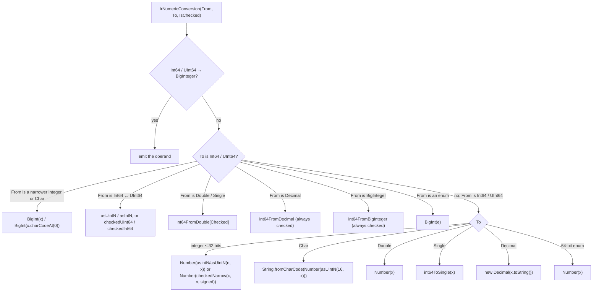

# Data model: `long` and `ulong` as native `bigint`

The core (`Metano.Compiler`) decides every conversion, wrap and check (NFR-002); the targets render the
nodes below. Names are normative; field order is indicative.

## 1. IR additions (`src/Metano.Compiler/IR/`)

```csharp
public enum IrPrimitive
{
    // … existing members …
    Int64,
    UInt64,          // NEW (FR-001): ulong and nuint; Int64 also covers nint
    // …
}

public enum IrLiteralKind
{
    // … existing members …
    Int64,
    UInt64,          // NEW (FR-007): Value is a ulong
}

/// <summary>
/// The exact C# numeric kind of a conversion endpoint or of a built-in operation, independent of how
/// IrPrimitive collapses narrow integer types (uint → Int32, ushort → Int16, sbyte → Byte).
/// nint maps to Int64 and nuint to UInt64 (DECIDED-2).
/// </summary>
public enum IrNumericKind
{
    SByte, Byte, Int16, UInt16, Int32, UInt32, Int64, UInt64,
    Char, Single, Double, Decimal, BigInteger,
}

/// <summary>
/// A C# numeric conversion whose source or target is a 64-bit integer (FR-010). Produced for implicit
/// conversions (from SemanticModel.GetConversion / ConvertedType) and explicit casts (IConversionOperation).
/// IsChecked is Roslyn's IConversionOperation.IsChecked (DECIDED-4). Enum endpoints use the enum's
/// underlying kind and set the matching flag, so a target can tell `(long)e` from `(long)i`.
/// </summary>
public sealed record IrNumericConversion(
    IrExpression Operand,
    IrNumericKind From,
    IrNumericKind To,
    bool IsChecked,
    bool FromEnum = false,
    bool ToEnum = false,
    bool IsLifted = false            // int? → long? (FR-019)
) : IrExpression;

public enum IrOverflowMode { Wrap, Check }

/// <summary>
/// Reduces the unbounded result of Value to the domain of Kind (Int64 or UInt64): wrapped modulo 2^64 in
/// an unchecked context, range-checked in a checked one (FR-021, FR-022, FR-026). The core wraps exactly the
/// operations of FR-021 and nothing else (DECIDED-7).
/// </summary>
public sealed record IrIntegerOverflow(
    IrExpression Value,
    IrNumericKind Kind,
    IrOverflowMode Mode
) : IrExpression;
```

`IrBinaryExpression` gains the operand kind of a built-in numeric operator, so a target can pick the
division helper and convert a shift count without re-deriving types (FR-027, FR-028):

```csharp
public sealed record IrBinaryExpression(
    IrExpression Left,
    IrBinaryOp Operator,
    IrExpression Right,
    IrNumericKind? NumericKind = null   // NEW: set for built-in numeric operators; null otherwise
) : IrExpression;
```

The shift count stays an `int` expression in the IR, already masked by the core (`n & 63`, folded when
constant). The TS bridge converts it with `BigInt(...)` when `NumericKind` is `Int64` / `UInt64`; Dart uses
it as is.

`checked` / `unchecked` expressions and statements have no IR node: the extractor lowers them to their
operand or body (FR-023), because `IsChecked` already carries the context into every operation.

## 2. Where the nodes come from

| C# construct | Roslyn source | IR |
|---|---|---|
| Implicit numeric conversion (`long x = i`, `M(i)`, `l + i`, `return i`, `c ? i : l`, `{ 1, i }`, `l is 5`, `case 7:`) | `GetConversion(e)` (`IsNumeric`, `IsImplicit`) + `GetTypeInfo(e).ConvertedType` | `IrNumericConversion` around the operand, or a folded literal when `GetConstantValue(e)` has a value |
| Explicit cast `(int)l`, `(long)d`, `(long)dm`, `(long)b`, `(E)l` | `IConversionOperation` (`IsChecked`, `Conversion.IsNumeric` / `IsEnumeration` / `IsUserDefined` for `BigInteger`) | `IrNumericConversion` |
| `l + m`, `l - m`, `l * m`, `-l`, `l << n`, `~u` | `IBinaryOperation` / `IUnaryOperation` (`IsChecked`, `Type`) | `IrIntegerOverflow(IrBinaryExpression(…, NumericKind), Kind, Wrap or Check)` |
| `l++`, `l += i` | `IIncrementOrDecrementOperation` / `ICompoundAssignmentOperation` (`IsChecked`) | the existing read-modify-write nodes, with `IrIntegerOverflow` on the stored value |
| `l / m`, `l % m` | `IBinaryOperation` | `IrBinaryExpression(…, IntegerDivide or Modulo, NumericKind)` |
| `l >>> n` | `IBinaryOperation` (`UnsignedRightShift`) | `IrIntegerOverflow(IrBinaryExpression(…, UnsignedRightShift, Int64), Int64, Wrap)` for `long`; a plain `>>` binary for `ulong` |
| `const long`, `long.MaxValue`, `1L << 40` | `GetConstantValue` | `IrLiteral(value, Int64 or UInt64)` |

## 3. TypeScript rendering (`src/Metano.Compiler.TypeScript/Bridge/`)

| IR | TS |
|---|---|
| `IrPrimitiveTypeRef(Int64 / UInt64)` | `TsBigIntType` |
| `IrLiteral(_, Int64 / UInt64)` | `TsLiteral("<digits>n")` |
| `IrNumericConversion` | the row of contracts/ts-emission.md § Conversions for `(From, To, IsChecked)` |
| `IrIntegerOverflow(_, Int64, Wrap)` | `BigInt.asIntN(64, value)` |
| `IrIntegerOverflow(_, UInt64, Wrap)` | `BigInt.asUintN(64, value)` |
| `IrIntegerOverflow(_, Int64, Check)` | `checkedInt64(value)` |
| `IrIntegerOverflow(_, UInt64, Check)` | `checkedUInt64(value)` |
| `IrBinaryExpression(IntegerDivide / Modulo, NumericKind: Int64)` | `divInt64` / `remInt64`, or inline for a safe constant divisor |
| `IrBinaryExpression(<<, >>, NumericKind: Int64 / UInt64)` | the count as a `bigint` literal or `BigInt(count)` |

`BigInt` and `Number` render as `IrTypeReference`-style global identifiers so the naming policy does not
camelCase them (the existing `ExtractCast` already does this for `BigInt`, R1).

## 4. Dart rendering (`src/Metano.Compiler.Dart/`)

| IR | Dart |
|---|---|
| `IrPrimitive.UInt64` | `int` |
| `IrLiteral(_, UInt64)` beyond `long.MaxValue` | the two's-complement `int` literal (Dart has no unsigned type) |
| `IrNumericConversion` between integer kinds | the operand (Dart `int` is 64-bit) |
| `IrNumericConversion` to / from `Double` | `.toDouble()` / `.toInt()` |
| `IrIntegerOverflow` | the operand (VM `int` wraps; checked mode is a documented gap, DECIDED-19) |

## 5. Runtime types (`targets/js/metano-runtime/`)

- `src/system/int64.ts`: the helpers of contracts/runtime-int64.md (DECIDED-12).
- `src/system/json/types.ts`: `Int64Descriptor` (contracts/json-int64.md) joins `TypeDescriptor`;
  `NumberTypeName` keeps its ten names, with the documentation fixed (FR-057).
- `src/system/json/number-from-string.ts`: `NumberTextReader` returns `number | bigint | undefined`.
- `src/type-checking/primitive-type-checks.ts`: `isInt64` / `isUInt64` narrow to `bigint`.
- `src/system/linq/terminals.ts`: the 64-bit terminals.
- `src/system/temporal-helpers.ts`: the ticks helpers.
- `src/system/linq/expr-tree.ts`: `ExprConvert` (`{ kind: "convert"; operand: ExprTree; type: ExprTypeRef }`)
  joins `ExprTree` (FR-044).

## 6. Diagnostics data

| Code | Raised by | Inputs |
|---|---|---|
| `MS0064` | the enum extractor | the member's constant value and the enum's underlying `SpecialType` |
| `MS0065` | the declaration extractor for `[Import]` / `[Emit]` / `[NoEmit]` / `[External]` | the member's signature types, walked through nullable, array, generic and delegate types |
| `MS0066` | the BCL lowering of `ToString` / interpolation / `Parse` | the constant format string or `NumberStyles` value |

## 7. Conversion decision table (the single source for both FR-010 and the bridge)


