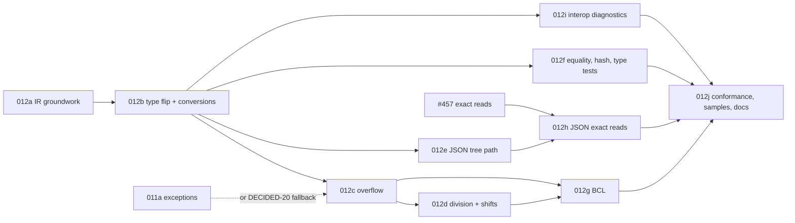

# Implementation Plan: `long` and `ulong` as native `bigint`

**Branch**: `docs/450-long-as-bigint-spec` (spec directory `012-long-as-bigint`) | **Date**: 2026-11-04 | **Spec**: [spec.md](./spec.md) | **Issue**: [#450](https://github.com/danfma/metano/issues/450)

## Summary

Metano 3.0 maps `long`, `ulong`, `nint` and `nuint` to `bigint` (D1). The core gains an unsigned 64-bit
primitive, an explicit numeric-conversion node and an overflow-reduction node, all decided from Roslyn's
semantic model (DECIDED-1–DECIDED-7). The TS target renders them with native `BigInt` operations where that
is exact and with a tree-shakable `metano-runtime/system/int64` module where .NET's exceptions or rounding
need code (DECIDED-8–DECIDED-13). BCL mappings, runtime type tests, JSON and diagnostics follow
(DECIDED-14–DECIDED-21). The work lands in ten slices (below).

## Technical Context

- **Language/Version**: C# 14 on .NET 10 for the compiler; TypeScript for the runtime and generated code,
  built with `tsgo`; Bun for tests and the benchmark (Node 24 run once for comparison).
- **Primary Dependencies**: Roslyn 5.3.0 (`IOperation.IsChecked`, `SemanticModel.GetConversion`,
  `GetConstantValue`; verified in research R3), decimal.js (existing), `@js-temporal/polyfill` (existing),
  `mitata` (benchmark; already a dev dependency per spec 011's plan, otherwise added in 012j).
- **Testing**: TUnit goldens (`tests/Metano.Tests/Expected/`), a new reference-fixture generator
  (`tests/Int64Reference/`, a net10.0 console project) and its fixtures, bun tests in
  `targets/js/metano-runtime/test/system/int64.test.ts` and in the sample consumer that runs the transpiled
  twin, the JSON conformance fixtures.
- **Constraints**: `TreatWarningsAsErrors`; NFR-001 (no churn outside 64-bit code); NFR-002 (decisions in the
  core); NFR-003 (tree-shaking); NFR-004 (no IIFE).
- **Scale/Scope**: about 4 new core files (`IrNumericKind`, `IrNumericConversion` + `IrIntegerOverflow`,
  `NumericConversionExtractor`, `IntegerOverflowLowering`), 1 new TS bridge file
  (`IrToTsInt64Bridge`), 1 runtime module (`system/int64.ts`) plus edits to the LINQ, JSON, temporal and
  type-check modules, 3 diagnostics, about 30 goldens.

## Constitution Check

| Principle | Status | Notes |
|---|---|---|
| Spec as source of truth | ✅ | This spec lands before code; the diagnostic catalog and the feature-support matrix are updated in this PR. |
| Clean Code / expressive names | ✅ | One job per unit: `NumericConversionExtractor` (Roslyn → `IrNumericConversion`), `IntegerOverflowLowering` (which operations wrap or check), `IrToTsInt64Bridge` (rendering). Helper names state the C# operation (`divInt64`, `int64FromDouble`). |
| Ports & Adapters | ✅ | Roslyn is read in the core only; the targets consume `IrNumericConversion` / `IrIntegerOverflow` (NFR-002). |
| Pragmatism | ✅ | Inline native operations where exact; helpers only where .NET throws or rounds differently; no range analysis in v1 (DECIDED-7); no opt-in mode (D1). |
| DX | ✅ | `tsgo --strict` catches every consumer mismatch; three warnings name the places where behavior differs; the migration notes list every break. |

**Required by gates**: dual-agent review (`compiler-man` + `bob`) on every slice; the global reviewers
(backend / frontend / architecture) on every code slice; the reference fixtures (FR-064) green from slice
012c on; 011's tree-shaking suite covers `system/int64.ts` once both exist.

## Code survey (what each slice touches)

All paths repo-relative, line numbers on `main` at `90be699e`.

### Core (`src/Metano.Compiler/`)

| File | Today | Change |
|---|---|---|
| `IR/IrPrimitive.cs` L8-29 | no unsigned 64-bit member | add `UInt64` (FR-001) |
| `IR/IrExpression.cs` L14-38 (`IrLiteral`, `IrLiteralKind`), L363-367 (`IrBinaryExpression`), L378-423 (`IrBinaryOp`, `IntegerDivide`), L484 (`IrCastExpression`) | — | `IrLiteralKind.UInt64`; `IrBinaryExpression.NumericKind`; new `IrNumericConversion`, `IrIntegerOverflow` (data-model.md) |
| `IR/IrPrimitiveExtensions.cs` L19-29 | `IsBrandable` lists `Int64` | add `UInt64` |
| `Extraction/IrTypeRefMapper.cs` L72-98 | `Int64` / `UInt64` → `Int64`; `IntPtr` unmapped | `UInt64`, `nint` / `nuint` (FR-001, FR-005) |
| `Extraction/IrExpressionExtractor.cs` L1629-1637 (`ClassifyNumericInContext`), L1663-1672 (`ClassifyNumeric`), L1676-1700 (`ExtractBinary`), L1939 (`ExtractUnary`), L4542-4625 (`ExtractCast`) | literals classified by `ConvertedType` for `decimal` / `BigInteger` only; casts erased except `BigInteger` / `decimal` | constant folding (FR-008), implicit conversions at every position (FR-010), casts through `IrNumericConversion` (FR-003, FR-010–FR-019), overflow nodes (FR-021–FR-026) |
| `Extraction/IrExpressionExtractor.IntegerDivision.cs` | `IntegerDivide` for every integral `/` | also sets `NumericKind` (FR-027) |
| `Extraction/IrExpressionExtractor.ReadModifyWrite.cs`, `NullableIncrement.cs`, `LiftedOperators.cs` | read-modify-write and lifted lowerings over `number` | wrap / check the stored value (FR-024, FR-025) |
| `Extraction/IrStatementExtractor.cs` | `checked { }` / `unchecked { }` unsupported | lower to a block (FR-023) |
| `Extraction/DefaultValueLiterals.cs` L49 | `Int64` default literal | `UInt64`, `0n` semantics via the literal kind (FR-004) |
| `Extraction/IrLinqChainFuser.cs` L353-393 | fuses `Int64` literals | `UInt64` |
| `Extraction/Invocation/IntrinsicBclLoweringTable.cs` | decimal / rounding / tuple intrinsics | `Math` / `long.*` statics, `Parse` styles, `Convert`, `LongCount`, `Sum` / `Average` / `Min` / `Max` element-type routing (FR-035–FR-041) |
| `Extraction/IrEnumExtractor.cs` | — | `MS0064` (FR-058) |
| `Extraction/IrExpressionTreeExtractor.cs` | no conversion node | `convert` nodes and typed 64-bit constants (FR-044) |
| `Analysis/IrRuntimeRequirementScanner.cs` L254-268 | `Int64` → `isInt64` | `UInt64` → `isUInt64`; the `system/int64` helpers as runtime requirements |
| `Analysis/IrNodeChildren.cs` L75 | — | children of the two new nodes |
| `Diagnostics/MetaSharpDiagnostic.cs` | codes up to `MS0063` | `MS0064`–`MS0066` (FR-061) |

### TypeScript target (`src/Metano.Compiler.TypeScript/`)

| File | Today | Change |
|---|---|---|
| `Bridge/IrToTsTypeMapper.cs` L184-207 (`MapPrimitive`, L191) | `Int64 => TsNumberType` | `Int64` / `UInt64` → `TsBigIntType` (FR-002) |
| `Bridge/IrToTsExpressionBridge.cs` L82-86 (cast dispatch), L140-190 (`MapBinary`), L153-154 + L256 (`MapIntegerDivision`), L1681-1700 (`MapLiteral`), L1730 (`BinaryOperatorToken`) | `number` lowering | literals `Nn`; the two new nodes; division helpers; shift counts (FR-007, FR-027–FR-034) |
| `Bridge/IrToTsExpressionBridge.Patterns.cs` L267-277 (`MapCast`) | erases casts | 64-bit casts arrive as `IrNumericConversion`, not here |
| `Bridge/IrToTsInt64Bridge.cs` (new) | — | renders `IrNumericConversion` / `IrIntegerOverflow` per contracts/ts-emission.md |
| `Bridge/IrTypeCheckBuilder.cs` L214-230 (`TypeofKind`), L246-276 (`PrimitiveCheck`) | `Int64` is `"number"` / `isInt64` over numbers | `"bigint"`; `UInt64` → `isUInt64` (FR-048) |
| `Bridge/IrToTsOverloadDispatcherBridge.cs` L535-545, `Bridge/IrToTsClassBridge.Operators.cs` L285-300 | `Int64` → `Long` suffix | `UInt64` → `ULong`; dispatch order of OQ-6 |
| `Bridge/IrToTsClassBridge.cs` L112-130 (`ComputeDefaultInitializer`), `Bridge/IrToTsJsxComponentBridge.cs` L201-216 | `0` | `0n` (FR-004) |
| `Bridge/IrToTsBrandedBridge.cs` | branded `number` | branded `bigint` (FR-002) |
| `Transformation/TypeGuardBuilder.cs` L749-754 | `TsBigIntType` → `typeof … === "bigint"` | no change; tests added (FR-049) |
| `Transformation/Json/JsonTypeClassifier.cs` L101-118, `Transformation/Json/JsonTypeDescriptorBuilder.cs` L224-240 | `numberType` for 64-bit when reading strings | `int64` descriptor (FR-050) |
| `Transformation/Json/JsonStructuralVariants.cs` | guard kinds | confirm wire-side use of `GuardTestKind.BigInt` (FR-049) |
| `src/Metano/Runtime/Math.cs` L49-56 | `Abs` / `Min` / `Max` by name for every overload | 64-bit overloads to the helpers (FR-035) |
| `src/Metano/Runtime/Parsing.cs` L19-24 | `long.TryParse(string, out long)` only | `long` / `ulong` `Parse` / `TryParse` with styles (FR-038) |
| `src/Metano/Runtime/Objects.cs` | `GetHashCode` → `valueHashCode` | unchanged (hash formula is runtime-side) |
| `src/Metano/Runtime/Linq.cs` L249-285 | `Count`, `Sum`, `Average`, `Min`, `Max` → generic terminals | 64-bit routing is intrinsic (above); `LongCount` (FR-041) |
| `src/Metano/Runtime/Temporal.cs` | no ticks | ticks members (FR-042) |

### Dart target (`src/Metano.Compiler.Dart/`)

| File | Change |
|---|---|
| `Bridge/IrToDartTypeMapper.cs` L84-90 | `UInt64` → `int` (FR-006) |
| `Dart/IrBodyPrinter.cs` L345, `Bridge/DartIrRewriter.cs` L141, `Bridge/DartBodyTypeReferences.cs` L81, `Dart/DartBinaryOperandGrouping.cs` L78 | handle `IrNumericConversion` / `IrIntegerOverflow` (data-model.md § 4) |

### Runtime (`targets/js/metano-runtime/src/`)

| File | Today | Change |
|---|---|---|
| `system/int64.ts` (new) | — | contracts/runtime-int64.md |
| `system/integer-division.ts` | `intDiv` over `number`, plain `Error` | unchanged for `number` (011 FR-016 moves it to `DivideByZeroException`) |
| `system/number-parsing.ts` L50-62 (`tryParseInt64`) | returns `number` | moves to `int64.ts`, returns `bigint` |
| `system/equality.ts` L35-45 | `bigint` by `===` | unchanged; tests (FR-047) |
| `system/hash-code.ts` L81 | low 32 bits | .NET formula via `hashInt64` (FR-046) |
| `type-checking/primitive-type-checks.ts` L57-75, L96 | `isInt64` / `isUInt64` over `number` | over `bigint` (FR-048) |
| `system/linq/terminals.ts` L226-342 | `number` terminals | 64-bit terminals (FR-041) |
| `system/linq/compare-keys.ts` | handles `bigint` | unchanged |
| `system/linq/expr-tree.ts`, `expr-tree-visitor.ts` | no `convert` node | `ExprConvert` (FR-044) |
| `system/temporal-helpers.ts` | — | ticks helpers (FR-042) |
| `system/json/types.ts` L7-27 | `NumberTypeName` "maps to a TS number" | `Int64Descriptor`; doc fix (FR-050, FR-057) |
| `system/json/numeric-converters.ts` | `primitive` passthrough, `decimal` | `int64ConverterOf` (FR-051, FR-052) |
| `system/json/number-from-string.ts` L77-92, L149-154 | `Number(value)` for 64-bit | returns `bigint` (FR-054) |
| `system/json/converters.ts` L80-87, L130-166, L318-323 | descriptor dispatch; map keys as strings | `int64` dispatch; key reader (FR-055); `object` slots (FR-056) |
| `system/json/exact-json-number.ts` | `writeExactNumber`, `rawJsonTextOf` | reused as is |

### Tests and samples

| Path | Today | Change |
|---|---|---|
| `tests/Metano.Tests/` (the `long` tests listed in research R1) | `number` expectations | regenerated in 012b–012f |
| `tests/Metano.Tests/Expected/int64-*.ts` (new) | — | one golden per contracts/ts-emission.md section (FR-063) |
| `tests/Int64Reference/` (new) | — | .NET fixture generator + `fixtures/*.json` (FR-064, FR-065) |
| `samples/SampleIssueTracker/` + `targets/js/sample-issue-tracker/` | no 64-bit values | 64-bit id, ticks duration, JSON round-trip tests (FR-068) |
| `samples/SampleInt64Conformance/` + `targets/js/sample-int64-conformance/` (new) | — | the transpiled twin of the reference matrix, `tsgo --strict`, bun tests against the fixtures (FR-064) |

## Slices

Each slice is one PR with dual-agent review, merged into the `release/3.0` integration branch (OQ-7
recommendation) and kept green: the full TUnit suite, every bun sample, `git diff --exit-code targets/`.

| Slice | Commit type | Scope | FRs | Depends on |
|---|---|---|---|---|
| **012a — IR groundwork and `checked` / `unchecked`** | `feat:` | `IrPrimitive.UInt64` (TS still `number`, Dart `int`), `IrLiteralKind.UInt64`, `IrNumericKind`, the two new nodes with their children / rewriter / Dart arms (not produced yet), `checked` / `unchecked` expressions and statements lowered transparently (replaces `MS0001` + placeholder). Output changes only at `checked` / `unchecked` sites. | FR-001 (IR part), FR-006, FR-023 (lowering) | — |
| **012b — Type flip, literals, constants, conversions** | `feat!:` (`BREAKING CHANGE:` footer) | `Int64` / `UInt64` → `bigint`; literals and constant folding; zero values; `nint` / `nuint`; `IrNumericConversion` for every position and every pair of contracts/ts-emission.md § Conversions; the conversion helpers of `system/int64.ts` (`checkedNarrow`, `int64FromDouble*`, `int64ToSingle`, `int64FromDecimal`, `int64FromBigInteger`, `mapNullable`); comparisons, patterns, `switch`, unary plus; `MS0064`; every affected golden regenerated. | FR-001–FR-020, FR-031–FR-034, FR-058 | 012a |
| **012c — Overflow** | `feat:` | `IrIntegerOverflow` production (`IntegerOverflowLowering`), unchecked wraps, `checkedInt64` / `checkedUInt64`, increments, compound assignments, lifted operators; the reference generator (`tests/Int64Reference/`) and the conformance sample start here. | FR-021–FR-026, FR-064 (first rows) | 012b; `OverflowException` from 011a or added here (DECIDED-20) |
| **012d — Division, remainder, shifts** | `feat:` | `NumericKind` on binary nodes; `divInt64` / `remInt64` / `divUInt64` / `remUInt64`; inline constant divisors; shift-count masking and conversion; `>>>`; compound forms. | FR-027–FR-030 | 012c (shares the overflow lowering for `<<`) |
| **012e — JSON (tree path)** | `feat!:` (`BREAKING CHANGE:` footer: tree leaves) | `Int64Descriptor`, generator emission, exact writes, tree reads, numbers from strings as `bigint`, dictionary keys, `object` slots, STJ fixtures. Scheduled right after 012b's merge so the integration branch never carries `bigint` fields whose JSON writes throw for long. | FR-050–FR-052, FR-054–FR-057, FR-065 (tree rows) | 012b |
| **012f — Runtime equality, hashing, type tests, dispatch** | `feat:` | `hashInt64` in `HashCode` / `valueHashCode`; `isInt64` / `isUInt64` over `bigint`; `TypeofKind` / `PrimitiveCheck` / scanner; dispatcher order and `ULong` suffix; guard tests; `[Branded]` over `bigint`. | FR-046–FR-049 | 012b |
| **012g — BCL mappings** | `feat:` | `Math` / `INumber` statics, indexing / `LongLength` / `LongCount`, `formatInt64` + interpolation formats and alignment, `Parse` / `TryParse` with styles, `Convert`, `CompareTo` / `Equals`, LINQ terminals, ticks, expression-tree `convert`; `MS0066`. | FR-035–FR-044 | 012c, 012d |
| **012h — JSON exact reads** | `feat:` | Route 64-bit roots through #457's exact path; exact-path fixture rows. | FR-053, FR-065 (exact rows) | 012e, #457 |
| **012i — Interop diagnostics** | `feat:` | `MS0065`; `[PlainObject]` construction conversions verified; docs for the `JSON.stringify` hazard. | FR-059, FR-060 | 012b |
| **012j — Conformance, samples, docs, release** | `test:` + `docs:` | Complete the reference matrix (every BCL row), the `SampleIssueTracker` 64-bit scenario, the benchmark and its recorded table, `docs/bcl-mappings.md`, `docs/serialization.md`, README, CHANGELOG migration notes; matrix rows → Implemented. | FR-061–FR-068 (remaining) | all above |



Deferred / follow-ups: `checked` / wrap semantics for `int` and narrower (OQ-4); range-based wrap elision
(OQ-5); `bigint` enum members after 011 FR-044 (OQ-1); custom and `C` / `P` / `E` formats with #308 (OQ-2);
`Int128` / `UInt128`, `Interlocked`, `BitConverter`, `BinaryPrimitives`, the bit-manipulation statics,
`DateTimeOffset.Ticks` (FR-043); Dart checked arithmetic (DECIDED-19).

## Test strategy

- **Core units**: `NumericConversionExtractor` for every conversion pair and every position of research R3
  (arguments, returns, assignments, conditional branches, collection and array initializers, patterns, case
  labels, lambda bodies, compound assignments) with and without a constant operand; `IntegerOverflowLowering`
  for every operator of FR-021 in both contexts and with `CheckOverflow = true`; `IrTypeRefMapper` for
  `ulong`, `nint`, `nuint`.
- **Goldens**: `int64-types`, `int64-literals-constants`, `int64-conversions-unchecked`,
  `int64-conversions-checked`, `int64-conversions-nullable`, `int64-overflow-unchecked`,
  `int64-overflow-checked`, `int64-overflow-project-checked` (a compilation with `CheckOverflow`),
  `int64-increments-compound`, `int64-division`, `int64-shifts`, `int64-patterns-switch`, `int64-math`,
  `int64-format-parse`, `int64-convert`, `int64-linq`, `int64-ticks`, `int64-json-context`,
  `int64-guards-dispatch`, `int64-plain-object`, `int64-branded`, `int64-expression-tree`,
  `checked-unchecked-int32` (012a, NFR-001 boundary).
- **Diagnostics**: one test per reason of contracts/diagnostics.md (MS0064 1, MS0065 1 per declaration kind,
  MS0066 2), asserting code, severity, location and that the output is still emitted.
- **Reference conformance (FR-064)**: `tests/Int64Reference/` writes `fixtures/{operators,conversions,bcl}.json`
  (`{ "case": "add.long.unchecked", "args": ["9223372036854775807", "1"], "result": "-9223372036854775808" }` or
  `{ …, "throws": "OverflowException", "message": "…" }`); the conformance sample's C# twin is transpiled,
  built with `tsgo --strict` and run by `bun test` (and once under Node, since bun hides some load-order
  issues) against the same files. CI regenerates the fixtures in a job filtered on the generator and fixture
  paths and fails on `git diff --exit-code`.
- **JSON (FR-065)**: STJ-produced fixtures under `tests/Int64Reference/fixtures/json/`; bun tests in
  `metano-runtime/test/system/json/int64.test.ts` and in `sample-issue-tracker`.
- **Runtime units**: every helper of contracts/runtime-int64.md with boundary operands and every exception
  message; `isInt64` / `isUInt64`; `hashInt64` against R2's four values.
- **Dart**: unit tests for the new nodes; `git diff --exit-code targets/flutter`.
- **Regression**: full TUnit suite and every bun sample; NFR-001 checked by transpiling `SampleTodo` and
  `SampleIssueTracker` before 012a and after 012d (no 64-bit code) and diffing.

## Benchmark plan (FR-066; review artifact, not a CI gate)

- **Harness**: `targets/js/metano-runtime/bench/int64.bench.ts` with `mitata`, `bun run bench:int64`; Node 24
  once for comparison.
- **Cases** (each against the same code over `number`): a 1e6-iteration `long` sum with wrap; FNV-1a 64-bit
  hash mixing (`*`, `^`) over 1e5 strings; `divInt64` vs inline constant division; `formatInt64("N0")`;
  `parseInt64`; a JSON round-trip of 1e5 records with a 64-bit id through the context.
- **Method**: median of 10 runs after 3 warm-ups; the ratio to the `number` baseline is the reported figure;
  `docs/bcl-mappings.md` records the table and the machine.

## CI changes

- `ci.yml`: the conformance sample (`cd targets/js/sample-int64-conformance && bun run build && bun test`);
  the fixture-drift job filtered on `tests/Int64Reference/**`; the `git diff --exit-code targets/` check
  covers the new sample.
- `release.yml`: the conformance sample runs before `semantic-release`.

## Compatibility and migration

See spec.md § Migration (3.0.0). Cross-package consumers must upgrade producer and consumer together: a 2.x
package's `.d.ts` says `number` where a 3.0 consumer passes `bigint`. The incremental cache's
`ConfigurationFingerprint` gains an `int64-bigint-v1` token so a 2.x cache never masks the new output (as
ADR-0025 did for the layout).

## Risks

| ID | Risk | Mitigation |
|---|---|---|
| K1 | A conversion position is missed and a `bigint` / `number` mix reaches the output (TS2365 at build or `TypeError` at run time) | Conversions come from Roslyn's semantic model, not from syntax (R3); every golden is built with `tsgo --strict` in the conformance sample (SC-003) |
| K2 | `bigint` cost hurts hot paths (R8: 12–95×) | Documented (NFR-006), benchmarked (FR-066); `int` / `double` remain the fast types; range elision is a measured follow-up (OQ-5) |
| K3 | A release is cut between 012b and 012e and ships `bigint` fields whose JSON writes throw | OQ-7 (integration branch); 012e is scheduled right after 012b |
| K4 | 011's exception classes are not ready for 012c | DECIDED-20 fallback: 012c adds the modules exactly as 011's contract defines them |
| K5 | #457 slips | Only 012h waits for it; the tree path is exact for `bigint` and `rawJSON` leaves already |
| K6 | Hand-written TS in consumers breaks widely | 3.0 major, migration notes, `tsgo` reports every site; `MS0065` points at interop declarations |
| K7 | Message drift between .NET versions | The fixture-drift job regenerates the reference fixtures on SDK bumps |
| K8 | `formatInt64` / `parseInt64` grow into a general number-formatting engine | Scope fixed by DECIDED-16 / FR-038; the rest is #308's |

## Project Structure

```text
specs/012-long-as-bigint/
├── spec.md
├── plan.md
├── research.md
├── data-model.md
├── quickstart.md
├── contracts/
│   ├── ts-emission.md
│   ├── runtime-int64.md
│   ├── json-int64.md
│   └── diagnostics.md
└── checklists/requirements.md
```

## Complexity Tracking

> No constitution violations. No entries.
