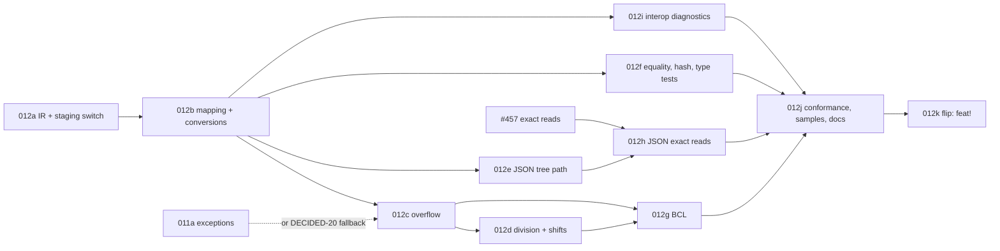

# Implementation Plan: `long` and `ulong` as native `bigint`

**Branch**: `docs/450-long-as-bigint-spec` (spec directory `012-long-as-bigint`) | **Date**: 2026-11-04 | **Spec**: [spec.md](./spec.md) | **Issue**: [#450](https://github.com/danfma/metano/issues/450)

## Summary

Metano 3.0 maps `long`, `ulong`, `nint` and `nuint` to `bigint` (D1). The core gains an unsigned 64-bit
primitive, an explicit numeric-conversion node and an overflow-reduction node, all decided from Roslyn's
semantic model (DECIDED-1–DECIDED-7). The TS target renders them with native `BigInt` operations where that
is exact and with a tree-shakable `metano-runtime/system/int64` module where .NET's exceptions or rounding
need code (DECIDED-8–DECIDED-13). BCL mappings, runtime type tests, JSON and diagnostics follow
(DECIDED-14–DECIDED-21). The work lands in eleven slices behind a compiler-internal staging switch, with one final breaking flip (DECIDED-22, below).

## Technical Context

- **Language/Version**: C# 14 on .NET 10 for the compiler; TypeScript for the runtime and generated code,
  built with `tsgo`; Bun for tests and the benchmark (Node 24 run once for comparison).
- **Primary Dependencies**: Roslyn 5.3.0 (`IOperation.IsChecked`, `SemanticModel.GetConversion`,
  `GetConstantValue`; verified in research R3), decimal.js (existing), `@js-temporal/polyfill` (existing),
  `mitata` (benchmark; already a dev dependency per spec 011's plan, otherwise added in 012j).
- **Testing**: TUnit goldens (`tests/Metano.Tests/Expected/`), a new reference-fixture generator
  (`tests/Int64Reference/`, a net10.0 console project) and its fixtures, bun tests in
  `targets/js/metano-runtime/test/system/int64.test.ts` and in the sample consumer that runs the transpiled
  twin, the JSON conformance fixtures.
- **Constraints**: `TreatWarningsAsErrors`; NFR-001 (no churn outside 64-bit code); NFR-002 (decisions in the
  core); NFR-003 (tree-shaking); NFR-004 (no IIFE).
- **Scale/Scope**: about 4 new core files (`IrNumericKind`, `IrNumericConversion` + `IrIntegerOverflow`,
  `NumericConversionExtractor`, `IntegerOverflowLowering`), 1 new TS bridge file
  (`IrToTsInt64Bridge`), 1 runtime module (`system/int64.ts`) plus edits to the LINQ, JSON, temporal and
  type-check modules, 3 diagnostics, about 30 goldens.

## Constitution Check

| Principle | Status | Notes |
|---|---|---|
| Spec as source of truth | ✅ | This spec lands before code; the diagnostic catalog and the feature-support matrix are updated in this PR. |
| Clean Code / expressive names | ✅ | One job per unit: `NumericConversionExtractor` (Roslyn → `IrNumericConversion`), `IntegerOverflowLowering` (which operations wrap or check), `IrToTsInt64Bridge` (rendering). Helper names state the C# operation (`divInt64`, `int64FromDouble`). |
| Ports & Adapters | ✅ | Roslyn is read in the core only; the targets consume `IrNumericConversion` / `IrIntegerOverflow` (NFR-002). |
| Pragmatism | ✅ | Inline native operations where exact; helpers only where .NET throws or rounds differently; no range analysis in v1 (DECIDED-7); no opt-in mode (D1). |
| DX | ✅ | `tsgo --strict` catches every consumer mismatch; three warnings name the places where behavior differs; the migration notes list every break. |

**Required by gates**: dual-agent review (`compiler-man` + `bob`) on every slice; the global reviewers
(backend / frontend / architecture) on every code slice; the reference fixtures (FR-064) green from slice
012c on; 011's tree-shaking suite covers `system/int64.ts` once both exist.

## Code survey (what each slice touches)

All paths repo-relative, line numbers on `main` at `90be699e`.

### Core (`src/Metano.Compiler/`)

| File | Today | Change |
|---|---|---|
| `IR/IrPrimitive.cs` L8-29 | no unsigned 64-bit member | add `UInt64` (FR-001) |
| `IR/IrExpression.cs` L14-38 (`IrLiteral`, `IrLiteralKind`), L363-367 (`IrBinaryExpression`), L378-423 (`IrBinaryOp`, `IntegerDivide`), L484 (`IrCastExpression`) | — | `IrLiteralKind.UInt64`; `IrBinaryExpression.NumericKind`; new `IrNumericConversion`, `IrIntegerOverflow` (data-model.md) |
| `IR/IrPrimitiveExtensions.cs` L19-29 | `IsBrandable` lists `Int64` | add `UInt64` |
| `Extraction/IrTypeRefMapper.cs` L72-98 | `Int64` / `UInt64` → `Int64`; `IntPtr` unmapped | `UInt64`, `nint` / `nuint` (FR-001, FR-005) |
| `Extraction/IrExpressionExtractor.cs` L4542-4625 (`ExtractCast`) erases `(int)d` | — | FR-070 float → int truncation (all sources) |
| `Extraction/IrExpressionExtractor.cs` L1629-1637 (`ClassifyNumericInContext`), L1663-1672 (`ClassifyNumeric`), L1676-1700 (`ExtractBinary`), L1939 (`ExtractUnary`), L4542-4625 (`ExtractCast`) | literals classified by `ConvertedType` for `decimal` / `BigInteger` only; casts erased except `BigInteger` / `decimal` | constant folding (FR-008), implicit conversions at every position (FR-010), casts through `IrNumericConversion` (FR-003, FR-010–FR-019), overflow nodes (FR-021–FR-026) |
| `Extraction/IrExpressionExtractor.IntegerDivision.cs` | `IntegerDivide` for every integral `/` | also sets `NumericKind` (FR-027) |
| `Extraction/IrExpressionExtractor.ReadModifyWrite.cs`, `NullableIncrement.cs`, `LiftedOperators.cs` | read-modify-write and lifted lowerings over `number` | wrap / check the stored value (FR-024, FR-025) |
| `Extraction/IrStatementExtractor.cs` | `checked { }` / `unchecked { }` unsupported | lower to a block (FR-023) |
| `Extraction/DefaultValueLiterals.cs` L49 | `Int64` default literal | `UInt64`, `0n` semantics via the literal kind (FR-004) |
| `Extraction/IrLinqChainFuser.cs` L353-393 | fuses `Int64` literals | `UInt64` |
| `Extraction/Invocation/IntrinsicBclLoweringTable.cs` | decimal / rounding / tuple intrinsics | `Math` / `long.*` statics, `Parse` styles, `Convert`, `LongCount`, `Sum` / `Average` / `Min` / `Max` element-type routing (FR-035–FR-041) |
| `Extraction/IrEnumExtractor.cs` | — | `MS0064` (FR-058) |
| `Extraction/IrExpressionTreeExtractor.cs` | no conversion node | `convert` nodes and typed 64-bit constants (FR-044) |
| `Analysis/IrRuntimeRequirementScanner.cs` L254-268 | `Int64` → `isInt64` | `UInt64` → `isUInt64`; the `system/int64` helpers as runtime requirements |
| `Analysis/IrNodeChildren.cs` L75 | — | children of the two new nodes |
| `Diagnostics/MetaSharpDiagnostic.cs` | codes up to `MS0063` | `MS0064`–`MS0066` (FR-061) |

### TypeScript target (`src/Metano.Compiler.TypeScript/`)

| File | Today | Change |
|---|---|---|
| `TypeScriptTarget.cs`, `tests/Metano.Tests/TranspileHelper.cs` | no 64-bit option | the internal `Int64Representation` staging switch and a test overload (FR-071, removed by 012k) |
| `Bridge/IrToTsTypeMapper.cs` L184-207 (`MapPrimitive`, L191) | `Int64 => TsNumberType` | `Int64` / `UInt64` → `TsBigIntType` (FR-002) |
| `Bridge/IrToTsExpressionBridge.cs` L82-86 (cast dispatch), L140-190 (`MapBinary`), L153-154 + L256 (`MapIntegerDivision`), L1681-1700 (`MapLiteral`), L1730 (`BinaryOperatorToken`) | `number` lowering | literals `Nn`; the two new nodes; division helpers; shift counts (FR-007, FR-027–FR-034) |
| `Bridge/IrToTsExpressionBridge.Patterns.cs` L267-277 (`MapCast`) | erases casts | 64-bit casts arrive as `IrNumericConversion`, not here |
| `Bridge/IrToTsInt64Bridge.cs` (new) | — | renders `IrNumericConversion` / `IrIntegerOverflow` per contracts/ts-emission.md |
| `Bridge/IrTypeCheckBuilder.cs` L214-230 (`TypeofKind`), L246-276 (`PrimitiveCheck`) | `Int64` is `"number"` / `isInt64` over numbers | `"bigint"`; `UInt64` → `isUInt64` (FR-048) |
| `Bridge/IrToTsOverloadDispatcherBridge.cs` L535-545, `Bridge/IrToTsClassBridge.Operators.cs` L285-300 | `Int64` → `Long` suffix | `UInt64` → `ULong`; dispatch order of OQ-6 |
| `Bridge/IrToTsClassBridge.cs` L112-130 (`ComputeDefaultInitializer`), `Bridge/IrToTsJsxComponentBridge.cs` L201-216 | `0` | `0n` (FR-004) |
| `Bridge/IrToTsBrandedBridge.cs` | branded `number` | branded `bigint` (FR-002) |
| `Transformation/TypeGuardBuilder.cs` L749-754 | `TsBigIntType` → `typeof … === "bigint"` | no change; tests added (FR-049) |
| `Transformation/Json/JsonTypeClassifier.cs` L101-118, `Transformation/Json/JsonTypeDescriptorBuilder.cs` L224-240 | `numberType` for 64-bit when reading strings | `int64` descriptor (FR-050) |
| `Transformation/Json/JsonStructuralVariants.cs` | guard kinds | confirm wire-side use of `GuardTestKind.BigInt` (FR-049) |
| `src/Metano/Runtime/Math.cs` L49-56 | `Abs` / `Min` / `Max` by name for every overload | 64-bit overloads to the helpers (FR-035) |
| `src/Metano/Runtime/Parsing.cs` L19-24 | `long.TryParse(string, out long)` only | `long` / `ulong` `Parse` / `TryParse` with styles (FR-038) |
| `src/Metano/Runtime/Objects.cs` | `GetHashCode` → `valueHashCode` | unchanged (hash formula is runtime-side) |
| `src/Metano/Runtime/Linq.cs` L249-285 | `Count`, `Sum`, `Average`, `Min`, `Max` → generic terminals | 64-bit routing is intrinsic (above); `LongCount` (FR-041) |
| `src/Metano/Runtime/Temporal.cs` | no ticks | ticks members (FR-042) |

### Dart target (`src/Metano.Compiler.Dart/`)

| File | Change |
|---|---|
| `Bridge/IrToDartTypeMapper.cs` L84-90 | `UInt64` → `int` (FR-006) |
| `Dart/IrBodyPrinter.cs` L345, `Bridge/DartIrRewriter.cs` L141, `Bridge/DartBodyTypeReferences.cs` L81, `Dart/DartBinaryOperandGrouping.cs` L78 | handle `IrNumericConversion` / `IrIntegerOverflow` (data-model.md § 4) |

### Runtime (`targets/js/metano-runtime/src/`)

| File | Today | Change |
|---|---|---|
| `system/int64.ts` (new) | — | contracts/runtime-int64.md |
| `system/integer-division.ts` | `intDiv` over `number`, plain `Error` | unchanged for `number` (011 FR-016 moves it to `DivideByZeroException`) |
| `system/number-parsing.ts` L50-62 (`tryParseInt64`) | returns `number` | moves to `int64.ts`, returns `bigint` |
| `system/equality.ts` L35-45 | `bigint` by `===` | unchanged; tests (FR-047) |
| `system/hash-code.ts` L81 | low 32 bits | .NET formula via `hashInt64` (FR-046) |
| `type-checking/primitive-type-checks.ts` L57-75, L96 | `isInt64` / `isUInt64` over `number` | over `bigint` (FR-048) |
| `system/linq/terminals.ts` L226-342 | `number` terminals | 64-bit terminals (FR-041) |
| `system/linq/compare-keys.ts` | handles `bigint` | unchanged |
| `system/linq/expr-tree.ts`, `expr-tree-visitor.ts` | no `convert` node | `ExprConvert` (FR-044) |
| `system/temporal-helpers.ts` | — | ticks helpers (FR-042) |
| `system/json/types.ts` L7-27 | `NumberTypeName` "maps to a TS number" | `Int64Descriptor`; doc fix (FR-050, FR-057) |
| `system/json/numeric-converters.ts` | `primitive` passthrough, `decimal` | `int64ConverterOf` (FR-051, FR-052) |
| `system/json/number-from-string.ts` L77-92, L149-154 | `Number(value)` for 64-bit | returns `bigint` (FR-054) |
| `system/json/converters.ts` L80-87, L130-166, L318-323 | descriptor dispatch; map keys as strings | `int64` dispatch; key reader (FR-055); `object` slots (FR-056) |
| `system/json/exact-json-number.ts` | `writeExactNumber`, `rawJsonTextOf` | reused as is |

### Tests and samples

| Path | Today | Change |
|---|---|---|
| `tests/Metano.Tests/` (the `long` tests listed in research R1) | `number` expectations | regenerated in 012b–012f |
| `tests/Metano.Tests/Expected/int64-*.ts` (new) | — | one golden per contracts/ts-emission.md section (FR-063) |
| `tests/Int64Reference/` (new) | — | .NET fixture generator + `fixtures/*.json` (FR-064, FR-065) |
| `samples/SampleIssueTracker/` + `targets/js/sample-issue-tracker/` | no 64-bit values | 64-bit id, ticks duration, JSON round-trip tests (FR-068) |
| `samples/SampleInt64Conformance/` + `targets/js/sample-int64-conformance/` (new) | — | the transpiled twin of the reference matrix, `tsgo --strict`, bun tests against the fixtures (FR-064) |

## Slices

Each slice is one PR with dual-agent review, merged into `main` (OQ-7) and kept green: the full
TUnit suite, every bun sample, `git diff --exit-code targets/`. Until slice 012k, the new behavior sits
behind the compiler-internal staging switch `Int64Representation` (DECIDED-22, FR-071): the default
`Number` mode renders the new IR nodes as their operands and keeps every 2.x mapping, so shipped output is
byte-identical (apart from the FR-023 and FR-070 fixes); the tests, the goldens of this feature and the
conformance sample run in `BigInt` mode. No slice before 012k is breaking, so a release cut at any point
ships consistent 2.x-style 64-bit output. Slice 012k has landed: the switch is deleted and `bigint` is the only
64-bit output.

| Slice | Commit type | Scope | FRs | Depends on |
|---|---|---|---|---|
| **012a — IR groundwork, staging switch, `checked` / `unchecked`** | `feat:` | `IrPrimitive.UInt64`, `IrLiteralKind.UInt64`, `IrNumericKind`, the two new nodes with their children / rewriter / Dart arms (not produced yet); the `Int64Representation` option on `TypeScriptTarget` and a `TranspileHelper` overload that sets it; `checked` / `unchecked` expressions and statements lowered transparently (replaces `MS0001` + placeholder). | FR-001 (IR part), FR-006, FR-023, FR-071 | — |
| **012b — Mapping, literals, constants, conversions (BigInt mode)** | `feat:` | `Int64` / `UInt64` → `bigint` in `BigInt` mode; literals and constant folding; zero values; `nint` / `nuint` member mappings; `IrNumericConversion` for every position and pair of contracts/ts-emission.md § Conversions; relational operators (FR-069); the conversion helpers (`checkedNarrow`, `int64FromDouble*`, `int64ToSingle`, `int64FromDecimal`, `int64FromBigInteger`, `mapNullable`); comparisons, patterns, `switch`, unary plus; Dart `.toSigned` / `.toUnsigned`; `MS0064`. **Outside the switch**: FR-070 (`int32FromDouble` and friends replace the erased float → int cast for every source, a `fix` with regenerated goldens). | FR-001–FR-020 (FR-003 for the 64-bit pairs and integer → `BigInteger`; FR-004 except arrays, both finished in 012g), FR-031–FR-034, FR-058, FR-069, FR-070 | 012a |
| **012c — Overflow** | `feat:` | `IrIntegerOverflow` production (`IntegerOverflowLowering`), unchecked wraps, `checkedInt64` / `checkedUInt64`, increments, every compound assignment, lifted operators, lambdas and local functions in `checked` blocks; the reference generator (`tests/Int64Reference/`) and the conformance sample start here. As landed: the shift operators, including the `<<` wrap and `<<=` of FR-021 / FR-024, move to 012d with the shift counts; local functions stay `MS0001` (unsupported by the transpiler in every mode), so their checked-context row waits for local-function support; the twin (`samples/SampleInt64Conformance`) has no MSBuild transpile step, because the `BigInt` mode has none, and `tests/Metano.Tests/Int64ConformanceSampleTests.cs` writes and drift-checks `targets/js/sample-int64-conformance/src`. | FR-021–FR-026, FR-064 (first rows) | 012b; `OverflowException` from 011a or added here (DECIDED-20) |
| **012d — Division, remainder, shifts** | `feat:` | `NumericKind` on binary nodes; `divInt64` / `remInt64` / `divUInt64` / `remUInt64`; inline constant divisors; shift-count masking and conversion; `>>>`; compound forms. `Number` mode keeps `intDiv` and today's shifts. As landed: `NumericKind` is the operand kind of every built-in numeric binary operator, in every mode (the `Number` bridge ignores it); the count mask is a core decision under the exact 64-bit lowering, so Dart prints `l << (n & 63)` too; every 64-bit compound form except `&=` / `\|=` / `^=` goes through the read-modify-write lowering, extension properties included; a lifted `nl / nm` keeps the shared lifted guard around the helper; `DivideByZeroException` joins `system/exceptions` (DECIDED-20 fallback, 011's contract); `intDiv` keeps its plain `Error` until 011 FR-016; `>>>` is never an `IrIntegerOverflow` (its C# result cannot leave the domain), so the TS bridge renders the `long` re-wrap itself; whether a constant divisor can throw is a target-agnostic IR fact (`IrBinaryExpressionExtensions.HasNonThrowingConstantDivisor`); TypeScript reads it, Dart keeps its native `~/` / `%` (DECIDED-19). | FR-021 / FR-024 (the `<<` wrap and `<<=`, moved from 012c), FR-027–FR-030 | 012c |
| **012e — JSON (tree path)** | `feat:` | `Int64Descriptor` (also for `[Branded]` / `[InlineWrapper]`), generator emission, exact writes, tree reads (safe integers; OQ-3), numbers from strings as `bigint`, dictionary keys, `object` slots, STJ fixtures. `Number` mode keeps the 2.x descriptors. As landed: a branded type's `int64` descriptor carries the companion factory (`create`, the valid `[JsonFactory]` member) and the branded `typeName`, applied after the exact read, so MS0034's honored factory stays honored (a factory case FR-050 does not describe; the review of this slice, #450, added it); `int64` joined `forwardsNumberTexts`, so `deserializeText` reads 64-bit values from their exact digits and its errors match STJ's, while a text of at most 15 significant digits still takes `JSON.parse` (which folds `1.0` into `1`); a `ulong` accepts no negative number, `-0` included; writes range-check; the manifest rows I1–I12 run on the runtime side through `deserializeText` (`int64-manifest.test.ts`). The `nint` / `nuint` deferral closed with issue #529: `JsonTypeClassifier.Is64BitIntegerType` admits `System_IntPtr` / `System_UIntPtr` and `Int64NumberTypeNameOf` resolves them to `System.Int64` / `System.UInt64`, so they take every `long` / `ulong` path (no runtime change); System.Text.Json throws `NotSupportedException` for both types, so no manifest row exists and `NativeIntegerJsonContextTests` pins the descriptors instead. | FR-050–FR-052, FR-054–FR-057, FR-065 (tree rows) | 012b |
| **012f — Runtime equality, hashing, type tests, dispatch** | `feat:` | `hashInt64` in `HashCode` / `valueHashCode`; `isInt64Value` / `isUInt64Value` (the `bigint` checks, added beside today's `number` checks, which 012k replaces); `TypeofKind` / `PrimitiveCheck` / scanner in `BigInt` mode; dispatcher order and `ULong` suffix; guard tests. | FR-046–FR-049 | 012b |
| **012g — BCL mappings** | `feat:` | `Math` / `INumber` statics, indexing / `LongLength` / `LongCount` / `new T[l]`, `formatInt64` + interpolation formats and alignment, `Parse` / `TryParse` with styles, `Convert`, `CompareTo` / `Equals`, LINQ terminals, ticks, `Console.WriteLine`, expression-tree `convert`; `MS0066`. Also, deferred from 012b: array creation with a length (`new long[n]` → `new Array<bigint>(Number(n)).fill(0n)`, FR-004 and FR-036; array creation without an initializer is unsupported for every element type today) and the remaining `BigInteger` casts of FR-003 (`decimal` ↔ `BigInteger`, `BigInteger` → `int` and narrower) through `IrNumericConversion`. The declarative mappings pick their `bigint` templates only in `BigInt` mode. As landed: the staging filter is `WhenInt64IsBigInt` on `[MapMethod]` / `[MapProperty]` (public because C# accepts only public named attribute arguments, hidden from IntelliSense, honored only in the assembly that declares the attributes, read into `DeclarativeMappingEntry` and applied by the TS `JsMappingApplicability`; 012k deletes it); a `bigint` template wins over a name-only 2.x entry by preceding it in the same file (first match wins), which #477's matching changes must keep; the 3.0 migration notes must list `tryParseInt64Value` (renamed by 012k) beside `isInt64` / `isUInt64`; the provider overloads (`ToString(format, provider)`, `Parse` / `TryParse` with a provider) drop the provider unevaluated (#308), and `ToString(provider)` is the native `toString()`; only the `NumberStyles` argument of `long` / `ulong` `Parse` / `TryParse` folds; `Min` / `Max` with an `IComparer` keep the generic terminal; `(int)nullableBigInteger` reads the value first (and throws on `null`), as C# does; Dart (always exact) gets `List<T>.filled` for a sized array whose default is not `null` (a `null` default stays `MS0001` under sound null safety), and its `BigInteger` casts keep `x as T` (a documented gap, as every `BigInteger` endpoint in the shape-only Dart target); a lifted conversion across 64 bits (`int` → `long?`) is a `convert` node too, which in-memory evaluation passes `null` through; the signed `TryParse` helper is `tryParseInt64Value` until 012k replaces the 2.x `number` `tryParseInt64` (renaming it now would break the shipped `Number` output); `G[n]` is implemented (scientific notation past the precision, rounded half away from zero), not only `G`; the valid formats the runtime rejects are covered by the runtime tests and `MS0066`, not by the fixtures, since they diverge by design; `MS0066` carries no source location (the bridge has none); `Enumerable` has no `Sum` / `Average` over `ulong`, so `sumUInt64` / `averageUInt64` do not exist, and `Min` / `Max` over `ulong` use `minUInt64Of` / `maxUInt64Of`; `Math.DivRem` returns a mutable `[bigint, bigint]` (C#'s `(long, long)` maps to a mutable tuple); `Equals(object)` maps to `objectEquals`; `Convert.ToDecimal(long)` stays unmapped (a template cannot import decimal.js); `Console.Write` has no mapping in any mode, so only `WriteLine` is covered; `new T[n]` lowers to the new `IrArrayCreation` under the exact lowering only, for element types whose `default(T)` every slot can share (a jagged or struct-element array stays `MS0001`), and a `null` default drops the `Array<T>` type argument; a negative length throws `RangeError`, not `OverflowException`; an interpolation hole over a `long?` keeps the 2.x hole (its format is dropped); the expression tree names a 64-bit type `System.Int64` / `System.UInt64` and converts every explicit or implicit conversion across a 64-bit integer (a capture keeps its own type and raw value); the `BigInteger` conversions reproduce .NET 10, including the truncated `(double)` significand and the split between the generic and the per-type overflow messages (`int32FromBigInteger`, `uint32FromBigInteger`, `narrowFromBigInteger`, `doubleFromBigInteger`, `decimalTextFromBigInteger`, `bigIntegerFromDouble`, `bigIntegerFromDecimal`); the runtime adds `ArgumentException`, `ArgumentNullException`, `ArgumentOutOfRangeException`, `FormatException`, `InvalidCastException`, `InvalidOperationException` and moves the JSON `NotSupportedException` under `system/exceptions` (DECIDED-20). Two gaps the 012g review found were closed before 012j (96c68466): `Math.Abs` / `Max` / `Min` / `Sign` / `Clamp` / `DivRem` over `nint` / `nuint` bound the `IntPtr` / `UIntPtr` overloads, whose names never matched the `long` / `ulong` templates, so they fell through to the JS `Math.*` renames and threw on a `bigint` (pointer-width `WhenParameterTypes` variants now route them to the 64-bit helpers); and `ArrayIndexKind` gated on arrays only, so a 64-bit index into a `List<T>` or a `string` would have stayed a raw `bigint` (TS2538) — widened to every array-shaped receiver, defensively, since in valid C# those indexers take an `int` and the `(int)` conversion already lowers the index. | FR-003 (rest), FR-004 (arrays), FR-035–FR-044, FR-072, FR-073 | 012c, 012d |
| **012h — JSON exact reads** | `feat:` | Route 64-bit roots through #457's exact path; exact-path fixture rows. As landed: 012e had already routed a 64-bit closure through `deserializeText`'s tokenizer, but only for a text that may hold a number of 16+ digits, and the tokenizer kept only those as `JsonNumberText`; a shorter `1.0` / `1e3` reached the converter as the `number` `JSON.parse` folds it into and read as `1n` / `1000n` (divergence I5, STJ throws). The closure walk now answers which leaves the tree keeps (`specNumberTextLeaves` → `NumberTextLeaves`: `inexact` for decimals only, `inexactOrNonInteger` once an `int64` is reached), the tokenizer marks every other number with a fraction or an exponent under `inexactOrNonInteger` as a `JsonNonIntegerNumber` (its double, no text copy: review round 1 measured the copied-text leaf at about 3x the no-long read, the mark at about 1.9x, the rest being the tokenizer), an `object` slot reads its whole subtree with doubles (a leak the same review found, also reaching decimal specs), and the `JSON.parse` shortcut also needs the text to have no digit followed by `.` / `e` / `E` (`mayHoldNumberTextLeaf`); decimal-only specs keep #457's tree and gate. So `deserializeText` rejects `1.0`, `1e3`, `1E0`, `-0.0` for `long` / `ulong` in every position, as STJ does, and the I5 runtime divergence is gone; a polymorphic int tag `1.0` / `1e0` under a 64-bit closure now throws through `deserializeText` as STJ does (a side effect, the tree path still accepts it). `Number` mode is unaffected (its descriptors are `primitive`). Manifest rows I13–I21 (STJ side in `StjConformanceFixtureTests`, runtime side in `int64-manifest.test.ts`, the generated `BigInt` context in `sample-issue-tracker/test/json-int64.test.ts`). | FR-053, FR-065 (exact rows) | 012e, #457 |
| **012i — Interop diagnostics** | `feat:` | `MS0065` (`[Import]`, `[Emit]`, `[External]`, user `[MapMethod]` / `[MapProperty]`); `[PlainObject]` construction conversions verified. As landed: the warning walks the Roslyn declarations from the TypeScript target (`Transformation/Int64InteropBoundaries.cs`) in the staging `BigInt` mode, once per declaration or mapping attribute, with the type-level `[Import]` / `[External]` surface covering its members and nested types (a nested delegate's `Invoke` included); Metano's own mappings are excluded by the declaring assembly's identity name, and the location of a mapping warning is the attribute's syntax. A non-void method names its return when the 64-bit integer sits there and its first such parameter otherwise. The `[PlainObject]` construction conversions needed no change (012b already converts: folds, `BigInt(x)` on an `int`, `null`, omitted defaulted keys), so the slice adds the `int64-plain-object*.ts` goldens and the `JSON.stringify` hazard note in `docs/serialization.md`. | FR-059, FR-060 | 012b |
| **012j — Conformance, samples, docs** | `test:` + `docs:` | Complete the reference matrix (every BCL row), the `SampleIssueTracker` 64-bit scenario, the benchmark and its recorded table, `docs/bcl-mappings.md`, `docs/serialization.md`, README, CHANGELOG migration notes. As landed: the matrix gained the comparison/hash and indexing rows (`comparisons.json` / `indexing.json`, `CompareTo` / boxed `Equals` / `GetHashCode` / `arr[l]` / `LongLength` / `new T[l]`), with boxed operands (`Type:value` fixture texts), array operands and an in-range index set, because an out-of-range index reads `undefined` where .NET throws (011 OD-4) and a negative length throws `RangeError`, not `OverflowException` (012g); the fixture generator unboxes its boxed operands before `Invoke` and gained array fixture text. The harness is `bench/int64/` (`run.ts` + `int64-probe.ts` + `int64-cases.ts`), the `bench/json` fresh-process style instead of `mitata` (which never became a dev dependency), and it drove a `fix:` the matrix exposed: `equality.ts`'s `hashCode` — and with it `valueHashCode` — hashed a bare `bigint` through the accumulator mix (012f's claim that it reached `hashInt64` covered only `hash-code.ts`); now it answers the raw word fold, as FR-040 / FR-046 require. The extraction also gained the dictionary arm of `ExtractCollectionExpression` (`Dictionary<K, V> map = []` emitted an array literal for a `Map` field; found by the scenario's `Dictionary<long, …>` log — a `fix:` in both modes, the NFR-001 exception category of FR-070, since the array literal was broken output). The `SampleIssueTracker` scenario could not keep its MSBuild transpile step (the staging mode has no MSBuild surface), so the sample transpiles test-driven like the conformance twin (`tests/Metano.Tests/Int64IssueTrackerSampleTests.cs`, `METANO_UPDATE_INT64_ISSUE_TRACKER=1`), running the build's Biome pass in-test to keep the committed formatting; a `long`-branded type synthesizes `toString`, which `biome`'s `noShadowRestrictedNames` rejects, so the sample's file prefix suppresses it beside the existing `noUselessConstructor` line. A `long`-keyed dictionary stays a property, not a root (`MS0035`), so the wire shape wraps it in an `ActivityFeed` record. Matrix skips, named so they are not read as coverage: the Ticks rows are round trips (`SpanRoundTrip`, `ConstructedSpanRoundTrip` and `MomentRoundTrip` start and end in ticks), so the absolute calendar anchor — `plainDateTimeTicks` of `2026-01-01T00:00` is `639028224000000000n`, an epoch offset no round trip can see — has no fixture twin and is pinned only by the runtime unit test (`test/system/int64-ticks.test.ts`); the runtime type checks (`o is long` / `o is ulong`) are twin-less by design, since a raw `bigint` answers by its range where .NET reads the box (the spec's Edge Cases divergence), and the compiler and runtime unit tests cover them (`Int64DispatchGuardTests.cs`, `test/type-checking/primitive-type-checks.test.ts`); `GetHashCodeOf` fixtures cover `Int64` only — the `UInt64` fold (`ulong.MaxValue` → `0`) is pinned by `test/system/hash-code.test.ts`. | FR-061, FR-063–FR-068 | 012a–012i |
| **012k — Flip** | `feat!:` (`BREAKING CHANGE:` footer) | Default `Int64Representation` to `BigInt`, delete the option and every `Number`-mode branch, replace `isInt64` / `isUInt64` with the `bigint` versions, regenerate every golden and `targets/` output, matrix rows → Implemented. Small by construction: every behavior it enables was already tested in `BigInt` mode. As landed in 012k: `Int64Representation`, `Int64RepresentationScope` (the `AsyncLocal`) and the option on `TypeScriptTarget` / `TypeTransformer` / `TypeScriptTransformContext` are deleted, and each of the 25 reads keeps its `BigInt` arm; the cache fingerprint pins `int64=bigint`, so a group cache written by a 2.x compiler is discarded. The core loses `IrExtractionContext.ExactInt64Lowering` (both targets always set it after the flip, so Dart output is unchanged) and `ForConstantDefault` keeps the origin resolver alone, dropping the target capabilities on purpose. The `WhenInt64IsBigInt` filter of `[MapMethod]` / `[MapProperty]`, its frontend reader and `JsMappingApplicability` are deleted; the 2.x catch-all `long.TryParse` entry (`WhenArgCount = 2`) stays as the fallback for the span overloads and now names the `bigint` parser. The runtime's `number` `isInt64` / `isUInt64` / `tryParseInt64` are removed and `isInt64Value` / `isUInt64Value` / `tryParseInt64Value` take their names, so `Int64TypeCheckName` goes too; that rename is the one difference between the output of this slice and the staging `BigInt` output of the slice before it (verified by a differential over every golden and every sample). Sources without `long` / `ulong` change only where the staging gate also covered them: a `BigInteger` cast or implicit conversion is an `IrNumericConversion` (FR-003; `decimalTextFromBigInteger`, `bigIntegerFromDecimal`, `BigInt(i)`), `(int)dec` truncates first (`dec.trunc().toNumber()`), a sized `new T[n]` is supported (012g had staged it), and `uint op int` promotes (NFR-001). Tests: the ones that pinned `Number` output are deleted (their goldens `int64-number-mode.ts`, `int64-json-context-number.ts`, `int64-extension-members-number.ts` too) or converted, and `Int64StagingSwitchTests` becomes `SixtyFourBitMappingTests`. Not done here: `SampleIssueTracker` and `SampleInt64Conformance` keep their test-driven transpile (restoring the MSBuild step is a follow-up), the `I*` rows of the STJ manifest still run on the TypeScript side through the runtime's `int64-manifest.test.ts` mirrors, and the `ConstantLiteral` / `ClassifyNumericForConvertedType` merge stays a `TODO`. Found by the flip, not fixed: a type that declares both `explicit operator int` and `explicit operator long` gets a conversion dispatcher whose implementation signature returns the first overload's `number` while an arm returns `bigint`, which `tsgo --strict` rejects (TS2394 / TS2322; golden `overload-name-pin-conversions.ts`). | FR-062, FR-071 | 012j (and 012h, or an explicit decision to ship before #457) |

**012k checklist (#541 leftovers; done in 012k):** remove the `Int64RepresentationScope.IsBigInt` gate in `BrandedSixtyFourBitOverloads`, the `NumberMode_ReportsNothing` test and the `Int64Representation` parameter of the `Int64BrandedDispatchDiagnosticTests` helper, and the "BigInt mode" / "BigInt-mode dispatcher" wording of the `MS0063` catalog row, the `DiagnosticCodes.AmbiguousRuntimeDispatch` summary, the OQ-6 note in `spec.md`, the XML docs of `BrandedSixtyFourBitOverloads`, `BrandedSixtyFourBitReporter` and `SixtyFourBitTypes`, and the `Int64BrandedDispatchDiagnosticTests` class summary.



Deferred / follow-ups: `checked` / wrap semantics for `int` and narrower (OQ-4); range-based wrap elision
(OQ-5); `bigint` enum members after 011 FR-044 (OQ-1); custom and `C` / `P` / `E` formats with #308 (OQ-2);
`Int128` / `UInt128`, `Interlocked`, `BitConverter`, `BinaryPrimitives`, the bit-manipulation statics,
`DateTimeOffset.Ticks` (FR-043); Dart checked arithmetic (DECIDED-19).

## Test strategy

- **Core units**: `NumericConversionExtractor` for every conversion pair and every position of research R3
  (arguments, returns, assignments, conditional branches, collection and array initializers, patterns, case
  labels, lambda bodies, compound assignments) with and without a constant operand; `IntegerOverflowLowering`
  for every operator of FR-021 in both contexts and with `CheckOverflow = true`; `IrTypeRefMapper` for
  `ulong`, `nint`, `nuint`.
- **Goldens**: `int64-types`, `int64-literals-constants`, `int64-conversions-unchecked`,
  `int64-conversions-checked`, `int64-conversions-nullable`, `int64-overflow-unchecked`,
  `int64-overflow-checked`, `int64-overflow-project-checked` (a compilation with `CheckOverflow`),
  `int64-increments-compound`, `int64-division`, `int64-shifts`, `int64-patterns-switch`, `int64-math`,
  `int64-format-parse`, `int64-convert`, `int64-linq`, `int64-ticks`, `int64-json-context`,
  `int64-guards-dispatch`, `int64-plain-object`, `int64-branded`, `int64-expression-tree`,
  `checked-unchecked-int32` (012a, NFR-001 boundary).
- **Diagnostics**: one test per reason of contracts/diagnostics.md (MS0064 1, MS0065 1 per declaration kind,
  MS0066 2), asserting code, severity, location and that the output is still emitted.
- **Reference conformance (FR-064)**: `tests/Int64Reference/` writes `fixtures/{operators,conversions,bcl}.json`
  (`{ "case": "add.long.unchecked", "args": ["9223372036854775807", "1"], "result": "-9223372036854775808" }` or
  `{ …, "throws": "OverflowException", "message": "…" }`); the conformance sample's C# twin is transpiled,
  built with `tsgo --strict` and run by `bun test` (and once under Node, since bun hides some load-order
  issues) against the same files. CI regenerates the fixtures in a job filtered on the generator and fixture
  paths and fails on `git diff --exit-code`.
- **JSON (FR-065)**: STJ-produced fixtures under `tests/Int64Reference/fixtures/json/`; bun tests in
  `metano-runtime/test/system/json/int64.test.ts` and in `sample-issue-tracker`.
- **Runtime units**: every helper of contracts/runtime-int64.md with boundary operands and every exception
  message; `isInt64` / `isUInt64`; `hashInt64` against R2's four values.
- **Dart**: unit tests for the new nodes; `git diff --exit-code targets/flutter`.
- **Regression**: full TUnit suite and every bun sample; NFR-001 checked by transpiling every sample in the
  default `Number` mode before 012a and after each slice up to 012j and diffing (only FR-023 / FR-070 hunks
  allowed).
- **Staging switch**: every 64-bit golden is produced in `BigInt` mode; a guard test asserts that `Number`
  mode reproduces the pre-012a output for the same sources.
- **Hazards pinned**: a bun test that a fractional `number` reaching an `int` slot from untyped JS throws
  `RangeError` at `BigInt(...)` (spec Edge Cases); goldens for `uint` / `int` promotion (arithmetic in
  `bigint`, relational in `number`).

## Benchmark plan (FR-066; review artifact, not a CI gate)

- **Harness**: `targets/js/metano-runtime/bench/int64.bench.ts` with `mitata`, `bun run bench:int64`; Node 24
  once for comparison.
- **Cases** (each against the same code over `number`): a 1e6-iteration `long` sum with wrap; FNV-1a 64-bit
  hash mixing (`*`, `^`) over 1e5 strings; `divInt64` vs inline constant division; `formatInt64("N0")`;
  `parseInt64`; a JSON round-trip of 1e5 records with a 64-bit id through the context.
- **Method**: median of 10 runs after 3 warm-ups; the ratio to the `number` baseline is the reported figure;
  `docs/bcl-mappings.md` records the table and the machine.

## CI changes

- `ci.yml`: the conformance sample (`cd targets/js/sample-int64-conformance && bun run build && bun test`);
  the fixture-drift job filtered on `tests/Int64Reference/**`; the `git diff --exit-code targets/` check
  covers the new sample.
- `release.yml`: the conformance sample runs before `semantic-release`.

## Compatibility and migration

See spec.md § Migration (3.0.0). Cross-package consumers must upgrade producer and consumer together: a 2.x
package's `.d.ts` says `number` where a 3.0 consumer passes `bigint`. The incremental cache's
`ConfigurationFingerprint` gains an `int64-bigint-v1` token so a 2.x cache never masks the new output (as
ADR-0025 did for the layout).

## Risks

| ID | Risk | Mitigation |
|---|---|---|
| K1 | A conversion position is missed and a `bigint` / `number` mix reaches the output (TS2365 at build or `TypeError` at run time) | Conversions come from Roslyn's semantic model, not from syntax (R3); every golden is built with `tsgo --strict` in the conformance sample (SC-003) |
| K2 | `bigint` cost hurts hot paths (R8: 12–95×) | Documented (NFR-006), benchmarked (FR-066); `int` / `double` remain the fast types; range elision is a measured follow-up (OQ-5) |
| K3 | A release is cut mid-feature and ships a half-converted `bigint` surface | The staging switch (DECIDED-22) keeps shipped output in 2.x form until 012k; only 012k is breaking; releases are held until the 3.0 gate anyway (OQ-7) |
| K9 | The staging switch rots or leaks into user configuration | It is internal to `TypeScriptTarget` (no CLI / MSBuild / attribute surface), exercised by every test in `BigInt` mode, and deleted by 012k (FR-071) |
| K10 | `uint op int` promotion turns hot 32-bit code into `bigint` code after the flip | Documented (NFR-001, migration item 12); relational operators stay `number` (FR-069); the benchmark includes a `uint` + `int` loop |
| K4 | 011's exception classes are not ready for 012c | DECIDED-20 fallback: 012c adds the modules exactly as 011's contract defines them |
| K5 | #457 slips | Only 012h waits for it; the tree path is exact for `bigint` and `rawJSON` leaves already |
| K6 | Hand-written TS in consumers breaks widely | 3.0 major, migration notes, `tsgo` reports every site; `MS0065` points at interop declarations |
| K7 | Message drift between .NET versions | The fixture-drift job regenerates the reference fixtures on SDK bumps |
| K8 | `formatInt64` / `parseInt64` grow into a general number-formatting engine | Scope fixed by DECIDED-16 / FR-038; the rest is #308's |

## Project Structure

```text
specs/012-long-as-bigint/
├── spec.md
├── plan.md
├── research.md
├── data-model.md
├── quickstart.md
├── contracts/
│   ├── ts-emission.md
│   ├── runtime-int64.md
│   ├── json-int64.md
│   └── diagnostics.md
└── checklists/requirements.md
```

## Complexity Tracking

> No constitution violations. No entries.
