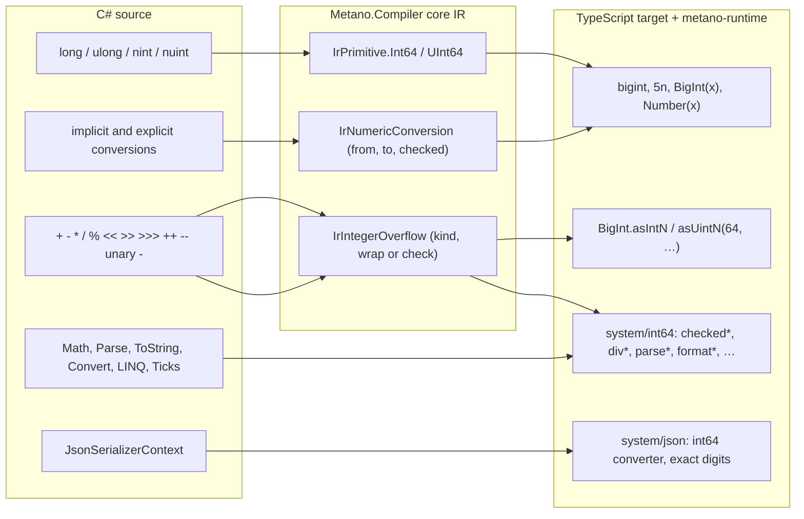

# Feature Specification: `long` and `ulong` as native `bigint`

**Feature Branch**: `docs/450-long-as-bigint-spec` (spec directory `012-long-as-bigint`)

**Created**: 2026-11-04

**Status**: Draft (spec change request; the maintainer's decision of 2026-11-04 is applied: the mapping is always on, has no opt-in and ships in the 3.0 major)

**Input**: GitHub issue [danfma/metano#450](https://github.com/danfma/metano/issues/450), "Map long and ulong to native bigint in the TypeScript target", and its decision comment. The findings behind every requirement are in [research.md](./research.md) (R1–R11): today's output (R1), .NET 10 probes of every C# rule this spec reproduces (R2), the Roslyn APIs that expose the checked context and implicit conversions (R3), Node 24.11 / Bun 1.4.2 probes of `bigint` (R4, R5), the runtime surface (R6), JSON (R7), cost (R8), Dart (R9) and interop (R10).

**Traceability**: a 3.0.0 breaking change. It extends these legacy requirement families of the baseline: semantic transformation (`FR-005`–`FR-014`, specifically operators and expressions), types and collections (`FR-015`–`FR-018`), serialization (`FR-032`–`FR-034`) and diagnostics (`FR-038`–`FR-040`). It adds a section to the baseline [feature-support matrix](../001-project-baseline-evolution/baseline/feature-support-matrix.md) and reserves `MS0064`–`MS0066` in the [diagnostic catalog](../001-project-baseline-evolution/baseline/diagnostic-catalog.md) (`MS0063` is the last allocated code, taken by #440). As in features 002–011, FR identifiers are local to this feature and are cited as "012 FR-0NN". FR-069–FR-073 were added after the first `compiler-man` review; each sits next to the requirement it extends, so the list is grouped by topic, not by number.

**Related specs and issues**: [009-polymorphic-json](../009-polymorphic-json/spec.md) FR-048 (numbers read from strings, decimal writes, #458) and [011-runtime-collections-and-types](../011-runtime-collections-and-types/spec.md) (runtime exception classes FR-013, runtime type descriptors FR-048) change where they meet 64-bit integers; see [Interaction with other specs](#interaction-with-other-specs). The exact JSON read path is [#457](https://github.com/danfma/metano/issues/457). Neither spec is edited by this PR.

## Overview

The TypeScript target maps `long` and `ulong` to `number` (`IrToTsTypeMapper.cs:191`), so a value beyond 2^53 silently loses digits: 64-bit ids (Snowflake, database keys), `DateTime` / `TimeSpan` ticks, hashes and bit masks. The probe in research R1 shows more: `checked` and `unchecked` expressions emit a throwing placeholder, shifts are 32-bit, narrowing casts are erased, and `long.Parse`, `long.MaxValue`, `ToString("N0")`, `nint` and `Ticks` produce code that does not compile or does not run. The project already chooses fidelity over convenience elsewhere (decimal.js for `decimal`, Temporal for dates). This feature does the same for 64-bit integers.

`bigint` and `number` do not mix (`1n + 1` throws `TypeError`), and `bigint` is unbounded where `long` wraps at 64 bits (R4). So the lowering is total: every C# conversion between a 64-bit integer and another numeric type becomes an explicit conversion, every arithmetic result is reduced to the 64-bit domain the way C# reduces it (wrapped in an unchecked context, range-checked in a checked one), and every API that rejects `bigint` gets a `bigint`-aware mapping.

## Maintainer decisions (normative)

- **D1 — Always `bigint`, in 3.0.** `long`, `ulong` and their nullable, array and generic forms map to `bigint` with no opt-in attribute and no compatibility switch. The change ships in the 3.0 major (maintainer, 2026-11-04, issue #450). There is one lowering path.

## Decisions taken by this spec (DECIDED)

Each decision states the rule and the rejected alternative. The open questions that remain for the maintainer are listed in [Open questions](#open-questions).

- **DECIDED-1 — The IR distinguishes `ulong`.** `IrPrimitive` gains `UInt64`. `IrTypeRefMapper` stops collapsing `ulong` into `Int64` (research R1). The other unsigned collapses (`uint` → `Int32`, `ushort` → `Int16`, `sbyte` → `Byte`) stay, because their values fit a `number`; conversions carry the exact kind on their own node (DECIDED-3), so they do not need the type ref to be exact. Rejected: keeping one `Int64` primitive and reading signedness from Roslyn in each backend (it would leak Roslyn into the targets, NFR-002).
- **DECIDED-2 — `nint` / `nuint` are 64-bit.** `nint` is `long` and `nuint` is `ulong` for every rule of this spec, because Metano defines them as 64-bit (the TypeScript target has no 32-bit mode; `IntPtr.Size` is 8 on the 64-bit hosts, R2). A 32-bit .NET process (win-x86, linux-arm, browser-wasm) wraps them at 32 bits, so arithmetic on such a host can diverge. `nint.MaxValue` / `MinValue` are not C# constants (CS0133), so they get explicit member mappings (FR-005). `IntPtr` / `UIntPtr` members other than the numeric operators, conversions, `MinValue`, `MaxValue` and `Size` stay unmapped (`MS0001`, as today). Rejected: mapping them to `number` (a second, divergent 64-bit path) or rejecting them.
- **DECIDED-3 — Conversions are explicit IR nodes, decided from Roslyn.** Every C# conversion whose source or target is a 64-bit integer, implicit or explicit, becomes an `IrNumericConversion(Operand, From, To, IsChecked)` in the core. The extractor reads `SemanticModel.GetConversion` / `GetTypeInfo(e).ConvertedType` for implicit conversions and `IConversionOperation` for explicit ones, at every position Roslyn reports (R3). A Roslyn constant folds into a `bigint` literal instead (DECIDED-6). Rejected: inserting `BigInt(...)` in the TS bridge by comparing TS types (it would miss positions and duplicate C# conversion rules in the target).
- **DECIDED-4 — The checked context comes from Roslyn.** The lowering reads `IsChecked` on the binary, unary, conversion, increment / decrement and compound-assignment operations. Roslyn already folds `checked(...)`, `unchecked(...)`, `checked { }`, `unchecked { }` and the compilation option `CheckOverflow` (MSBuild `CheckForOverflowUnderflow`) into it (R3). The `checked` / `unchecked` expressions and statements themselves lower to their operand / body. Rejected: tracking the context in the extractor.
- **DECIDED-5 — Unchecked wraps inline, checked calls a helper.** An unchecked 64-bit result is wrapped with the native `BigInt.asIntN(64, …)` (`long`) or `BigInt.asUintN(64, …)` (`ulong`), which needs no import and which V8 lowers to native 64-bit arithmetic (R8). A checked result calls `checkedInt64(…)` / `checkedUInt64(…)` from `metano-runtime`, which throws `OverflowException` with .NET's message. Rejected: a helper for the unchecked case (an import and a call on the hottest path for no gain), or no wrap (`bigint` would grow past 64 bits and diverge from C#).
- **DECIDED-6 — Constants fold.** Any 64-bit expression that Roslyn reports as constant (`const long`, `long.MaxValue`, `ulong.MaxValue`, `1L << 40`, `unchecked((long)ulong.MaxValue)`, an `int` literal converted to `long`) is emitted as one `bigint` literal with its decimal digits (`9223372036854775807n`). No wrap, conversion or helper is emitted for it. A bare reference to a `const` field that the output declares stays a reference (FR-008).
- **DECIDED-7 — The wrap is elided by operator algebra only.** v1 elides the wrap where the operator cannot leave the 64-bit domain whatever the operands (`& | ^`, `>>`, `~` on `long`, comparisons, `/` and `%` through their helpers). It does no range analysis: `for (long i = 0; i < n; i++)` still wraps `i + 1n`. R8 shows the wrap is free on V8. Range-based elision is a follow-up (OQ-5). The same algebra drops a conversion where JS is already exact: a relational operator (`<`, `<=`, `>`, `>=`) between a `bigint` and a `number` that holds an integer compares by mathematical value (`9007199254740993n > 9007199254740992` is `true`, research R11), so `l < i` emits `l < i`, not `l < BigInt(i)` (FR-069). Equality keeps the conversion, because the output uses `===`.
- **DECIDED-8 — Division and remainder go through helpers.** `/` and `%` on 64-bit operands call `divInt64` / `remInt64` / `divUInt64` / `remUInt64`. They throw `DivideByZeroException` on a zero divisor and, for `long`, `OverflowException` for `MinValue / -1` and `MinValue % -1` **in both contexts**, as .NET does (R2). A divisor that is a constant other than `0` (and other than `-1` for `long`) is emitted inline (`a / 7n`, `a % 7n`), because JS `bigint` division already truncates toward zero and `%` already takes the dividend's sign (R4).
- **DECIDED-9 — Shift counts are masked at compile time when constant.** The count is `count & 63`. A constant count is folded and printed as a `bigint` literal (`x << 70` → `x << 6n`); a variable count becomes `BigInt(n & 63)`. `<<` is wrapped (DECIDED-5); `>>` is not. `>>>` on `long` becomes `BigInt.asIntN(64, BigInt.asUintN(64, x) >> c)`; on `ulong` it is `>>`, which is already logical for a non-negative `bigint`.
- **DECIDED-10 — Floating-point conversions follow .NET 9+.** Unchecked `double` / `float` → 64-bit truncates, saturates out-of-range values and maps NaN to `0` (`int64FromDouble`); checked throws `OverflowException` (`int64FromDoubleChecked`). `long` → `double` is `Number(x)` (one correct rounding, R4). `long` → `float` is `int64ToSingle(x)`, which rounds once, because `Math.fround(Number(x))` rounds twice and differs from C# on halfway values (R5).
- **DECIDED-11 — `decimal` conversions go through decimal.js text and are always checked.** `long` → `decimal` is `new Decimal(x.toString())`. `decimal` → `long` truncates and throws `OverflowException` ("Value was either too large or too small for an Int64.") outside the range **whatever the context**, as C# does (R2).
- **DECIDED-12 — Runtime helpers live in one tree-shakable module.** `metano-runtime/src/system/int64.ts` (re-exported from the package root, like `intDiv`) holds every helper of [contracts/runtime-int64.md](./contracts/runtime-int64.md) as a named export with no module-scope side effect. Generated code imports only the helpers it calls.
- **DECIDED-13 — Hashing follows .NET.** The runtime hashes a `bigint` as `(int)v ^ (int)(v >> 32)`, as `long.GetHashCode()` and `ulong.GetHashCode()` do (R2), instead of the low 32 bits only (R6), so ids that differ in the high word spread. Equality is unchanged: `===` for `bigint`, and `5n` is not equal to `5` in `valueEquals`, as a boxed `long` is not equal to a boxed `int` (R2, R6).
- **DECIDED-14 — Runtime type tests read `bigint` by range.** `isInt64(v)` is `typeof v === "bigint"` within the `long` range, `isUInt64(v)` within the `ulong` range, `isBigInt(v)` any `bigint`. Same-arity overloads that differ only among `long`, `ulong` and `BigInteger` are dispatched in that order (OQ-6). A raw `bigint` asked for its runtime type answers `Int64Type` when it fits `long`, `UInt64Type` when it fits only `ulong`, `BigIntegerType` otherwise (011 FR-048 interaction).
- **DECIDED-15 — Enums keep `number` values.** An enum declared `: long` or `: ulong` still emits `number` member values, because TypeScript `enum` members cannot be `bigint`. Conversions between the enum and a 64-bit integer are explicit (`BigInt(e)`, `Number(x)`). A member whose value is not exactly representable as a double gets `MS0064`, and so does every member of a `[Flags]` enum `: long` / `: ulong` whose value is 2^31 or more, because the generated bit operations on `number` values are 32-bit in JS (OQ-1 asks whether to revisit this once 011's `const`-object enums land).
- **DECIDED-16 — Formatting is invariant.** `ToString()` and an interpolation hole without a format print `bigint`'s own digits, which equal .NET's invariant output. A format string goes to `formatInt64`, which implements the standard formats `G`, `D`, `N`, `F`, `X` / `x` and `R` with their precision specifiers in the invariant culture, consistent with the value-formatting policy of #308. Every other constant format gets `MS0066` (OQ-2).
- **DECIDED-17 — JSON writes exact digits and reads integers only.** The JSON converter of a 64-bit value writes `writeExactNumber(x.toString(), () => Number(x))` (the #458 writer, `JSON.rawJSON`). It reads a `bigint`, a `rawJSON` leaf with an integer token, an integral `number` or, under `AllowReadingFromString`, a string in the 009 FR-048 grammar. The exact text path is #457's (FR-053).
- **DECIDED-18 — Interop boundaries are reported, not coerced.** A 64-bit type in the signature of a declaration whose JavaScript Metano does not generate (`[Import]`, `[Emit]`, `[External]`, and user `[MapMethod]` / `[MapProperty]` templates) gets the warning `MS0065`, because the JS side may pass or expect a `number`. The compiler inserts no runtime coercion.
- **DECIDED-19 — Dart keeps `int`, with explicit narrowing.** `Int64` and `UInt64` map to Dart `int` (64-bit two's complement on the VM, R9). Dart prints `IrIntegerOverflow` as its operand, for `Wrap` (the VM `int` already wraps) and for `Check` (a documented gap). Because the core builds 64-bit increments and compound `+=` / `-=` / `*=` as the read-modify-write of the reduced value (FR-024), Dart prints them in that stored-value form (`l = l + 1`, a used postfix as `(l = l + 1) - 1`), which is equivalent on the VM `int`. An `IrNumericConversion` that narrows MUST use `.toSigned(n)` / `.toUnsigned(n)` (`(int)0x100000001L` is `1`, not `4294967297`); widening is the operand; floating-point conversions use `.toDouble()` / `.toInt()`, followed by the narrowing selector for a target narrower than 64 bits. A conversion whose endpoint Dart does not convert (`char`, an enum, `decimal`, `BigInteger`) keeps the explicit cast it lowers (`x as T`), and a nullable value cast to its underlying type reads through that type (`(d as double).toInt()`). A `ulong` value of 2^63 or more is a negative Dart `int`, so unsigned `/`, `%`, `>>`, relational operators, `.toDouble()` and `.toString()` on it are wrong in Dart (documented divergence; the Dart target is a shape-only prototype). Dart's `~/` and `%` on 64-bit operands keep their own semantics too: `%` is Euclidean (`-7 % 3` is `2`, not `-1`), `long.MinValue ~/ -1` wraps instead of throwing `OverflowException`, and a zero divisor throws Dart's own error instead of `DivideByZeroException` (documented divergence, slice 012d).
- **DECIDED-20 — Exceptions are the runtime classes of spec 011.** The helpers throw `OverflowException`, `DivideByZeroException`, `FormatException`, `ArgumentException`, `ArgumentNullException`, `InvalidOperationException` and `NotSupportedException` from `metano-runtime/system/exceptions/*` (011 FR-013). If 011's exception stage has not merged when this feature's overflow slice starts, that slice adds the modules it needs exactly as 011's contract defines them, and 011 adopts them.
- **DECIDED-21 — Diagnostic codes.** This feature reserves `MS0064`–`MS0066` (the next free code after #440's `MS0063`; spec 009's in-flight S6b reuses `MS0037` and takes no new code, verified on `feat/268-s6b-json-option-diagnostics` at `1b453856`). The next free code is `MS0067`.
- **DECIDED-22 — A compiler-internal staging switch.** Until the last slice, the TS target keeps a compiler-internal option (`Int64Representation`: `Number` or `BigInt`; not exposed on the CLI, MSBuild or any attribute) that defaults to `Number`. In `Number` mode the TS bridge renders `Int64` / `UInt64` as `number`, `IrNumericConversion` and `IrIntegerOverflow` as their operand (as Dart does), 64-bit division as `intDiv`, the BCL mappings as in 2.x, and the JSON generator emits the 2.x descriptors, so the output stays byte-identical to `main`, with two exceptions: from PR #473, a type with `ulong`-typed method or operator overloads gets distinct `…ULong` fast-path helpers and an `isUInt64` check (with its import), because `main` emits duplicate `…Long` helpers for that input, which is invalid TypeScript; and from slice 012b, `nint` / `nuint` map to `number` instead of the undeclared `IntPtr` / `UIntPtr` type names `main` emits, which is invalid TypeScript (FR-001, FR-005). Tests and the conformance sample run in `BigInt` mode. The `bigint` BCL templates carry the `WhenInt64IsBigInt` filter of `[MapMethod]` / `[MapProperty]` (slice 012g): a public named argument, because C# accepts no other, hidden from IntelliSense and honored only in the assembly that declares the attributes, so user mappings cannot reach the switch; 012k deletes it. Slices 012a–012j land as non-breaking commits; one final small `feat!:` commit (012k) flips the default to `BigInt` and deletes the switch (FR-071). Every slice is therefore mergeable on `main` (OQ-7), and shipped output never mixes `bigint` and `number`.

## User Scenarios & Testing *(mandatory)*

### User Story 1 - 64-bit ids survive (Priority: P1)

A developer keeps Snowflake ids, database keys and hashes in `long` / `ulong` fields of records and DTOs. The generated TypeScript holds them as `bigint`, so no digit is lost, and equality, hashing, `Map` keys and JSON round-trips keep every bit.

**Why this priority**: this is the precision loss the issue exists to fix, and every other story depends on the type flip.

**Independent Test**: transpile a record `Snowflake(long Id, ulong Mask, long? Parent)`, build it with `tsgo --strict`, create `new Snowflake(1152921504606846977n, 18446744073709551615n, null)`, compare two equal instances, use one as a `Map` key, and round-trip it through the generated `JsonSerializerContext` against a fixture produced by .NET STJ.

**Acceptance Scenarios**:

1. **Given** `public record Snowflake(long Id, ulong Mask, long? Parent);`, **When** transpiled, **Then** the constructor is `constructor(readonly id: bigint, readonly mask: bigint, readonly parent: bigint | null)`.
2. **Given** `public const long Big = 9007199254740993L;`, **When** transpiled, **Then** the field is `static readonly big: bigint = 9007199254740993n;` and reads back `9007199254740993n` (today it rounds to `…992`, R1).
3. **Given** an instance with `Id = (1L << 60) + 1`, **When** serialized by the context and written with `JSON.stringify`, **Then** the text is `{"id":1152921504606846977,…}`, byte-identical to STJ, and reading the STJ fixture back yields `1152921504606846977n` (FR-051, FR-053).
4. **Given** two instances with equal fields, **When** compared with `==` in C#, **Then** the synthesized `equals` returns `true` and both `hashCode()` values match; **and** `(1L << 32).GetHashCode()` is `1`, as in .NET (DECIDED-13).
5. **Given** `Dictionary<long, string>` serialized by the context, **When** the JSON is read back, **Then** the keys are `bigint` (`9223372036854775807n`, `-3n`), not strings (FR-055).

---

### User Story 2 - Arithmetic behaves like C# (Priority: P1)

A developer writes hash mixing, tick arithmetic and bit masks over `long` / `ulong`. Overflow wraps exactly where C# wraps, `checked` code throws `OverflowException` exactly where C# throws, and division, remainder and shifts follow C# rules.

**Why this priority**: an unbounded `bigint` that never wraps is a silent semantic change for every hash function and every bit trick.

**Independent Test**: run the reference-fixture suite (FR-064): a .NET program writes the result (or the exception type and message) of each operation of contracts/ts-emission.md § Overflow and § Operators over boundary operands, and a bun test runs the generated TS over the same operands and compares.

**Acceptance Scenarios**:

1. **Given** `long M(long a) => a + 1;` and `a = long.MaxValue`, **When** run, **Then** the result is `-9223372036854775808n`; the emitted body is `return BigInt.asIntN(64, a + 1n);`.
2. **Given** `long M(long a) => checked(a * 2);` and `a = long.MaxValue`, **When** run, **Then** `OverflowException` is thrown with `Arithmetic operation resulted in an overflow.`; the emitted body is `return checkedInt64(a * 2n);`.
3. **Given** a project with `<CheckForOverflowUnderflow>true</CheckForOverflowUnderflow>` and `long M(long a) => a + 1;`, **When** transpiled, **Then** the body is `return checkedInt64(a + 1n);` (DECIDED-4).
4. **Given** `ulong M(ulong u) => u - 1;` and `u = 0`, **When** run, **Then** the result is `18446744073709551615n`.
5. **Given** `long M(long a, long b) => unchecked(a / b);` called with `a = long.MinValue`, `b = -1`, **When** run, **Then** `OverflowException` is thrown, as in .NET (DECIDED-8). (With constant operands the expression is CS0220 in a checked context and folded under `unchecked`, so the scenario uses variables.)
6. **Given** `x << 70` and `x >>> 2` on a `long`, **When** transpiled, **Then** the output is `BigInt.asIntN(64, x << 6n)` and `BigInt.asIntN(64, BigInt.asUintN(64, x) >> 2n)`.
7. **Given** `checked(a << 1)`, **When** run with `a = long.MaxValue`, **Then** the result is `-2n` and nothing is thrown (shifts never check, R2).

---

### User Story 3 - Conversions are explicit and faithful (Priority: P1)

A developer mixes `int` and `long`, narrows with casts and converts to `double` or `decimal`. Every implicit widening becomes `BigInt(x)`, every narrowing keeps C#'s bits or throws in a checked context, and the generated code type-checks under `tsgo --strict` because `bigint` and `number` never meet.

**Why this priority**: without explicit conversions the output does not compile (`bigint + number` is TS2365) or throws `TypeError` at run time.

**Independent Test**: transpile the conversion matrix of contracts/ts-emission.md § Conversions, build it with `tsgo --strict`, and compare each result with the .NET reference fixtures.

**Acceptance Scenarios**:

1. **Given** `long Add(long a, int b) => a + b;`, **When** transpiled, **Then** the body is `return BigInt.asIntN(64, a + BigInt(b));`.
2. **Given** `Take(i)` where `Take(long v)` and `i` is an `int`, **When** transpiled, **Then** the call is `take(BigInt(i))`; the same holds for a return, an assignment, a conditional branch, a collection initializer element, a lambda body and a compound assignment (R3).
3. **Given** `(int)l` with `l = 0x1_0000_0001L`, **When** run, **Then** the result is `1`; the emitted expression is `Number(BigInt.asIntN(32, l))`. In a checked context it throws `OverflowException`.
4. **Given** `(double)l` and `(float)l`, **When** transpiled, **Then** they emit `Number(l)` and `int64ToSingle(l)`; `(float)((1L << 60) + (1L << 36) + 1)` equals C#'s `1.1529216E+18` (R5).
5. **Given** `(long)d` with `d = 1e19` unchecked, `double.NaN` unchecked, and `1e19` checked, **When** run, **Then** the results are `9223372036854775807n`, `0n` and `OverflowException`.
6. **Given** `(long)m` with `m = decimal.MaxValue` in an `unchecked` context, **When** run, **Then** `OverflowException` (`Value was either too large or too small for an Int64.`) is thrown (DECIDED-11).
7. **Given** `l == 5` and `l is > 10`, **When** transpiled, **Then** they emit `l === 5n` and `l > 10n` (constants fold, no `BigInt(...)` call).

---

### User Story 4 - BCL APIs keep working (Priority: P2)

A developer calls `Math.Max(a, b)`, `long.Parse(s)`, `l.ToString("N0")`, `$"{l:X}"`, `Convert.ToInt64(d)`, `ids.Sum()`, `ids.Max()`, `ts.Ticks` and `TimeSpan.FromTicks(n)` on 64-bit values. Each call reaches a `bigint`-aware mapping with .NET's results and exceptions.

**Why this priority**: the JS built-ins (`Math.*`, `Number.prototype.toString(radix)`) reject or misread `bigint` (R4), and several of these calls do not compile today (R1).

**Independent Test**: the BCL rows of the reference-fixture suite.

**Acceptance Scenarios**:

1. **Given** `Math.Max(a, b)` over `long`, **When** transpiled, **Then** it emits `maxInt64(a, b)`; `Math.Abs(long.MinValue)` throws `OverflowException` with `Negating the minimum value of a twos complement number is invalid.`
2. **Given** `long.Parse("9223372036854775808")`, **When** run, **Then** `OverflowException` (`Value was either too large or too small for an Int64.`) is thrown; `long.Parse("0x10")` throws `FormatException` (`The input string '0x10' was not in a correct format.`), although `BigInt("0x10")` is `16n` (R4).
3. **Given** `1234567L.ToString("N0")`, `(-1L).ToString("X")` and `1234L.ToString("D8")`, **When** run, **Then** they return `1,234,567`, `FFFFFFFFFFFFFFFF` and `00001234`.
4. **Given** `new[] { long.MaxValue, 1L }.Sum()`, **When** run, **Then** `OverflowException` is thrown, as LINQ's checked sum does (R2).
5. **Given** `TimeSpan.FromSeconds(1).Ticks`, **When** run, **Then** the result is `10000000n`.
6. **Given** `arr[l]` with `long l` and `arr.LongLength`, **When** transpiled, **Then** they emit `arr[Number(l)]` and `BigInt(arr.length)`.

---

### User Story 5 - Runtime type questions and dispatch see `bigint` (Priority: P2)

Overload dispatchers, `[GenerateGuard]` guards and runtime type tests distinguish `long` from `int` by `typeof`, which `number` could not do.

**Independent Test**: goldens for a class with `M(int)` / `M(long)` / `M(ulong)` overloads and a `[GenerateGuard]` record with a `long` field, plus bun tests that call the dispatcher with `5`, `5n` and `2n ** 63n`.

**Acceptance Scenarios**:

1. **Given** overloads `M(int x)` and `M(long x)`, **When** `m(5)` and `m(5n)` are called from TS, **Then** the dispatcher picks `M(int)` and `M(long)` respectively (the guards are `isInt32(x)` and `isInt64(x)`, and `isInt64` now tests `typeof x === "bigint"`).
2. **Given** `[GenerateGuard] record Snowflake(long Id)`, **When** transpiled, **Then** the guard contains `typeof v.id === "bigint"`.
3. **Given** `object o = 5L; o is long`, **When** run, **Then** the answer is `true`, and `o is int` is `false`, as in .NET (R2).

---

### User Story 6 - Migration is guided (Priority: P2)

A consumer upgrading from 2.x learns from build errors, diagnostics and the migration notes exactly what changed: TS types `number` → `bigint`, JSON tree leaves, `JSON.stringify` on DTOs, interop declarations and enum precision.

**Independent Test**: the migration notes list every item of [Migration (3.0.0)](#migration-300); each diagnostic reason has a test.

**Acceptance Scenarios**:

1. **Given** `[Import("lib")] static extern long Count();`, **When** transpiled, **Then** `MS0065` warns at the declaration that the JS function now must return a `bigint`.
2. **Given** `enum Big : long { A = (1L << 53) + 1 }`, **When** transpiled, **Then** `MS0064` warns that `A` is emitted as `9007199254740992`.
3. **Given** `l.ToString("#,##0")`, **When** transpiled, **Then** `MS0066` warns that the custom format is not supported, and the call throws `NotSupportedException` at run time.

---

### User Story 7 - Dart does not regress (Priority: P3)

The Dart target keeps mapping 64-bit integers to `int` and keeps building every Flutter sample.

**Independent Test**: CI's `git diff --exit-code targets/flutter` after regenerating every Dart sample, plus the Dart unit tests for the new IR nodes.

---

### Edge Cases

- **Mixed signed / unsigned operands.** `ulong + long` is a C# compile error (CS0034), so the lowering never sees it. `ulong + int` compiles only for a non-negative constant `int`, which folds (`u + 1n`).
- **`uint + long`.** The `uint` widens to `long` (`ui + l` → `BigInt.asIntN(64, BigInt(ui) + l)`); `uint` values are non-negative `number`s, so `BigInt(ui)` is exact (R2: `4000000005`).
- **`MinValue` literal.** `-9223372036854775808L` is a constant and folds to `-9223372036854775808n`. No unary minus is applied to a positive literal that does not fit.
- **Unary minus on `ulong`** is a compile error (CS0023), so `asUintN` never wraps a negation.
- **Unary plus** is the operand: TS `+x` throws on `bigint` (R4).
- **Truthiness.** C# has no integer truthiness, so the generator never emits `if (x)` for a 64-bit value; `0n` is falsy in JS (R4).
- **`uint` with `int` promotes to `long`.** C# evaluates `ui + i`, `ui * i`, `-ui` and `ui < i` in `long` (R11: `ui + i` is `Int64 -1`, `-ui` is `Int64 -1`), so code that never names `long` produces 64-bit operations: `int r = (int)(ui + i);` emits `Number(BigInt.asIntN(32, BigInt.asIntN(64, BigInt(ui) + BigInt(i))))`. Relational operators whose operands are both 32-bit or narrower compare as plain `number`s (FR-069), so `ui < i` stays `ui < i`. NFR-001 and the migration notes call this out.
- **`BigInt(x)` needs an integer.** `BigInt(3.7)` throws `RangeError` (R4, R11). Today `(int)d` is erased (R1), so `long x = (int)d;` would emit `BigInt(d)` over a fractional value. FR-070 makes floating-point → integer casts truncate and saturate as .NET does, in slice 012b. A fractional `number` that reaches an `int` slot from interop or from the JSON `primitive` passthrough still throws `RangeError` at the next `BigInt(...)`; that is the interop hazard `MS0065` names, and the conformance suite pins it with a test.
- **`Console.WriteLine(l)`** would print `5n` through `console.log`; FR-072 maps it to `console.log(String(x))`.
- **Interpolation with alignment.** `$"{l,8}"` pads with `formatInt64` plus alignment (FR-037), not with `${l}`.
- **`string + long`.** `"a" + l` stays a JS concatenation; JS prints `bigint` with the same digits .NET prints in the invariant culture (R4: `"a5"`).
- **Boxing to `object`.** A `long` stored in an `object` slot stays a raw `bigint`. `o is long`, `o is ulong` and `o is BigInteger` all test `typeof === "bigint"` plus a range (DECIDED-14), so `object o = 5UL; o is long` is `true` in TS and `false` in C# (documented divergence, the analogue of 011 D9 for numbers).
- **Unboxing a JS `number` as `long`.** A `number` that reaches a `long` slot from untyped JS (an `any`, a `dynamic`, an interop return) mixes at the next arithmetic and throws `TypeError`. 011's checked casts (`castTo(o, Int64Type)`) reject it with `InvalidCastException` where a cast exists; elsewhere it is the interop hazard `MS0065` reports.
- **`Nullable<long>` lifted operators.** `(long?)null + 1` is `null` (R2); the wrap applies inside the existing lifted lowering, never to `null` (FR-025).
- **Increment in expression position.** `xs[i++]` with `long i` keeps evaluate-once semantics through the existing read-modify-write lowering (FR-024); no IIFE (011 D4).
- **Array index beyond 2^53.** `arr[l]` emits `arr[Number(l)]`; a `long` index beyond the array length reads `undefined`, as any out-of-range array index does today (011 OD-4 keeps native arrays unchecked).
- **`Enumerable.Range` has no 64-bit overload.** `Enumerable.Range(0, n).Select(i => (long)i)` needs nothing beyond FR-011.
- **`checked` around non-64-bit code.** `checked(i + 1)` over `int` lowers to `i + 1` with today's unbounded `number` semantics (no throw, no wrap). This is the existing `int` divergence; this feature does not widen it or fix it (OQ-4).
- **Constant shift counts beyond 63.** `x << 64` folds to `x << 0n`, which is `x` after the wrap; the generator may print `x` directly.
- **Negative variable shift counts.** `x << n` with `n = -1` becomes `x << BigInt(-1 & 63)` = `x << 63n`, as C# masks (R2); JS would otherwise shift right for a negative count (R4).
- **`BigInteger` next to `long`.** Both are `bigint`; `long` → `BigInteger` emits nothing; `BigInteger` → `long` range-checks in both contexts (FR-017).
- **`decimal` with a fraction to `ulong`.** `(ulong)(-0.9m)` truncates to `0` before the range test, so it does not throw (R2); the helper truncates first.
- **Hex literals.** `0xFFFF_FFFF_FFFF_FFFFUL` folds to its decimal digits `18446744073709551615n` (DECIDED-6).
- **JSON tree from user code.** `deserialize({ id: 2 ** 60 + 1 }, spec)` gets a `number` that `JSON.parse` (or the user) already rounded; it is beyond `Number.MAX_SAFE_INTEGER`, so the converter throws `JsonException` pointing to `deserializeText` (FR-052, OQ-3 decided). A safe-integer `number`, a `bigint` or a `rawJSON` leaf in the tree reads exactly.
- **`JSON.stringify` on a transpiled object.** A `[PlainObject]` or record with a `bigint` field throws `TypeError` in `JSON.stringify` unless it goes through the generated context (R10). Migration notes call this out; the runtime does not patch `BigInt.prototype.toJSON` (no global side effects, 011 NFR-006).
- **Expression trees.** A `[Queryable]` lambda that captures a `long` carries a `bigint` constant; a 64-bit conversion inside the lambda becomes a `convert` node (FR-044). In-memory evaluation does not wrap on overflow (documented divergence).
- **`DateTimeOffset.Ticks`, `Stopwatch`, `Environment.TickCount64`, `Random.NextInt64`, `Interlocked`, `BitConverter`, `BinaryPrimitives`, `Int128` / `UInt128`** stay unmapped (`MS0001`), as today.

## Requirements *(mandatory)*

### Functional Requirements

#### A. Type mapping

- **FR-001 — IR primitives.** `IrPrimitive` MUST gain `UInt64`. `IrTypeRefMapper` MUST map `SpecialType.System_Int64` and `System_IntPtr` to `Int64`, and `System_UInt64` and `System_UIntPtr` to `UInt64` (DECIDED-1, DECIDED-2). Every exhaustive switch over `IrPrimitive` in the core and in both targets MUST handle `UInt64` (the list is in plan.md § Code survey).
- **FR-002 — TypeScript types.** `IrToTsTypeMapper` MUST map `Int64` and `UInt64` to `TsBigIntType`. The mapping MUST hold wherever a type is printed: nullable (`bigint | null`), arrays (`bigint[]`), generic arguments (`List<long>`, `Map<bigint, V>`, `Promise<bigint>`), tuples, out-parameter result tuples, `[PlainObject]` fields (`id?: bigint`), `[Branded]` / `[InlineWrapper]` over `long` (`bigint & { __brand: "Id" }`), delegates and JSX props.
- **FR-003 — `BigInteger`.** `System.Numerics.BigInteger` MUST keep mapping to `bigint` (`IrPrimitive.BigInteger`). Its existing cast lowerings (`ExtractCast`, R1) MUST be expressed through `IrNumericConversion` with `From` / `To` = `BigInteger` so one table decides every `bigint` conversion.
- **FR-004 — Zero values.** The zero value of a 64-bit type MUST be `0n` everywhere a zero is emitted: field and auto-property initializers (`ComputeDefaultInitializer`), `default(long)` and a target-typed `default`, optional parameter defaults (`long x = 5` → `x: bigint = 5n`), JSX prop defaults, `out` default slots, and the elements of `new long[n]` (filled with `0n`).
- **FR-005 — Native integers.** `nint` / `nuint` MUST follow every rule of this spec as `long` / `ulong` (DECIDED-2). `nint.MaxValue` / `MinValue` and `nuint.MaxValue` are not C# constants (CS0133), so they MUST get explicit member mappings to `9223372036854775807n` / `-9223372036854775808n` / `18446744073709551615n`. `IntPtr.Size` MUST map to `8`. Other `IntPtr` / `UIntPtr` members MUST keep reporting `MS0001`.
- **FR-006 — Dart mapping.** `IrToDartTypeMapper` MUST map `UInt64` to `int` (DECIDED-19), and the Dart printer MUST handle the IR nodes of FR-010 and FR-026 in the same PR that introduces them.

#### B. Literals and constants

- **FR-007 — Literals.** A 64-bit literal MUST print as a `bigint` literal with its decimal digits and an `n` suffix: `5L`, `5UL`, `0x10L` and `5` in a `long` context all print `5n` / `16n`. `IrLiteralKind` MUST gain `UInt64`, so `ulong` values above `long.MaxValue` keep their value.
- **FR-008 — Constant folding.** Any expression whose Roslyn constant value is a `long` or `ulong`, or whose constant value converts to one (`GetConstantValue` plus a 64-bit `ConvertedType`), MUST be emitted as one literal (DECIDED-6): the initializer of a `const long` field, `long.MaxValue` (`9223372036854775807n`), `long.MinValue` (`-9223372036854775808n`), `ulong.MaxValue` (`18446744073709551615n`), `1L << 40`, `unchecked((long)ulong.MaxValue)` (`-1n`), a narrower constant in a 64-bit operation (`l + 1` → `l + 1n`), constant patterns and case labels. A bare reference to a `const` field that the output itself declares stays a reference (`Snowflake.epoch`), as today; BCL constants (`long.MaxValue`, `nint.MaxValue`, `TimeSpan.TicksPerSecond`) always fold, because they have no runtime counterpart.
- **FR-009 — `const` fields.** A `const long` field MUST keep today's `static readonly` shape with a `bigint` type and literal (`static readonly big: bigint = 9007199254740993n;`).

#### C. Conversions

- **FR-010 — Conversion node.** The core MUST represent each C# conversion whose source or target kind is `Int64` or `UInt64` (including `nint` / `nuint`, `char`, enums with a 64-bit underlying type and `BigInteger`) as `IrNumericConversion(Operand, From, To, IsChecked)` (data-model.md). It MUST be produced for implicit conversions at every position Roslyn reports them (arguments, returns, assignments and initializers, compound assignments, binary operator operands, conditional branches, switch-expression arms, collection and array initializer elements, lambda bodies, constant and relational patterns, case labels, interpolation alignments; R3) and for explicit casts. A conversion whose operand is a constant folds instead (FR-008). A conversion between two kinds with the same JS representation (`Int64` → `BigInteger`, `Int32` → `Double`) emits nothing.
- **FR-011 — Widening into 64 bits.** `sbyte`, `byte`, `short`, `ushort`, `int`, `uint` → `long` / `ulong` MUST emit `BigInt(x)`; `char` → `long` / `ulong` MUST emit `BigInt(x.charCodeAt(0))`. These conversions cannot overflow and are never checked.
- **FR-070 — Floating point to 32-bit and narrower integers.** Because FR-011 feeds integers into `BigInt(...)`, which throws on a fraction (R4), a cast from `double` / `float` to `int` / `uint` MUST emit `int32FromDouble(d)` / `uint32FromDouble(d)` (truncate, saturate, NaN → `0`) unchecked and the `…Checked` variants (truncate, then `OverflowException`) checked; to `sbyte`, `byte`, `short`, `ushort` and `char` it MUST saturate to `int` and keep the low bits, as .NET does (R11: `(int)3.7` = `3`, `(int)1e10` = `2147483647`, `(int)NaN` = `0`, `(uint)-3.7` = `0`, `(byte)300.5` = `44`). This replaces today's erased cast (R1) for every source, not only 64-bit code, and lands in slice 012b outside the staging switch, as a fix of existing output (NFR-001).
- **FR-012 — Narrowing out of 64 bits to an integer.** `long` / `ulong` → `int`, `uint`, `short`, `ushort`, `sbyte`, `byte` MUST emit `Number(BigInt.asIntN(n, x))` for a signed target and `Number(BigInt.asUintN(n, x))` for an unsigned one, `n` being the target width, in an unchecked context; `char` MUST emit `String.fromCharCode(Number(BigInt.asUintN(16, x)))`. In a checked context they MUST emit `Number(checkedNarrow(x, n, signed))`, which throws `OverflowException` (`Arithmetic operation resulted in an overflow.`).
- **FR-013 — `long` ↔ `ulong`.** Unchecked: `BigInt.asUintN(64, x)` and `BigInt.asIntN(64, x)`. Checked: `checkedUInt64(x)` and `checkedInt64(x)`.
- **FR-014 — 64 bits to floating point.** `long` / `ulong` → `double` MUST emit `Number(x)`; → `float` MUST emit `int64ToSingle(x)`, rounded once (DECIDED-10, R5). Neither is ever checked.
- **FR-015 — Floating point to 64 bits.** `double` / `float` → `long` / `ulong` MUST emit `int64FromDouble(x)` / `uint64FromDouble(x)` unchecked (truncate, saturate, NaN → `0n`) and `int64FromDoubleChecked(x)` / `uint64FromDoubleChecked(x)` checked (truncate, then throw `OverflowException` outside the range, NaN included), matching R2 line by line.
- **FR-016 — `decimal`.** `long` / `ulong` → `decimal` MUST emit `new Decimal(x.toString())`. `decimal` → `long` / `ulong` MUST emit `int64FromDecimal(m)` / `uint64FromDecimal(m)`, which truncate toward zero and throw `OverflowException` with `Value was either too large or too small for an Int64.` (`… for a UInt64.`) outside the range, in both contexts (DECIDED-11).
- **FR-017 — `BigInteger`.** `long` / `ulong` → `BigInteger` emits nothing. `BigInteger` → `long` / `ulong` MUST emit `int64FromBigInteger(b)` / `uint64FromBigInteger(b)`, which throw `OverflowException` with `Value was either too large or too small for an Int64.` (`… for a UInt64.`) in both contexts (R2).
- **FR-018 — Enums.** Enum → 64-bit MUST emit `BigInt(e)` (enum values stay `number`, DECIDED-15). 64-bit → enum MUST convert to the enum's underlying kind with FR-012 (for an `int`-backed enum) or `Number(x)` (for a 64-bit-backed enum).
- **FR-019 — Nullable conversions.** A lifted conversion (`int?` → `long?`, `long?` → `int?`) MUST apply the conversion of FR-011–FR-018 to a non-null operand and yield `null` otherwise, evaluating the operand once: the null test MUST also catch `undefined` (a `[PlainObject]` `field?:`), so it reuses the existing lifted null test (`x == null`): an identifier or a side-effect-free member chain emits `x == null ? null : BigInt(x)`; any other operand calls the runtime `mapNullable(value, convert)` (no IIFE, 011 D4).
- **FR-020 — No mixing reaches the output.** After FR-010–FR-019, no generated TS expression MUST combine a `bigint` and a `number` operand. A golden built with `tsgo --strict` (FR-064) is the check.

#### D. Overflow

- **FR-021 — Unchecked wrap.** In an unchecked context, the result of `+`, `-`, `*`, unary `-`, `++`, `--` and `<<` on `long` operands MUST be wrapped with `BigInt.asIntN(64, …)`, and on `ulong` operands with `BigInt.asUintN(64, …)`; `~` on `ulong` MUST be wrapped with `asUintN`. Operators that cannot leave the domain MUST NOT be wrapped: `&`, `|`, `^`, `>>`, `~` on `long`, unary `+`, comparisons, and `/` / `%` (FR-027) (DECIDED-7).
- **FR-022 — Checked results.** In a checked context, the results of `+`, `-`, `*`, unary `-`, `++` and `--` on 64-bit operands MUST be passed to `checkedInt64(…)` / `checkedUInt64(…)`, which throw `OverflowException` (`Arithmetic operation resulted in an overflow.`) outside the range and return the value otherwise. Shifts MUST stay wrapped in a checked context (R2, R3).
- **FR-023 — Context.** The context of each operation MUST be read from Roslyn's `IsChecked` (DECIDED-4). `checked(e)` / `unchecked(e)` MUST lower to the lowering of `e`, and `checked { … }` / `unchecked { … }` to their statements in a block, replacing today's `MS0001` and throwing placeholder (R1). Operations narrower than 64 bits keep today's behavior in either context (OQ-4).
- **FR-024 — Increments and compound assignments.** `x++`, `++x`, `x--`, `--x`, `x += y`, `x -= y`, `x *= y`, `x /= y`, `x %= y`, `x &= y`, `x |= y`, `x ^= y`, `x <<= n`, `x >>= n` and `x >>>= n` on a 64-bit local, field, property or indexer MUST store the wrapped (or checked) result and yield C#'s value (the old value for a postfix form), reusing the existing read-modify-write lowering (`IrExpressionExtractor.ReadModifyWrite.cs`, `NullableIncrement.cs`) so the receiver and index are evaluated once. A statement-level increment emits `x = BigInt.asIntN(64, x + 1n);`. Each compound operator stores what its binary form computes (FR-021, FR-027–FR-030): `/=` and `%=` call the division helpers, `&=` / `|=` / `^=` / `>>=` store unwrapped, `<<=` wraps even in a checked context (`checked { l <<= 1; }` never throws, R11), and `>>>=` follows FR-029. The context of a `checked` / `unchecked` block also applies to lambdas and local functions declared inside it, as Roslyn reports; contracts/ts-emission.md has golden rows for both.
- **FR-025 — Lifted operators.** For `long?` / `ulong?` operands, the wrap or check MUST apply to the non-null result inside the existing lifted lowering (`IrExpressionExtractor.LiftedOperators.cs`); a `null` operand yields `null`.
- **FR-026 — Overflow node.** The core MUST represent the reduction as `IrIntegerOverflow(Value, Kind, Mode)` (`Mode` = `Wrap` or `Check`) around the raw operation, so that the decision of FR-021 / FR-022 is taken once, in the core, for every target (NFR-002). The TS bridge renders `Wrap` as `BigInt.asIntN` / `asUintN` and `Check` as the helper call.

#### E. Operators

- **FR-027 — Division and remainder.** `/` and `%` (and `/=`, `%=`) on 64-bit operands MUST call `divInt64` / `remInt64` / `divUInt64` / `remUInt64`, which throw `DivideByZeroException` (`Attempted to divide by zero.`) on a zero divisor and, for `long`, `OverflowException` for `MinValue / -1` and `MinValue % -1` in both contexts. A constant divisor other than `0` (and other than `-1` for `long`) MUST be emitted inline: `a / 7n`, `a % 7n` (DECIDED-8). `IrBinaryOp.IntegerDivide` keeps marking the integral `/`; the binary node carries the operand kind (data-model.md) so the bridge picks `intDiv` or the 64-bit helpers. The lifted forms accept `null` and return `null`, as `intDiv` does.
- **FR-028 — Shifts.** For `<<`, `>>`, `>>>` (and their compound forms) with a 64-bit left operand, the count MUST be `count & 63`: a constant count folds and prints as a `bigint` literal, a variable count emits `BigInt(n & 63)` (DECIDED-9). `<<` is wrapped (FR-021); `>>` on `long` is arithmetic and on `ulong` logical, both native.
- **FR-029 — Unsigned shift.** `x >>> c` on `long` MUST emit `BigInt.asIntN(64, BigInt.asUintN(64, x) >> c)`; on `ulong` it MUST emit `x >> c`.
- **FR-030 — Bitwise.** `&`, `|`, `^` and `~` MUST use the native `bigint` operators (`~` on `ulong` is wrapped, FR-021). Mixed-width operands are already converted by FR-010.
- **FR-031 — Comparisons and equality.** `==`, `!=`, `<`, `<=`, `>`, `>=` on 64-bit operands MUST compare two `bigint`s with `===` / `!==`; a constant side folds (`l === 5n`). Relational operators follow FR-069.
- **FR-069 — Relational operators.** A relational operator whose operands are both 32-bit or narrower kinds, including the `uint` / `int` pairs C# promotes to `long`, MUST compare the two `number`s directly, with no conversion. A relational operator between a 64-bit operand and a narrower integer operand MUST compare the `bigint` with the `number` directly (`l < i`), because JS compares them exactly (DECIDED-7, R11). A floating-point operand is converted per FR-014 (C# compares in `double`).
- **FR-032 — Patterns and `switch`.** Constant patterns, relational patterns, `case` labels, property and list sub-patterns over 64-bit values MUST use `bigint` literals (`case 1099511627776n:`, `x > 10n`), and a `switch` statement on a 64-bit value keeps the native TS `switch` (its `===` matches `bigint`s by value).
- **FR-033 — String conversion without a format.** `"a" + l`, `l.ToString()` and `$"{l}"` MUST stay `"a" + l`, `l.toString()` and `` `${l}` ``: JS prints a `bigint` with the digits .NET prints in the invariant culture (R2, R4).
- **FR-034 — Unary plus.** `+x` on a 64-bit operand MUST emit `x`.

#### F. BCL mappings

The helpers named here are specified in [contracts/runtime-int64.md](./contracts/runtime-int64.md); the call-site shapes in [contracts/ts-emission.md](./contracts/ts-emission.md).

- **FR-035 — `Math` and the `INumber` statics.** For `long` / `ulong` arguments, `Math.Abs`, `Max`, `Min`, `Sign`, `Clamp`, `DivRem`, `BigMul(a, b, out low)` and the statics `long.Abs`, `Max`, `Min`, `Sign`, `Clamp`, `DivRem` (and the `ulong` ones) MUST map to `absInt64`, `maxInt64` / `maxUInt64`, `minInt64` / `minUInt64`, `signInt64`, `clampInt64` / `clampUInt64`, `divRemInt64` / `divRemUInt64` and `bigMulInt64` / `bigMulUInt64`, with .NET's exceptions and messages (R2). Overloads that bind to `double` (`Math.Pow(l, 2)`) need no mapping: FR-014 converts the argument. `Math.BigMul(long, long)` returning `Int128`, `PopCount`, `LeadingZeroCount`, `TrailingZeroCount`, `RotateLeft`, `RotateRight`, `IsPow2` and `Log2` stay unmapped (`MS0001`).
- **FR-036 — Indexing and lengths.** An array element access with a 64-bit index MUST emit `arr[Number(i)]`, and an array creation with a 64-bit length (`new int[l]`) MUST emit the length as `Number(l)`. `Array.LongLength` MUST emit `BigInt(arr.length)`. `Enumerable.LongCount` MUST return `BigInt(count)`. `Length` / `Count` stay `number`.
- **FR-037 — Formatting.** `ToString(format)`, `ToString(format, provider)` and an interpolation hole with a format or an alignment (`$"{l:N0}"`, `$"{l,8}"`) on a 64-bit value MUST call `formatInt64(value, format, alignment)`, implementing `G`, `D[n]`, `N[n]`, `F[n]`, `X[n]` / `x[n]` and `R` in the invariant culture (hex of a negative `long` prints its 64-bit two's complement). The provider is ignored (invariant, #308). A constant format outside that set MUST report `MS0066` and still call `formatInt64`, which throws `NotSupportedException` for a valid .NET format it does not implement and `FormatException` (`Format specifier was invalid.`) for an invalid one. `string.Format` stays unmapped, as today.
- **FR-038 — Parsing.** `long.Parse` / `ulong.Parse` (`string`, `string, NumberStyles`, `string, IFormatProvider`, `string, NumberStyles, IFormatProvider`) MUST map to `parseInt64(text, style)` / `parseUInt64(text, style)`, and `TryParse` to `tryParseInt64` / `tryParseUInt64`, which return `[found, bigint]` with `0n` on failure. The grammar is .NET's for `NumberStyles.Integer` (the default), `HexNumber`, `Integer | AllowThousands` and `Number` (a fraction of zeros is accepted, a non-zero fraction is `OverflowException`, R2), with .NET's whitespace set and messages; `null` throws `ArgumentNullException` (`Value cannot be null. (Parameter 's')`). A constant style outside that set MUST report `MS0066`. The parsers MUST NOT delegate to `BigInt(string)`, which accepts `""`, `0x` prefixes and other whitespace (R4).
- **FR-039 — `Convert`.** `Convert.ToInt64` / `ToUInt64` MUST be mapped per source type (contracts/runtime-int64.md § Convert): `double` / `float` round half to even and check the range (NaN throws); `decimal` rounds half to even and checks; `string` parses with `NumberStyles.Integer` (`null` → `0n`); `string, fromBase` parses bases 2, 8, 10 and 16 with two's complement for 16; `bool` → `1n` / `0n`; `char` → its code; integer sources widen (FR-011) or check (`Convert.ToUInt64(-1)` throws, R2); `object` dispatches on the runtime value. `Convert.ToInt32` / `ToInt16` / `ToByte` / … over a 64-bit argument MUST check with the `Value was either too large or too small for an Int32.` family of messages; `Convert.ToDouble` / `ToSingle` / `ToDecimal` follow FR-014 / FR-016.
- **FR-040 — `CompareTo`, `Equals`, `GetHashCode`.** `a.CompareTo(b)` on 64-bit operands MUST emit `compareInt64(a, b)` (`-1` / `0` / `1`). `a.Equals(b)` binding to `Equals(long)` MUST emit `a === b` (after FR-010 converts `b`); `Equals(object)` keeps `objectEquals`. `GetHashCode()` keeps `valueHashCode`, which hashes a `bigint` per DECIDED-13.
- **FR-041 — LINQ.** For 64-bit sources or selectors, `Sum` MUST use `sumInt64` / `sumUInt64` (checked, `0n` when empty, nulls skipped for `long?`); `Average` MUST use `averageInt64` / `averageUInt64` (checked sum, then `Number(sum) / count`; empty throws `InvalidOperationException` `Sequence contains no elements`; `long?` returns `null` when empty); `Min` / `Max` MUST use the `minInt64Of` / `maxInt64Of` terminals (and their `UInt64` and nullable twins; empty throws; `long?` skips nulls and returns `null` when empty). The extractor picks the terminal from the element or selector type. `OrderBy`, `MinBy`, `MaxBy`, `Distinct`, `Contains` and `GroupBy` keyed by a 64-bit value need no change (`compareKeys` and `valueEquals` handle `bigint`, R6).
- **FR-042 — Ticks.** `TimeSpan.Ticks` MUST map to `durationTicks(d)`, `TimeSpan.FromTicks(n)` and `new TimeSpan(long)` to `durationFromTicks(n)`, `DateTime.Ticks` to `plainDateTimeTicks(dt)`, and `new DateTime(long)` to `plainDateTimeFromTicks(n)`; the `TimeSpan.TicksPer*` constants fold. One tick is 100 ns, and `DateTime` ticks count from `0001-01-01T00:00:00` (R2).
- **FR-043 — Out of scope.** `Interlocked`, `BitConverter`, `BinaryPrimitives`, `Int128` / `UInt128`, `Random.NextInt64`, `Stopwatch`, `Environment.TickCount64` and `DateTimeOffset.Ticks` MUST keep reporting `MS0001`; follow-up issues track them.
- **FR-044 — Expression trees.** In a `[Queryable]` lambda, a 64-bit literal or capture MUST be a `bigint` value whose `type` is `System.Int64` / `System.UInt64`, and a 64-bit conversion MUST be a new `convert` node (`{ kind: "convert", operand, type }`) that `evaluateExprTree` and `compileLambdaBody` evaluate per FR-011–FR-017. In-memory evaluation of 64-bit arithmetic is not wrapped (documented divergence; providers translate the tree to their own semantics).
- **FR-072 — Console output.** `Console.WriteLine` / `Console.Write` with a 64-bit argument MUST emit the existing lowering over `String(x)`, so the output is `5`, not `5n`.
- **FR-073 — Generic math scope.** `T` = `long` in ordinary generic code needs nothing new: values are `bigint`, and `CompareTo` / `Equals` / `GetHashCode` through `IComparable<T>` / `IEquatable<T>` / `object` reach `compareKeys` / `valueEquals` / `valueHashCode`, which handle `bigint` (R6). Static abstract interface members (`INumber<T>`, `T.Zero`, `T.One`, `T + T` under `where T : INumber<T>`) are out of scope and keep today's behavior (`MS0001`).

#### G. Runtime

- **FR-045 — Runtime module.** `metano-runtime` MUST add `src/system/int64.ts` with the helpers of contracts/runtime-int64.md, each a named export with no module-scope side effect, re-exported from the package root (DECIDED-12), and covered by `test/system/int64.test.ts`. Error messages MUST be .NET's exact texts, kept in that module (NFR-007).
- **FR-046 — Hashing.** `HashCode.add` / `hashValue` and `valueHashCode` MUST hash a `bigint` as `Number(BigInt.asIntN(32, v)) ^ Number(BigInt.asIntN(32, v >> 32n))` (DECIDED-13), which gives `5`, `0`, `1` and `0` for `5L`, `-1L`, `1L << 32` and `ulong.MaxValue`, as .NET does.
- **FR-047 — Equality.** `valueEquals` / `objectEquals` / record `equals` MUST compare `bigint`s by value and MUST keep `5n` unequal to `5` (no change, R6); tests MUST pin both.
- **FR-048 — Type checks and dispatch.** `isInt64` / `isUInt64` MUST become `(value: unknown) => value is bigint` with the range tests of DECIDED-14. `IrTypeCheckBuilder.TypeofKind` MUST return `"bigint"` for `Int64` and `UInt64`, `PrimitiveCheck` and `IrRuntimeRequirementScanner.PrimitiveTypeCheckHelper` MUST map `UInt64` to `isUInt64`, and the dispatcher and operator-name suffixes MUST name `UInt64` overloads `…ULong` (cross-reference: spec 013 DECIDED-3 / FR-002 renames this suffix to the exact CLR spelling `…UInt64`, with `…Long` → `…Int64`, when slice 013a lands; see 013's interaction table). Same-arity overloads that differ only among `long`, `ulong` and `BigInteger` are tried in that order (OQ-6). Until the flip (DECIDED-22) the `bigint` checks ship beside today's `number` checks under separate names, and slice 012k replaces `isInt64` / `isUInt64` with them.
- **FR-049 — Guards.** `[GenerateGuard]` and synthesized structural guards MUST test a 64-bit member with `typeof v.x === "bigint"` (already the `TsBigIntType` arm of `TypeGuardBuilder.FieldTestOf`). Wherever spec 009's structural polymorphism (009 FR-019) runs a guard on a parsed JSON value rather than on a TS value, the member test MUST also accept a JSON number leaf for a 64-bit member; the implementing slice MUST confirm which paths do (research R6 lists the write path only [I]).

#### H. JSON

The wire contract is in [contracts/json-int64.md](./contracts/json-int64.md).

- **FR-050 — Descriptor.** The generator MUST emit `{ kind: "int64", numberType: "System.Int64" }` (or `"System.UInt64"`) for every 64-bit property, element, dictionary value and root, instead of a `primitive` descriptor, whatever the read options; a `[Branded]` / `[InlineWrapper]` type over a 64-bit integer gets the same descriptor. The descriptor of a branded type keeps the branded descriptor's companion factory (`create`, the valid `[JsonFactory]` member) and CLR `typeName`, which the runtime applies after the exact read. FR-050 does not describe that factory case; the review of slice 012e (#450) added it. `nint` / `nuint` (and a `[Branded]` / `[InlineWrapper]` over one) classify as `int64` too (DECIDED-2, issue #529): `nint` names `System.Int64` and `nuint` names `System.UInt64`. System.Text.Json has no converter for `IntPtr` / `UIntPtr` (measured on .NET 10 and 11: every non-null serialize, deserialize and dictionary-key use throws `NotSupportedException`; `Deserialize<nint?>("null")` returns null), so there is no STJ behavior to mirror and the native integers follow `long` / `ulong` by the maintainer's decision; the manifest has no `nint` row because its STJ side cannot run one.
- **FR-051 — Writes.** The `int64` converter MUST write a `bigint` as `writeExactNumber(value.toString(), () => Number(value))` (the shared #458 writer), so `JSON.stringify` prints the exact digits unquoted; `null` writes `null`. A value that is not a `bigint` (a JS `number` from untyped code) MUST be written as its integer digits when it is a safe integer, and MUST throw `JsonException` otherwise.
- **FR-052 — Reads from a tree.** The converter MUST accept: a `bigint` within the range; a `rawJSON` leaf (`rawJsonTextOf`) whose text is a JSON integer token (`-?(0|[1-9][0-9]*)`, so `-0` reads as `0n` and `1.0` / `1e3` are rejected, R7) within the range; a `number` that is a safe integer (`Number.isSafeInteger`), read as `BigInt(n)`; a `number` beyond `Number.MAX_SAFE_INTEGER` MUST throw `JsonException` naming the exact read path, because the tree already lost its digits (OQ-3, decided: (d)); and, when the context reads numbers from strings, a string in the 009 FR-048 grammar (FR-054). Anything else MUST throw `JsonException` `The JSON value could not be converted to System.Int64.` (``System.Nullable`1[System.Int64]`` for a nullable slot; `System.UInt64` for `ulong`).
- **FR-053 — Exact reads (#457).** A root spec whose transitive closure contains a 64-bit member MUST be read through #457's exact path, and the `int64` converter MUST read the exact text that path provides with the rules of FR-052. Landed with slice 012h (plan.md): the exact path is `deserializeText`, whose tokenizer hands the converter the source text (a `JsonNumberText` leaf, OQ-3) of every number that is not a short integer token, so `1.0` and `1e3` reach FR-052's integer-token rules instead of the `number` `JSON.parse` folds them into.
- **FR-054 — Numbers from strings.** `readNumberText` for `System.Int64` / `System.UInt64` MUST return the `bigint` it already computes, instead of `Number(value)` (`number-from-string.ts` `integerReader`); the reader type becomes `number | bigint`. The grammar is unchanged (009 FR-048 item 4).
- **FR-055 — Dictionary keys.** A dictionary key of a 64-bit type MUST be written as `key.toString()` and read with the 009 FR-048 integer grammar (signed `[+-]?[0-9]+`, unsigned `[0-9]+`, leading zeros allowed, within range), whatever the read options, because STJ always reads such keys from the property name (R7: `"+5"` and `"05"` read as `5`; `" 5"`, `"1e3"` and, for `ulong`, `"-0"` throw). A rejected key throws `JsonException` with STJ's message and path.
- **FR-056 — `object` slots.** A `bigint` reaching a converter with no 64-bit descriptor (an `object`-typed member, a polymorphic `object` value) MUST be written as an exact JSON number through `writeExactNumber`, never handed to `JSON.stringify` as a `bigint` (which throws, R4).
- **FR-057 — Tree contract.** `serialize` MUST return `rawJSON` leaves for 64-bit values (as #458 does for `decimal`), and `deserialize` MUST read them back, so a tree passed from `serialize` to `deserialize` round-trips without a `JSON.stringify` / `JSON.parse` trip. The `NumberTypeName` documentation MUST stop saying the type "maps to a TS `number`".

#### I. Interop, enums and diagnostics

- **FR-058 — Long-backed enums.** An enum whose underlying type is `long` / `ulong` (or `nint` / `nuint`) MUST keep emitting `number` member values (DECIDED-15). A member whose value is not exactly representable as a double (magnitude above 2^53 and not a multiple of the double's ulp there) MUST report `MS0064` at the member, and the emitted value is the nearest double (`Number(value)`). A member of a `[Flags]` enum `: long` / `: ulong` (or `nint` / `nuint`) whose value is 2^31 or more MUST also report `MS0064`, because JS bit operators on `number` truncate to 32 bits.
- **FR-059 — Interop declarations.** A `long` / `ulong` (including nullable, array, generic argument and delegate parameter forms) in the signature of an `[Import]`, `[Emit]` or `[External]` member or type, or of a BCL member mapped by a user assembly's `[MapMethod]` / `[MapProperty]` template (Metano's own `src/Metano/Runtime` mappings excluded), MUST report `MS0065` once per declaration or mapping (DECIDED-18). The emitted TS type is `bigint`; no coercion is inserted.
- **FR-060 — `[PlainObject]`.** A 64-bit `[PlainObject]` field MUST be `field?: bigint`, and `new T(args)` → object literal MUST convert its arguments per FR-010. The docs MUST state that `JSON.stringify` on such an object throws and that the generated context is the supported writer (R10).
- **FR-061 — Diagnostics.** `MS0064`–`MS0066` MUST be implemented as [contracts/diagnostics.md](./contracts/diagnostics.md) defines them, each with a test asserting code, severity and location.

#### J. Release, tests, documentation

- **FR-062 — Release.** Slices 012a–012j MUST be non-breaking commits, with the new behavior behind the staging switch of DECIDED-22; the final commit that flips the switch to `BigInt` and deletes it (FR-071) MUST be `feat!:` with a `BREAKING CHANGE:` footer; the feature ships in 3.0.0 with the migration notes of [Migration (3.0.0)](#migration-300) (D1).
- **FR-071 — Staging switch.** Until slice 012k, `TypeScriptTarget` MUST carry the compiler-internal `Int64Representation` option of DECIDED-22, defaulting to `Number`. In `Number` mode the output MUST be byte-identical to the output before slice 012a for every source, apart from the FR-023 and FR-070 fixes and the two exceptions DECIDED-22 lists (`ulong` overload helpers, `nint` / `nuint` types). Tests and the conformance sample MUST run in `BigInt` mode. Slice 012k MUST remove the option and every `Number`-mode branch.
- **FR-063 — Goldens.** Every lowering rule of contracts/ts-emission.md MUST have a golden under `tests/Metano.Tests/Expected/` (checked and unchecked variants, nullable variants, compound forms), and the existing goldens that change MUST be regenerated in the slice that changes them.
- **FR-064 — Reference conformance.** A committed .NET project (`tests/Int64Reference/`) MUST produce JSON fixtures of results and exceptions (type and message) for the operation matrix of contracts/ts-emission.md and the BCL rows of contracts/runtime-int64.md, over boundary operands (`0`, `±1`, `int.MaxValue`, `2^53 ± 1`, `long.MaxValue`, `long.MinValue`, `ulong.MaxValue`, `2^63`). A transpiled C# twin of the same matrix MUST run under `bun test` in a sample consumer, built with `tsgo --strict`, and match every fixture. CI MUST regenerate the fixtures and fail on drift (`git diff --exit-code`), in a job that runs only when the generator or the fixtures change.
- **FR-065 — JSON conformance.** Round-trip tests MUST cover values above 2^53 (`2^60 + 1`, `long.MinValue`, `ulong.MaxValue`), `long?`, arrays, dictionary values and keys, `object` slots and numbers from strings, against STJ-produced fixtures, through the tree API (now) and the exact path (after #457).
- **FR-066 — Benchmark.** `targets/js/metano-runtime/bench/int64.bench.ts` MUST measure, on Bun and Node, a `long` sum loop, a hash-mixing loop (multiply, xor, shift), division, `formatInt64`, `parseInt64` and a JSON round-trip of 1e5 ids, against the same code over `number`; the table and the machine MUST be recorded in `docs/bcl-mappings.md`. It is a review artifact, not a CI gate (NFR-006).
- **FR-067 — Documentation.** `docs/bcl-mappings.md` (the 64-bit table), `docs/serialization.md` (exact 64-bit numbers, the tree contract, the `JSON.stringify` hazard), the README type table and the CHANGELOG migration notes MUST be updated, and the feature-support-matrix rows of this spec move to Implemented as their slices land.
- **FR-068 — Samples.** No sample uses a 64-bit integer today (R1). `samples/SampleIssueTracker` MUST gain a 64-bit id and a tick-based duration that its bun tests round-trip through its `JsonContext` above 2^53, and the reference twin of FR-064 MUST live in a consumer built with `tsgo --strict`.

### Non-Functional Requirements

- **NFR-001 (no churn)**: while the staging switch is in `Number` mode (DECIDED-22), generated output MUST be byte-identical to `main` except the `checked` / `unchecked` fix (FR-023), the floating-point → integer cast fix (FR-070) and the exceptions DECIDED-22 lists (`ulong` overload helpers, `nint` / `nuint` types). After the flip, output changes wherever C# evaluates in 64 bits, which **includes code that never names `long`**: `uint op int` promotes to `long` (R11), so `ui + i`, `ui * i` and `-ui` become `bigint` expressions (relational `ui < i` stays `number`, FR-069). Sources with neither 64-bit integers nor such promotions stay byte-identical. The runtime `bigint` hash formula (FR-046) changes `BigInteger` hash values but not generated code.
- **NFR-002 (target-agnostic core)**: which conversions, wraps and checks an expression needs is decided in `Metano.Compiler` (`IrNumericConversion`, `IrIntegerOverflow`, the operand kind on binary nodes). The TS and Dart targets only render them.
- **NFR-003 (tree-shaking)**: inline lowerings (`BigInt`, `Number`, `BigInt.asIntN` / `asUintN`) import nothing; each helper is a named export with no module-scope side effect, so a bundle that uses none of them contains none of `system/int64.ts` (011 FR-043's side-effect suite covers the module once it exists).
- **NFR-004 (no IIFE)**: no lowering of this feature emits an immediately invoked function (011 D4).
- **NFR-005 (determinism)**: literals print decimal digits; helper names, import order and diagnostic order are stable across runs.
- **NFR-006 (performance is documented, not hidden)**: the cost of `bigint` (R8) and the benchmark of FR-066 are published with the release; there is no `number` fallback mode (D1). Wraps are elided only by DECIDED-7.
- **NFR-007 (messages)**: every exception the helpers throw carries .NET's exact message, pinned by the reference fixtures of FR-064.

### Key Entities

- **Numeric kind**: the exact C# numeric type of a conversion endpoint or an operation (`SByte` … `UInt64`, `Char`, `Single`, `Double`, `Decimal`, `BigInteger`), independent of how `IrPrimitive` collapses narrow types.
- **Numeric conversion**: a conversion between two numeric kinds, with its checked flag, attached to the converted expression.
- **Integer overflow reduction**: the wrap-or-check step that brings an unbounded `bigint` result back into a 64-bit domain.
- **`int64` descriptor**: the JSON descriptor kind that reads and writes a 64-bit value exactly.

## Success Criteria *(mandatory)*

- **SC-001**: The reference twin of FR-064 builds with `tsgo --strict` and matches 100% of the .NET fixtures (values, exception types and messages) on Bun and on Node.
- **SC-002**: Every JSON fixture of FR-065 round-trips byte-identically, including `2^60 + 1`, `long.MinValue` and `ulong.MaxValue`.
- **SC-003**: Every lowering row of contracts/ts-emission.md has a golden, and no golden contains a `bigint` / `number` mix (`tsgo --strict` passes on the consumer that compiles them).
- **SC-004**: Outside 64-bit code and `uint` / `int` promotions, every existing golden and every `targets/` output is unchanged except the reviewed `checked` / `unchecked` fixes (NFR-001).
- **SC-005**: Each `MS0064`–`MS0066` reason has a test asserting code, severity and location.
- **SC-006**: The benchmark of FR-066 is recorded with both runtimes before 3.0.0 ships.

## Divergences from C# (documented)

| Construct | C# | TypeScript after this feature | Why |
|---|---|---|---|
| `object o = 5UL; o is long` | `false` (the box is a `ulong`) | `true` | A raw `bigint` carries no static type; tests read the range (DECIDED-14) |
| Same-arity `M(long)` / `M(ulong)` / `M(BigInteger)` called with `5UL` from TS | `M(ulong)` (static binding) | `M(long)` (first matching guard) | Runtime dispatch; static call-site dispatch (#25) fixes it (OQ-6) |
| `checked` over `int` / `short` / `byte` | throws on overflow | no throw, no wrap (today's `number` behavior) | Out of scope (OQ-4) |
| Enum `: long` member beyond 2^53 | exact | nearest double | TS enums hold no `bigint`; `MS0064` (DECIDED-15) |
| JSON tree holding a rounded `number` | n/a (STJ reads text) | `JsonException` beyond 2^53, pointing to the exact path (OQ-3) | The tree lost the digits before the runtime saw them; the exact text path is #457 (OQ-3) |
| In-memory evaluation of a `[Queryable]` tree with 64-bit overflow | wraps | does not wrap | FR-044 |
| `ToString(format, provider)` | culture-aware | invariant | #308 policy (DECIDED-16) |
| Dart checked 64-bit arithmetic | throws | wraps (VM `int`) | DECIDED-19 |
| Dart narrowing `(int)l` | low 32 bits | `.toSigned(32)` (correct); without it the full value | DECIDED-19 |
| Dart `ulong` ≥ 2^63: `/`, `%`, `>>`, `<`, `toDouble()`, `toString()` | unsigned results | signed results (the value is a negative Dart `int`) | DECIDED-19 |
| Dart floating point to an integer (`(int)1e10`, `(long)double.NaN`) | truncates and saturates; NaN → `0` | `.toInt()` clamps to the 64-bit range and the narrowing selector wraps (`(int)1e10` keeps the low 32 bits); NaN and ±Infinity throw `UnsupportedError` | DECIDED-19 |
| Dart `char`, enum, `decimal`, `BigInteger` conversion endpoints | converted | the explicit cast is kept (`x as T`); an implicit conversion prints its operand | DECIDED-19 |

## Interaction with other specs

| Spec / issue | Requirement | Change | Why both stay satisfiable |
|---|---|---|---|
| 009 | FR-048 item 4 (numbers from strings) | `System.Int64` / `System.UInt64` readers return `bigint` | The grammar is unchanged; only the value type changes (FR-054) |
| 009 | FR-048 item 6 (#458 decimal writes) | The shared `writeExactNumber` also writes 64-bit values | The writer was designed for it (`exact-json-number.ts` names #450) |
| 009 | FR-019 (structural polymorphism) | Guards of 64-bit members test `bigint` | FR-049 keeps wire-side tests accepting JSON numbers |
| 011 | FR-013 / FR-016 (runtime exceptions) | The 64-bit helpers throw those classes | DECIDED-20; the modules are 011's |
| 011 | FR-048 (`getNumberType`) | A `number` never answers `Int64Type` any more; a `bigint` answers `Int64Type` / `UInt64Type` / `BigIntegerType` by range | DECIDED-14; 011's text predates this feature and its PR that implements FR-048 applies this rule |
| 011 | FR-043 (tree-shaking suite) | `system/int64.ts` joins the side-effect suite | NFR-003 |
| 011 | FR-040 (one 3.0.0) | This feature joins the same major | D1, OQ-7 |
| #457 | exact JSON reads | 64-bit roots route through the exact path | FR-053 consumes whatever leaf #457 defines (OQ-3) |
| #308 | value formatting | 64-bit formatting is invariant | DECIDED-16 |
| 013 | DECIDED-3 / FR-002 (exact CLR spellings) | The `…ULong` / `…Long` suffixes of FR-048 become `…UInt64` / `…Int64` | Same overloads, distinct names either way; only the spelling changes |

## Migration (3.0.0)

Shipped with spec 011 and #457 in the 3.0 major. This feature's notes:

1. **`long` / `ulong` are `bigint`.** Generated types change from `number` to `bigint` (`nint` / `nuint` too). Hand-written TS that passes `number`s to generated members, or reads them as `number`s, fails `tsc` with TS2322 / TS2345 / TS2365: pass `5n` / `BigInt(n)` and convert with `Number(x)` where a `number` is required.
2. **TypeScript `target` ES2020 or later** is required for `bigint` literals (TS2737).
3. **`JSON.stringify` on a transpiled object with a 64-bit field throws** (`TypeError: Do not know how to serialize a BigInt`). Serialize through the generated `JsonSerializerContext`, which writes exact digits; a framework helper that calls `JSON.stringify` on DTOs (`c.json(dto)` in Hono) needs `JSON.stringify(serializer.serialize(dto, spec))` instead.
4. **The JSON tree changes.** `serialize` returns `rawJSON` leaves for 64-bit values (as for `decimal` since #458); `JSON.stringify` prints them unquoted. Read a leaf with `JSON.isRawJSON(leaf)` and `BigInt(leaf.rawJSON)`. `structuredClone` of such a tree throws `DataCloneError`.
5. **Reads beyond 2^53 are exact only through the exact path** (#457). A tree the caller parsed with `JSON.parse` already lost the digits.
6. **Interop declarations.** `[Import]`, `[Emit]` and `[External]` members (and user `[MapMethod]` / `[MapProperty]` templates) with 64-bit parameters or returns now exchange `bigint` with JavaScript (`MS0065`). Change the C# type to `double` / `int` where the JS side uses `number`, or adapt the JS side.
7. **Enums `: long` / `: ulong`** keep `number` values; a member beyond 2^53 is rounded (`MS0064`).
8. **Overflow now wraps or throws like C#.** `long.MaxValue + 1` is `long.MinValue`; `checked` code throws `OverflowException`; `/` by zero throws `DivideByZeroException`, now also for `long`.
9. **Overload dispatch.** `M(int)` versus `M(long)` is now decided by `typeof` (a `number` versus a `bigint`); 2.x decided by range.
10. **Performance.** `bigint` arithmetic is 12–95× slower than `number` arithmetic in tight loops (R8). Code that does not need 64-bit range should use `int` or `double`.
11. **`BigInteger` hash codes change** (FR-046); persisted hash values computed in 2.x do not match.
12. **`uint` mixed with `int` becomes `bigint`.** C# evaluates `ui + i`, `ui * i` and `-ui` in `long`, so these expressions now produce `bigint` intermediates even in code that never names `long`, with their cost (R8) and a `Number(...)` where the result narrows back to `int`.
13. **`(int)d` now truncates.** Floating-point → integer casts were erased in 2.x (`(int)3.7` was `3.7`); they now truncate and saturate as .NET does (FR-070).

## Open questions

Each question has a recommendation; the plan proceeds with the recommendation unless the maintainer decides otherwise.

- **OQ-1 — Long-backed enum values. Decided (maintainer, 2026-11-04): the recommendation below.** (a) Keep `number` member values plus `MS0064` (DECIDED-15). (b) Emit `bigint` members once spec 011 turns numeric enums into `const` objects (011 FR-044), which can hold `bigint`. **Recommendation: (a) for 3.0**, revisit after 011 lands; (b) makes every enum ↔ integer conversion representation-dependent.
- **OQ-2 — Formatting scope. Decided (maintainer, 2026-11-04): the recommendation below.** (a) v1 implements `G`, `D`, `N`, `F`, `X`, `R` and reports `MS0066` for `C`, `P`, `E` and custom formats (DECIDED-16). (b) Also implement `E`, `P`, `C` and custom formats now. **Recommendation: (a)**; custom numeric formats belong to the #308 formatting policy, which covers every numeric type.
- **OQ-3 — #457's leaf, and rounded `number`s in a tree. Decided (maintainer, 2026-11-04).** FR-053 needs #457 to hand converters the exact text of a number token: (a) a `JSON.rawJSON`-compatible leaf, so `rawJsonTextOf` is the one read path for `decimal` and 64-bit values, or (b) a token type of #457's own. For a tree that already holds a `number`: (c) accept any integral `number`, which silently keeps an already-rounded id (the very bug #450 fixes), or (d) accept safe integers only and throw `JsonException` for a `number` beyond `Number.MAX_SAFE_INTEGER`, pointing to the exact read path. **Decision: (d)** for trees. For the leaf, #457 shipped an internal `JsonNumberText` leaf with a plug-in point (`readsNumberText` in `exact-number-reads.ts`), so FR-053 consumes that leaf on the `deserializeText` path rather than a `rawJSON` leaf; `rawJsonTextOf` stays the read path for `rawJSON` leaves the caller puts in a tree. (c) is not offered. (d) rejects only values that already lost digits, so callers that pass `JSON.parse` output with small ids keep working.
- **OQ-4 — Checked context below 64 bits. Decided (maintainer, 2026-11-04): the recommendation below.** This feature honors `checked` / `unchecked` for 64-bit operations only; `int` arithmetic keeps today's unbounded `number` behavior. **Recommendation: open a follow-up issue** to apply FR-021 / FR-022 to 32-bit and narrower operations (`(x + y) | 0` and range checks), measured separately because it changes the hottest `number` paths.
- **OQ-5 — Range-based wrap elision. Decided (maintainer, 2026-11-04): the recommendation below.** **Recommendation: not in v1** (DECIDED-7); V8 already makes the wrap cheap (R8). Revisit with FR-066's numbers if Bun is the deployment target.
- **OQ-6 — Overlapping 64-bit overloads. Decided (maintainer, 2026-11-04): the recommendation below.** Same-arity overloads that differ only among `long`, `ulong` and `BigInteger` cannot be told apart for values that fit several of them. (a) Dispatch in the order `long`, `ulong`, `BigInteger` and document it. (b) Also warn at the overload set (an `MS0063`-style diagnostic). **Recommendation: (a)**; static call-site dispatch (#25) removes the problem, as it does for `int` / `uint` today.
- **OQ-7 — Where the slices land. Decided (maintainer, 2026-11-04).** Facts on `90be699e`: no `release/3.0` branch exists; `main` already holds the breaking commits `a4b03cd2` and `e79a114b`, so any release from `main` is 3.0.0; `release.yml` runs on `workflow_dispatch` only, and `release.config.mjs` (then `.releaserc.json`) releases from `["main"]`. **Decision:** integrate every slice on `main` behind the staging switch (DECIDED-22), hold releases until the 3.0 gate (011 FR-040), and cut a `2.x` maintenance branch from `v2.10.1` only if a 2.x hotfix is needed. The earlier recommendation (a `release/3.0` integration branch) is withdrawn: it assumed a branch that does not exist.

## Assumptions

- Node ≥ 24 and Bun ≥ 1.4 are the supported runtimes (`JSON.rawJSON`, `BigInt.asIntN`; R4, R7).
- The C# spec section numbers cited in research.md are those of the ECMA-334 7th edition draft; every behavior they describe is also pinned by a probe line.
- .NET's saturating floating-point conversions (.NET 9+) are the reference, not the C# spec's unspecified result (R2).

## Dependencies

- Spec 011 FR-013 (runtime exception classes), with the fallback of DECIDED-20.
- #457 for FR-053 (slice 012h only).
- #458 (merged): `exact-json-number.ts`.
- Spec 009 FR-048 (merged): numbers read from strings.
