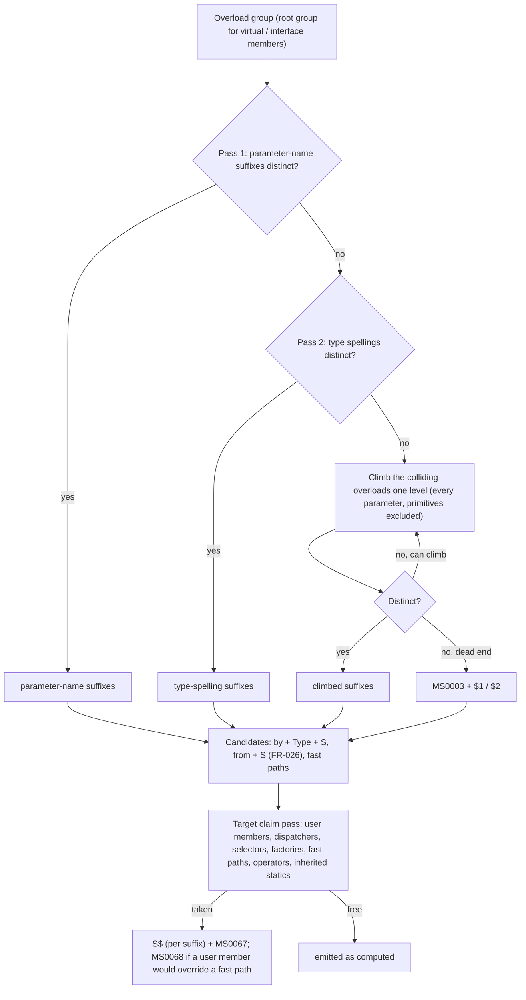

# Data model: Overload factories, selector symbols and direct call sites

The core (`Metano.Compiler`) computes the **candidate** names and the call-site decisions
(NFR-002); each target bridge resolves the claims and renders (DECIDED-18). Names are normative;
field order is indicative.

## 1. IR additions (`src/Metano.Compiler/`)

```csharp
/// <summary>
/// How one parameter type is spelled in an overload name (013 FR-002), captured
/// from the Roslyn symbol at extraction time, because the IR type refs erase
/// collections, delegates, unsigned primitives and containing types (research R7).
/// The spelling is its parts concatenated; Leaf is the unqualified spelling
/// ("Int32", "ListOfInt32", "Decimal"), derived from the parts.
/// </summary>
public sealed record IrNamingSpelling(IReadOnlyList<IrNamingComponent> Components)
{
    public string Leaf { get; }
}

/// <summary>One part of a spelling. A part with an empty chain never climbs: a
/// primitive's CLR name, a type parameter, or a structural word ("Of", "Array",
/// "OrNull", "TupleOf", "RefOf"). A named type carries its qualifier chain, nearest
/// first (containing types, namespace segments, then "Global"), and its declaration's
/// identity (assembly + full name), which tells same-named declarations apart and
/// stops a part shared by every colliding overload from climbing.</summary>
public sealed record IrNamingComponent(
    string Name,
    IReadOnlyList<string> Chain,
    string? TypeIdentity = null
);

/// <summary>
/// The candidate names OverloadNamePolicy computed for one overload of a
/// dispatched group (013 FR-001). Candidates only: the target bridge claims them
/// (DECIDED-18), so the emitted spelling may carry a `$`.
/// </summary>
public sealed record IrOverloadName(
    string Suffix               // "Amount", "WidthHeight", "NumericsDecimal", "Default" (013a)
    // Deferred to the slices that consume them:
    // IrOverloadRef Root       — the root overload this name belongs to (FR-025, 013d)
);
// FR-026 (from + TypeName + Suffix) is not IR: it compares the TypeScript static side a class
// inherits, so the TypeScript claim pass decides it (013b, `TsOverloadClaimPass`, DECIDED-18).
// The member candidates (`addXY`, `__addMoneyInt32`, `fromAmount`) are not IR: each target
// composes them from its own emitted base name and the suffix (naming.md step 8), since
// camelCasing and the `__` operator prefix are target spellings (NFR-002).

/// <summary>A stable overload identity: the declaring type (for an interface root, the
/// constructed interface, DECIDED-30), the member's C# name (`.ctor` for a constructor),
/// and the overload's declaration ordinal in its root group (013c:
/// `IR/IrOverloadRef.cs`).</summary>
public sealed record IrOverloadRef(IrTypeKey DeclaringType, string MemberName, int Ordinal);

/// <summary>A type's identity across compilations: its assembly's name and its metadata
/// name (`Shop.Box`1`, `Shop.Outer+Inner`). A target finds the type with
/// `IAssemblySymbol.GetTypeByMetadataName` (`Extraction/IrTypeKeys.cs`, 013c).</summary>
public sealed record IrTypeKey(string AssemblyName, string MetadataName);

// IrParameter gains:
public IrNamingSpelling? NamingSpelling { get; init; }   // null outside dispatched groups
// IrConstructorDeclaration and IrMethodDeclaration gain:
public IrOverloadName? OverloadName { get; init; }       // null: not part of a dispatched group (NFR-001)
public string? SignatureText { get; init; }              // constructors: "Money(decimal amount)" (D2)
// IrConstructorDeclaration gains:
public int DeclarationOrdinal { get; init; }             // declaration order of a dispatched set (013b): selectors and factories follow it
// IrMethodDeclaration gains:
public bool IsOverride { get; init; }                    // emits `override` on the root's fast path (FR-030), with the root's mapped visibility
public bool IsHiding { get; init; }                      // `new`: a non-root candidate, claimed against inherited members (claim step 7)
// IrClassDeclaration gains:
public bool HasMultiplyConstructedInterface { get; init; } // DECIDED-30: runtime-dispatched root names, MS0069
// IrConstructorDeclaration gains, for a dispatched base call (013c):
public IrOverloadRef? BaseOverload { get; init; }        // the statically resolved base overload (FR-017)
// BaseArguments (already IReadOnlyList<IrArgument>) then holds Roslyn's bound arguments, defaults explicit
// IrNewExpression gains (013c), for a construction lowered to a factory:
IrOverloadRef? Overload = null                           // Arguments then hold Roslyn's bound arguments
```

- `OverloadName` is `null` whenever the member is not in a dispatched group — the no-churn rule
  of NFR-001 keys on it.
- `SignatureText` and `NamingSpelling` are read from Roslyn at extraction time, so neither target
  needs Roslyn. Roslyn spells `uint` as `UInt32` and `List<int>` as `List<int>` whatever the IR
  folds them to, so #475 is related but not a prerequisite.
- A struct's implicit parameterless constructor is not an `IrConstructorDeclaration`; the TS bridge
  adds its zero-argument branch (FR-027).

## 2. Direct call sites

```csharp
/// <summary>
/// A call Metano lowered to the Roslyn-resolved overload (013 FR-017, FR-018).
/// Target carries the overload's root identity, never a final string: the
/// target bridge resolves it through the declaring type's claim results
/// (DECIDED-18, M2). Produced only when the receiver, the overload and the
/// type arguments are static and the declaring type's IR is available
/// (source or project reference, FR-019); everything else keeps the dispatcher.
/// </summary>
public sealed record IrDirectOverloadCall(
    IrExpression? Receiver,             // null: static, module function or constructor factory
    IrOverloadRef Target,
    IrDirectCallKind Kind,              // Factory | Method | BaseMethod (super.) | Operator | ModuleFunction
    IReadOnlyList<IrArgument> Arguments, // Roslyn's bound form: expanded params as elements, normal form as one spread
    IReadOnlyList<IrTypeRef>? TypeArguments
) : IrExpression;

/// <summary>A method group converted to a delegate, resolved to one overload (FR-018).</summary>
public sealed record IrDirectOverloadGroupReference(
    IrExpression? Receiver,             // bound with .bind(receiver) when instance
    IrOverloadRef Target
) : IrExpression;
```

The constructor-initializer case (`: base(args)` → `super(Base.byBaseX, ...)`) is not an
expression: `IrConstructorDeclaration.BaseOverload` and `BaseArguments` record it, and the
constructor bridge renders the selector form in every branch that chains to that base overload.
`this(...)` chains keep today's inlining (DECIDED-7). A declared constructor without an
initializer records its implicit `base()` the same way when the base set is dispatched.

**Constructions (013c).** A `new` lowered to a factory is not an `IrDirectOverloadCall`: it stays
an `IrNewExpression` that carries `Overload`, because a construction keeps everything else an
`IrNewExpression` models — object initializers, constructed type arguments (passed to the
factory, `Box.fromValue<string>(s)`), imports, and the shapes a target lowers first
(`[PlainObject]`, branded, JSX, declarative BCL mappings). A Dart named constructor
(`T.fromX(...)`) is a construction too. `IrDirectOverloadCall` (with its `Factory` kind) is left
to the method call sites of 013e.

## 3. TypeScript rendering (`src/Metano.Compiler.TypeScript/Bridge/`)

| IR / C# | TS |
|---|---|
| constructor overload `OverloadName` | `protected static readonly by<TypeName><Suffix>: unique symbol = Symbol("<SignatureText>");` — first among the static members (FR-029) |
| every overload of a dispatched constructor | `constructor(overload: typeof T.by<TypeName><Suffix>, ...params);` before the retained plain signatures |
| the constructor implementation | guarded selector branches, then today's fallback branches, then the throw |
| constructor overload, concrete class | `static [override] from<Suffix>(...)` (or `from<TypeName><Suffix>`, FR-026) with the overload's #445 accessibility, `return new T(T.by…, ...)`; `override` when the name is inherited |
| method overload `OverloadName` | `<accessibility> [static] [override] [abstract] <fastPath>(...)`; an override takes the root's accessibility |
| a derived type's dispatcher over new overloads | `override` dispatcher with the base dispatcher's signatures plus its own; unmatched calls → `super.<dispatcher>(...args)` |
| interface method overload | the fast-path signature beside the dispatcher signatures (FR-031) |
| `IrDirectOverloadCall(Factory)` | `T.from<Suffix>(args)` |
| `IrDirectOverloadCall(Method)` | `<receiver>.<fastPath>(args)`, receiver evaluated once |
| `IrDirectOverloadCall(BaseMethod)` | `super.<fastPath>(args)` |
| `IrDirectOverloadCall(Operator)` | `T.__<op><Suffix>(left, right)` |
| `IrDirectOverloadCall(ModuleFunction)` | `<fastPath>(args)` plus a value import from the declaring module |
| `IrDirectOverloadGroupReference` | `<receiver>.<fastPath>.bind(<receiver>)` / `T.<fastPath>` |
| `BaseOverload` | `super(Base.by<BaseName><Suffix>, ...BaseArguments)` |

The claim results per type (`TsOverloadClaims`: overload ref → emitted names) are computed once
per declaring type from its IR and cached for the compilation, so every file spells a cross-file
call the way the declaring file emitted it.

## 4. Dart rendering (`src/Metano.Compiler.Dart/`, names only)

| IR | Dart |
|---|---|
| constructor overload `OverloadName` | the named constructor `T.from<Suffix>(...)` (no selector) |
| method overload `OverloadName` | the same candidate, claimed in Dart's single member namespace |
| `IrDirectOverloadCall(Factory)` | `T.from<Suffix>(args)` |
| `IrDirectOverloadCall(Method)` | `<receiver>.<fastPath>(args)` |

## 5. Diagnostics data

| Code | Raised by | Inputs |
|---|---|---|
| `MS0067` | each target's claim pass | the candidate, the claimant (user member or synthesized kind + name), the emitted name, the overload's location |
| `MS0067` reason 3 | each target's claim pass (step 7) | the non-root candidate, the inherited instance member |
| `MS0068` | each target's claim pass | the user member (instance or static), the inherited fast path or factory, its overload |
| `MS0069` | the core class extractor | the type, the interface, its constructions |
| `MS0003` | `OverloadNamePolicy` (dead end, FR-024) | the colliding overloads, the positional names |

## 6. Naming decision flow



The parameterless overload's suffix is `Default` before pass 1 (DECIDED-5); it takes part in the
same distinctness checks.
