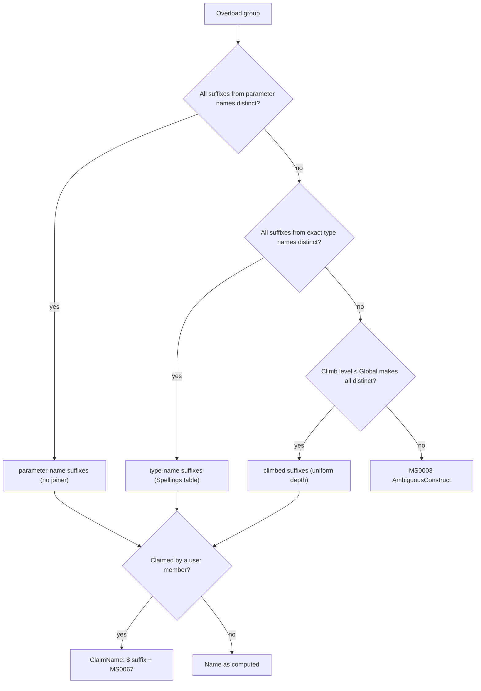

# Data model: Overload factories, selector symbols and direct call sites

The core (`Metano.Compiler`) computes the names and the call-site decisions (NFR-002); the targets
render them. Names are normative; field order is indicative.

## 1. IR additions (`src/Metano.Compiler/`)

```csharp
/// <summary>
/// The names OverloadNamePolicy computed for one overload of a dispatched group
/// (013 FR-001). The suffix is shared by the constructor factory (from + Suffix)
/// and the selector symbol (by + Suffix); the fast path name is the complete
/// method name. Both are already ClaimName-resolved and [Name]-applied.
/// </summary>
public sealed record IrOverloadName(
    string Suffix,       // "Amount", "WidthHeight", "NumericsDecimal", "Default"
    string? FastPathName // method groups only: "addXY", "fInt32", "nowDefault"; null on constructors (the selector branch holds the body)
);

// IrConstructorDeclaration and IrMethodDeclaration gain, per overload:
public IrOverloadName? Name { get; init; }            // null: single member, no group
// IrConstructorDeclaration gains, per overload, the C# signature text of the
// overload ("Money(decimal amount)") for the selector symbol description (D2).
public string SignatureText { get; init; }
```

- `Name` is `null` whenever the member is not part of a dispatched group (fewer than two
  overloads) — the no-churn rule of NFR-001 keys on it.
- `SignatureText` is the Roslyn display of the constructor's signature (parameters only, as the
  maintainer's example spells it), captured at extraction time so the targets never need Roslyn.

## 2. Direct call sites

```csharp
/// <summary>
/// A call Metano lowered to the Roslyn-resolved overload (013 FR-017, FR-018).
/// Target: the factory (constructor), the fast-path method (instance/static),
/// or the bare exported function (companion namespace). Produced only when the
/// receiver, the overload and the type arguments are static (DECIDED-11);
/// everything else keeps the dispatcher call.
/// </summary>
public sealed record IrDirectOverloadCall(
    IrExpression? Receiver,        // null: static or namespace function
    IrNamedType DeclarationType,   // the type declaring the overload (factory receiver)
    IrOverloadName Name,
    IReadOnlyList<IrArgument> Arguments,
    bool IsConstructorFactory      // new T(args) -> T.fromXxx(args)
) : IrExpression;
```

The constructor-initializer case (`: base(args)` → `super(Base.byXxx, ...)`) is not an expression:
the constructor extractor records the resolved base overload's `IrOverloadName` next to the
existing base-call arguments, and the constructor bridge renders the selector form. `this(...)`
chains keep today's inlining (DECIDED-7); the chained target's selector is resolved the same way
if a future lowering needs it.

## 3. TypeScript rendering (`src/Metano.Compiler.TypeScript/Bridge/`)

| IR / C# | TS |
|---|---|
| `IrOverloadName(Suffix)` on a constructor overload | `protected static readonly by<Suffix>: unique symbol = Symbol("<SignatureText>");` |
| the same, when the class is abstract | emitted (no factory beside it, DECIDED-9) |
| every overload of a dispatched constructor | `constructor(overload: typeof T.by<Suffix>, ...params);` |
| the constructor implementation | selector branches first, then today's fallback branches, then the throw (contracts/ts-emission.md) |
| `IrOverloadName(Suffix)` on a constructor | `static from<Suffix>(...): T { return new T(T.by<Suffix>(...)); }` with FR-049's accessibility |
| `IrOverloadName(FastPathName)` on a method | `/** @internal */ static|public <FastPathName>(...)` — public, `ClaimName`-resolved |
| `IrDirectOverloadCall(IsConstructorFactory)` | `T.from<Suffix>(args)` |
| `IrDirectOverloadCall(Receiver)` | `<receiver>.<FastPathName>(args)` — the receiver is the ordinary call lowering's receiver, evaluated once |
| the base call of a dispatched derived constructor | `super(Base.by<Suffix>, ...)` |

Member order follows spec 005's deterministic layout: static fields (the selectors, grouped) come
before the constructor, and the factories sit with the other static methods.

## 4. Dart rendering (`src/Metano.Compiler.Dart/`, names only)

| IR | Dart |
|---|---|
| Factory of a constructor overload | the named constructor `T.from<Suffix>(...)` (no selector symbols) |
| `IrOverloadName(FastPathName)` | the same public method name as TypeScript |
| `IrDirectOverloadCall(IsConstructorFactory)` | `T.from<Suffix>(args)` |
| `IrDirectOverloadCall(Receiver)` | `<receiver>.<FastPathName>(args)` |

## 5. Diagnostics data

| Code | Raised by | Inputs |
|---|---|---|
| `MS0067` | `OverloadNamePolicy` (through `ClaimName`) | the claimed computed name, the claiming member (kind + name), the emitted `$`-resolved name, the overload's location |

## 6. Naming decision flow (the single source for FR-001)



The zero-argument overload's suffix is `Default` before step B (DECIDED-5); it participates in the
same distinctness checks.
