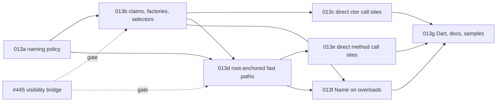

# Implementation Plan: Overload factories, selector symbols and direct call sites

**Branch**: `docs/25-overload-factories-spec` (spec directory `013-overload-factories`) | **Date**: 2026-11-04 (revised after review) | **Spec**: [spec.md](./spec.md) | **Issue**: [#25](https://github.com/danfma/metano/issues/25)

## Summary

The core gains one naming policy that computes candidate names from Roslyn-captured spellings,
anchored on each overload's root declaration (DECIDED-1, DECIDED-15). Each target bridge claims the
candidates against its own member tables in one order (DECIDED-18). The TS target emits
type-qualified selector symbols first among the statics, guarded selector branches and
per-overload-visibility factories (DECIDED-16, DECIDED-17, DECIDED-19); it makes fast paths
addressable members with their overload's visibility, emitted as `override` / `abstract` members
and declared on interfaces; and it rewrites resolved call sites — constructors, `base(...)`,
methods, `base.M`, method groups, operators, module functions, JSON factories — to them
(DECIDED-11). The dispatcher stays public as the hand-written fallback (DECIDED-12). `MS0067` and
`MS0068` report renames and hijacks. Dart inherits the candidates. Seven slices; 013b and 013d
start after #445 merges.

## Technical Context

- **Language/Version**: C# 14 on .NET 10 for the compiler; TypeScript built with `tsgo`; Bun for
  tests; Node for the load-order runs (R2, R9).
- **Primary Dependencies**: Roslyn 5.3.0 (`GetSymbolInfo`, `IMethodSymbol.OverriddenMethod`,
  `FindImplementationForInterfaceMember`, `IInvocationOperation.Arguments` for bound `params` /
  default arguments); #445's visibility mapper (`IrToTsVisibilityMapper.MapMember`).
- **Testing**: TUnit goldens (`tests/Metano.Tests/Expected/`), naming unit tests on the core
  policy, diagnostic tests, bun tests plus a Node run in the sample consumer,
  `bash scripts/verify-targets-clean.sh` for the no-churn check (NFR-001).
- **Constraints**: `TreatWarningsAsErrors`; NFR-001–NFR-006.
- **Scale/Scope**: 1 new core file (`OverloadNamePolicy`) plus the spelling capture; IR fields
  (data-model.md); a TS claim resolver; edits in both dispatcher bridges, the class and interface
  bridges, the operator bridge, the namespace / module emission, the expression extractor and the
  JSON spec builder; `MS0067`–`MS0069`; ~35 goldens; the sample scenario. No runtime
  (`metano-runtime`) changes.

## Constitution Check

| Principle | Status | Notes |
|---|---|---|
| Spec as source of truth | ✅ | This spec lands before code; baseline FR-050, the matrix rows and the `MS0067` / `MS0068` reservations are updated in this PR. |
| Clean Code / expressive names | ✅ | `OverloadNamePolicy` (candidates), one claim resolver per target, the bridges gain focused members; both spelling tables are deleted. |
| Ports & Adapters | ✅ | Candidates in the core; claims and rendering in each target (DECIDED-18). |
| Pragmatism | ✅ | The dispatcher survives (DECIDED-12); chains stay inlined (DECIDED-7); metadata-only references fall back (DECIDED-24). |
| DX | ✅ | TS2445 / TS2341 enforce access; factories are the construction API; every rename is reported; every break is in the migration notes. |

**Required by gates**: dual-agent review (`compiler-man` + `bob`) on every slice; the global
reviewers on every code slice; #445 merged before 013b and 013d.

## Code survey (what each slice touches)

All paths repo-relative, on `f520be36`.

### Core (`src/Metano.Compiler/`)

| File | Today | Change |
|---|---|---|
| `Extraction/OverloadNamePolicy.cs` (new) | — | stage 1 of contracts/naming.md: passes, spellings, climb, `Default`, root anchoring, dead end (FR-001–FR-003, FR-006, FR-024, FR-025) |
| `Extraction/IrTypeRefMapper.cs` and the parameter extraction | maps types, folding `uint` → `Int32` (lines 75–83) and `List<T>` → array | captures `IrNamingSpelling` from the Roslyn symbol beside the mapped type (FR-002); the folding itself is #475's |
| `IR/IrMemberDeclaration.cs` (`IrMethodDeclaration`), `IR/IrConstructorDeclaration.cs`, `IR/IrParameter.cs` | overload lists without names | `OverloadName`, `SignatureText`, `NamingSpelling`, `IsOverride`, `BaseOverload` / `BaseArguments` (data-model.md) |
| `Extraction/IrConstructorExtractor.cs` | builds overload sets; `FindPrimaryConstructor` (line 97) | threads the policy; records the resolved base overload and bound arguments (FR-017) |
| `Extraction/IrExpressionExtractor.cs` | dispatcher calls for every overload call | `IrDirectOverloadCall` / `IrDirectOverloadGroupReference` when DECIDED-11 holds (FR-017, FR-018) |
| `Extraction/` (method-group extraction) | abstract overload groups report `MS0001` and are skipped (R5) | extracts them with `IsAbstract` fast paths (FR-030) |
| `Diagnostics/MetaSharpDiagnostic.cs` | codes up to `MS0063` (`MS0064`–`MS0066` reserved by 012) | `MS0067`, `MS0068` (FR-020) |

### TypeScript target (`src/Metano.Compiler.TypeScript/`)

| File | Today | Change |
|---|---|---|
| `Bridge/TsOverloadClaims.cs` (new) | — | the claim pass per class (static and instance tables) and per barrel; cached per declaring type; `MS0067` / `MS0068` (FR-004, FR-034) |
| `Bridge/IrToTsOverloadDispatcherBridge.cs` | `ComputeFastPathNames` / `SimpleTypeName` / `PrimitiveSuffix` (lines 501–545); private fast paths; `ClaimName` only on the namespace path (line 137); `internal` → `private` (line 555) | consumes the claimed names; fast paths with #445's per-overload visibility, `override` / `abstract`; no dispatcher for override-only types; namespace fast paths exported (FR-015, FR-030, FR-032); the naming helpers deleted |
| `Bridge/IrToTsClassBridge.Operators.cs` | its own `SimpleTypeName` (line 287); private operator fast paths | policy names, public (FR-033); the table deleted |
| `Bridge/IrToTsConstructorDispatcherBridge.cs` | one dispatcher constructor, bodies in branches | selectors, selector signatures, guarded selector branches, factories, struct zero-argument branch, `super(Base.by…, …)` (FR-007–FR-012, FR-017, FR-026–FR-028) |
| `Bridge/IrToTsClassBridge.cs` | member assembly and ordering | selectors first among statics (FR-029); abstract classes skip factories (FR-012) |
| `Bridge/IrToTsInterfaceBridge.cs` | dispatcher signatures only | fast-path signatures (FR-031) |
| `Bridge/IrToTsExpressionBridge.cs` | call nodes | renders the direct-call nodes through `TsOverloadClaims` |
| `Bridge/IrToTsNamingPolicy.cs` | member name overrides | `[Name]` on an overload (FR-005) |
| `Transformation/Json/JsonSpecBuilder.cs`, `JsonUnmirroredAttributes.cs` | `factory: (p) => new T(...)`; `MS0037` for an uncalled `[JsonConstructor]` | factory call of the `[JsonConstructor]` overload; that `MS0037` reason retired for dispatched types (FR-035) |
| barrel emission (spec 005) | re-exports declared names | re-exports module fast paths (FR-032) |

### Dart target (`src/Metano.Compiler.Dart/`)

| File | Change |
|---|---|
| `Bridge/IrToDartNamingPolicy.cs`, `Transformation/DartTransformer.cs` | named constructors for factories, no selectors, the core candidates, a single-namespace claim pass (FR-022) |

### Tests and samples

| Path | Change |
|---|---|
| `tests/Metano.Tests/MethodOverloadFastPathTests.cs`, `ConstructorOverloadTests.cs`, `PrimaryConstructorDispatchTests.cs`, `Int64OverloadNamingTests.cs`, `OperatorTranspileTests.cs` | regenerated per slice |
| `tests/Metano.Tests/OverloadNamePolicyTests.cs` (new) | the naming table of contracts/naming.md, unit-level |
| `tests/Metano.Tests/OverloadNameClaimTests.cs` (new) | `MS0067` reasons, `MS0068`, `MS0003` dead end |
| `tests/Metano.Tests/Expected/overload-*.ts` (new) | the planned goldens below |
| `samples/SampleIssueTracker` / `targets/js/sample-issue-tracker` | an overloaded constructor, a virtual overload group and an extension group exercised by bun tests and a Node run (SC-006) |

## Slices

Each slice is one PR with dual-agent review, merged into `main`, kept green: the full TUnit suite,
every bun sample, `bash scripts/verify-targets-clean.sh`. **No staging switch**: 3.0.0 is not
released yet, so every slice lands its output change directly and regenerates the goldens it
breaks; the CHANGELOG collects the breaks for the release.

| Slice | Commit type | Scope | FRs | Depends on |
|---|---|---|---|---|
| **013a — Naming policy in the core** | `feat!:` | Roslyn spelling capture; `OverloadNamePolicy` (passes, exact CLR spellings, the climb, `Default`, dead end + `MS0003`); the TS bridges consume the candidates for today's private fast paths and operator helpers; both spelling tables deleted. The R7 duplicate families compile. | FR-001–FR-003, FR-006, FR-024, FR-033 | — |
| **013b — Claim pass, factories and selectors** | `feat!:` | `TsOverloadClaims` (order, per-suffix `$`, `MS0067` reasons 1–2); type-qualified selectors first among statics; guarded selector branches; factories with per-overload visibility and FR-026 (constructed-base comparison, accessibility, `static override` for kept names); `MS0068` reason 2 (a derived user static against an inherited factory); abstract exclusion; struct zero-argument branch; generic factory constraints. | FR-004, FR-007–FR-014, FR-020 (`MS0067`, `MS0068` reason 2), FR-026–FR-029, FR-034 (statics) | 013a, #445 |
| **013c — Direct constructor call sites** | `feat!:` | `new T(...)` → factory; every `: base(...)` (selector and fallback branches alike) → `super(Base.by…, …)` with explicit defaults; the JSON factory of the `[JsonConstructor]` overload; project-reference-only cross-package resolution. | FR-017, FR-019 (constructor half), FR-035 | 013b |
| **013d — Root-anchored fast paths** | `feat!:` | addressable fast paths with per-overload visibility (overrides: the root's); root anchoring on constructed roots; `override` fast paths and no dispatcher for override-only types; `override` superset dispatchers forwarding to `super` for types adding overloads; claim step 7 (`MS0067` reason 3) for `new` methods and new overloads; `abstract` fast paths (lifting today's `MS0001`); interface fast-path signatures, implementer forwarding, explicit implementations; multiply-constructed interfaces with `MS0069`; root names from metadata symbols for DLL / package bases (DECIDED-28); `MS0068` reason 1. | FR-015, FR-016, FR-025, FR-030, FR-031, FR-034, FR-036, FR-037, FR-020 (`MS0067` reason 3, `MS0068` reason 1, `MS0069`) | 013a, 013b (claim pass), #445 |
| **013e — Direct method call sites** | `feat!:` | method, `base.M`, method-group, operator and module-function call sites, with Roslyn's bound defaults passed explicitly (DECIDED-32); overloaded module groups with exported fast paths and barrel claims; `params` forms; generic type arguments; project-reference-only cross-package resolution. | FR-018, FR-019 (method half), FR-032 | 013d |
| **013f — `[Name]` on overloads** | `feat:` | the OQ-1 decision. | FR-005 | 013b, 013d |
| **013g — Dart names, docs, samples** | `feat:` + `docs:` | Dart named-constructor mapping and claim pass (Dart then honors the 013f pins and their diagnostics); `docs/` naming rule; CHANGELOG migration notes (including the 013f `[Name]` renames below); the sample scenario with its Node run; matrix rows → Implemented. | FR-021 (sample), FR-022, FR-023 | 013c, 013e, 013f |



Ownership notes the review asked for: the selector `super(...)` calls belong to **013c** (013b
emits the selectors and branches but leaves derived classes on today's `super(args)`); the
root-anchoring rule belongs to **013d**; the claim pass belongs to **013b**, and 013d / 013e extend
its tables (instance fast paths, barrels).

Hand-offs from 013b (its review): the TypeScript claim results (`TsOverloadClaims`, cached by
`TsOverloadClaimsRegistry` per `INamedTypeSymbol`) are keyed by suffix (constructors) and by
table + emitted group name + suffix (fast paths). **013c** re-keys them by the overload identity a
call site carries (`IrOverloadRef`: declaring type, C# member name, declaration ordinal; methods
need the ordinal the core so far records only on constructors) and keeps the symbol lookup as a
thin adapter. **013d** adds the inherited instance side (claim step 7) to the cached result, which
today holds only the static side. **013e** replaces the module-function path, which still names
fast paths without a claim (`IrToTsOverloadDispatcherBridge.BuildNamespaceFunctions`), with the
barrel claim table. `IrToTsTypeOverrides` both maps a type and records its package; the claim pass
reads shapes through a copy with a throwaway ledger, and splitting the mapping from the recording is
left to a later cleanup. FR-027's struct branch zeroes references, numbers, `bool`, `decimal`,
enums, nullables, `char`, `BigInteger`, branded values and structs whose `new S()` zeroes them; it
leaves `undefined` with `MS0001` for `Guid` (`UUID.empty` is expressible, not built yet), the date
and time types, structs with a single declared constructor or a user parameterless one, tuples,
`KeyValuePair`, `ValueTask` and type parameters constrained to a value type; a containing type's
value-constrained type parameter still takes `null`, and so does a user struct implementing
`IEnumerable<T>`, which the IR folds into an iterable shape without its value-ness — a follow-up
closes these. The factory widening of FR-011 (a factory code outside the class body calls)
lands with **013c**, the first slice that calls factories.

Hand-offs from 013c: constructor claims are keyed by declaration ordinal
(`TsOverloadClaims.ConstructorNamesAt`), and a call site resolves its `IrOverloadRef` through
`TsOverloadClaimsRegistry.ConstructorNamesOf`, which finds the declaring type by its `IrTypeKey`
(an unresolved identity keeps the dispatcher silently; once methods share the key, **013d / 013e**
should report it instead);
`TypeTransformer` publishes the registry for the transform (`TsOverloadCallSites`, the same
`AsyncLocal` pattern as the other per-transform lowering state), so module functions, operators
and entry points reach it too. Method fast paths are still keyed by table + group name + suffix:
**013d / 013e** move them to `IrOverloadRef` once methods carry an ordinal. The core's call-site
decision is `DispatchedConstructorCalls` (dispatched set, source IR: DECIDED-24), and the shapes a
target emits with selectors come through the `IrExtractionContext.EmitsConstructorSelectors` port
(TypeScript: `TsConstructorSelectorShapes`; Dart sets none, so it keeps its source arguments until
**013g**); bound arguments keep C#'s evaluation order (`IrSelectedOverload.EvaluationOrder`); the
per-group cache key folds in every dispatched set's shape (`DispatchedConstructionFingerprint`),
since a body's `new` now depends on the callee's claimed names; bound arguments come from `IArgumentOperation` (`ExtractBoundArguments`), so 013e
can reuse them for DECIDED-32. FR-011's widening reads per-overload facts
(`ConstructorAccessFacts.OutsideCallOfFactory`); FR-049 rule 3 still widens the constructor
of a restricted type too, because a `TypeSpec`'s `type: T` needs a public construct signature.
Still on the dispatcher: a class that declares no constructor over a dispatched base (TypeScript's
implicit `super(...args)`), a C# 12 primary-constructor class whose base list passes no arguments
(`class P(int x) : Base`), a `new` whose argument list has a `params` collection that is not an
array, and every call into a metadata-only reference (DECIDED-24). Known gaps: an omitted
non-nullable struct `= default` passes `undefined`, which the factory's own default fills with
013b's `undefined` (FR-027's zero value is not used there yet); a project-reference base whose
factory its package widened (FR-011) is judged by its declared accessibility, so FR-026 may qualify
a derived factory it could have kept. The evaluation-order binding follows
`IrEvaluationTraits.IsSideEffectFree`, which counts a property read as free, so named arguments
reading a mutating getter are reordered unbound, as elsewhere in the pipeline.

As landed in 013d: the core groups a type's methods in `MethodOverloadGroups` (`Extraction/`):
an `override` of a dispatched root (the first declaration of its override chain, declared by an
emitted class) and an implementation of a member of a dispatched interface group are **anchored**
(`IrMethodDeclaration.Anchor`: root `IrOverloadRef`, `Override` / `Implementation`, further
interface roots) and reuse the root's suffix; an override of a single virtual keeps its own group
(DECIDED-29, the `$override` segregation of #159); every other method is its own root, named over
the visible group — the inherited dispatcher's overloads the type can see plus the methods it
declares. Methods now carry `DeclarationOrdinal` (their position among the type's methods of that
C# name), so method fast paths are keyed by `IrOverloadRef` (`TsOverloadClaims.FastPathNameAt`,
`TsOverloadClaimsRegistry.RootFastPathOf`), which **013e** resolves call sites through. The primary
of a group an emitted base already dispatches carries `InheritedOverloads` (the base dispatcher's
overloads, constructed through the base chain, invisible ones included), and `IrMethodGroup`
decides the dispatcher once for every consumer (`None` / `Declared` / `OverridesInherited`, and the
branches the runtime scanner collects type checks for). The TypeScript claim pass gained the
instance side (`TsOverloadClaims.Instances`, every visibility, inherited included): own fast paths
claim against it (step 7, `MS0067` reason 3), anchored ones take the root's emitted name
(`RootFastPathOf`, which reads a metadata-only root's class through the same shape extraction,
DECIDED-28), and a user instance member meeting an inherited fast path, or an anchored name held by
a user member, reports `MS0068` reason 1. Interfaces name their groups in `IrInterfaceExtractor` and
claim fast paths in `TsInterfaceFastPaths` (one table per interface, `MS0067` on a rename);
`ExplicitImplementationLowering` no longer drops an explicit overload of a dispatched interface group
beside a class method of another signature (DECIDED-31). Multiply-constructed interfaces are found
by `MultiplyConstructedInterfaces` (core): the class IR carries `ConstructedRoots`, every
implementation (an override of a base's included) anchors on the interface root, and
`IrToTsConstructedRootDispatcherBridge` emits the root-name runtime dispatcher with the bodies inlined
in its branches; `MS0069` is reported by the class emitter, once, at the type that adds the second
construction. One call-site shape lands here rather than in 013e: `base.M(...)` resolved into a
dispatched group is bound (`IrCallExpression.Overload`, Roslyn's bound arguments) and emitted as
`super.<fastPath>(...)`, because the base dispatcher now branches through `this.<fastPath>` and an
override calling `base.M` would recurse; this holds for metadata-only bases too (their names come from
metadata, DECIDED-28), and Dart keeps its source call. Every other call site stays on the dispatcher
until 013e — so a call through a base-typed receiver to a type with a `new` method still reaches the
hiding type's dispatcher (spec § Divergences). Known gaps: Roslyn imports no private (or, across
assemblies, internal) member of a metadata reference (`MetadataImportOptions.Public` by default),
so DECIDED-28's blind spot covers implementation DLLs as well as reference assemblies — a private
claimant that renamed the producer's fast path is missed and the consumer's `override` fails with
TS4117 (pinned by `MetadataBase_OverridesTheUnrenamedFastPath_WhenTheClaimantIsPrivate`); a group whose base's dispatcher signatures
all take a `params` rest parameter forwards `...(args as never[])`; an abstract implementation of a
multiply-constructed root is not branched (no body); a class that implements only part of an
interface group, the rest inherited from a base that does not implement the interface, gets no
dispatcher for it; DECIDED-29's pinned output still fails `tsgo` (TS2416/TS2385), as before.
An interface root is always *implemented*: a `new` method, an explicit re-implementation
(`X3 : X, IR`) or an override of an undispatched base virtual that also implements a root anchors
on the interface member (`Implementation`), and the claim pass emits it `override` when an emitted
base already implements the root (the base's interface mapping, recorded as
`IrOverloadAnchor.ReimplementedRoots`, judged per root so each forwarder follows its own root) (`TsMethodOverloadNames.OverriddenNames`);
a base fast path of that name the base does not implement the root with is a different overload the
anchored name cannot move from, reported `MS0068` reason 1 — naming.md's
"a `new` method is its own root" holds for class groups only. The interface group is one definition,
`Frontend/Roslyn/InterfaceOverloadGroup`, shared by the method groups, the multiply-constructed
interfaces, the interface extractor and the explicit-implementation lowering. `base.M(...)` is bound only into an
emitted class (not `[External]`, not the BCL), and inherited signatures of explicit implementations
are declared under the interface member's name. Still failing `tsgo`, as before 013d (the
DECIDED-29 family): a class overloading an inherited single virtual (`B : G` adding `M(int)` /
`M(string)` beside `G.M(bool)`, or `Bi : A, I` whose dispatcher shadows `A.n`) emits a dispatcher
that redeclares the base's single method. (`base.Equals(obj)` on a class with no emitted base still
emitted `super.equals` at 013d; #506 lowered it to `object`'s defaults.)
`MS0069` is reported by the TypeScript class emitter only; Dart reports it
when it emits overloads (013g).
A multiply-constructed root's name is the one its interface declares (computed on the interface
definition, `convX`), not a constructed spelling: implementers must match the interface's member
name, and a constructed spelling differs from it whenever the group needs type spellings.

As landed in 013e: the core binds a call resolved into a dispatched method group
(`DispatchedMethodCalls`, `IrExpressionExtractor`): an instance or static call keeps its receiver
and carries `IrCallExpression.Overload` with Roslyn's bound arguments — an omitted optional passes
the static overload's default explicitly (DECIDED-32; the runtime probe pins the static type's
default winning over a hiding derived one, and the emitted output returns .NET's exact results
under Node), an expanded `params` call its elements and a normal-form one the spread array
(DECIDED-21), and a generic call keeps its type arguments. An extension call binds through the
same extractor hook (`TryRewriteExtensionCall`, the reduced extension's original carrying the
overload; the receiver binds as the group's first argument, whose syntax node is an expression, so
`IsBindable` accepts the receiver form), an operator application binds its two operands
(`ExtractBoundOperatorCall`), and a method group renames through `IrMemberAccess.Overload`
(`b.addX.bind(b)`). The TypeScript bridge resolves every bound call through the claims registry —
instance receivers in place, statics on the type, extensions through the containerless flatten,
operators on the type's fast path — and keeps the dispatcher call (with the bound arguments,
which are correct for the resolved overload) when a metadata-only reference leaves the claims
unreadable (DECIDED-24, `overload-cross-package-metadata-methods`). Overloaded module groups
landed: the barrel-scope claim pass (`TsModuleFunctionClaims`) names one exported fast path per
overload of every dispatched module-function group — containerless classes and extension
containers — claiming dispatchers and module variables first and reporting `MS0067` for each
`$`-rename; `IrToTsModuleBridge.ConvertDispatchedGroup` emits the exported fast paths plus the
exported dispatcher (its own branch builder over `IrModuleFunction`s, until the deferred
`TsDispatcherShape` unification), the export registry registers the dispatcher with its fast
paths (replacing MS0020 for same-class overloads), and own-assembly call sites — static or
extension syntax — import and call the claimed names. A module-function group declared by a
project-referenced producer keeps the dispatcher: the barrel claims enumerate the current
assembly only, so the consumer cannot re-run the producer's claim pass — the dispatcher name is
stable and always exported, so the fallback stays loud; the producer-pipeline barrel claims that
would close it are a follow-up issue for the orchestrator. Direct calls stay target-side: Dart renders source calls and
arguments until it claims names (013g), and a C# 14 extension block's member, whose synthetic
type the groups do not cover, keeps the dispatcher. Regenerated in this slice: the
`overload-virtual` and `overload-abstract-methods` goldens (bodies calling dispatched groups now
bind), the cross-package `q`-call assertion, the internal-tagged caller assertion, and the
sample-issue-tracker output (`addCommentAsyncIssueAuthorIdMessage` and friends).

The 013e review added four pins: a dispatched extension group on a plain `[Transpile] static
class` registers its fast paths in the extension-helper registry, so the importing file imports
them (`overload-extension-helper`); a call whose named arguments evaluate out of parameter order
binds an impure receiver first (`$recv` before the argument bindings), keeping C#'s
receiver-before-arguments order (`overload-calls-receiver-order`; since #592 a reordered call whose
arguments run user code implicitly (a computed property read, a user-defined operator or
conversion, a `ToString` in a concatenation) records its evaluation order too, for TypeScript
only: `KeepsOrderForImplicitUserCode`, `overload-calls-computed-read-order`,
`overload-calls-stable-read-order`; Dart is unchanged, pinned by
`ReorderedComputedReads_KeepParameterOrder_AndReportNothing`); a lifted operator application
— a nullable operand C# null-propagates — keeps the lifted guard, since the fast path would
throw on the value read (`ExtractBoundOperatorCall` rejects `IsLifted`); and a generic call
whose type arguments are error or anonymous types keeps the dispatcher, since no emitted
declaration spells them (`DispatchedMethodCalls.HasUnresolvedTypeArguments`). The export
registry's dispatched branch reports MS0020 for a dispatcher or fast path another type claimed,
the single-function clash unchanged; a member whose barrel claim is missing (a type the barrel
enumeration does not cover) stays single and reports MS0001. Module functions and extensions of
a project-referenced producer keep the dispatcher — the barrel claims enumerate the current
assembly only — correct, only slower (DECIDED-24); closing that gap is a follow-up. The module
dispatcher's branch builder copies the class one over `IrModuleFunction`s until
`TsDispatcherShape` lands: follow-up issue to file.

As landed in 013f (OQ-1 closed with (a)): `[Name]` on an overload pins its suffix only.
`OverloadSuffixPin` (`Extraction/`) reads the pin — the attribute targeted at the extraction's
target, else the untargeted one — validates it once (`^[A-Za-z_][A-Za-z0-9_]*$`), and owns the
pin's reports: an invalid value (`MS0003` error at the attribute's argument; the overload keeps
its generated suffix, and the message names no suffix so re-reports deduplicate), a pin on an
override or implementation naming another suffix than its root's (`MS0003` warning), and a pin on
a constructor outside a dispatched set (`MS0003` warning). A pin applies neither to a conversion
operator, which has no C# name, so its `[Name]` names its group as before (`__toInt`), nor to the
Dart target, which names no fast paths before 013g (Dart output and diagnostics are unchanged).
`OverloadGroupNaming.SuffixesOf` takes `PinnedOverload`s and hands the validated suffix to
`OverloadNamePolicy` as `OverloadSignature.PinnedSuffix` (a string: the policy is pure and needs
only the suffix): the pin replaces the suffix in every pass and is one spelling part that never
climbs, so collisions move the computed overloads and equal pins dead-end (`MS0003`, naming the
pinned overloads). Anchored members take their root's suffix, so the root's `[Name]` wins, and in
a derived type's visible group an anchored member carries its root's pin, never its own, so an
ignored `[Name]` cannot move the type's other overloads. `NameAttribute` now allows
`AttributeTargets.Constructor`. Dispatchers keep the C# name everywhere: the core's
`OverloadEmittedName.NameOverrideOf` answers `null` for an overload of a dispatched group of a
type that emits dispatchers (not `[External]`, `[JsCallable]` or `[PlainObject]`) and is used by
the call-site `EmittedName`, `OverrideChains` (`toJSON` detection) and `IrParameterNaming`
(flattened callees; that cache is target-agnostic, so it reads the TypeScript-like rule); the
TypeScript side reads symbols through one `IrToTsNamingPolicy.ToFunctionName(IMethodSymbol)`
(barrel claims, extension-helper registry, `[NoContainer]` exports, the `[JsonFactory]`
descriptor) and IR declarations through `IrToTsNamingPolicy.FindMemberNameOverride`
(`TsClassMemberTable.OperatorNameOf`, module and branded dispatchers) and
`TsClassMemberTable.MethodNameOf` (class and interface dispatchers); #543 records the rule for the
shared `TsDispatcherShape`. `ExplicitImplementationLowering.EmittedName` keeps the plain
`GetNameOverride`: it runs inside the grouping itself (`MethodOverloadGroups.DeclaredMethods`), so
the group rule would recurse, and it compares explicit implementations by the interface member's
name. `[JsonFactory]` on a method of a dispatched group is `MS0034` (the dispatcher is shared with its
siblings), so no descriptor names a pinned fast path; a `[JsonFactory] From(string)` next to a
`[Name("num")] From(int)` was accepted before 013f (descriptor `create: UserId.from`, the
dispatcher) and is now an `MS0034` error: a build break for the 013g migration notes.
`IrParameterNaming` passes no target, so for Dart a flattened `[NoContainer]` callee that is an
overload with `[Name]` no longer gets the `$` rename of a parameter that shadows it (Dart renames
the whole member and its call sites ignore `[Name]`): a 013g item, with the Dart pins. Before 013f, `[Name]` was ignored on class method overloads, renamed a whole overloaded
operator group after its first overload (`__op…`), gave an interface overload a dispatcher
signature of its own (`side(s)` beside `area(w, h)`), and renamed a module overload's fast-path
base (`textS` beside the dispatcher `twice`); no existing golden pinned any of these, so none
changed. Goldens: `overload-name-pin-{class,roots,module,invalid,equal,dead-end,claimed,
deterministic,conversions,plain-object,override-leak,json-factory}` (type-checked with
`tsgo --strict --noImplicitOverride`; `override-leak` against a hand-copied base), and
`-cross-package` / `-cross-package-metadata` (consumer only). Found in review and filed: #564 (an
override next to its root in the visible group reports a bogus `MS0003`; fixed since: the override
stands for its root once, which also names the added overload by its parameter, `addB`, where the
bogus collision had climbed it to `addBoolean`), #565 (an interface
member renamed by `[Name]` is never declared by an implementer with overloads, TS2420), #566
(`[PlainObject]` overloads, unary and conversion call sites, C# 14 extension blocks, static and
instance overloads grouped together), #567 (duplicate barrel re-exports after `MS0020`, an
override of a single `[Name]`'d virtual).

Migration notes 013f hands to 013g's CHANGELOG (`[Name]` on an overload now pins the suffix):
an overloaded operator group named by one overload's `[Name("scaled")]` (`__scaled`, `$scaled`)
becomes `__multiply` / `$multiply` with the fast path `__multiplyScaled`; a module or extension
overload's `[Name("text")]` (`textS`) becomes `twiceText`; an interface overload's
`[Name("side")]` (`side(s)` beside `area(w, h)`) becomes `area(s)` plus the fast path `areaSide`;
a class method overload's `[Name("addText")]`, ignored before (`addS`), becomes `addAddText`.
Conversion operator groups keep their `[Name]` (`__toInt`).

As landed in 013g: the core's Dart special cases are gone (#549). `OverloadSuffixPin.Applies`
no longer takes a target (only a conversion operator pins nothing), so `[Name]` pins a suffix,
and reports its `MS0003`s, on Dart as on TypeScript; `DispatchedMethodCalls.RefOf` and the
`base.M` / method-group gates of `IrExpressionExtractor` bind on every target. The one real
difference is an opt-in capability the target declares on its extraction context, beside the
existing `EmitsConstructorSelectors` port: `IrExtractionContext.EmitsOperatorFastPaths` (unset by
default; TypeScript sets it, Dart, which declares one `operator` per class, does not), read by the
binary-operator binding only. Dart answers `EmitsConstructorSelectors` with
`DartTypeShapes.EmitsNamedConstructors`, so constructions bind too; a `: this(...)` chain target
now carries its `DeclarationOrdinal`, which a Dart redirect addresses. `IrParameterNaming.IrNameOf`
takes the target and caches the colliding names per owner and target, closing the Dart
parameter-shadow gap 013f recorded (and, for TypeScript, honoring a TypeScript-targeted `[Name]`,
which the target-less lookup missed). The Dart emission, claims and call sites are recorded in
contracts/dart-mapping.md § As landed; Dart call sites now spell a method's whole-member
`[Name]` (`IrMemberOrigin.EmittedName`), which they ignored before. The claim findings of both
targets are located through the core `OverloadDeclarationSite` (the TypeScript `TsClaimSite` is
gone). Four lists decide what a "keep today's emission" type is, per concept: (a) the core's
`OverloadEmittedName.PinsOverloadSuffixes` (whether `[Name]` pins: not `[External]`,
`[JsCallable]`, `[PlainObject]`), (b) the core's `DispatchedMethodCalls.IsEmittedContainingType`
(whether calls bind: those three; since #569 a branded type is judged per method by the target's
`IrExtractionContext.EmitsBrandedFastPath` port, which TypeScript answers and Dart leaves unset), (c) the targets' constructor shapes
(`TsConstructorSelectorShapes.EmitsSelectors`, `DartTypeShapes.EmitsNamedConstructors`) and (d) the
targets' member naming (`TsClassMemberTable`, `DartOverloadShape.NamesMembers`). They disagreed for
Dart on more than one shape: a branded type's kept primary (declared under its `[Name]` while call
sites spelled the pinned C# name) and an `[Import]` class (named constructors declared, `Ext(2)`
called); Dart now derives (c) and (d) once per symbol (`DartTypeShapes.ShapeOf`), read by the core
port, the claim pass and the class bridge, and declares a kept primary under (a)'s rule. Writing the
effective name into the IR (`IrMethodDeclaration.EmittedName`) and a target port for (a)/(b) are
the open half of #549 (comment there, and on #543). The Dart output of
SampleCounterV1–V4 is byte-identical to `main`; the Dart output of SampleTodo,
SampleTodo.Service and SampleIssueTracker changes where they declare overloads (none of it is
committed: `targets/flutter` holds SampleCounterV1 only, and its committed files predate later
sample edits). The sample scenario of FR-021 / SC-006 is `Planning/Domain/Estimate.cs` in
SampleIssueTracker: three constructor overloads with factories and a static field initialized
through one, a virtual `Add` group with an override calling `super`, an extension `Scale` group;
its bun tests and its Node run (`bun run test:node`, a resolve hook for the generated
extensionless relative specifiers, #573, wired into CI) return the .NET results. The user-facing
rule and migration guide are `docs/overloads.md`; the CHANGELOG lists the 3.0 items; ADR-0028 is
Accepted. Known Dart gaps (prototype, RT-02, #572): no `super(...)` initializer, so a derived
class of a dispatched base does not select the base's named constructor; a `: this(...)` chain
whose constructor has a body keeps the body without the chain (`MS0001` at the constructor);
module fast paths are claimed per file, not across the files a consumer imports together; named
arguments out of parameter order are passed in parameter order, which the core reports as
`MS0001` at a call with two or more order-sensitive evaluations (the opt-in
`IrExtractionContext.KeepsArgumentEvaluationOrder`, set by TypeScript only; with one, the call stays
inline and Dart types each argument from its parameter). Two closure-based attempts were withdrawn
in review: an untyped closure parameter loses Dart's downward inference (`2` passed as a `double`,
`[]` as a `List<int>`, a generic `T`) and a syntactic "unassigned local" test misses a write
captured by a closure; the typed-closure approach is #591.

Deferred from the 013d reviews (design, no behavior): reporting `MS0069` from the core so every target gets it;
splitting `MethodOverloadGroups` into grouping, anchoring and inherited-dispatcher modules; a shared
`TsDispatcherShape` for the two dispatcher bridges; passing the diagnostics sink and the claim
registry through the contexts instead of ambient state; moving the pure lookups on IR records
(`IrMethodGroup`, `IrClassDeclaration.ConstructedRootOf`) to `Analysis/` or recording the exception
in ADR-0019.

Deferred / follow-ups: OQ-3 (`[PlainObject]` factories), OQ-4 (dropping the fallback, 4.0),
OQ-5 (dropped secondary constructors warning); follow-up issues to file: DECIDED-29 (overloading an
inherited single virtual, today's emission pinned) and DECIDED-30 (full support for
multiply-constructed interfaces); default interface methods (bodies dropped today); the two
unrelated bugs of research R7 and R12's `object` check.

## Test strategy

- **Core units**: `OverloadNamePolicyTests` over contracts/naming.md — every pass, every spelling
  row (unsigned, `List<int>` vs `int[]`, delegates, tuples, type parameters), every climb case
  (nested, namespace, generic argument, primitive not climbing, partial-set climbing), `Default`,
  the dead end, root anchoring, determinism.
- **Planned goldens** (each built with `tsgo --strict --noImplicitOverride --declaration` in its consumer, FR-021, SC-008):
  - `overload-factory-basic` (`Money`, R1) and `overload-dispatcher-fallback` (hand-written
    `new T(...)` keeps the runtime signatures and branches);
  - `overload-factory-hierarchy` — base / derived / grand-derived with identical suffixes, the
    FR-026 kept (`static override Receipt.fromAmount`) and qualified factories
    (`GiftReceipt.fromGiftReceiptAmount`), an inherited factory (R2), and the accessibility cases —
    a `private` base factory (`fromReceiptCode`) and a narrower derived one (`fromReceiptId`) (R14);
  - `overload-factory-user-static` — a derived user static against an inherited factory, `MS0068`
    (R14);
  - `overload-factory-generic` (constraints re-declared, R4) and `overload-factory-generic-closed`
    (`IntBox : Box<int>` → `fromIntBoxValue`);
  - `overload-factory-abstract`, `overload-factory-record`, `overload-factory-chain`;
  - `overload-factory-accessibility` — per-overload `private` / `protected` / `internal` /
    `protected internal` / `private protected` factories, the most permissive constructor with
    `MS0060`, and a widened factory (`MS0061`) from a nested type and from a JSON `TypeSpec` (R10);
  - `overload-factory-struct` — `new S()` with the zero-argument branch; an explicit
    parameterless struct constructor as `fromDefault` (R11);
  - `overload-factory-params` — a `params` constructor overload;
  - `overload-static-init` — `static readonly Zero = new Money(0)` declared before the
    constructors, selectors first, plus a Node run of the emitted module (R9);
  - `overload-static-init-cycle` — two modules whose static initializers reach each other's
    factories, run under Node from both entries (R9: the pre-existing TDZ error, no new one);
  - `overload-names-types` (`fInt32`, `uInt32` / `uUInt32`, `wInt64` / `wUInt64`,
    `lListOfInt32` / `lInt32Array`, `sumInt32Array`, `hInt32OrNull`, `identityT`),
    `overload-names-climb` (`kNumericsDecimal`, nested types, generic arguments, primitives not
    climbing), `overload-names-default` (`nowDefault`);
  - `overload-names-claims` — the `Cash` `From` group colliding with its factories
    (`fromAmount$`, `MS0067` reason 2) and a user member claiming a factory (`fromCents$` /
    `byMoneyCents$`, reason 1);
  - `overload-virtual` — partial override, full override, `base.Add` → `super.addX`, a method
    group with `.bind`, a derived type adding an overload (the `override` superset dispatcher, a
    base `private` overload reached through `super`), a cross-assembly `protected override` of a
    `protected internal` root (public), a `new` hiding method (`addX$`), a new overload whose
    candidate meets a base `private` fast path (`addS$`, with the derived dispatcher's own `Add(short)` branch calling `this.addS$` before forwarding to `super` — the `s013r2/r3/privfast.ts` probe omits that branch; the golden must not); plus a Node run returning C#'s results
    (R8, R14, SC-007);
  - `overload-virtual-single` — an inherited non-overloaded virtual that a derived type overloads:
    today's emission pinned (DECIDED-29);
  - `overload-virtual-metadata` — a base read from metadata only: root names from the metadata
    symbols, `override` fast paths (DECIDED-28);
  - `overload-abstract-methods` — `abstract` fast paths and the concrete dispatcher;
  - `overload-interface` — interface fast-path signatures, an implementer with different
    parameter names, a method implementing two roots (forwarding member), explicit
    implementations beside a class overload (`Plot`, R14) and an `MS0031` same-signature conflict,
    and the interface receiver call `sh.areaS(2)`;
  - `overload-interface-multiple-inherited` — (a) `D : C` with `C` multiply-constructed, overriding `Conv(int)`; (b) `D : C, IConv<string>` with `C : IConv<int>`: `override` root-name dispatchers with every constructed signature, forwarding to `super` (R15);
  - `overload-factory-generic-constraints` — `SortedBox<T> : Box<T> where T : IComparable<T>` → `fromSortedBoxValue` (qualified), and `Pair<K, V> : Box<K>` → `static override fromValue` (R15);
  - `overload-interface-multiple` — `C : IConv<int>, IConv<string>`: runtime-dispatched root names
    and `MS0069` (R14);
  - `overload-calls-new`, `overload-calls-super` (with explicit default arguments), `overload-calls-defaults` (a method call site passing the static overload's default, DECIDED-32),
    `overload-calls-methods`, `overload-calls-static-binding` (`F(object)` / `F(string)`, R12),
    `overload-calls-params` (expanded and normal forms, R11), `overload-calls-operators`;
  - `overload-module-extension` — exported fast paths, the dispatcher, the cross-file import at the
    call site, and two modules sharing a barrel (R11);
  - `overload-json-factory` — the `[JsonConstructor]` overload's factory in the `TypeSpec`;
  - `overload-cross-package` — `TranspileWithLibrary` with a project reference (direct calls) and
    a metadata-only reference (dispatcher fallback).
- **Diagnostics**: one test per `MS0067` reason (1–3), `MS0068` reason (1–2), `MS0069` and the `MS0003` dead end, asserting
  code, severity, location, and that the renamed output still compiles.
- **Behavior**: the sample consumer's bun tests and a Node run of the same output (SC-006).
- **Regression**: the full TUnit suite; `verify-targets-clean.sh`; the NFR-001 sample diff.
- **SC-002 check**: research R7's `tsgo` output is the before; each slice's goldens are the after.

## Risks

| ID | Risk | Mitigation |
|---|---|---|
| K1 | A rewritten call site misses an evaluation detail (receiver order, `params`, defaults) | The rewrite uses Roslyn's bound arguments; goldens pin `params` forms and explicit defaults |
| K2 | Claims differ between the declaring file and a cross-file call site | Claims are cached per declaring type and resolved through `IrOverloadRef` (DECIDED-18) |
| K3 | Version skew: a 3.0 consumer against a 2.x package | Migration (g); `tsc` reports the missing member; metadata-only references keep the dispatcher |
| K4 | Root anchoring renames members of types that only override | Override-only types now emit just the fast paths; Migration (a) |
| K5 | #445 slips | 013a and 013c's design are independent; 013b and 013d wait |
| K6 | A user member hijacks an inherited fast path | `MS0068` (error) |
| K7 | Static initialization order regresses in a later refactor of member ordering | FR-029 golden plus the guard of FR-009 makes any regression throw instead of misdispatching (R9) |

## Project Structure

```text
specs/013-overload-factories/
├── spec.md
├── plan.md
├── research.md
├── data-model.md
├── quickstart.md
├── contracts/
│   ├── naming.md
│   ├── ts-emission.md
│   ├── dart-mapping.md
│   └── diagnostics.md
└── checklists/requirements.md
```

## Complexity Tracking

> No constitution violations. No entries.
