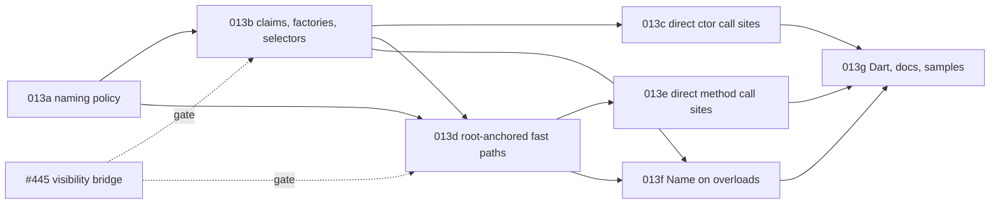

# Implementation Plan: Overload factories, selector symbols and direct call sites

**Branch**: `docs/25-overload-factories-spec` (spec directory `013-overload-factories`) | **Date**: 2026-11-04 (revised after review) | **Spec**: [spec.md](./spec.md) | **Issue**: [#25](https://github.com/danfma/metano/issues/25)

## Summary

The core gains one naming policy that computes candidate names from Roslyn-captured spellings,
anchored on each overload's root declaration (DECIDED-1, DECIDED-15). Each target bridge claims the
candidates against its own member tables in one order (DECIDED-18). The TS target emits
type-qualified selector symbols first among the statics, guarded selector branches and
per-overload-visibility factories (DECIDED-16, DECIDED-17, DECIDED-19); it makes fast paths
addressable members with their overload's visibility, emitted as `override` / `abstract` members
and declared on interfaces; and it rewrites resolved call sites — constructors, `base(...)`,
methods, `base.M`, method groups, operators, module functions, JSON factories — to them
(DECIDED-11). The dispatcher stays public as the hand-written fallback (DECIDED-12). `MS0067` and
`MS0068` report renames and hijacks. Dart inherits the candidates. Seven slices; 013b and 013d
start after #445 merges.

## Technical Context

- **Language/Version**: C# 14 on .NET 10 for the compiler; TypeScript built with `tsgo`; Bun for
  tests; Node for the load-order runs (R2, R9).
- **Primary Dependencies**: Roslyn 5.3.0 (`GetSymbolInfo`, `IMethodSymbol.OverriddenMethod`,
  `FindImplementationForInterfaceMember`, `IInvocationOperation.Arguments` for bound `params` /
  default arguments); #445's visibility mapper (`IrToTsVisibilityMapper.MapMember`).
- **Testing**: TUnit goldens (`tests/Metano.Tests/Expected/`), naming unit tests on the core
  policy, diagnostic tests, bun tests plus a Node run in the sample consumer,
  `bash scripts/verify-targets-clean.sh` for the no-churn check (NFR-001).
- **Constraints**: `TreatWarningsAsErrors`; NFR-001–NFR-006.
- **Scale/Scope**: 1 new core file (`OverloadNamePolicy`) plus the spelling capture; IR fields
  (data-model.md); a TS claim resolver; edits in both dispatcher bridges, the class and interface
  bridges, the operator bridge, the namespace / module emission, the expression extractor and the
  JSON spec builder; `MS0067`–`MS0069`; ~35 goldens; the sample scenario. No runtime
  (`metano-runtime`) changes.

## Constitution Check

| Principle | Status | Notes |
|---|---|---|
| Spec as source of truth | ✅ | This spec lands before code; baseline FR-050, the matrix rows and the `MS0067` / `MS0068` reservations are updated in this PR. |
| Clean Code / expressive names | ✅ | `OverloadNamePolicy` (candidates), one claim resolver per target, the bridges gain focused members; both spelling tables are deleted. |
| Ports & Adapters | ✅ | Candidates in the core; claims and rendering in each target (DECIDED-18). |
| Pragmatism | ✅ | The dispatcher survives (DECIDED-12); chains stay inlined (DECIDED-7); metadata-only references fall back (DECIDED-24). |
| DX | ✅ | TS2445 / TS2341 enforce access; factories are the construction API; every rename is reported; every break is in the migration notes. |

**Required by gates**: dual-agent review (`compiler-man` + `bob`) on every slice; the global
reviewers on every code slice; #445 merged before 013b and 013d.

## Code survey (what each slice touches)

All paths repo-relative, on `f520be36`.

### Core (`src/Metano.Compiler/`)

| File | Today | Change |
|---|---|---|
| `Extraction/OverloadNamePolicy.cs` (new) | — | stage 1 of contracts/naming.md: passes, spellings, climb, `Default`, root anchoring, dead end (FR-001–FR-003, FR-006, FR-024, FR-025) |
| `Extraction/IrTypeRefMapper.cs` and the parameter extraction | maps types, folding `uint` → `Int32` (lines 75–83) and `List<T>` → array | captures `IrNamingSpelling` from the Roslyn symbol beside the mapped type (FR-002); the folding itself is #475's |
| `IR/IrMemberDeclaration.cs` (`IrMethodDeclaration`), `IR/IrConstructorDeclaration.cs`, `IR/IrParameter.cs` | overload lists without names | `OverloadName`, `SignatureText`, `NamingSpelling`, `IsOverride`, `BaseOverload` / `BaseArguments` (data-model.md) |
| `Extraction/IrConstructorExtractor.cs` | builds overload sets; `FindPrimaryConstructor` (line 97) | threads the policy; records the resolved base overload and bound arguments (FR-017) |
| `Extraction/IrExpressionExtractor.cs` | dispatcher calls for every overload call | `IrDirectOverloadCall` / `IrDirectOverloadGroupReference` when DECIDED-11 holds (FR-017, FR-018) |
| `Extraction/` (method-group extraction) | abstract overload groups report `MS0001` and are skipped (R5) | extracts them with `IsAbstract` fast paths (FR-030) |
| `Diagnostics/MetaSharpDiagnostic.cs` | codes up to `MS0063` (`MS0064`–`MS0066` reserved by 012) | `MS0067`, `MS0068` (FR-020) |

### TypeScript target (`src/Metano.Compiler.TypeScript/`)

| File | Today | Change |
|---|---|---|
| `Bridge/TsOverloadClaims.cs` (new) | — | the claim pass per class (static and instance tables) and per barrel; cached per declaring type; `MS0067` / `MS0068` (FR-004, FR-034) |
| `Bridge/IrToTsOverloadDispatcherBridge.cs` | `ComputeFastPathNames` / `SimpleTypeName` / `PrimitiveSuffix` (lines 501–545); private fast paths; `ClaimName` only on the namespace path (line 137); `internal` → `private` (line 555) | consumes the claimed names; fast paths with #445's per-overload visibility, `override` / `abstract`; no dispatcher for override-only types; namespace fast paths exported (FR-015, FR-030, FR-032); the naming helpers deleted |
| `Bridge/IrToTsClassBridge.Operators.cs` | its own `SimpleTypeName` (line 287); private operator fast paths | policy names, public (FR-033); the table deleted |
| `Bridge/IrToTsConstructorDispatcherBridge.cs` | one dispatcher constructor, bodies in branches | selectors, selector signatures, guarded selector branches, factories, struct zero-argument branch, `super(Base.by…, …)` (FR-007–FR-012, FR-017, FR-026–FR-028) |
| `Bridge/IrToTsClassBridge.cs` | member assembly and ordering | selectors first among statics (FR-029); abstract classes skip factories (FR-012) |
| `Bridge/IrToTsInterfaceBridge.cs` | dispatcher signatures only | fast-path signatures (FR-031) |
| `Bridge/IrToTsExpressionBridge.cs` | call nodes | renders the direct-call nodes through `TsOverloadClaims` |
| `Bridge/IrToTsNamingPolicy.cs` | member name overrides | `[Name]` on an overload (FR-005) |
| `Transformation/Json/JsonSpecBuilder.cs`, `JsonUnmirroredAttributes.cs` | `factory: (p) => new T(...)`; `MS0037` for an uncalled `[JsonConstructor]` | factory call of the `[JsonConstructor]` overload; that `MS0037` reason retired for dispatched types (FR-035) |
| barrel emission (spec 005) | re-exports declared names | re-exports module fast paths (FR-032) |

### Dart target (`src/Metano.Compiler.Dart/`)

| File | Change |
|---|---|
| `Bridge/IrToDartNamingPolicy.cs`, `Transformation/DartTransformer.cs` | named constructors for factories, no selectors, the core candidates, a single-namespace claim pass (FR-022) |

### Tests and samples

| Path | Change |
|---|---|
| `tests/Metano.Tests/MethodOverloadFastPathTests.cs`, `ConstructorOverloadTests.cs`, `PrimaryConstructorDispatchTests.cs`, `Int64OverloadNamingTests.cs`, `OperatorTranspileTests.cs` | regenerated per slice |
| `tests/Metano.Tests/OverloadNamePolicyTests.cs` (new) | the naming table of contracts/naming.md, unit-level |
| `tests/Metano.Tests/OverloadNameClaimTests.cs` (new) | `MS0067` reasons, `MS0068`, `MS0003` dead end |
| `tests/Metano.Tests/Expected/overload-*.ts` (new) | the planned goldens below |
| `samples/SampleIssueTracker` / `targets/js/sample-issue-tracker` | an overloaded constructor, a virtual overload group and an extension group exercised by bun tests and a Node run (SC-006) |

## Slices

Each slice is one PR with dual-agent review, merged into `main`, kept green: the full TUnit suite,
every bun sample, `bash scripts/verify-targets-clean.sh`. **No staging switch**: 3.0.0 is not
released yet, so every slice lands its output change directly and regenerates the goldens it
breaks; the CHANGELOG collects the breaks for the release.

| Slice | Commit type | Scope | FRs | Depends on |
|---|---|---|---|---|
| **013a — Naming policy in the core** | `feat!:` | Roslyn spelling capture; `OverloadNamePolicy` (passes, exact CLR spellings, the climb, `Default`, dead end + `MS0003`); the TS bridges consume the candidates for today's private fast paths and operator helpers; both spelling tables deleted. The R7 duplicate families compile. | FR-001–FR-003, FR-006, FR-024, FR-033 | — |
| **013b — Claim pass, factories and selectors** | `feat!:` | `TsOverloadClaims` (order, per-suffix `$`, `MS0067` reasons 1–2); type-qualified selectors first among statics; guarded selector branches; factories with per-overload visibility and FR-026 (constructed-base comparison, accessibility, `static override` for kept names); `MS0068` reason 2 (a derived user static against an inherited factory); abstract exclusion; struct zero-argument branch; generic factory constraints. | FR-004, FR-007–FR-014, FR-020 (`MS0067`, `MS0068` reason 2), FR-026–FR-029, FR-034 (statics) | 013a, #445 |
| **013c — Direct constructor call sites** | `feat!:` | `new T(...)` → factory; every `: base(...)` (selector and fallback branches alike) → `super(Base.by…, …)` with explicit defaults; the JSON factory of the `[JsonConstructor]` overload; project-reference-only cross-package resolution. | FR-017, FR-019 (constructor half), FR-035 | 013b |
| **013d — Root-anchored fast paths** | `feat!:` | addressable fast paths with per-overload visibility (overrides: the root's); root anchoring on constructed roots; `override` fast paths and no dispatcher for override-only types; `override` superset dispatchers forwarding to `super` for types adding overloads; claim step 7 (`MS0067` reason 3) for `new` methods and new overloads; `abstract` fast paths (lifting today's `MS0001`); interface fast-path signatures, implementer forwarding, explicit implementations; multiply-constructed interfaces with `MS0069`; root names from metadata symbols for DLL / package bases (DECIDED-28); `MS0068` reason 1. | FR-015, FR-016, FR-025, FR-030, FR-031, FR-034, FR-036, FR-037, FR-020 (`MS0067` reason 3, `MS0068` reason 1, `MS0069`) | 013a, 013b (claim pass), #445 |
| **013e — Direct method call sites** | `feat!:` | method, `base.M`, method-group, operator and module-function call sites, with Roslyn's bound defaults passed explicitly (DECIDED-32); overloaded module groups with exported fast paths and barrel claims; `params` forms; generic type arguments; project-reference-only cross-package resolution. | FR-018, FR-019 (method half), FR-032 | 013d |
| **013f — `[Name]` on overloads** | `feat:` | the OQ-1 decision. | FR-005 | 013b, 013d |
| **013g — Dart names, docs, samples** | `feat:` + `docs:` | Dart named-constructor mapping and claim pass; `docs/` naming rule; CHANGELOG migration notes; the sample scenario with its Node run; matrix rows → Implemented. | FR-021 (sample), FR-022, FR-023 | 013c, 013e, 013f |



Ownership notes the review asked for: the selector `super(...)` calls belong to **013c** (013b
emits the selectors and branches but leaves derived classes on today's `super(args)`); the
root-anchoring rule belongs to **013d**; the claim pass belongs to **013b**, and 013d / 013e extend
its tables (instance fast paths, barrels).

Hand-offs from 013b (its review): the TypeScript claim results (`TsOverloadClaims`, cached by
`TsOverloadClaimsRegistry` per `INamedTypeSymbol`) are keyed by suffix (constructors) and by
table + emitted group name + suffix (fast paths). **013c** re-keys them by the overload identity a
call site carries (`IrOverloadRef`: declaring type, C# member name, declaration ordinal; methods
need the ordinal the core so far records only on constructors) and keeps the symbol lookup as a
thin adapter. **013d** adds the inherited instance side (claim step 7) to the cached result, which
today holds only the static side. **013e** replaces the module-function path, which still names
fast paths without a claim (`IrToTsOverloadDispatcherBridge.BuildNamespaceFunctions`), with the
barrel claim table. `IrToTsTypeOverrides` both maps a type and records its package; the claim pass
reads shapes through a copy with a throwaway ledger, and splitting the mapping from the recording is
left to a later cleanup. FR-027's struct branch zeroes references, numbers, `bool`, `decimal`,
enums, nullables, `char`, `BigInteger`, branded values and structs whose `new S()` zeroes them; it
leaves `undefined` with `MS0001` for `Guid` (`UUID.empty` is expressible, not built yet), the date
and time types, structs with a single declared constructor or a user parameterless one, tuples and
type parameters constrained to a value type — a follow-up closes these. The factory widening of FR-011 (a factory code outside the class body calls)
lands with **013c**, the first slice that calls factories.

Deferred / follow-ups: OQ-3 (`[PlainObject]` factories), OQ-4 (dropping the fallback, 4.0),
OQ-5 (dropped secondary constructors warning); follow-up issues to file: DECIDED-29 (overloading an
inherited single virtual, today's emission pinned) and DECIDED-30 (full support for
multiply-constructed interfaces); default interface methods (bodies dropped today); the two
unrelated bugs of research R7 and R12's `object` check.

## Test strategy

- **Core units**: `OverloadNamePolicyTests` over contracts/naming.md — every pass, every spelling
  row (unsigned, `List<int>` vs `int[]`, delegates, tuples, type parameters), every climb case
  (nested, namespace, generic argument, primitive not climbing, partial-set climbing), `Default`,
  the dead end, root anchoring, determinism.
- **Planned goldens** (each built with `tsgo --strict --noImplicitOverride --declaration` in its consumer, FR-021, SC-008):
  - `overload-factory-basic` (`Money`, R1) and `overload-dispatcher-fallback` (hand-written
    `new T(...)` keeps the runtime signatures and branches);
  - `overload-factory-hierarchy` — base / derived / grand-derived with identical suffixes, the
    FR-026 kept (`static override Receipt.fromAmount`) and qualified factories
    (`GiftReceipt.fromGiftReceiptAmount`), an inherited factory (R2), and the accessibility cases —
    a `private` base factory (`fromReceiptCode`) and a narrower derived one (`fromReceiptId`) (R14);
  - `overload-factory-user-static` — a derived user static against an inherited factory, `MS0068`
    (R14);
  - `overload-factory-generic` (constraints re-declared, R4) and `overload-factory-generic-closed`
    (`IntBox : Box<int>` → `fromIntBoxValue`);
  - `overload-factory-abstract`, `overload-factory-record`, `overload-factory-chain`;
  - `overload-factory-accessibility` — per-overload `private` / `protected` / `internal` /
    `protected internal` / `private protected` factories, the most permissive constructor with
    `MS0060`, and a widened factory (`MS0061`) from a nested type and from a JSON `TypeSpec` (R10);
  - `overload-factory-struct` — `new S()` with the zero-argument branch; an explicit
    parameterless struct constructor as `fromDefault` (R11);
  - `overload-factory-params` — a `params` constructor overload;
  - `overload-static-init` — `static readonly Zero = new Money(0)` declared before the
    constructors, selectors first, plus a Node run of the emitted module (R9);
  - `overload-static-init-cycle` — two modules whose static initializers reach each other's
    factories, run under Node from both entries (R9: the pre-existing TDZ error, no new one);
  - `overload-names-types` (`fInt32`, `uInt32` / `uUInt32`, `wInt64` / `wUInt64`,
    `lListOfInt32` / `lInt32Array`, `sumInt32Array`, `hInt32OrNull`, `identityT`),
    `overload-names-climb` (`kNumericsDecimal`, nested types, generic arguments, primitives not
    climbing), `overload-names-default` (`nowDefault`);
  - `overload-names-claims` — the `Cash` `From` group colliding with its factories
    (`fromAmount$`, `MS0067` reason 2) and a user member claiming a factory (`fromCents$` /
    `byMoneyCents$`, reason 1);
  - `overload-virtual` — partial override, full override, `base.Add` → `super.addX`, a method
    group with `.bind`, a derived type adding an overload (the `override` superset dispatcher, a
    base `private` overload reached through `super`), a cross-assembly `protected override` of a
    `protected internal` root (public), a `new` hiding method (`addX$`), a new overload whose
    candidate meets a base `private` fast path (`addS$`, with the derived dispatcher's own `Add(short)` branch calling `this.addS$` before forwarding to `super` — the `s013r2/r3/privfast.ts` probe omits that branch; the golden must not); plus a Node run returning C#'s results
    (R8, R14, SC-007);
  - `overload-virtual-single` — an inherited non-overloaded virtual that a derived type overloads:
    today's emission pinned (DECIDED-29);
  - `overload-virtual-metadata` — a base read from metadata only: root names from the metadata
    symbols, `override` fast paths (DECIDED-28);
  - `overload-abstract-methods` — `abstract` fast paths and the concrete dispatcher;
  - `overload-interface` — interface fast-path signatures, an implementer with different
    parameter names, a method implementing two roots (forwarding member), explicit
    implementations beside a class overload (`Plot`, R14) and an `MS0031` same-signature conflict,
    and the interface receiver call `sh.areaS(2)`;
  - `overload-interface-multiple-inherited` — (a) `D : C` with `C` multiply-constructed, overriding `Conv(int)`; (b) `D : C, IConv<string>` with `C : IConv<int>`: `override` root-name dispatchers with every constructed signature, forwarding to `super` (R15);
  - `overload-factory-generic-constraints` — `SortedBox<T> : Box<T> where T : IComparable<T>` → `fromSortedBoxValue` (qualified), and `Pair<K, V> : Box<K>` → `static override fromValue` (R15);
  - `overload-interface-multiple` — `C : IConv<int>, IConv<string>`: runtime-dispatched root names
    and `MS0069` (R14);
  - `overload-calls-new`, `overload-calls-super` (with explicit default arguments), `overload-calls-defaults` (a method call site passing the static overload's default, DECIDED-32),
    `overload-calls-methods`, `overload-calls-static-binding` (`F(object)` / `F(string)`, R12),
    `overload-calls-params` (expanded and normal forms, R11), `overload-calls-operators`;
  - `overload-module-extension` — exported fast paths, the dispatcher, the cross-file import at the
    call site, and two modules sharing a barrel (R11);
  - `overload-json-factory` — the `[JsonConstructor]` overload's factory in the `TypeSpec`;
  - `overload-cross-package` — `TranspileWithLibrary` with a project reference (direct calls) and
    a metadata-only reference (dispatcher fallback).
- **Diagnostics**: one test per `MS0067` reason (1–3), `MS0068` reason (1–2), `MS0069` and the `MS0003` dead end, asserting
  code, severity, location, and that the renamed output still compiles.
- **Behavior**: the sample consumer's bun tests and a Node run of the same output (SC-006).
- **Regression**: the full TUnit suite; `verify-targets-clean.sh`; the NFR-001 sample diff.
- **SC-002 check**: research R7's `tsgo` output is the before; each slice's goldens are the after.

## Risks

| ID | Risk | Mitigation |
|---|---|---|
| K1 | A rewritten call site misses an evaluation detail (receiver order, `params`, defaults) | The rewrite uses Roslyn's bound arguments; goldens pin `params` forms and explicit defaults |
| K2 | Claims differ between the declaring file and a cross-file call site | Claims are cached per declaring type and resolved through `IrOverloadRef` (DECIDED-18) |
| K3 | Version skew: a 3.0 consumer against a 2.x package | Migration (g); `tsc` reports the missing member; metadata-only references keep the dispatcher |
| K4 | Root anchoring renames members of types that only override | Override-only types now emit just the fast paths; Migration (a) |
| K5 | #445 slips | 013a and 013c's design are independent; 013b and 013d wait |
| K6 | A user member hijacks an inherited fast path | `MS0068` (error) |
| K7 | Static initialization order regresses in a later refactor of member ordering | FR-029 golden plus the guard of FR-009 makes any regression throw instead of misdispatching (R9) |

## Project Structure

```text
specs/013-overload-factories/
├── spec.md
├── plan.md
├── research.md
├── data-model.md
├── quickstart.md
├── contracts/
│   ├── naming.md
│   ├── ts-emission.md
│   ├── dart-mapping.md
│   └── diagnostics.md
└── checklists/requirements.md
```

## Complexity Tracking

> No constitution violations. No entries.
