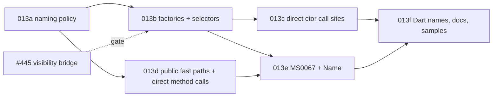

# Implementation Plan: Overload factories, selector symbols and direct call sites

**Branch**: `docs/25-overload-factories-spec` (spec directory `013-overload-factories`) | **Date**: 2026-11-04 | **Spec**: [spec.md](./spec.md) | **Issue**: [#25](https://github.com/danfma/metano/issues/25)

## Summary

The core gains one naming policy for overload groups (DECIDED-1) and the IR carries the computed
names; the TS target emits constructor factories and selector symbols (DECIDED-6, DECIDED-7,
DECIDED-8), rewrites resolved call sites to them and to the method fast paths (DECIDED-11), and
makes the fast paths public `/** @internal */` members (DECIDED-6). The dispatcher stays public
and unchanged as the hand-written fallback (DECIDED-12). `MS0067` reports shadowed names
(DECIDED-13). Dart inherits the names and maps factories to named constructors (DECIDED-14).
Six slices, each one PR; the implementation starts after #445 merges (FR-011).

## Technical Context

- **Language/Version**: C# 14 on .NET 10 for the compiler; TypeScript for the runtime and generated
  code, built with `tsgo`; Bun for tests (Node for the load-order checks of R2).
- **Primary Dependencies**: Roslyn 5.3.0 (`GetSymbolInfo` for call-site resolution — already the
  mechanism behind `[Emit]` inlining and `ResolveMemberNameOverride`); #445's visibility bridge for
  the factory accessibility rule.
- **Testing**: TUnit goldens (`tests/Metano.Tests/Expected/`), the naming unit tests on the core
  policy, diagnostic tests for `MS0067`, bun tests in the sample consumer, and
  `git diff --exit-code targets/` for the no-churn check (NFR-001).
- **Constraints**: `TreatWarningsAsErrors`; NFR-001 (no churn outside overload groups); NFR-002
  (decisions in the core); NFR-003 (single body home); NFR-006 (dispatcher contract unchanged).
- **Scale/Scope**: 1 new core file (`OverloadNamePolicy`), IR fields for the computed names, edits
  in the two dispatcher bridges, the class bridge, the expression extractor, `MS0067`, ~15 goldens,
  and the sample scenario. No runtime (`metano-runtime`) changes — factories, selectors and direct
  call sites are pure emission.

## Constitution Check

| Principle | Status | Notes |
|---|---|---|
| Spec as source of truth | ✅ | This spec lands before code; the matrix row and the `MS0067` reservation are updated in this PR. |
| Clean Code / expressive names | ✅ | `OverloadNamePolicy` (naming), the existing bridges gain one method each; `ClaimName` stays the single collision resolver (FR-004). |
| Ports & Adapters | ✅ | The policy reads the IR only (NFR-002); both targets render. |
| Pragmatism | ✅ | The dispatcher survives unchanged (DECIDED-12); chains stay inlined (DECIDED-7); no dead-code stripping (OQ-4). |
| DX | ✅ | Outsiders are rejected by TS2445 (R3); factories are the documented construction API; `MS0067` names every shadowed rename; migration notes list every break. |

**Required by gates**: dual-agent review (`compiler-man` + `bob`) on every slice; the global
reviewers (backend / frontend / architecture) on every code slice; the implementation starts after
#445 merges.

## Code survey (what each slice touches)

All paths repo-relative, line numbers on `5c084f50`.

### Core (`src/Metano.Compiler/`)

| File | Today | Change |
|---|---|---|
| `Extraction/OverloadNamePolicy.cs` (new) | — | the algorithm of contracts/naming.md: parameter names, type spellings, the climb, `Default`, `ClaimName` (FR-001–FR-004, FR-006) |
| `IR/IrMethodDeclaration.cs`, `IR/IrConstructorDeclaration.cs` | overload lists without names | per-overload computed names (data-model.md): the suffix shared by factory and selector, the fast-path name, the C# signature text of a constructor overload (for the symbol description) |
| `Extraction/IrConstructorExtractor.cs` | builds overload sets | threads the policy over each set; carries the signature text |
| `Extraction/IrExpressionExtractor.cs` | emits dispatcher calls for every overload call | resolves the overload via `GetSymbolInfo` and emits the direct-call nodes (`IrDirectOverloadCall` / the constructor factory node, data-model.md) when the receiver and the type arguments are static (DECIDED-11); leaves dynamic / unresolved / BCL-mapped calls alone |
| `Diagnostics/MetaSharpDiagnostic.cs` | codes up to `MS0066` | `MS0067` (FR-020) |

### TypeScript target (`src/Metano.Compiler.TypeScript/`)

| File | Today | Change |
|---|---|---|
| `Bridge/IrToTsOverloadDispatcherBridge.cs` | owns `ComputeFastPathNames` / `SimpleTypeName` / `PrimitiveSuffix`; class fast paths private, no `ClaimName`; namespace fast paths non-exported | consumes the IR names; fast paths public + `/** @internal */` (FR-015); `ClaimName` on the class path; namespace fast paths exported + `/** @internal */`; `ComputeFastPathNames` and its helpers deleted |
| `Bridge/IrToTsConstructorDispatcherBridge.cs` | one dispatcher constructor, bodies in branches, no selectors, no factories | selector fields + selector overload signatures + selector-first branches (FR-008, FR-009); factories as static members (FR-007); `super(Base.byXxx, ...)` in the fallback branches (FR-017); factory accessibility from FR-049's predicate (FR-011) |
| `Bridge/IrToTsClassBridge.cs` | member assembly and ordering | places the new members (static fields first, then factories, per the layout of spec 005); abstract classes skip factories (FR-012) |
| `Bridge/IrToTsExpressionBridge.cs` | renders call nodes | renders the direct-call nodes (factory call, fast-path call with the receiver evaluated once) |
| `Bridge/IrToTsNamingPolicy.cs` | member name overrides | `[Name]` on an overload overrides the suffix per OQ-1's decision (FR-005) |
| `Transformation/Json/JsonSerializerContextTransformer.cs` | `factory: (p) => new T(...)` in the `TypeSpec` | targets `T.fromXxx(p)` for dispatched types when the widening of `MS0061` applies (FR-017 scope in slice 013c) |

### Dart target (`src/Metano.Compiler.Dart/`)

| File | Change |
|---|---|
| `Bridge/IrToDartNamingPolicy.cs`, `Transformation/DartTransformer.cs` | render the core names: named constructors for factories, no selectors, same fast-path names (FR-022) |

### Tests and samples

| Path | Today | Change |
|---|---|---|
| `tests/Metano.Tests/MethodOverloadFastPathTests.cs`, `ConstructorOverloadTests.cs`, `PrimaryConstructorDispatchTests.cs` | private fast-path and dispatcher expectations | regenerated per slice (goldens + assertions) |
| `tests/Metano.Tests/OverloadNamePolicyTests.cs` (new) | — | the naming table of contracts/naming.md, unit-level |
| `tests/Metano.Tests/OverloadNameShadowTests.cs` (new) | — | `MS0067` reasons (FR-020) |
| `tests/Metano.Tests/Expected/overload-*.ts` (new) | — | the goldens of contracts/ts-emission.md (FR-021) |
| `samples/SampleIssueTracker` / `targets/js/sample-issue-tracker` | dispatcher-based output | an overloaded constructor + method exercised by bun tests through factories and direct call sites (SC-006) |

## Slices

Each slice is one PR with dual-agent review, merged into `main`, kept green: the full TUnit suite,
every bun sample, `git diff --exit-code targets/`. There is no staging switch: 3.0 is unreleased
(the repo already carries breaking commits on `main`; 012 OQ-7), so each slice lands its output
change and regenerates the goldens it breaks. **The implementation starts after #445 merges** —
slice 013b reuses its visibility bridge (FR-011).

| Slice | Commit type | Scope | FRs | Depends on |
|---|---|---|---|---|
| **013a — Naming policy in the core** | `feat:` | `OverloadNamePolicy` + the IR name fields; the TS bridge consumes them (fast paths still private); the naming unit tests; the two R7 collision families (`kDecimal`, `now`) start compiling. | FR-001–FR-006 | — |
| **013b — Constructor factories and selectors** | `feat:` | selector fields, selector overload signatures, selector-first branches, factories, factory accessibility (FR-049 predicate), abstract-class exclusion; goldens `overload-factory-*`. | FR-007–FR-014 | 013a, #445 |
| **013c — Direct constructor call sites** | `feat:` | `new T(...)` → `T.fromXxx(...)`; `: base(...)` → `super(Base.byXxx, ...)`; the JSON `TypeSpec` factory of dispatched types; goldens for the call-site shapes. | FR-017, FR-019 (ctor half) | 013b |
| **013d — Public fast paths and direct method call sites** | `feat:` | fast paths public + `/** @internal */`, `ClaimName` on the class path, exported namespace fast paths; method calls → fast path; statics and companion modules; generic call sites carry their type arguments. | FR-015, FR-016, FR-018, FR-019 (method half) | 013a |
| **013e — `MS0067`** | `feat:` | the diagnostic, its tests, `[Name]` suffix override (OQ-1 decision). | FR-005, FR-020 | 013b, 013d |
| **013f — Dart names, docs, samples** | `feat:` + `docs:` | Dart named-constructor mapping (names + call-site spelling); `docs/` naming rule; CHANGELOG migration notes; the sample scenario; matrix rows → Implemented. | FR-022, FR-023 | 013b, 013d, 013e |



Deferred / follow-ups: the `[PlainObject]` / branded dropped-secondary-constructor warning (OQ-5);
dropping the constructor fallback for hand-written TS (OQ-4, a 4.0 direction); factories for
`[PlainObject]` object literals (OQ-3).

## Test strategy

- **Core units**: `OverloadNamePolicyTests` over the full table of contracts/naming.md — parameter
  names, every spelling row, every climb depth, `Default`, `ClaimName`, determinism (same input →
  same output).
- **Goldens**: `overload-factory-basic` (R1's `Money`), `overload-factory-generic` (R4's `Box`),
  `overload-factory-abstract` (selectors, no factories), `overload-factory-record` (primary +
  secondary), `overload-factory-chain` (`this(...)`), `overload-factory-accessibility` (private /
  protected / mixed / widened), `overload-names-types` (`fInt32`…), `overload-names-climb`
  (`kNumericsDecimal`…), `overload-names-default` (`nowDefault`), `overload-calls-new`
  (`Money.fromDecimal(...)`), `overload-calls-super` (`super(Money.byDecimal, ...)`),
  `overload-calls-methods` (`Shapes.addXY(...)`, `p.addP(...)`), `overload-calls-namespace`
  (companion exported fast paths), `overload-dispatcher-fallback` (hand-written `new T(...)` keeps
  the runtime signatures and branches). Every golden's consumer is built with `tsgo --strict
  --declaration` (FR-021).
- **Diagnostics**: one test per `MS0067` reason (user member claims factory, selector suffix, fast
  path), asserting code, severity, location, and that the `$`-renamed output is still emitted.
- **Behavior**: bun tests in the sample consumer exercising factories and direct call sites at
  runtime (SC-006); the R2 two-module pattern as a golden pair plus a Node run in CI (load order).
- **Regression**: the full TUnit suite; `git diff --exit-code targets/` per slice; the no-churn
  check of NFR-001 by transpiling every sample and diffing against `main` for sources without
  overload groups.
- **SC-002 check**: the three R7 families' `main`-equivalents are captured once in the first PR's
  description (the R7 tsgo output) as the before/after evidence.

## Risks

| ID | Risk | Mitigation |
|---|---|---|
| K1 | A rewritten call site misses a semantics detail (receiver evaluation order, `params` expansion) | The rewrite emits an ordinary call node — the existing call lowering handles evaluation order; goldens pin `params` and optional arguments |
| K2 | Factory/fast-path names collide across a package's files after the `$` fallback | `ClaimName` runs per scope (class, namespace) exactly as today's namespace path does; `MS0067` makes every rename visible |
| K3 | Version skew: a 3.0 consumer against a 2.x package fails at `tsc` | Migration item 4; `tsc`'s missing-member error is loud and points at the stale `.d.ts` |
| K4 | `.d.ts` surface growth surprises consumers | Migration item 6; the selectors are `protected` and the fast paths `/** @internal */` — only factories are new public API |
| K5 | #445 slips | Only 013b (and 013e's accessibility-adjacent tests) wait for it; 013a and 013d are independent of the visibility bridge |
| K6 | The climb renames types that moved namespaces (D7) | Documented name stability; `[Name]` pins a name (OQ-1) |

## Project Structure

```text
specs/013-overload-factories/
├── spec.md
├── plan.md
├── research.md
├── data-model.md
├── quickstart.md
├── contracts/
│   ├── naming.md
│   ├── ts-emission.md
│   ├── dart-mapping.md
│   └── diagnostics.md
└── checklists/requirements.md
```

## Complexity Tracking

> No constitution violations. No entries.
