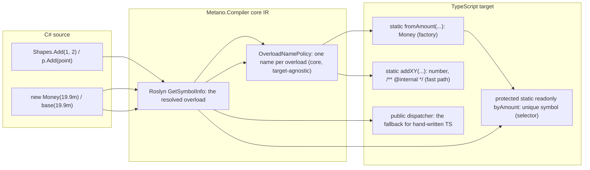

# Feature Specification: Overload factories, selector symbols and direct call sites

**Feature Branch**: `docs/25-overload-factories-spec` (spec directory `013-overload-factories`)

**Created**: 2026-11-04

**Status**: Draft (spec change request; the maintainer's decisions of 2026-11-04 on issue #25 are applied)

**Input**: GitHub issue [danfma/metano#25](https://github.com/danfma/metano/issues/25), "Static call-site fast-path optimization" (the sub-item left open after the 2026-05-02 spike closed the inheritance and factories sub-items differently), plus the maintainer's decision comments of 2026-11-04 that reopen and settle constructor factories, selector symbols and direct call sites together. The findings behind every requirement are in [research.md](./research.md) (R1–R7): TypeScript acceptance of protected `unique symbol` selectors (R1), subclass `super(Base.byXxx, …)` across modules on Node and Bun (R2), the outsider rejection (R3), generics (R4), interactions with records, structs, `[PlainObject]`, `[InlineWrapper]`, primary constructors, `this(...)` chains and abstract classes (R5), the Dart mapping (R6), and a snapshot of today's fast-path naming against the new algorithm (R7).

**Traceability**: it extends the baseline overload-dispatch capability — the legacy requirement the issue cites as `FR-042` (overload dispatch) and the two "Method overload dispatch" / "Constructor overload dispatch" rows of the baseline [feature-support matrix](../001-project-baseline-evolution/baseline/feature-support-matrix.md) — and it builds on FR-049 (constructor access modifiers, #432), which already computes the emitted constructor accessibility that factories inherit. It adds a Planned row to the matrix and reserves `MS0067` in the [diagnostic catalog](../001-project-baseline-evolution/baseline/diagnostic-catalog.md) (`MS0064`–`MS0066` are reserved by spec 012). As in features 002–012, the FR identifiers below are local to this feature and are cited as "013 FR-0NN".

**Related specs and issues**: [ADR-0008](../../docs/adr/0008-overload-dispatch.md) (dispatcher + private fast paths) is superseded in part by [ADR-0028](../../docs/adr/0028-overload-factories.md); [ADR-0013](../../docs/adr/0013-shared-ir-as-canonical-semantic-representation.md) (shared IR) is where the naming policy lands. The implementation depends on #445 (member visibility bridge), which touches the same accessibility code the factories reuse. Spec 012's OQ-6 (`long` / `ulong` / `BigInteger` dispatch order) becomes moot at call sites resolved by this feature; the runtime dispatcher keeps its documented order.

## Overview

Metano lowers C# overload groups to one runtime dispatcher plus one private fast-path method per overload (ADR-0008). Every generated call site pays the dispatcher's runtime arity and type checks even when Roslyn resolved the overload statically; every constructor body is inlined into a dispatcher branch, so hand-written TypeScript cannot address one overload at all; and the private fast-path names are computed by a naming rule that today produces output that does not compile for two shape families (research R7: a type-name fallback that collides into duplicate members, and a zero-arg overload whose fast path shadows the dispatcher's own name).

This feature makes the statically known call site the normal path, gives every constructor overload an addressable TypeScript identity, and replaces the ad-hoc naming with one deterministic algorithm shared by factories, selector symbols and method fast paths:

The dispatcher survives, public, as the fallback for hand-written TypeScript: `new Money(19.9)` and `money.add(point)` keep compiling and running by arity and type. What changes is that code Metano generates never reaches for it when Roslyn knows the answer.

## Maintainer decisions (normative)

- **D1 — Constructor factories.** Every overload of a dispatched constructor (two or more declared instance constructors) gets a static factory `fromXxx(...)` returning the type — public in the common case; its accessibility follows the constructor's emitted FR-049 modifier (DECIDED-8), so a private constructor set does not leak construction C# forbids. A type without constructor overloads is unchanged: `new T(args)` stays `new T(args)` (maintainer, 2026-11-04, issue #25).
- **D2 — Selector symbols.** Every constructor overload gets `protected static readonly byXxx: unique symbol = Symbol("<C# signature>")`. The symbol description carries the full C# signature (`Symbol("Money(decimal amount)")`) for debugging only. The constructor gains one overload signature `constructor(overload: typeof T.byXxx, ...params)` per overload; the implementation dispatches on `args[0] === T.byXxx` first, with no type checks; a call without a selector falls back to the existing dispatcher; a derived class picks the exact base overload with `super(Base.byXxx, ...)` (maintainer, 2026-11-04).
- **D3 — Direct call sites.** Metano-generated code never goes through the runtime dispatcher when Roslyn has resolved the overload: C# `new T(args)` becomes `T.fromXxx(args)` (or `super(Base.byXxx, ...)` in a constructor chain), and an overloaded method call goes straight to its fast path (maintainer, 2026-11-04).
- **D4 — Methods share the scheme.** Method fast paths become public, use the same naming rules, and are called directly from generated code. The dispatcher stays public for hand-written TS (maintainer, 2026-11-04).
- **D5 — One naming algorithm** for factories, selector suffixes and method fast paths: parameter names first; on any collision the whole group switches to C# type names; on a remaining collision it climbs containing type and namespaces; a user-member collision falls back to `$` ([Naming](#naming) below, with the spellings and the joiner checked against today's `ComputeFastPathNames` output in R7).
- **D6 — The breaking change ships in 3.0.0.** User code that relied on the old private fast-path names, or on generated call shapes that went through the dispatcher, changes ([Migration (3.0.0)](#migration-300)).
- **D7 — Name stability is documented.** Renaming a C# parameter renames the TypeScript factory and fast-path names; a refactor that only renames a parameter becomes a TypeScript API change ([Migration (3.0.0)](#migration-300), item 7).

## Decisions taken by this spec (DECIDED)

Each decision states the rule and the rejected alternative. The open questions that remain for the maintainer are listed in [Open questions](#open-questions).

- **DECIDED-1 — The naming policy lives in the core.** `Metano.Compiler` computes, once per overload of a group, the suffix shared by the factory and the selector and the fast-path name, from the IR alone; the targets render them (NFR-002, as 012's DECIDED-1). `ComputeFastPathNames` moves out of `IrToTsOverloadDispatcherBridge` into a core `OverloadNamePolicy` the expression extractor can also call — the exact restructuring the 2026-05-02 spike listed as a requirement of sub-item 3. Rejected: duplicating the rule in the TS bridge and again in `IrExpressionExtractor` (two copies diverge; Dart needs the same names for its named constructors).
- **DECIDED-2 — No `And` joiner.** The parameter-name suffix is the capitalized parameter names concatenated: `Add(int width, int height)` → `addWidthHeight`, factory `fromWidthHeight`. The maintainer's `fromWidthAndHeight` example is corrected to the joiner today's `ComputeFastPathNames` already produces (R7: `addXY`, `formatFmtArgs` — no joiner anywhere), so names that are already stable stay byte-identical where the algorithm agrees. Rejected: introducing `And` (every existing parameter-name-based fast path renames, for no gain).
- **DECIDED-3 — The type fallback uses exact C# type names.** On any collision inside a group, the whole group switches to type-based suffixes spelled with the C# type's name: `fromInt32`, `fromDecimal`, `fromString`, `fromBoolean`, `fromInt64`. The legacy shortenings (`Int32 → Int`, `Int64 → Long`, `Boolean → Bool`, `Single → Float`) are retired: the names become public API (DECIDED-8), and `fromInt` is ambiguous between `int` and `uint`, `fromLong` between `long` and `BigInteger`-adjacent spellings. This renames today's fallback names (`fInt` → `fInt32`, `gLong` → `gInt64`, R7) — a 3.0 break (D6). Rejected: keeping the lossy spellings on public API.
- **DECIDED-4 — The climb is uniform and stops at the first distinct level.** When type-based suffixes still collide, every overload of the group climbs one level at a time — containing type first (for nested types), then namespace segments from nearest to farthest, up to the global namespace (`Global`) — and the group uses the first depth at which all suffixes are distinct: `K(Numerics.Decimal)` / `K(Other.Decimal)` → `fromNumericsDecimal` / `fromOtherDecimal`. Climbing applies only to suffixes built from type names (parameter names have no containing type). Today's algorithm stops here and emits duplicate members instead (R7: two `kDecimal` private methods, TS2393). Rejected: climbing only the colliding overloads (mixed depths are harder to read and to specify) or jumping straight to full names (needlessly long).
- **DECIDED-5 — The zero-argument suffix is `Default`.** A parameterless overload gets suffix `Default`: factory `fromDefault`, selector `byDefault`, fast path `nowDefault`. Today its fast path is the bare method name, which is the dispatcher's own name and makes the class fail to compile (R7: `private static now()` next to the `now` dispatcher, TS2393 + TS2385). Rejected: a positional suffix (`from0`) — unreadable.
- **DECIDED-6 — Fast paths are public with `/** @internal */`; factories are documented API.** Direct call sites from any file of the package — including a nested type emitted outside its container's class body and a cross-package consumer's generated code — target the fast path, so `private` is wrong. `/** @internal */` documents the intent (the name is the compiler's business, spelled out only so generated code can call it) without blocking those calls: JSDoc `@internal` is advisory, and the emitted `.d.ts` keeps the member (stripping it would break cross-package call sites that reference the package's declarations). Factories, by contrast, are the public construction API — they are what C# `new T(...)` lowers to, they appear in every `.d.ts` by design, and they are documented in the migration notes. Selectors stay `protected`: a non-derived caller is rejected by TS2445 (R3), which is exactly the access level C# gives `new T(...)` against a private/protected constructor set. The namespace fast paths of companion modules and `[ExportedAsModule]` (non-exported functions today, `BuildNamespaceFunctions`) become exported `/** @internal */` functions for the same reason. Rejected: documented public fast paths (the C# member is the API; the suffix is an emission detail) and `private` with `(obj as any)` casts at call sites (loses every type check).
- **DECIDED-7 — Factories delegate to the selector branch; bodies stay single-homed.** `static fromSize(size: number): Dimension { return new Dimension(Dimension.bySize, size); }`. The constructor implementation keeps one branch per overload: the selector branch first (`args[0] === T.byXxx`, no type checks, parameters rebound from `args[1..]`), which holds the overload's body with its `this(...)` / `base(...)` chains inlined exactly as today's bridge lowers them; then today's arity-and-type fallback branches, whose `super(...)` calls now name the statically resolved base overload's selector (`super(Base.bySize, ...)`, D3); then the throw. A hand-written `new T(...)` hits the fallback and behaves as today; the body of each overload still lives in exactly one place (ADR-0008's diff discipline, kept). Rejected: delegating fallback branches to the factories (a factory call inside a derived constructor would construct a second instance instead of running `super`) and keeping two body copies (the duplication ADR-0008 rejected).
- **DECIDED-8 — Factory accessibility follows the emitted constructor accessibility.** The factory's TS modifier is the constructor's emitted modifier under FR-049: the mapped accessibility of the overload's constructor, the most permissive one when constructors mix (`MS0060`), and the widened public one when code outside the class body constructs the type (`MS0061`). A private constructor gets a private factory (usable inside the class body, as in C#); a `protected` one a protected factory. Selector symbols are `protected` regardless, because they are addressed by derived classes, which C# allows for any non-private constructor set and which cost nothing when unused. Rejected: always-public factories (they would expose construction C# makes impossible) and mirroring per-overload accessibility (TS allows one constructor accessibility; the factories would disagree with the constructor they call).
- **DECIDED-9 — Abstract dispatched classes get selectors but no factories.** A static factory on an abstract class would have to `new` its own abstract type, which tsgo rejects (TS2511, R5). Abstract classes emit the selector symbols and the selector branches (subclasses pick the base overload with `super(Base.byXxx, ...)`, which is the only way to construct the abstract part anyway) and skip the factories. Rejected: factories typed `T` that throw at runtime (a compile-time lie) and emitting a factory that calls `new.target` (static methods do not receive it).
- **DECIDED-10 — Shapes without a dispatched constructor keep today's behavior.** `[PlainObject]` (an interface plus object literals — today its secondary constructors are dropped silently, R5), `[InlineWrapper]` / `[Branded]` (a brand alias whose `create` casts; today its secondary constructors are dropped silently, R5), `[External]` / `[NoEmit]` interfaces and `[JsCallable]` members get no factories and no selectors. Single-constructor types keep `new T(args)` (D1). Records and C# 12 primary constructors participate like any class: a record positional constructor with secondary constructors is a dispatched constructor (it already is, R5), so every overload — the primary included — gets a factory. `this(...)` chains need no special case: the chain stays inlined in the target's selector branch, and the chaining overload's factory calls its own selector (DECIDED-7). Whether the dropped secondary constructors of `[PlainObject]` and branded types should instead surface as a diagnostic is a separate gap this spec only records (OQ-5).
- **DECIDED-11 — Direct call sites need a statically resolved receiver and overload.** `IrExpressionExtractor` rewrites the call when Roslyn resolved it: `new T(args)` → `T.fromXxx(args)` (or the `super(Base.byXxx, ...)` of the chain), `Type.M(args)` / `obj.M(args)` → the fast path with the receiver evaluated once in place. A call whose receiver is `dynamic` / `any`, whose symbol is unresolved, or that resolves to a BCL mapping rather than a transpiled overload keeps today's dispatcher call. Overloads of `[Emit]` / `[Import]` members and BCL-mapped members are untouched (they have no fast path). Generic call sites carry their type arguments to the fast path (`Shapes.identityValue<string>(s)`); a call whose type arguments are not statically known keeps the dispatcher. Rejected: rewriting every call and re-dispatching at runtime when the rewrite misses (that is what the dispatcher already does).
- **DECIDED-12 — The dispatcher stays public and complete.** Overload signatures, guards, ordering (`OverloadDispatchOrder`), the `MS0063` catch-all rule and the error messages are unchanged: hand-written TypeScript keeps today's contract, including its documented order for the `long` / `ulong` / `BigInteger` overlap (012 OQ-6). The generated code simply stops being its customer. `MS0063` keeps firing — it names a hazard hand-written callers still face. Rejected: removing the dispatcher (breaks hand-written TS for no compile-time gain) or downgrading `MS0063` (the hazard is real for the public API).
- **DECIDED-13 — `MS0067` (`OverloadNameShadowed`, warning).** When the `$` fallback of the name policy renames a factory, a selector suffix or a now-public fast path away from its computed name because a user-written member claims it, the compiler reports `MS0067` at the colliding overload, naming the claimed name, the winner and the emitted name. Silent public-API renames are what the `$` fallback was allowed to do while the names were private; public names must be visible (FR-020). The next free code was `MS0067` (after spec 012's `MS0064`–`MS0066`); no other codes are needed.
- **DECIDED-14 — The Dart target maps factories to named constructors.** Dart has native named constructors: `Dimension.fromSize(...)` is spelled `Dimension.fromSize(...)` exactly as C# reads. Selector symbols have no Dart counterpart and are not emitted (the Dart constructor keeps its current shape-only form); method fast paths get the same public names and the same direct call sites (DECIDED-6). Scope: the Dart target is a shape-only prototype (no bodies), so this spec fixes the names and the call-site spelling only — the emission lands with the rest of Dart parity (roadmap RT-02). Rejected: inventing a Dart selector analogue (no Dart construct needs it).

### Naming

The algorithm (normative text in [contracts/naming.md](./contracts/naming.md)):

1. **Parameter names** (D2, DECIDED-2): the capitalized parameter names concatenated, no joiner — `fromSize`, `addXY`, `formatFmtArgs`. Parameter defaults, nullability and `params` do not change the suffix; `params int[] args` contributes the parameter's name.
2. **Type names** (DECIDED-3): on any collision within the group, every overload switches to type-based suffixes from its parameter types: `fromInt32`, `fromDecimal`. Arrays append `Array` (`Int32Array`), nullable appends `OrNull` (`Int32OrNull`), generic types read `Name` + `Of` + argument spellings (`ListOfInt32`, `DictionaryOfStringInt32`), tuples read `TupleOf` + element spellings, `params` expands to its element spelling, and `ref` / `out` parameters (which report `MS0001` in the TypeScript target today) have the spellings `RefOfInt32` / `OutInt32` reserved for the Dart future.
3. **The climb** (DECIDED-4): `fromNumericsDecimal` / `fromOtherDecimal`; containing type first, then namespaces nearest first, `Global` last.
4. **`Default`** (DECIDED-5) for the parameterless overload.
5. **`$`** (DECIDED-13): the user-member collision fallback (`ClaimName`), now with `MS0067`.
6. **`[Name("…")]`** on an overload overrides the generated suffix — proposed scope in [Open questions](#open-questions) OQ-1.

**Name stability (D7).** The suffix of an overload is a function of its C# declaration: renaming a parameter renames the factory, the selector and the fast path; moving a type between namespaces can rename it through the climb; adding an overload can flip a whole group from parameter names to type names. All three are 3.0-documented behavior: generated names are stable across compilations of the same source (NFR-005), and they are part of the package's public surface the moment a factory or fast path appears in its `.d.ts`.

## User Scenarios & Testing *(mandatory)*

### User Story 1 - Constructors become addressable (Priority: P1)

A developer writes `new Money(19.9m)` in C# and consumes `Money.fromAmount(19.9)` from hand-written TypeScript; another overload is reachable as `Money.fromCents(1990)`. The `.d.ts` advertises both factories and both selector-guarded constructor overloads.

**Why this priority**: today the only TypeScript-visible construction API is an untyped dispatcher; the factories are the visible half of the whole feature.

**Independent Test**: transpile a class with two constructor overloads, build the output with `tsgo --strict --declaration`, assert both factories and both selector overload signatures in the `.d.ts`, and call each factory under Node.

**Acceptance Scenarios**:

1. **Given** `Money(decimal amount)` and `Money(int cents)`, **When** transpiled, **Then** the class declares `protected static readonly byAmount: unique symbol = Symbol("Money(decimal amount)")`, `byCents` likewise, the two selector overload signatures, and `static fromAmount(amount: Decimal): Money` / `static fromCents(cents: number): Money` (R1; pass 1 names the suffixes from the parameter names).
2. **Given** the same class, **When** a consumer writes `new Money(19.9)` in TypeScript, **Then** it still type-checks through the retained overload signatures and runs through the fallback dispatcher (D2).
3. **Given** `new Money(Money.byAmount, 19.9)` written outside the class, **When** compiled, **Then** tsgo rejects it with TS2445 (R3) — outsiders must use the factories.
4. **Given** a type with a single constructor, **When** transpiled, **Then** the output is byte-identical to today: no factory, no selector, no selector signature (D1).

---

### User Story 2 - Derived classes pick the base overload (Priority: P1)

A derived class's constructor chain `: base(19.9m)` compiles to `super(Money.byAmount, amount)`, and the generated code in the derived module compiles and runs on Node and Bun.

**Why this priority**: inheritance with overloads is the spike-closed sub-item 2; the selector must reach across modules.

**Independent Test**: two modules (base class, derived class) compiled with `tsgo --strict`, run under Node and Bun, asserting the base overload selected and field values set (R2).

**Acceptance Scenarios**:

1. **Given** `class Receipt : Money { public Receipt(decimal amount) : base(amount) { … } }`, **When** transpiled, **Then** the branch calls `super(Money.byAmount, amount)`; `typeof Money.byAmount` is accepted in the derived module (R2).
2. **Given** the derived module imported before the base's other consumers, **When** run under Node (the runtime that exposes load-order issues; Bun hides some), **Then** the selector is initialized when the derived constructor runs (R2).
3. **Given** an abstract dispatched base, **When** transpiled, **Then** the selectors and selector branches are emitted and no factory is (DECIDED-9, R5: TS2511).

---

### User Story 3 - Generated calls skip the dispatcher (Priority: P1)

A hot loop calling an overloaded method in C# transpiles to direct fast-path calls: `shapes.addXY(x, y)`, `p.addP(point)` — no arity checks, no type checks, one property read.

**Why this priority**: this is issue #25's original ask (sub-item 3), and the cost ADR-0008 named as its open optimization.

**Independent Test**: transpile a class whose method calls an overload of another class in a loop; assert the emitted call targets the fast path; type-check the whole package with `tsgo --strict`; run the bun test of the sample consumer.

**Acceptance Scenarios**:

1. **Given** `Shapes.Add(1, 2)` (resolved to `Add(int, int)`), **When** transpiled, **Then** the call is `Shapes.addXY(1, 2)`.
2. **Given** `p.Add(point)` on an instance, **When** transpiled, **Then** the receiver is evaluated once and the call is `p.addP(point)`.
3. **Given** `new Money(19.9m)` inside a method body, **When** transpiled, **Then** the call is `Money.fromAmount(19.9)`, and the constructor's runtime checks do not run.
4. **Given** a call on a `dynamic` receiver or to an unresolved symbol, **When** transpiled, **Then** the dispatcher call is kept (DECIDED-11).

---

### User Story 4 - Names are predictable (Priority: P2)

A developer reading the emitted `.d.ts` can derive every factory and fast-path name from the C# signatures alone: parameter names, else type names, else namespace-qualified type names, `Default` for parameterless, `$` only on a reported collision (`MS0067`).

**Independent Test**: the naming goldens of plan.md § Test strategy — one golden per row of contracts/naming.md, including the R7 collision families, each built with `tsgo --strict` (today's equivalents do not compile, R7).

**Acceptance Scenarios**:

1. **Given** `F(int a)` / `F(string a)` (same parameter name), **When** transpiled, **Then** the fast paths are `fInt32` / `fString` (type fallback, DECIDED-3).
2. **Given** `K(Numerics.Decimal)` / `K(Other.Decimal)`, **When** transpiled, **Then** the fast paths are `kNumericsDecimal` / `kOtherDecimal` and the class compiles (DECIDED-4; today: duplicate `kDecimal`, TS2393).
3. **Given** `Now()` / `Now(int tick)`, **When** transpiled, **Then** the fast paths are `nowDefault` / `nowTick` and the dispatcher `now` no longer has a same-named private twin (DECIDED-5; today: TS2393 + TS2385).
4. **Given** a user-written member `fromCents` on a class whose constructors would synthesize `fromCents`, **When** transpiled, **Then** the factory is `fromCents$` and `MS0067` warns (DECIDED-13).

---

### User Story 5 - Migration is guided (Priority: P2)

A 2.x consumer upgrades with the migration notes: hand-written `new T(...)` calls keep working; the old `as any` fast-path hacks break; packages and their consumers upgrade together.

**Independent Test**: each item of [Migration (3.0.0)](#migration-300) has a test or a diagnostic reason behind it.

**Acceptance Scenarios**:

1. **Given** hand-written TS calling `new Money(19.9)`, **When** the package is rebuilt with 3.0, **Then** the call still type-checks and dispatches by arity and type (D2).
2. **Given** hand-written TS calling `(money as any).addXY(p)`, **When** rebuilt, **Then** the name may have changed (DECIDED-3/4/5); the migration notes say how to derive the new name and `[Name]` pins it (OQ-1).
3. **Given** a 2.x-built package consumed by a 3.0 consumer's generated code, **When** compiled, **Then** the missing factory fails at `tsc` with a missing-export error; the notes require upgrading producer and consumer together.

---

### User Story 6 - Dart gets named constructors (Priority: P3)

The same C# source transpiled to Dart produces `Dimension.fromSize(3)` — Dart's native named-constructor spelling — and the same fast-path names for methods.

**Independent Test**: the Dart unit tests of plan.md § Test strategy on the prototype transformer (names only; bodies are out of scope until Dart parity, RT-02).

---

### Edge Cases

- **A group with one overload** is not dispatched: no factory, no selector, no fast path, byte-identical output (D1).
- **A constructor overload with all-optional or `params` parameters**: the selector branch binds exactly what the factory passes (`fromXxx(a?)` passes `undefined` for an omitted optional; a `params` factory takes `...rest` and spreads), while the fallback keeps today's omitted-default rebinding (#438, #440).
- **A zero-argument constructor overload**: `fromDefault()` / `byDefault` (DECIDED-5).
- **Two overloads whose C# signatures differ only by `out` / `ref`**: `MS0001` today; the spellings of contracts/naming.md § Spellings exist for the Dart future but no TS output reaches them.
- **A class whose constructors mix accessibility** (FR-049, `MS0060`): one emitted constructor accessibility, and every factory carries it (DECIDED-8).
- **A private constructor set with code outside the class body constructing the type** (`MS0061` widening): the widened accessibility applies to the factories too, so a JSON `SerializerContext`'s `factory: (p) => new T(...)`-shaped emission can target `T.fromXxx(p)` once the direct-call rewrite reaches the JSON generator (slice 013c; the `TypeSpec` keeps `new T(...)` when the constructors were not dispatched).
- **An abstract class** (DECIDED-9, R5): selectors yes, factories no; a derived class compiles and runs `super(Base.byXxx, ...)`.
- **A nested type with overloads**: emitted outside the container's class body (FR-049 § 3); its factories and selectors are emitted on its own class, and the climb can name them `fromOwnerTypeName` when a simple name collides.
- **A `[PlainObject]` or branded type with secondary constructors**: unchanged — the secondary constructors are dropped today (R5) and stay dropped (DECIDED-10, OQ-5).
- **A static method overload group in a companion module / `[ExportedAsModule]` class**: the fast paths become exported `/** @internal */` namespace functions; the dispatcher stays the only exported-with-overloads name (DECIDED-6). The package's export surface gains those names.
- **A call to an overload group from a cross-package consumer**: the consumer's generated code names the producer's fast path or factory; both sides must be built with 3.0 (Migration item 4).
- **`nameof` and attribute arguments**: never rewritten (they do not lower to calls).
- **A call site inside the same class** (`this.Add(...)` / bare `Add(...)`): rewritten to the fast path like any other (`this.addXY(...)`), except inside the dispatcher's own branches, which are emitted, not extracted.
- **Constructors with `this(...)` chains** (R5): the chain stays inlined in the target's selector branch; the chaining overload's factory calls its own selector (`new Temp()` → `Temp.fromDefault()` → selector branch → inlined chain).
- **A generic class's static factory** (R4): `static fromValue<V>(value: V): Box<V>` — the factory carries its own type parameters, not the class's; the selector `typeof Box.byValue` needs no instantiation (R4).
- **A dispatched class consumed via `[EmitPackage]` with a `Version`**: factories are ordinary public statics; `package.json` and barrels are unchanged; the `.d.ts` grows (selectors + factories).
- **Record `with` / `equals` / `hashCode` synthesis**: untouched; they call the promoted fields, not the constructors.

## Requirements *(mandatory)*

### Functional Requirements

#### A. Naming (core)

- **FR-001 — One policy.** The core MUST compute, for every overload of every dispatched group, one suffix shared by the factory and the selector and one fast-path name, with the algorithm of [contracts/naming.md](./contracts/naming.md) (DECIDED-1). The computation MUST read the IR only — parameter names, parameter types with their spellings, and the declaring type's containing-type / namespace chain.
- **FR-002 — Spellings.** The type-name suffixes MUST use the table of contracts/naming.md § Spellings (primitives as exact C# names, `…Array`, `…OrNull`, `…Of…` for generics, `TupleOf…`, `Default`, `RefOf…` / `OutOf…`) (DECIDED-3, DECIDED-5). The legacy shortenings (`Int`, `Long`, `Bool`, `Float`, `Double`) MUST be retired from new emission.
- **FR-003 — The climb.** On a remaining type-name collision the group MUST climb containing type, then namespaces nearest-first, to `Global`, at one uniform depth, stopping at the first depth where all suffixes are distinct (DECIDED-4). A group that still collides at `Global` is not constructible from distinct C# declarations and MUST report the existing `MS0003` (`AmbiguousConstruct`).
- **FR-004 — `ClaimName` and `MS0067`.** A computed name that a user-written member of the same scope claims MUST get the `$` suffix until free, and the compiler MUST report `MS0067` naming the claimed name and the emitted one (DECIDED-13). The existing `ClaimName` of the namespace-function path is the single implementation; the class path (which today skips it, R7's duplicate `now`) MUST use it too.
- **FR-005 — `[Name]` on an overload.** `[Name]` applied to a constructor or method overload MUST override the generated suffix per OQ-1's decision (recommended: the suffix only — `from` + `Name`, `by` + `Name`, and the fast path keeps its camelCased method base; on a single, non-overloaded method `[Name]` keeps today's full-name behavior). An invalid identifier MUST report `MS0003`.
- **FR-006 — Determinism.** Names MUST be stable across runs for the same source (NFR-005), and the ordering of any tie-break (declaration order) MUST be explicit in the policy.

#### B. Constructor factories and selector symbols

- **FR-007 — Factories.** Every overload of a dispatched constructor MUST get a static factory `from<Suffix>(...)` returning the type, with the overload's parameter list (local-binding names, `params` as rest, defaults kept) and the body `return new T(T.by<Suffix>(...));` (DECIDED-7). A type with fewer than two declared instance constructors MUST NOT gain a factory (D1).
- **FR-008 — Selectors.** Every overload of a dispatched constructor MUST get `protected static readonly by<Suffix>: unique symbol = Symbol("<C# signature>")`, the description being the overload's full C# signature text (debug only, D2). The symbol MUST be emitted even when no generated call site uses it (it is the derived-class contract).
- **FR-009 — Constructor emission.** Per C# overload, the emitted constructor MUST declare the selector signature `constructor(overload: typeof T.by<Suffix>, ...params)` beside today's plain signature (both coexist in the output and in the `.d.ts`, R1); the implementation MUST try the selector branches first — `args[0] === T.by<Suffix>`, no type checks, parameters rebound from `args[1..]`, body with chains inlined — then today's fallback branches unchanged, then the throw (DECIDED-7). Parameter properties on overload signatures and rest parameters stay forbidden (the 2026-05-02 spike's fixes stand).
- **FR-010 — Fallback preserved.** A constructor call without a selector MUST keep today's behavior: the retained runtime signatures type-check it, the arity-and-type branches dispatch it, the omitted defaults bind (#438, #440), and the error message is unchanged (DECIDED-12).
- **FR-011 — Factory accessibility.** The factory's TS accessibility MUST equal the emitted constructor accessibility under FR-049's mapping — including the most-permissive resolution of `MS0060` and the `MS0061` widening (DECIDED-8). The implementation MUST start after #445 merges (it touches the same visibility bridge).
- **FR-012 — Abstract classes.** A dispatched abstract class MUST emit selectors and selector branches and MUST NOT emit factories (DECIDED-9).
- **FR-013 — Excluded shapes.** `[PlainObject]`, `[InlineWrapper]` / `[Branded]`, `[External]`, `[NoEmit]` and `[JsCallable]` types MUST keep today's emission — no factories, no selectors (DECIDED-10).
- **FR-014 — Records and primary constructors.** A record positional constructor or C# 12 primary constructor participating in a dispatched set MUST get its factory like every overload; the branch keeps the promoted-member assignments the constructor bridge emits today (R5).

#### C. Method fast paths

- **FR-015 — Public `/** @internal */` fast paths.** Every fast-path method of a dispatched method group MUST be emitted public with a `/** @internal */` JSDoc comment and the policy's name (DECIDED-6); the class-path naming MUST go through `ClaimName` (FR-004). Namespace fast paths (companion modules, `[ExportedAsModule]`) MUST become exported with the same JSDoc.
- **FR-016 — Dispatcher stays public.** The dispatcher method MUST stay public with its overload signatures, guards, ordering and messages unchanged (DECIDED-12).

#### D. Direct call sites

- **FR-017 — Constructor call sites.** A C# `new T(args)` whose constructor Roslyn resolved inside a dispatched set MUST emit `T.fromXxx(args)` (DECIDED-11, D3). A constructor-initializer `: base(args)` / the `super(...)` of a derived branch MUST emit `super(Base.byXxx, ...)` with the statically resolved base overload (D2, R2).
- **FR-018 — Method call sites.** A call Roslyn resolved to an overload of a transpiled type MUST emit the fast-path call with the receiver evaluated once in place; statics use the type as receiver; companion-module functions use the bare exported name (DECIDED-11). Unresolved, `dynamic`, BCL-mapped and `[Emit]` / `[Import]` calls MUST keep today's shape; calls with unresolved type arguments MUST keep the dispatcher.
- **FR-019 — Cross-package call sites.** A consumer resolving an overload declared in a referenced `[EmitPackage]` package MUST emit the same factory / fast-path names; the producer's `.d.ts` carries them, and the version-skew failure mode is `tsc`'s missing member (Migration item 4).

#### E. Diagnostics, release, documentation

- **FR-020 — `MS0067`.** `MS0067` (`OverloadNameShadowed`, warning) MUST be implemented per [contracts/diagnostics.md](./contracts/diagnostics.md), with a test per reason asserting code, severity and location (DECIDED-13).
- **FR-021 — Goldens.** Every emission rule of [contracts/ts-emission.md](./contracts/ts-emission.md) MUST have a golden under `tests/Metano.Tests/Expected/`, each compiled with `tsgo --strict` in its consumer (FR-063-style), and every existing golden that changes MUST be regenerated in the slice that changes it.
- **FR-022 — Dart.** The Dart target MUST map factories to named constructors (`Dimension.fromSize(...)`), skip selectors, and give method fast paths the same names (DECIDED-14) — names and call-site spelling only; emission bodies stay out of scope until Dart parity (RT-02).
- **FR-023 — Documentation.** The feature-support-matrix rows move to Implemented as the slices land; `docs/` gains the naming rule and the migration notes; the CHANGELOG lists the breaking items of [Migration (3.0.0)](#migration-300).

### Non-Functional Requirements

- **NFR-001 (no churn)**: output changes only where an overload group exists (or a call resolves into one). Sources without overload groups MUST stay byte-identical; single-constructor and single-method types are untouched.
- **NFR-002 (target-agnostic core)**: the naming policy and every direct-call decision are computed in `Metano.Compiler` from the IR; the TS and Dart targets only render (DECIDED-1, DECIDED-11).
- **NFR-003 (single body home)**: an overload's body appears exactly once in the output (ADR-0008's discipline); factories and dispatchers delegate.
- **NFR-004 (no IIFE)**: no lowering of this feature emits an immediately invoked function.
- **NFR-005 (determinism)**: names, symbol descriptions, import order and diagnostic order are stable across runs.
- **NFR-006 (hand-written TS contract)**: the dispatcher's public contract — signatures, order, messages — does not change (DECIDED-12).

### Key Entities

- **Overload name policy**: the core algorithm producing one suffix and one fast-path name per overload of a group.
- **Factory**: the static `fromXxx` member that constructs one overload through its selector.
- **Selector symbol**: the protected `unique symbol` naming one constructor overload at runtime and in the type system.
- **Direct call site**: a generated call lowered to the Roslyn-resolved overload's factory or fast path.
- **Claimed name**: a computed name a user member owns, resolved by `$` and reported as `MS0067`.

## Success Criteria *(mandatory)*

- **SC-001**: every golden of contracts/ts-emission.md builds with `tsgo --strict --declaration`, and the `.d.ts` shows the factories, the selector symbols and the overload signatures as specified.
- **SC-002**: the three R7 collision families (type-name fallback, namespace-qualified names, zero-arg) each have a golden whose equivalent under `main` fails `tsgo` (research R7), proving the fix.
- **SC-003**: a two-module base/derived pair compiles and runs under Node and Bun with `super(Base.byXxx, ...)` selecting the exact base overload (R2).
- **SC-004**: sources without overload groups are byte-identical between `main` and the feature branch (NFR-001), checked by transpiling every sample and diffing.
- **SC-005**: every `MS0067` reason has a test asserting code, severity and location.
- **SC-006**: the sample consumer's bun tests pass against output whose overloaded calls are all direct call sites.

## Divergences from C# (documented)

| Construct | C# | TypeScript after this feature | Why |
|---|---|---|---|
| `new Money(Money.byAmount, …)` from outside the class | n/a (no such syntax) | rejected by TS2445 (R3) | Selectors are `protected`; outsiders use the factories |
| Renaming a C# parameter | private refactor | renames the public factory / fast path | D7; the names are derived from the declaration |
| Calling a specific overload from hand-written TS | overload resolution | `T.fromXxx(...)` (the spelling is Metano's) | TS has no per-overload address; D1 |
| A factory name colliding with a user member | compile error if truly ambiguous | `$` suffix + `MS0067` warning | One emitted namespace; FR-004 |
| Abstract class construction | impossible | selectors let subclasses construct the base part; no factory | TS2511 (R5); DECIDED-9 |

## Interaction with other specs

| Spec / issue | Requirement | Change | Why both stay satisfiable |
|---|---|---|---|
| ADR-0008 | dispatcher + private fast paths | Superseded in part by [ADR-0028](../../docs/adr/0028-overload-factories.md): public fast paths, factories, selectors, direct call sites | The dispatcher contract ADR-0008 guarantees for consumers is unchanged (DECIDED-12) |
| FR-049 (#432) | constructor accessibility | Factories inherit the emitted accessibility (DECIDED-8) | The accessibility predicate is already computed; #445 lands first |
| #445 | member visibility bridge | Implementation dependency (same files) | 013's slices start after #445 merges |
| #438 / #440 | guards, ordering, `MS0063` | Unchanged for the dispatcher; `MS0063` stays (hand-written callers) | DECIDED-12 |
| 012 OQ-6 | `long` / `ulong` / `BigInteger` dispatch order | Generated call sites resolve statically; the dispatcher order only governs hand-written TS | DECIDED-12 |
| 010 FR-042 | union companion namespace | Companion fast paths become exported `/** @internal */` functions | The companion's public names (members, guards) are unchanged |
| 005 | deterministic output layout | New members appear in the deterministic member order (fields, constructors, properties, methods; statics first) | The layout algorithm orders the new members like any other |

## Migration (3.0.0)

1. **Generated call shapes change.** C# `new T(...)` over dispatched constructors emits `T.fromXxx(...)`; overloaded method calls emit the fast-path name. Hand-written TypeScript that reads the generated sources as documentation should follow the new shapes.
2. **Hand-written `new T(...)` keeps working.** The retained runtime signatures and the fallback dispatcher behave exactly as before (D2); selector signatures are additive.
3. **Old fast-path names are gone.** The `as any` escape hatch of ADR-0008 (`(obj as any).addXY(...)`) breaks wherever the name changed: type fallbacks rename (`fInt` → `fInt32`, `gLong` → `gInt64`), the zero-arg overload gains `Default`, and collisions now climb namespaces. Derive the new name from contracts/naming.md, or pin it with `[Name]` (OQ-1).
4. **Upgrade packages and consumers together.** A consumer built with 3.0 emits factory and fast-path calls into the packages it references; a package still built with 2.x has neither. Rebuild the producer first; the consumer's `tsc` failure is a missing member of the stale `.d.ts`.
5. **Fast paths are public `/** @internal */`.** Subclass or extension code that declared a same-named member may now collide; the compiler renames the generated member with `$` and reports `MS0067`.
6. **The `.d.ts` grows**: `protected static readonly byXxx: unique symbol` per constructor overload, one selector constructor signature per overload, one static factory per overload (public for a public constructor set), and the formerly private fast paths.
7. **Names are API.** Renaming a C# parameter, moving a type in namespace space, or adding an overload can rename generated names (D7). Treat the generated names as reviewed surface.
8. **`MS0067`** is new (a warning; DECIDED-13).

## Open questions

Each question has a recommendation; the plan proceeds with the recommendation unless the maintainer decides otherwise.

- **OQ-1 — What `[Name]` controls on an overload.** (a) The suffix only: `[Name("cents")]` on `Money(int cents)` yields `fromCents` and `byCents`, and on an overloaded method it yields the fast path with the method base kept (`Add` + `cents` → `addCents`) — the `from` / `by` prefixes and the method base stay compiler-owned, so `[Name]` can never produce a name that dodges the scheme. (b) The full member name: `[Name("pickCents")]` yields factory `pickCents` and selector `byPickCents`, breaking the scheme's symmetry for a case the `$` fallback and the climb already cover. **Recommendation: (a)**; it keeps one spelling per concept, matches how `[Name]` reads today (the emitted name of one member), and the escape hatch's real job — pinning a name against parameter renames (D7) — needs exactly the suffix.
- **OQ-2 — Selectors on private constructor sets.** (a) Always `protected` (uniform; a derived class is impossible in C# for a `private` set, but the symbol costs nothing and keeps one shape). (b) `private` when every constructor is `private`, `protected` otherwise (smaller surface in the `.d.ts`, one more rule). **Recommendation: (a)**; the `.d.ts` noise is one line per overload and the uniform shape keeps the emission testable.
- **OQ-3 — Factories for the excluded shapes.** `[PlainObject]` and branded types drop their secondary constructors today (R5); factories would give those constructors a home without reintroducing a class. (a) Out of scope here (DECIDED-10); file the gap. (b) Emit `static fromXxx(...): T` object-literal factories for `[PlainObject]` in this feature. **Recommendation: (a)**; it grows this feature's blast radius into the JSON and interop shapes for a need no issue records, and (b) deserves its own spec slice after the baseline lands.
- **OQ-4 — Do the fallback branches of the constructor stay after 013c?** Every generated call site is direct, so the fallback serves hand-written TS only; dropping it would shrink every dispatched class. (a) Keep (DECIDED-12: the public contract stands). (b) A follow-up spec drops the fallback and keeps only selector signatures (hand-written TS must then use factories). **Recommendation: (a) for 3.0**; (b) is a plausible 4.0 direction once the factories have been public for a cycle.
- **OQ-5 — The silently dropped secondary constructors of `[PlainObject]` and branded types** (R5). (a) Document as a known gap (DECIDED-10). (b) A warning diagnostic that a declared constructor is not emitted. **Recommendation: (b) as a small follow-up issue**, not in this feature — the diagnostic belongs to the type-shape rules, not to overload dispatch.

## Assumptions

- `tsgo` 7.0.0-dev (the pinned preview) accepts `protected static readonly …: unique symbol` referenced from constructor overload signatures, preserves both in `.d.ts`, and rejects outsider use with TS2445 (R1, R3).
- The `super(Base.byXxx, ...)` pattern compiles across modules and runs under Node and Bun (R2).
- #445 (member visibility) merges before the implementation starts; the factory accessibility rule reuses its bridge (FR-011).
- The TypeScript target's `.d.ts` emission prints `/** @internal */` comments verbatim (they are advisory; nothing strips them).
- The Dart target remains shape-only; FR-022 covers names and call-site spelling, not bodies.

## Dependencies

- #445 (member visibility bridge) — implementation start gate (FR-011).
- #432 / FR-049 (landed) — the constructor accessibility predicate factories inherit (DECIDED-8).
- ADR-0008 (superseded in part), ADR-0013 (shared IR hosts the policy), ADR-0009 (the runtime checks the fallback keeps using).
- Spec 012 OQ-6 — unaffected for the dispatcher; moot for generated call sites (DECIDED-12).
