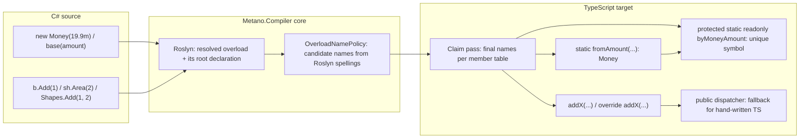

# Feature Specification: Overload factories, selector symbols and direct call sites

**Feature Branch**: `docs/25-overload-factories-spec` (spec directory `013-overload-factories`)

**Created**: 2026-11-04 · **Revised**: 2026-11-05 (round 3, after the second compiler-man review)

**Status**: Draft (spec change request; the maintainer's decisions of 2026-11-04 on issue #25, including the three taken after the first review, are applied)

**Input**: GitHub issue [danfma/metano#25](https://github.com/danfma/metano/issues/25), "Static call-site fast-path optimization" (the sub-item left open after the 2026-05-02 spike), plus the maintainer's decision comments of 2026-11-04 that reopen and settle constructor factories, selector symbols and direct call sites together, and the round-2 decisions on virtual calls, selector names and per-overload visibility. The evidence behind every requirement is in [research.md](./research.md) (R1–R15).

**Traceability**: it extends baseline **FR-050** (overload dispatch, added by this PR to [the baseline spec](../001-project-baseline-evolution/spec.md); the "Method overload dispatch" / "Constructor overload dispatch" rows of the [feature-support matrix](../001-project-baseline-evolution/baseline/feature-support-matrix.md) trace it) and builds on baseline FR-049 (constructor access modifiers, #432). It adds a Planned row to the matrix and reserves `MS0067`, `MS0068` and `MS0069` in the [diagnostic catalog](../001-project-baseline-evolution/baseline/diagnostic-catalog.md) (`MS0064`–`MS0066` are spec 012's). As in features 002–012, the FR identifiers below are local to this feature and are cited as "013 FR-0NN".

**Related specs and issues**: [ADR-0008](../../docs/adr/0008-overload-dispatch.md) (dispatcher + private fast paths) is superseded in part by [ADR-0028](../../docs/adr/0028-overload-factories.md) (Proposed); [ADR-0013](../../docs/adr/0013-shared-ir-as-canonical-semantic-representation.md) (shared IR) hosts the naming policy. The implementation depends on #445 (member visibility bridge). #475 (numeric dispatch order, unsigned folding) and #474 (visibility gaps) are related, not prerequisites. Spec 012 FR-048's `…ULong` suffix becomes `…UInt64` here ([Interaction with other specs](#interaction-with-other-specs)).

## Overview

Metano lowers C# overload groups to one runtime dispatcher plus one private fast path per overload (ADR-0008). Every generated call site pays the dispatcher's arity and type checks even when Roslyn resolved the overload statically; constructor bodies live in dispatcher branches, so hand-written TypeScript cannot address one overload; and the naming emits non-compiling output for several shape families (R7: duplicate fast paths for `uint`/`int`, `List<int>`/`int[]` and same-named types; a zero-argument fast path named like its dispatcher; overloaded extension methods; a derived override that replaces the whole dispatcher, R8).

This feature makes the statically known call site the normal path, gives every constructor overload an addressable TypeScript identity, anchors virtual calls on one name per overload, and replaces the ad-hoc naming with one deterministic algorithm:

The dispatcher survives as the fallback for hand-written TypeScript: `new Money(new Decimal("19.9"))` and `money.add(point)` keep compiling and running by arity and type. What changes is that code Metano generates never reaches for it when Roslyn knows the answer.

## Maintainer decisions (normative)

- **D1 — Constructor factories.** Every overload of a dispatched constructor (two or more declared instance constructors) gets a static factory `fromXxx(...)` returning the type, with its own overload's accessibility (DECIDED-17). A type without constructor overloads is unchanged (maintainer, 2026-11-04, issue #25).
- **D2 — Selector symbols.** Every constructor overload gets a `protected static readonly …: unique symbol = Symbol("<C# signature>")` (named per DECIDED-16); the description is for debugging only. The constructor gains one overload signature `constructor(overload: typeof T.by…, ...params)` per overload; the implementation dispatches on the selector first, with no type checks; a call without a selector falls back to the existing dispatcher; a derived class picks the exact base overload with `super(Base.by…, ...)` (maintainer, 2026-11-04).
- **D3 — Direct call sites.** Metano-generated code never goes through the runtime dispatcher when Roslyn has resolved the overload (maintainer, 2026-11-04).
- **D4 — Methods share the scheme.** Method fast paths become addressable members, use the same naming rules, and are called directly from generated code. The dispatcher stays public for hand-written TS (maintainer, 2026-11-04).
- **D5 — One naming algorithm** for factories, selector suffixes and fast paths: parameter names first; on any collision the whole group switches to C# type names; on a remaining collision the colliding overloads climb their parameter types' containing types and namespaces; a remaining clash falls back to `$` ([Naming](#naming)).
- **D6 — The breaking change ships in 3.0.0** ([Migration (3.0.0)](#migration-300)).
- **D7 — Name stability is documented.** Renaming a C# parameter renames the TypeScript factory and fast-path names.
- **D8 — Virtual calls use root-anchored names** (round 2): DECIDED-15.
- **D9 — Selectors are type-qualified** (round 2): DECIDED-16.
- **D10 — Per-overload visibility** (round 2): DECIDED-17.

## Decisions taken by this spec (DECIDED)

Each decision states the rule and the rejected alternative. Entries marked [M] record a maintainer decision.

- **DECIDED-1 — Candidates in the core, captured from Roslyn.** `Metano.Compiler`'s `OverloadNamePolicy` computes, once per overload, the suffix and the candidate names (NFR-002), from a naming spelling captured from the Roslyn symbols at extraction time, next to `SignatureText` (`IrNamingSpelling`, data-model.md). The IR type refs are not enough: they erase collections (`List<int>` and `int[]` are one array), delegates, unsigned primitives (`uint` folds into `Int32`, #475) and containing types (R7). `ComputeFastPathNames` and both spelling tables (`IrToTsOverloadDispatcherBridge.SimpleTypeName` / `PrimitiveSuffix` and `IrToTsClassBridge.Operators.SimpleTypeName`) are deleted. Rejected: computing from the IR (the collisions of R7 cannot be separated there) and a per-target rule (two copies diverge; Dart needs the same candidates).
- **DECIDED-2 — No `And` joiner.** `Add(int width, int height)` → `addWidthHeight`, factory `fromWidthHeight`; today's names (`addXY`, `formatFmtArgs`) stay. Rejected: `And` (every existing name renames, for no gain).
- **DECIDED-3 — Exact CLR type names.** On any collision the whole group switches to type spellings: `fromInt32`, `fromUInt32`, `fromInt64`, `fromUInt64`, `fromBoolean`, `fromListOfInt32`. The legacy shortenings (`Int`, `Long`, `ULong`, `Bool`, `Float`) are retired — the names are public API now, and `Int` cannot tell `int` from `uint`. This renames 012 FR-048's `…ULong` to `…UInt64`. Rejected: keeping the lossy spellings.
- **DECIDED-4 — The climb qualifies parameter types, colliding overloads only.** When type spellings still collide, every overload of each colliding set qualifies every parameter's spelling one level of **that parameter type's** containing types and then namespaces (nearest first, `Global` last), repeating until the group is distinct (`K(Numerics.Decimal)` / `K(Other.Decimal)` → `kNumericsDecimal` / `kOtherDecimal`). Primitives never climb (their CLR name is their identity); generic arguments, array elements and nullable inners climb with their parameter, never on their own. Rejected: round 1's uniform climb of the declaring type's namespace (it qualified the wrong type and renamed overloads that did not collide).
- **DECIDED-5 — The zero-argument suffix is `Default`.** `fromDefault`, `byTDefault`, `nowDefault`. Today `Now()`'s fast path is the dispatcher's own name (TS2393 + TS2385, R7). Rejected: `from0`.
- **DECIDED-6 — Fast paths are ordinary addressable members; `@internal` keeps #445's meaning.** A fast path is emitted with its overload's visibility (DECIDED-17), so a public overload's fast path is a public, untagged member that same-package and cross-package generated code calls. Round 1 tagged every fast path `/** @internal */`, which contradicts #445: `stripInternal` would delete members that cross-package direct calls need. `@internal` now means exactly what #445's final rule says: a member or signature no other package can reach — C# `internal`, `private protected`, or a `private` signature inside a wider dispatcher group. A `protected` signature in a wider group is widened to the group's accessibility and left **untagged**, because cross-package subclasses reach it. Consequence: `stripInternal` is safe for a package consumed by hand-written TypeScript, but **unsupported for a package consumed by other Metano packages** — a consumer granted `[InternalsVisibleTo]` emits direct calls to `internal` factories and fast paths, which the flag deletes, and #445's tags already make the same true of internal members (R10). OQ-6 records the alternative. Rejected: a separate tag (`@generated`) — it would document the names but buys nothing tooling uses.
- **DECIDED-7 — Factories delegate to the selector branch; bodies stay single-homed.** `static fromSize(size: number): Dimension { return new Dimension(Dimension.byDimensionSize, size); }`. The constructor keeps one branch per overload: the guarded selector branches first (holding the body, chains inlined as today), then today's fallback branches, then the throw. Rejected: fallback branches that call the factories (a derived constructor would build a second instance) and two body copies (ADR-0008's discipline).
- **DECIDED-8 — Replaced by DECIDED-17.** Round 1 gave every factory the constructor's single emitted accessibility, reasoning that TS allows one constructor accessibility. That binds only the constructor's own signatures; factories are separate statics (R10).
- **DECIDED-9 — Abstract dispatched classes get selectors but no factories.** A factory would `new` the abstract type (TS2511, R5). Rejected: throwing factories typed `T`.
- **DECIDED-10 — Shapes without a dispatched class constructor keep today's behavior.** `[PlainObject]`, `[InlineWrapper]` / `[Branded]`, `[External]` / `[NoEmit]` and `[JsCallable]` get no factories and no selectors (their secondary constructors are dropped silently today, R5, OQ-5). Records and primary constructors participate like any class.
- **DECIDED-11 — Direct call sites need a statically resolved receiver and overload, and the declaring type's IR.** `IrExpressionExtractor` rewrites a call Roslyn resolved into a dispatched group of a type whose IR is available (source, or a project reference, DECIDED-24). `dynamic` receivers, unresolved symbols, BCL mappings, `[Emit]` / `[Import]` members, unresolved type arguments and metadata-only references keep today's dispatcher call. Rejected: rewriting everything and re-dispatching on a miss.
- **DECIDED-12 — The dispatcher stays public and complete.** Signatures, guards, messages and the `MS0063` rule are unchanged; hand-written TS keeps today's contract. The one carve-out is #475: its numeric-specificity ordering and its unsigned unfolding change the dispatcher's branch order and checks, and may land before, during or after this feature (NFR-006). Rejected: removing the dispatcher.
- **DECIDED-13 — `MS0067` (`OverloadNameShadowed`, warning) reports every claim rename** — by a user member (reason 1) or by an earlier synthesized name (reason 2, the `From(decimal)` / `From(int)` fast paths claimed by the factories of `Cash(decimal)` / `Cash(int)`, R11) or by an inherited instance member (reason 3: a `new` method's `addX` against the base fast path, a derived overload's `addS` against a base `private addS`, R14). Round 1 left synthesized clashes unreported; they rename public API just the same.
- **DECIDED-14 — Dart maps factories to named constructors** (`Dimension.fromSize(...)`); no selectors; fast paths share the core candidates; Dart claims in its own single member namespace (DECIDED-18). Names and call-site spelling only (RT-02 brings bodies).
- **DECIDED-15 [M] — Virtual calls use root-anchored names.** A fast-path name comes from the overload's root declaration — the `OverriddenMethod` chain's first declaration, or the implemented interface member — so every override and implementation shares it:
  - an override emits the root's fast path as `override addX(...)`, so a direct call `b.addX(1)` dispatches virtually;
  - a type that only overrides emits no dispatcher: the inherited dispatcher keeps calling `this.addX(...)`, which fixes today's bug where `Derived` overriding one overload replaces the whole dispatcher (TS2416, and `d.add("abc")` returns `NaN` instead of `3`, R8);
  - an interface declares the fast-path signatures beside the dispatcher signatures, and implementing classes emit them under the root's names;
  - abstract overloads declare `abstract addX(...)`, and the abstract class keeps the concrete dispatcher (today the whole group is skipped with `MS0001`, R5);
  - `base.M(...)` becomes `super.addX(...)`; a method group keeps the receiver binding (`b.addX.bind(b)`);
  - a derived type that adds new overloads names them over its whole visible group and emits an `override` dispatcher whose signatures are a **superset of the base dispatcher's**, including base overloads the derived type cannot see (`private`, or `internal` to another assembly), tagged as #445 tags them; the branches for its own overloads call their fast paths, and every unmatched call forwards to `super.<dispatcher>(...args)` (TS2416 otherwise, R14);
  - an override's fast path takes the **root's** mapped visibility, not its own: a cross-assembly `protected override` of a `protected internal` root is emitted public (TS2415 otherwise, R14; the #445 root walk);
  - a `new` (hiding) method is its own root; its candidate claims against the inherited instance members (DECIDED-18 step 7), so it never silently overrides a base fast path (`addX$`, R14). The dispatcher the hiding type emits still overrides the base dispatcher, as today's does — a call through the base type's dispatcher reaches the hiding member (pre-existing, documented in § Divergences);
  - default interface methods are out of scope: their bodies are dropped today (`IrInterfaceExtractor.cs:147`, `Body: null`), and this feature does not change that.
  Migration (a): hand-written TS implementing a generated interface must implement the fast paths (TS2420, R8); a hand-written subclass that overrides a generated dispatcher is bypassed by direct calls. Rejected: per-type names (an override would emit a different name than the call site the base type's static type selects).
- **DECIDED-16 [M] — Selectors are type-qualified; factories qualify only on an incompatible inherited static.** Selectors are `protected static readonly by<TypeName><Suffix>: unique symbol` (`Money.byMoneyAmount`): two `unique symbol` types are never assignable, so a derived class repeating a base suffix would break the static side (TS2417, R2). Factories keep `from<Suffix>`; a factory becomes `from<TypeName><Suffix>` only when an emitted base declares a static of that name that it cannot compatibly redeclare — a different parameter list on the constructed base, a `private` base factory, or a derived accessibility narrower than the base's (FR-026; `GiftReceipt.fromGiftReceiptAmount`, R2, R14). A factory that keeps an inherited name is emitted `static override` (TS4114 under `noImplicitOverride`, which the samples set, R14). A derived class inherits the base factories it does not redeclare, and they return the base type (`GiftReceipt.fromAmount(1)` is a `Receipt`, R2; Migration (d)). Rejected: qualifying every factory (noisy, and `Money.fromMoneyAmount` reads badly) and redeclaring inherited factories (C# offers no such constructor).
- **DECIDED-17 [M] — Per-overload visibility.** Each factory and each fast path keeps its own C# overload's visibility, mapped by #445's member rule: `private` → `private`, `protected` → `protected`, `internal` → public + `/** @internal */`, `protected internal` → public untagged (the #445 round-3 rule: `stripInternal` must not hide members that cross-package subclasses use), `private protected` → `protected` + `/** @internal */`. The constructor keeps FR-049's most permissive accessibility (`MS0060`). A factory constructed from outside the class body (a JSON `TypeSpec`, a nested type) is widened public with `MS0061`, as FR-049 rule 3 widens the constructor. Selectors stay `protected` regardless: a `private` selector loses its `unique symbol` type in the `.d.ts`, which turns the selector signature into `any` for consumers (R10, closing round 1's OQ-2). An override's fast path takes its root's mapped visibility (DECIDED-15). Rejected: the constructor's accessibility on every factory (round 1's DECIDED-8, which exposed private overloads).
- **DECIDED-18 — Names are claimed by each target bridge.** The core computes candidates; each target resolves them against its own member tables — TypeScript keeps one static and one instance table per class plus one table per namespace barrel for module functions; Dart one table per class for everything (R6). One claim order holds for every generated name: user members, dispatchers, selectors, factories, method and module fast paths, operator fast paths, inherited instance members, then inherited statics (naming.md § Claim pass). The inherited-instance step makes every **non-root** candidate (a `new` method, a derived type's new overload) claim against the base classes' instance members of every visibility, `private` included, and report `MS0067` reason 3 (R14). Claims are **per suffix**: when a factory or its selector is taken, the overload's suffix takes the `$`, so the pair stays aligned (`fromCents$` / `byMoneyCents$`). `IrDirectOverloadCall` carries the overload's root identity, never a final string; the bridge resolves it through the declaring type's cached claim results. Rejected: claiming in the core (it cannot know a target's member tables; TS and Dart disagree on scopes).
- **DECIDED-19 — Selectors initialize first and selector branches are guarded.** Selectors are the first static members, before every other static field and static block, and each selector branch tests `typeof args[0] === "symbol" && args[0] === T.by…`. Without the order, `static readonly Zero = Money.fromCents(0)` declared first runs the **wrong** branch silently (`undefined === undefined`); with the guard alone it throws; with both it is correct (R9). ESM cycles add no new hazard: selectors are read while constructors run, never while modules evaluate (R9: the same `ReferenceError` with and without selectors).
- **DECIDED-20 — A struct's implicit parameterless constructor gets a branch, not a factory.** `new S()` keeps emitting `new S()`; the dispatcher gains `constructor();` and a first branch that assigns every instance field its type's default value and returns, as `default(S)` does (today: TS2554, R5; probe R11). An explicit parameterless struct constructor is an ordinary overload (`fromDefault`). Rejected: a `fromDefault` factory for the implicit one (C# has no such member to name).
- **DECIDED-21 — `params`.** Factories and fast paths declare the `params` parameter as a rest parameter. A direct call site passes the arguments in Roslyn's bound form: an expanded call's elements as arguments (`Extra.P(1, 2, 3)` → `Extra.pParts(1, 2, 3)`), a normal-form array spread into the rest (`Extra.P(arr)` → `Extra.pParts(...arr)`, as today's dispatcher call site already does, R11).
- **DECIDED-22 — Overloaded module functions are in scope.** Extension methods, `[ExportedAsModule]` functions and companion-namespace functions use the same naming: one exported fast path per overload plus an exported dispatcher. Today overloaded extension methods emit two `export function twice` (TS2393, R7). Call sites import the fast path from the declaring module; module fast paths are claimed in the namespace barrel's scope, because a barrel re-exporting two modules' `twiceX` is TS2300 (R11).
- **DECIDED-23 — Operators share the policy.** Operator fast paths take the policy's type spellings (`__addMoneyInt32`, `__addAcctUInt64`), which deletes `IrToTsClassBridge.Operators.SimpleTypeName`; they are public; resolved operator calls in an overloaded operator group target them directly.
- **DECIDED-24 — Cross-package direct calls need a project reference.** The consumer resolves the producer's names from the producer's IR, which a project reference (`CompilationReference`, loaded as source) provides. For a metadata-only reference (a DLL or a package), call sites fall back to the dispatcher (`new T(...)`, `super(args)`, `obj.method(...)`) — correct, only slower, and needing no persisted names. No diagnostic: an info would fire on every call into every packaged dependency and has no action attached. Overrides and implementations across a metadata-only reference are DECIDED-28.
- **DECIDED-25 — JSON constructs through the factory of the `[JsonConstructor]` overload.** The `TypeSpec` factory of a dispatched type keeps today's argument list and changes only the callee: `factory: (p) => Money.fromAmount(p.amount as Decimal)` (and `Object.assign(Money.fromAmount(…), { … })` for init members). The overload is the one marked `[JsonConstructor]`, as System.Text.Json picks it, now that factories make every overload addressable; without the attribute, the one `IrConstructorExtractor.FindPrimaryConstructor` picks today (the primary constructor, else the one with most parameters). The `MS0037` reason for an uncalled `[JsonConstructor]` (`JsonUnmirroredAttributes.UncalledJsonConstructorWarningOf`) is retired for dispatched types. Round 1's `T.fromXxx(...p)` was wrong (`p` is a record, not an array).
- **DECIDED-26 — `MS0068` (`OverloadFastPathHijacked`, error).** A user member of a derived type whose TypeScript name equals an inherited fast path it does not override would override it in TypeScript and hijack the inherited dispatcher (DECIDED-15). A derived **user static** whose name equals an inherited generated factory (`Receipt.FromAmount(string)` against `Money.fromAmount(amount: Decimal)`, TS2417, R14) is reported the same way (maintainer decision, 2026-11-05). Neither name can move, so the build fails; the message points at `[Name]` on the user member, or on the root overload, as the fix.
- **DECIDED-27 — The climb's dead end emits valid TypeScript.** When a colliding set cannot climb further (same full name from two assemblies, an extern alias, identical `[Name]` values), `MS0003` (error) is reported and each overload of the set gets a deterministic positional marker in declaration order (`$1`, `$2`). The output never contains duplicate members.
- **DECIDED-28 [M] — Root names across a metadata-only reference come from metadata (closes OQ-7 with (a)).** A derived class or interface implementer whose root lives in a DLL or package computes the root's names by running the producer's whole pipeline — candidates **and** the producer's claim pass — over the metadata symbols (`[Name]` included). An implementation DLL carries private members, so the result matches the producer's emission. A reference assembly strips private members, so a producer-side rename caused by a private claimant is the remaining blind spot; it fails loudly, because `override addX` against a producer that emitted `addX$` is TS4117, and TS4117 names the right symbol (R14). Call sites keep DECIDED-24's dispatcher fallback. Rejected: overriding the dispatcher (today's broken shape).
- **DECIDED-29 [M] — An inherited non-overloaded virtual method that a derived type overloads keeps today's emission (closes OQ-8 with (a)).** `Base.Add(int)` (no group) plus `Derived.Add(string)` is pinned by a golden and filed as a follow-up issue; treating every virtual method as a group of one would change output for sources with no overloads (NFR-001).
- **DECIDED-30 [M] — Multiply-constructed interfaces keep runtime dispatch, with a diagnostic (slice 013d).** For `C : IConv<int>, IConv<string>`, root anchoring on the constructed roots maps two implementations onto each root name (`convX`), which would be TS2393 / TS2416 (R14). The type keeps today's per-class runtime dispatch: each root fast-path name the interface requires is emitted as a runtime dispatcher over the constructed implementations (`convX(x: number); convX(x: string); convX(...args)`), no per-implementation fast paths are emitted, direct call sites into the type use those dispatchers, and `MS0069` (`MultiplyConstructedOverloadGroup`, warning) says so. Full support (distinct names per constructed root) is a follow-up issue. Names anchor on the **constructed** root member (`IConv<int>.Conv(int)`), whose spelling is the constructed one. Inheritance: a root-name dispatcher of this kind in a derived type — an override of the base's (`D : C` overriding `Conv(int)`) or one created because the derived type adds a construction (`D : C, IConv<string>` with `C : IConv<int>`, which makes `D` multiply-constructed) — is emitted with `override`, carries every constructed signature, handles the constructions the derived type implements and forwards the others to `super.<rootName>(...)` (TS2416 / TS2420 / TS4114 otherwise, R15). The derived `Conv(string)` is an implementation in claim step 7, not an override. When two constructions cannot be told apart at run time (`IConv<List<int>>` and `IConv<int[]>`), the first branch wins, as it does in today's dispatcher, and `MS0069` says so.
- **DECIDED-31 — Explicit implementations of an overload group.** Each explicitly implemented overload emits its fast path under the root's name (`areaS`, `areaWH`), which is how direct calls through the interface reach it. The interface's dispatcher name (`area`) is emitted on the class as a dispatcher covering the explicitly implemented overloads and the class's own same-named overloads (a superset of the interface's signatures). An explicit overload whose signature equals a class member's of the same name keeps today's `ExplicitImplementationLowering` outcome: `Conflicting`, `MS0031`, dropped. Today a class `Area(bool)` beside an explicit `IShape.Area` group emits TS2416 / TS2420; with this rule it compiles (R14).
- **DECIDED-32 — Method call sites pass default arguments explicitly.** As for `super(...)` (FR-017), a direct method call passes Roslyn's bound default values (the defaults of the statically resolved overload), because C# binds the default of the static type, not the runtime override's.

### Naming

The algorithm (normative text in [contracts/naming.md](./contracts/naming.md)):

1. **Parameter names** (DECIDED-2), `Default` for the parameterless overload (DECIDED-5).
2. **Type spellings** (DECIDED-3), from Roslyn (DECIDED-1).
3. **The climb** of the colliding overloads' parameter types (DECIDED-4); dead end `MS0003` + `$1` / `$2` (DECIDED-27).
4. **Candidates**: `by<TypeName><Suffix>` (DECIDED-16), `from<Suffix>` or `from<TypeName><Suffix>` (FR-026), the camelCased member + suffix for fast paths, from the root declaration (DECIDED-15).
5. **Claims** per target, per suffix, in one order, `$` + `MS0067` (DECIDED-13, DECIDED-18); `MS0068` for a hijack (DECIDED-26).
6. **`[Name("…")]`** on an overload pins its suffix (OQ-1 (a), FR-005); the dispatcher keeps the C# name.

**Name stability (D7).** A suffix is a function of the C# declaration: renaming a parameter renames the factory, the selector and the fast path; moving a parameter type between namespaces can rename a climbed suffix; renaming a type renames its selectors; adding an overload can flip a group from parameter names to type names. Names are stable across compilations of the same source (NFR-005), and they are public surface once they appear in a `.d.ts`.

## User Scenarios & Testing *(mandatory)*

### User Story 1 - Constructors become addressable (Priority: P1)

A developer writes `new Money(19.9m)` in C# and consumes `Money.fromAmount(new Decimal("19.9"))` from hand-written TypeScript; `Money.fromCents(1990)` reaches the other overload. The `.d.ts` advertises both factories and both selector signatures beside the plain ones.

**Why this priority**: today the only TypeScript-visible construction API is an untyped dispatcher.

**Independent Test**: transpile a class with two constructor overloads, build it with `tsgo --strict --declaration`, assert the factories and both kinds of signatures in the `.d.ts`, and call each factory under Node.

**Acceptance Scenarios**:

1. **Given** `Money(decimal amount)` and `Money(int cents)`, **When** transpiled, **Then** the class declares `protected static readonly byMoneyAmount: unique symbol = Symbol("Money(decimal amount)")` and `byMoneyCents` first among its static members, the selector signatures, the plain signatures, and `static fromAmount(amount: Decimal): Money` / `static fromCents(cents: number): Money` (R1).
2. **Given** the same class, **When** hand-written TypeScript calls `new Money(1990)`, **Then** it type-checks through the retained signatures and runs through the fallback (D2).
3. **Given** `new Money(Money.byMoneyAmount, x)` outside the class hierarchy, **When** compiled, **Then** tsgo rejects it with TS2445 (R3).
4. **Given** a private overload `Money(string code)`, **When** transpiled, **Then** its factory is `private static fromCode` and an outsider gets TS2341 (DECIDED-17, R10).
5. **Given** `static readonly Money Zero = new Money(0);` declared before the constructors, **When** the module loads under Node, **Then** `Zero` was built by the `int` overload (DECIDED-19, R9).
6. **Given** a type with a single constructor, **When** transpiled, **Then** the output is byte-identical to today (D1).

---

### User Story 2 - Derived classes pick the base overload (Priority: P1)

A derived constructor `: base(amount)` compiles to `super(Money.byMoneyAmount, amount)`, and a three-level hierarchy whose classes repeat the same suffixes compiles and runs on Node and Bun.

**Why this priority**: inheritance with overloads is the spike-closed sub-item 2; the selector must reach across modules without breaking the static side.

**Independent Test**: the base / derived / grand-derived golden of plan.md, compiled with `tsgo --strict`, run under Node and Bun (R2).

**Acceptance Scenarios**:

1. **Given** `Receipt : Money` with `Receipt(decimal amount) : base(amount)`, **When** transpiled, **Then** the branch calls `super(Money.byMoneyAmount, amount)` and `Receipt` declares `byReceiptAmount` (R2).
2. **Given** `GiftReceipt : Receipt` whose `GiftReceipt(string amount)` repeats the suffix with another parameter list, **When** transpiled, **Then** its factory is `fromGiftReceiptAmount` and the static side compiles (FR-026, R2).
3. **Given** `: base(1)` to `Base(int a, int b = 5)`, **When** transpiled, **Then** the call is `super(Base.byBaseAB, 1, 5)` (FR-017).
4. **Given** an abstract dispatched base, **When** transpiled, **Then** selectors and selector branches are emitted and no factory is (DECIDED-9).

---

### User Story 3 - Generated calls skip the dispatcher (Priority: P1)

A hot loop calling an overloaded method transpiles to direct fast-path calls: `Shapes.addXY(x, y)`, `p.addP(point)`.

**Why this priority**: issue #25's original ask, and the cost ADR-0008 named as its open optimization.

**Independent Test**: transpile a class whose method calls overloads of another class; assert the fast-path calls; build with `tsgo --strict`; run the sample consumer's bun tests and a Node run.

**Acceptance Scenarios**:

1. **Given** `Shapes.Add(1, 2)`, **When** transpiled, **Then** the call is `Shapes.addXY(1, 2)`.
2. **Given** `new Money(19.9m)` inside a method body, **When** transpiled, **Then** the call is `Money.fromAmount(new Decimal("19.9"))` and no runtime check runs.
3. **Given** `object o = "s"; F(o);` with `F(object a)` / `F(string a)`, **When** transpiled, **Then** the call is `fObject(o)` — C#'s static binding, where today's dispatcher picks `F(string)` by runtime type (R12, Migration (b)).
4. **Given** a call on a `dynamic` receiver, an unresolved symbol or a member of a metadata-only reference, **When** transpiled, **Then** the dispatcher call is kept (DECIDED-11, DECIDED-24).
5. **Given** `Extra.P(1, 2, 3)` and `Extra.P(arr)` for `P(params int[] parts)`, **When** transpiled, **Then** the calls are `Extra.pParts(1, 2, 3)` and `Extra.pParts(...arr)` (DECIDED-21).

---

### User Story 4 - Virtual and interface overloads behave like C# (Priority: P1)

A base class with `virtual Add(int)` / `Add(string)` and a derived class overriding one of them dispatch exactly as C# does, through the dispatcher and through direct calls; interface overloads are callable directly.

**Why this priority**: today's output for a partial override does not compile and misdispatches (R8).

**Independent Test**: the override / abstract / interface goldens of plan.md, built with `tsgo --strict --noImplicitOverride`, run under Node.

**Acceptance Scenarios**:

1. **Given** `Derived : Base` overriding `Add(int x)`, **When** transpiled, **Then** `Derived` emits `override addX(x)` and no dispatcher, and `new Derived().add("abc")` returns `3` (R8).
2. **Given** `b.Add(1)` with `b` typed `Base`, **When** transpiled, **Then** the call is `b.addX(1)` and runs `Derived.addX` for a `Derived` (R8).
3. **Given** `abstract Run(int x)` / `abstract Run(string s)`, **When** transpiled, **Then** the class declares `abstract runX` / `abstract runS` and a concrete dispatcher (today `MS0001`, R5).
4. **Given** `IShape.Area(int s)` / `Area(int w, int h)` implemented by `Sq.Area(int side)`, **When** transpiled, **Then** `IShape` declares `areaS` / `areaWH`, `Sq` emits `areaS(side)`, and `sh.Area(2)` emits `sh.areaS(2)`.
5. **Given** a derived user method `AddX()` beside an inherited root group with fast path `addX`, **When** transpiled, **Then** `MS0068` fails the build (DECIDED-26).

---

### User Story 5 - Names are predictable (Priority: P2)

A developer reading the `.d.ts` can derive every factory and fast-path name from the C# signatures: parameter names, else type names, else qualified parameter types, `Default` for parameterless, `$` only on a reported claim.

**Independent Test**: the naming goldens of plan.md, one per row of contracts/naming.md, each built with `tsgo --strict` (today's equivalents of several do not compile, R7).

**Acceptance Scenarios**:

1. **Given** `F(int a)` / `F(string a)`, **Then** `fInt32` / `fString`.
2. **Given** `U(int a)` / `U(uint a)` and `L(List<int> xs)` / `L(int[] xs)`, **Then** `uInt32` / `uUInt32` and `lListOfInt32` / `lInt32Array` (today: duplicates, TS2393).
3. **Given** `K(Numerics.Decimal)` / `K(Other.Decimal)`, **Then** `kNumericsDecimal` / `kOtherDecimal`.
4. **Given** `Now()` / `Now(int tick)`, **Then** `nowDefault` / `nowTick`.
5. **Given** `Cash(decimal amount)` / `Cash(int cents)` and `static From(decimal amount)` / `From(int cents)`, **Then** factories `fromAmount` / `fromCents`, fast paths `fromAmount$` / `fromCents$`, and two `MS0067` reason-2 warnings (R11).

---

### User Story 6 - Migration is guided (Priority: P2)

A 2.x consumer upgrades with the migration notes: hand-written `new T(...)` calls keep working; overrides of generated dispatchers and implementations of generated interfaces are flagged; packages and their consumers upgrade together.

**Independent Test**: each item of [Migration (3.0.0)](#migration-300) has a test, a probe or a diagnostic behind it.

---

### User Story 7 - Dart gets named constructors (Priority: P3)

The same C# source transpiled to Dart produces `Dimension.fromSize(3)` and the same fast-path candidates.

**Independent Test**: the Dart unit tests of plan.md on the prototype transformer (names only, RT-02).

---

### Edge Cases

- **A group with one overload** is not dispatched: no factory, no selector, no fast path (D1, NFR-001).
- **All-optional or `params` constructor overloads**: the selector branch binds what the factory passes; the fallback keeps today's omitted-default rebinding (#438, #440); `params` per DECIDED-21.
- **A zero-argument constructor overload**: `fromDefault()` / `byTDefault` (DECIDED-5). A struct's **implicit** one: DECIDED-20.
- **Overloads differing only by `ref` / `out`**: `MS0001` in TypeScript today; the `RefOf…` / `OutOf…` spellings are for Dart.
- **Mixed constructor accessibility** (FR-049, `MS0060`): one constructor accessibility; each factory keeps its own (DECIDED-17).
- **A non-public overload constructed outside the class body** (`MS0061`): the JSON `TypeSpec` or the nested type calls that overload's factory, which is widened public.
- **An abstract class**: selectors yes, factories no; `abstract` fast paths for abstract method overloads.
- **A nested type with overloads**: emitted outside its container's class body (FR-049 § 3); its selectors use its emitted class name (`Inner`, or `Owner$Inner` when module-local); a `new` of the container inside it calls the container's factory, which is widened public if non-public (`MS0061`).
- **A generic class**: factories re-declare the class type parameters with their constraints (FR-028, R4).
- **A generic base whose derived class closes the type parameter** (`IntBox : Box<int>`): `IntBox(int value)` has different parameter types than `Box<T>.fromValue<T>(value: T)`, so its factory is `fromIntBoxValue` (FR-026).
- **A derived class that adds overloads to an inherited group**: the new overloads are named over the whole visible group and the derived class emits a dispatcher covering all of them (DECIDED-15).
- **A derived class that overloads an inherited non-overloaded virtual method**: today's emission, pinned (DECIDED-29).
- **A multiply-constructed generic interface** (`C : IConv<int>, IConv<string>`): runtime dispatch kept, `MS0069` (DECIDED-30).
- **Default interface methods**: out of scope; bodies are dropped today (DECIDED-15).
- **A `new` (hiding) method**: claims against inherited instance members (`addX$`, DECIDED-18).
- **A method implementing two roots with different names**: the body under the first root's name, a forwarding member for each other name (naming.md § Root anchoring).
- **Explicit interface implementations**: DECIDED-31.
- **`nameof` and attribute arguments**: never rewritten.
- **A call inside the dispatcher's own branches**: emitted by the bridge, not extracted, so unchanged.
- **`this(...)` chains**: inlined in the target's selector branch; `new Temp()` → `Temp.fromDefault()` → selector branch → inlined chain.
- **Record `with` / `equals` / `hashCode`**: untouched; they do not call constructors.
- **Static constructors and static blocks**: emitted after the selectors (DECIDED-19).
- **Module fast paths in barrels**: claimed in the barrel scope; user-versus-user barrel clashes are pre-existing and out of scope.

## Requirements *(mandatory)*

### Functional Requirements

#### A. Naming (core candidates, target claims)

- **FR-001 — One policy.** The core MUST compute, for every overload of every dispatched group (constructors, methods, operators, module functions), one suffix and the candidate names, with the algorithm of [contracts/naming.md](./contracts/naming.md) (DECIDED-1). It MUST read the naming spellings captured from Roslyn at extraction time (`IrNamingSpelling`) and the parameter names, never the IR type refs.
- **FR-002 — Spellings.** Type spellings MUST be the exact CLR names of contracts/naming.md § Spellings (`Int32`, `UInt32`, `Int64`, `UInt64`, `Boolean`, `ListOfInt32`, `Int32Array`, `Int32OrNull`, `TupleOf…`, the type parameter's name, `Value` for an error type) (DECIDED-3). The legacy shortenings MUST be retired, including 012 FR-048's `…ULong`.
- **FR-003 — The climb.** On a remaining collision, every overload of each colliding set MUST qualify every parameter's spelling one level of that parameter type's containing types, then namespaces nearest first, then `Global`, repeating until the group is distinct. Primitives MUST NOT climb; generic arguments, array elements and nullable inners MUST climb with their parameter only (DECIDED-4).
- **FR-004 — Claims.** Each target bridge MUST resolve the candidates against its own member tables in the order of naming.md § Claim pass, per suffix, appending `$` until free and reporting `MS0067` for each rename (DECIDED-13, DECIDED-18). The class path MUST run the claim pass too (today only `BuildNamespaceFunctions` runs `ClaimName`, R7).
- **FR-005 — `[Name]` on an overload.** `[Name("x")]` (untargeted, or targeted at the emitting target) on one overload of a dispatched group — a constructor, method, operator or module-function / extension overload — MUST replace that overload's generated suffix with `X` (the value capitalized) and change nothing else: the dispatcher, the operator helper (`__add`) and the module dispatcher keep the C# name, and every other overload of the group is named by the normal rules (OQ-1 (a): `[Name("cents")]` → `fromCents`, `byMoneyCents`, `addCents`). The pinned suffix MUST take part in the distinctness checks like a computed one and MUST never climb, so a collision with it moves the computed overloads, and two equal pins (or a pin equal to a spelling that cannot climb) are the FR-024 dead end. An override or interface implementation MUST take its root's suffix (FR-025): the root's `[Name]` wins, and the implementer's own `[Name]`, when it names another suffix, MUST be ignored with an `MS0003` warning at the attribute. A value that is not an ASCII identifier without `$` (`^[A-Za-z_][A-Za-z0-9_]*$`) MUST report `MS0003` (error) at the attribute's argument, and the overload MUST keep its generated suffix. `[Name]` on a member that is not an overload of a dispatched group (a single method, a single operator, the overloads of an `[External]`, `[JsCallable]` or `[PlainObject]` type, which emit no dispatcher) keeps renaming the whole member, and so does `[Name]` on a conversion operator, which has no C# name: it names its group (`__toInt`, as before). `[Name]` on a constructor that is not part of a dispatched set names nothing and MUST report an `MS0003` warning. The Dart target applies the same rule and reports the same pin diagnostics (slice 013g, FR-022).
- **FR-006 — Determinism.** Candidates and claims MUST be pure functions of the source, iterating in declaration order (NFR-005).
- **FR-024 — Dead end.** A colliding set that cannot climb further MUST report `MS0003` and get the positional markers `$1`, `$2`, … in declaration order; the output MUST NOT contain duplicate members (DECIDED-27).
- **FR-025 — Root anchoring.** A method overload's names MUST come from its root declaration (`OverriddenMethod` chain or implemented interface member, `OriginalDefinition`); a `new` method is its own root (DECIDED-15, naming.md § Root anchoring).
- **FR-026 — Factory names against inherited statics.** A factory MUST keep `from<Suffix>` unless an emitted base declares a static of that name; then it MUST keep the name, emitted `static override`, only if that static is a generated factory that is not `private`, whose overload has the same parameter types (compared on the **constructed** base constructor, so `Box2<T> : Box<T>` compares `T` with `T`) in the same order with the same `params` / optional shape, whose accessibility the derived factory's is at least as wide as, and, for a generic class, whose type-parameter constraints equal the derived ones on the constructed mapping (a different type-parameter count is allowed); it MUST become `from<TypeName><Suffix>` otherwise (DECIDED-16).

#### B. Constructor factories and selector symbols

- **FR-007 — Factories.** Every overload of a dispatched constructor of a concrete class MUST get a static factory returning the type, with the overload's parameter list (local-binding names, `params` as rest, defaults kept) and the body `return new T(T.by<TypeName><Suffix>, ...);` (DECIDED-7). A type with fewer than two declared instance constructors MUST NOT gain one (D1), and a struct's implicit parameterless constructor MUST NOT (DECIDED-20).
- **FR-008 — Selectors.** Every overload of a dispatched constructor MUST get `protected static readonly by<TypeName><Suffix>: unique symbol = Symbol("<C# signature>")`, also when no generated call site uses it (DECIDED-16, DECIDED-17).
- **FR-009 — Constructor emission.** Per overload, the constructor MUST declare `constructor(overload: typeof T.by…, ...params)` before today's plain signatures (both kept, R1); the implementation MUST try the selector branches first, each guarded by `typeof args[0] === "symbol" && args[0] === T.by…`, binding from `args[1..]` with no other checks, then today's fallback branches, then the throw (DECIDED-7, DECIDED-19). Parameter properties on overload signatures and rest parameters stay forbidden.
- **FR-010 — Fallback preserved.** A call without a selector MUST keep today's behavior: signatures, arity-and-type branches, omitted defaults (#438, #440), message (DECIDED-12).
- **FR-011 — Factory accessibility.** Each factory MUST carry its own overload's accessibility under #445's member mapping; a factory that code outside the class body calls MUST be widened public with `MS0061`; the constructor MUST keep FR-049's most permissive accessibility (DECIDED-17). The implementation MUST start after #445 merges.
- **FR-012 — Abstract classes.** A dispatched abstract class MUST emit selectors and selector branches and MUST NOT emit factories (DECIDED-9).
- **FR-013 — Excluded shapes.** `[PlainObject]`, `[InlineWrapper]` / `[Branded]`, `[External]`, `[NoEmit]` and `[JsCallable]` types MUST keep today's emission (DECIDED-10).
- **FR-014 — Records and primary constructors.** A record positional or C# 12 primary constructor in a dispatched set MUST get its factory; its branch keeps the promoted-member assignments (R5).
- **FR-027 — Struct parameterless construction.** A dispatched struct MUST declare `constructor();` and a first branch that assigns every instance field the default value of its type and returns; `new S()` MUST keep emitting `new S()` (DECIDED-20).
- **FR-028 — Generic factories.** A factory of a generic class MUST re-declare the class type parameters with their constraints (R4).
- **FR-029 — Static order.** Selectors MUST be the first static members of the class, before every other static field and static block (DECIDED-19, R9).

#### C. Fast paths

- **FR-015 — Addressable fast paths.** Every fast path MUST carry its overload's accessibility under #445's member mapping, with no tag beyond #445's (DECIDED-6, DECIDED-17), and the root's name (FR-025); an override's fast path MUST carry the root's mapped visibility.
- **FR-016 — Dispatcher stays public.** The dispatcher MUST keep its overload signatures, guards and messages; its order and checks change only with #475 (DECIDED-12).
- **FR-030 — Overrides and abstract overloads.** An override MUST emit the root's fast path with `override` and, when it adds no overloads, no dispatcher; an abstract overload MUST emit `abstract <fastPath>(...)` beside the concrete dispatcher; a type that adds overloads MUST emit an `override` dispatcher whose signatures are a superset of the base dispatcher's, invisible base overloads included, and whose unmatched calls forward to `super.<dispatcher>(...args)` (DECIDED-15).
- **FR-031 — Interfaces.** An interface MUST declare the fast-path signatures of its overload groups beside the dispatcher signatures; an implementing class MUST emit them under the root's names, with forwarding members for further roots (DECIDED-15); explicit implementations follow DECIDED-31; a type implementing one generic interface more than once follows DECIDED-30.
- **FR-032 — Module groups.** An overloaded extension method, `[ExportedAsModule]` function or companion function group MUST emit one exported fast path per overload and one exported dispatcher, claimed in the namespace barrel's scope, and the barrel MUST re-export them (DECIDED-22).
- **FR-033 — Operators.** Operator fast paths MUST use the policy's type spellings and be public; `IrToTsClassBridge.Operators.SimpleTypeName` MUST be deleted (DECIDED-23).
- **FR-034 — `MS0068`.** A user member whose TypeScript name equals an inherited fast path it does not override, and a user static whose name equals an inherited generated factory, MUST report `MS0068` (DECIDED-26).
- **FR-036 — Multiply-constructed interfaces.** A type implementing one generic interface with overload groups more than once MUST emit each required root fast-path name as a runtime dispatcher over its implementations, emit no per-implementation fast paths, and report `MS0069`; in a derived type such a dispatcher MUST be `override`, carry every constructed signature and forward the constructions it does not implement to `super.<rootName>(...)` (DECIDED-30).
- **FR-037 — Explicit implementations.** Explicitly implemented overloads MUST emit their fast paths under the root's names and a class dispatcher covering them and the class's same-named overloads; a same-signature conflict MUST keep today's `MS0031` outcome (DECIDED-31).

#### D. Direct call sites

- **FR-017 — Constructor call sites.** A C# `new T(args)` resolved into a dispatched set MUST emit `T.from…(args)`; a constructor initializer `: base(args)` resolved into a dispatched base set MUST emit `super(Base.by…, ...)` with Roslyn's bound arguments, default values explicit, in every branch that chains to it (D3). Bound arguments are passed in parameter order and evaluated in C#'s order: named arguments out of parameter order with an observable evaluation order are bound first, in source order (NFR-004).
- **FR-018 — Method and operator call sites.** A call resolved to an overload of a dispatched group MUST emit the fast-path call with the receiver evaluated once (statics: the type; module functions: the imported bare name; `base.M(...)`: `super.<fastPath>`; operators: `T.__<op><Suffix>`); a method group MUST emit the fast path bound to its receiver (`.bind(receiver)`) for an instance method; `params` per DECIDED-21; omitted optional arguments MUST be passed explicitly with Roslyn's bound defaults (DECIDED-32); generic calls carry their type arguments. Unresolved, `dynamic`, BCL-mapped and `[Emit]` / `[Import]` calls, and calls with unresolved type arguments, MUST keep today's shape (DECIDED-11).
- **FR-019 — Cross-package call sites.** A consumer MUST emit direct calls into a referenced `[EmitPackage]` package only when the reference is a project reference; for a metadata-only reference it MUST keep the dispatcher call and report nothing (DECIDED-24).
- **FR-035 — JSON.** A JSON `TypeSpec` of a dispatched type MUST construct through the factory of its `[JsonConstructor]` overload, else of the overload `FindPrimaryConstructor` picks, keeping today's argument list (DECIDED-25).

#### E. Diagnostics, release, documentation

- **FR-020 — Diagnostics.** `MS0067` (warning, three reasons), `MS0068` (error, two reasons) and `MS0069` (warning) MUST be implemented per [contracts/diagnostics.md](./contracts/diagnostics.md), with a test per reason asserting code, severity and location.
- **FR-021 — Goldens.** Every emission rule of [contracts/ts-emission.md](./contracts/ts-emission.md) MUST have a golden under `tests/Metano.Tests/Expected/`, each compiled with `tsgo --strict` in its consumer, the planned goldens of plan.md included; every existing golden that changes MUST be regenerated in the slice that changes it.
- **FR-022 — Dart.** The Dart target MUST map factories to named constructors, skip selectors, use the core candidates for fast paths and run its own claim pass (DECIDED-14) — names and call-site spelling only.
- **FR-023 — Documentation.** The matrix rows move to Implemented as the slices land; `docs/` gains the naming rule and the migration notes; the CHANGELOG lists the breaking items of [Migration (3.0.0)](#migration-300).

### Non-Functional Requirements

- **NFR-001 (no churn)**: output changes only where an overload group exists (or a call resolves into one). Sources without overload groups MUST stay byte-identical.
- **NFR-002 (target-agnostic core)**: candidates and direct-call decisions are computed in `Metano.Compiler`; the targets claim and render (DECIDED-1, DECIDED-18).
- **NFR-003 (single body home)**: an overload's body appears exactly once in the output; factories, forwarding members and dispatchers delegate.
- **NFR-004 (no IIFE, one documented exception)**: no lowering of this feature emits an immediately invoked function, except the evaluation-order fallback. When named arguments are written in another order than the parameters and one of the reordered arguments has a side effect (`new T(b: F(), a: G())`, `c.Apply(d: F(), f: 2)`), the TypeScript target binds the receiver first (when it is not side-effect-free), then the arguments in source order, as temporaries of an immediately invoked arrow (`TsEvaluationOrder.Bind` + `TsImmediateInvocation`), because the expression position leaves no alternative and C# evaluation-order parity requires it (landed by 013c, reused by 013d/013e, DECIDED-32 callers included). The receiver itself is never reordered, and a side-effecting receiver alone needs no IIFE (`Get().Apply(d: 1, f: 2)` lowers to a plain fast-path call). Arguments evaluated before `super(...)` use `const __baseArgN` temporaries instead, and a call whose named arguments are in parameter order, or whose reordered arguments are side-effect-free, emits no IIFE. User code an argument runs implicitly counts as a side effect too (#592), in a call bound to an overload group: a read of a computed property (every property but a non-overridable auto-property of the compilation: a hand-written, `field`-keyword, overridable or interface getter, an indexer, a property of another assembly), a user-defined operator or conversion, and a string concatenation that formats an operand through its `ToString` (any operand but a string, a `bool`, a `char`, a number or an enum). Such code may write what another argument reads, so `c.Two(b: h.P, a: h.Q)` binds in source order as soon as a second argument is order-sensitive. The order-insensitive shapes are those of `IsOrderInsensitive`: a constant, `default`, `this`, `typeof`, a lambda, a delegate creation over one of those, and a collection or array creation made only of those; a user-defined conversion is always order-sensitive. Field and auto-property reads alone (`c.Two(b: h.Auto, a: h.Field)`) and a computed read beside constants (`c.Two(b: h.P, a: 7)`) run nothing whose order can be told apart, so they emit no IIFE. A call that is not bound to an overload group does not go through this fallback: its reordered named arguments are a separate, open defect (#597).
- **NFR-005 (determinism)**: names, symbol descriptions, member and import order and diagnostic order are stable across runs.
- **NFR-006 (hand-written TS contract)**: the dispatcher's signatures and messages do not change; its branch order and runtime checks change only through #475, which this feature neither requires nor blocks (DECIDED-12).

### Key Entities

- **Overload name policy**: the core algorithm producing one suffix and the candidate names per overload.
- **Naming spelling**: the Roslyn-captured spelling of a parameter type with its qualifier chains.
- **Root declaration**: the first declaration of a virtual method chain, or the implemented interface member.
- **Claim pass**: a target's resolution of candidates against its member tables.
- **Factory**: the static member that constructs one overload through its selector.
- **Selector symbol**: the protected `unique symbol` naming one constructor overload.
- **Direct call site**: a generated call lowered to the resolved overload's factory or fast path.

## Success Criteria *(mandatory)*

- **SC-001**: every golden of contracts/ts-emission.md builds with `tsgo --strict --declaration`, and the `.d.ts` shows the factories, selectors and both kinds of constructor signatures.
- **SC-002**: every R7 / R8 family whose output fails `tsgo` on `main` (duplicate fast paths for `uint`/`int`, `List<int>`/`int[]` and same-named types; `now`; overloaded extensions; the partial override; struct `new S()`) has a golden that compiles.
- **SC-003**: the base / derived / grand-derived golden compiles and runs under Node and Bun (R2).
- **SC-004**: sources without overload groups are byte-identical between `main` and each slice (NFR-001), checked by transpiling every sample and diffing.
- **SC-005**: every `MS0067` / `MS0068` reason has a test asserting code, severity and location.
- **SC-006**: the sample consumer's bun tests pass against output whose overloaded calls are all direct, and the same output runs under Node with a static field initialized through a factory (R9).
- **SC-007**: the override golden returns C#'s results under Node through both the dispatcher and direct calls (R8).
- **SC-008**: every golden builds with `--noImplicitOverride` (the samples' setting), so every kept inherited factory is `static override` and every derived dispatcher `override` (R14).

## Divergences from C# (documented)

| Construct | C# | TypeScript after this feature | Why |
|---|---|---|---|
| `new Money(Money.byMoneyAmount, …)` from outside the hierarchy | no such syntax | TS2445 at compile time; reachable at run time through casts or `Reflect.construct` (R3) | Selectors are an access convention, not a security boundary |
| Renaming a C# parameter | private refactor | renames the public factory / fast path | D7 |
| A derived class's inherited factory | C# has no inherited constructors | `GiftReceipt.fromAmount(1)` returns a `Receipt` (R2) | Static members are inherited in TypeScript |
| A factory name claimed by another member | n/a | `$` suffix + `MS0067` | One emitted namespace per table |
| Abstract class construction | impossible | selectors let subclasses construct the base part; no factory | TS2511 (R5) |
| Hand-written overrides of a generated dispatcher | n/a | bypassed by generated direct calls | DECIDED-15; override the fast path |
| A `new` (hiding) overload called through the base type's dispatcher | the base member runs | the hiding type's dispatcher runs (pre-existing); a direct call runs the base member, as C# does | the hiding type's dispatcher must cover its visible group (DECIDED-15) |

## Interaction with other specs

| Spec / issue | Requirement | Change | Why both stay satisfiable |
|---|---|---|---|
| Baseline FR-050 (new) | overload dispatch | Extended by this feature; the matrix rows trace it | FR-050 states today's contract; this spec states the extension |
| ADR-0008 | dispatcher + private fast paths | Superseded in part by ADR-0028 | The dispatcher contract stands (DECIDED-12) |
| Baseline FR-049 (#432) | constructor accessibility | The constructor keeps it; factories use per-overload accessibility and FR-049 rule 3's widening (DECIDED-17) | The predicate already exists; #445 lands first |
| #445 | member visibility bridge | Factories and fast paths use its member mapping, its root walk for overrides and its final mixed-group rule (only unreachable signatures tagged); `@internal` keeps its meaning (DECIDED-6) | Implementation dependency |
| #474 | visibility gaps | none (`[PlainObject]` and type-level tags are not touched) | — |
| #475 | numeric dispatch order, unsigned folding | Carved out of NFR-006 / DECIDED-12; spellings come from Roslyn, so 013 does not wait for it | Each changes a different thing (branch order vs names) |
| 012 FR-048 | `UInt64` overloads named `…ULong` | Becomes `…UInt64` with slice 013a (DECIDED-3); 012 carries a cross-reference note | Same overloads, exact spelling |
| 012 OQ-6 | `long` / `ulong` / `BigInteger` dispatch order | Moot at generated call sites; the dispatcher order (or #475's) governs hand-written TS | DECIDED-12 |
| 010 FR-042 | union companion namespace (spec-local number, **unrelated** to overload dispatch) | Overloaded companion functions follow FR-032 | The companion's other names are unchanged |
| 005 | deterministic output layout (files, barrels) | Barrels gain module fast paths (FR-032) | The layout algorithm is unchanged; barrels list more names |

## Migration (3.0.0)

- **(a) Hand-written code that extends or implements generated types.** Generated constructions of a type with constructor overloads call its factories (`new Money(19.9m)` → `Money.fromAmount(new Decimal("19.9"))`) and generated derived constructors select the base overload (`super(Money.byMoneyAmount, amount)`), with omitted defaults passed explicitly (slice 013c): neither reaches the constructor's fallback branches, so hand-written TypeScript that patches or wraps them is bypassed. A hand-written subclass that overrides a generated dispatcher (`add(...)`) is bypassed by generated direct calls (`b.addX(1)`) — override the fast path instead. A hand-written class implementing a generated interface must also implement its fast paths (TS2420, R8). A hand-written subclass that redeclares a generated factory under its inherited name needs `static override` under `noImplicitOverride`.
- **(b) Static binding replaces runtime-type dispatch in generated code.** With `F(object a)` / `F(string a)`, `object o = "s"; F(o);` now calls `F(object)`, as C# does; today's dispatcher calls `F(string)`. Generated code that relied on the runtime choice changes behavior (R12). Hand-written dispatcher calls keep the runtime choice.
- **(c) Renamed generated names.** Fast-path renames: `fInt` → `fInt32`, `gLong` → `gInt64`, `wLong` / `wULong` → `wInt64` / `wUInt64`, `pickLong` / `pickULong` → `pickInt64` / `pickUInt64`, `sumIntArray` → `sumInt32Array`, `hIntOrNull` → `hInt32OrNull`, `identityValue` → `identityT`, `now` → `nowDefault`, `areaSide` → `areaS` (root-anchored), duplicate names split (`uInt32` / `uUInt32`, `lListOfInt32` / `lInt32Array`, `kNumericsDecimal` / `kOtherDecimal`); operator renames `__addAcctLong` / `__addAcctULong` → `__addAcctInt64` / `__addAcctUInt64` (every `Int`, `Long`, `ULong`, `Bool`, `Float` spelling becomes the CLR name); `From`-style method fast paths that a factory claims take `$` (`fromAmount$`). New names: factories, selectors, exported module fast paths. Derive any name from contracts/naming.md or pin it with `[Name]` (OQ-1).
- **(d) Inherited factories.** A derived class inherits the base factories it does not redeclare; they return the base type.
- **(e) `stripInternal`.** Supported for packages consumed only by hand-written TypeScript; unsupported for packages consumed by other Metano packages (DECIDED-6, OQ-6).
- **(f) Larger `.d.ts` and barrels.** Per constructor overload: a selector, a selector signature and a factory; per method overload: an addressable fast path; per module group: exported fast paths re-exported from the barrel.
- **(g) Upgrade packages and consumers together.** A 3.0 consumer with a project reference emits factory and fast-path calls into the producer; a producer still built with 2.x lacks them (`tsc` reports the missing member). A metadata-only reference keeps dispatcher calls (DECIDED-24).
- **(h) Names are API** (D7).
- **(i) New diagnostics**: `MS0067` (warning), `MS0068` (error) — including a derived user static that shares an inherited factory's name — and `MS0069` (warning).

## Open questions

Each question has a recommendation; the plan proceeds with it unless the maintainer decides otherwise.

- **OQ-1 — Closed (FR-005, maintainer: (a)).** `[Name]` on an overload pins the suffix only (`[Name("cents")]` → `fromCents`, `byMoneyCents`, `addCents`); (b), the full member name, was rejected.
- **OQ-2 — Closed (DECIDED-17).** Selectors stay `protected`: a `private` selector erases to `any` in the `.d.ts` (R10).
- **OQ-3 — Factories for the excluded shapes.** (a) Out of scope here; file the gap. (b) Object-literal factories for `[PlainObject]` now. **Recommendation: (a).**
- **OQ-4 — Do the constructor's fallback branches stay after 013c?** (a) Keep (DECIDED-12). (b) A follow-up drops them. **Recommendation: (a) for 3.0**; (b) is a 4.0 direction.
- **OQ-5 — The silently dropped secondary constructors of `[PlainObject]` and branded types.** **Recommendation: a warning, as a small follow-up issue** (it belongs to the type-shape rules).
- **OQ-6 — `stripInternal` and Metano consumers.** (a) Unsupported for packages consumed by other Metano packages, documented (DECIDED-6). (b) Supported, with an info diagnostic in the producer when `[InternalsVisibleTo]` names a Metano consumer — the only path by which a consumer's generated code reaches a tagged member. **Recommendation: (a) now, (b) if a user asks**: (b) is precise but needs the consumer list at producer build time, which only `[InternalsVisibleTo]` gives.
- **OQ-7 — Closed (DECIDED-28, maintainer: (a)).**
- **OQ-8 — Closed (DECIDED-29, maintainer: (a)).**

## Assumptions

- `tsgo` 7.0.0-dev (the pinned preview) behaves as in R1–R15, with `--strict --noImplicitOverride` (the samples set it); the probes are re-run in each slice's goldens.
- #445 merges before slice 013b; its member mapping is the one DECIDED-17 cites.
- The Dart target remains shape-only; FR-022 covers names and call-site spelling.

## Dependencies

- #445 (member visibility bridge) — start gate for 013b and 013d.
- #432 / baseline FR-049 (landed) — the constructor accessibility.
- ADR-0008 (superseded in part), ADR-0013, ADR-0009.
- #475 — related (NFR-006 carve-out), not a prerequisite.
